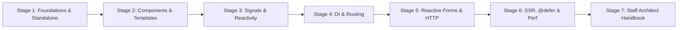
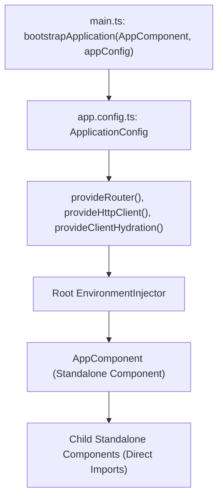
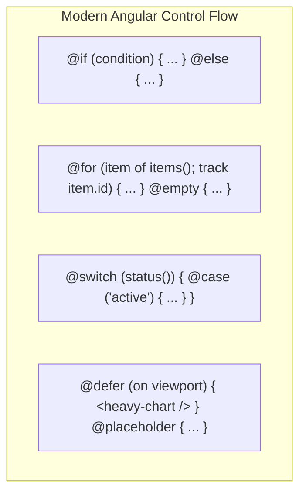
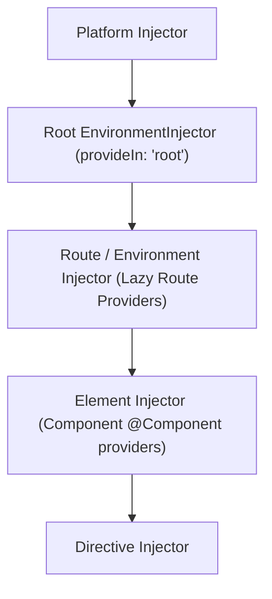

# Learn Angular 🅰️

<div align="center">

[](https://opensource.org/licenses/MIT)
[](https://angular.dev/)
[](https://www.typescriptlang.org/)
[](https://angular.dev/guide/signals)
[](https://angular.dev/guide/ssr)
[](https://github.com/manthanank/learn-angular)

**An exhaustive, production-grade masterclass from absolute zero to staff-level Angular platform architecture.**  
Master standalone applications, modern Signals reactivity, `@defer` incremental hydration, hierarchical dependency injection, functional router guards, reactive forms, and zoneless performance.

[Getting Started](#-getting-started) • [Standalone Components](#2-stage-2-standalone-components-templates--modern-control-flow) • [Signals & Reactivity](#3-stage-3-modern-signals-reactivity--state-management) • [Dependency Injection](#4-stage-4-hierarchical-dependency-injection--routing) • [Forms & HTTP](#5-stage-5-enterprise-reactive-forms--http-client) • [SSR & Performance](#6-stage-6-server-side-rendering-ssr-deferrable-views--performance) • [Interview Prep](#7-stage-7-staff-angular-architect-interview-handbook--cheatsheet)

<br/>

<a href="https://www.buymeacoffee.com/manthanank">
  
</a>

</div>

---

## 🗺️ 7-Stage Pedagogical Roadmap



| Stage | Focus Domain | Core Concepts & Engineering Outcomes |
| :--- | :--- | :--- |
| **Stage 1** | **Absolute Beginner Foundations** | Standalone bootstrapping (`bootstrapApplication`), application configuration, TypeScript 5 essentials. |
| **Stage 2** | **Components & Modern Control Flow** | Standalone components, `@if`, `@for (track)`, `@switch`, template bindings, content projection. |
| **Stage 3** | **Modern Signals Reactivity** | Fine-grained reactivity (`signal`, `computed`, `effect`), `input()`/`output()`, RxJS `toSignal()`, zoneless change detection. |
| **Stage 4** | **Hierarchical DI & Routing** | Tree-shakeable providers, `inject()` function, functional route guards (`canActivateFn`), resolvers, lazy loading. |
| **Stage 5** | **Reactive Forms & HTTP Engine** | Strongly-typed `FormGroup`, async validators, functional interceptors (`HttpInterceptorFn`), retry strategies. |
| **Stage 6** | **SSR, @defer & Enterprise Performance** | Event replay, incremental DOM hydration, `@defer` trigger conditions (`on viewport`, `on idle`), OnPush profiling. |
| **Stage 7** | **Staff Architect Interview Handbook** | Zone.js patching vs Zoneless microtasks, Module Federation, 40+ staff-level interview Q&As, cheat sheet. |

---


## 📋 Table of Contents

- [Introduction](#introduction)
  - What is Angular?
  - Features
  - Architecture
  - Angular CLI
  - Project Structure
  - Workspace Configuration
  - Standalone Applications
  - Angular Version History
  - Migration Guide
  - Bootstrapping
  - Application Configuration
  - Environment Providers
  - Version Compatibility

- [TypeScript Essentials](#typescript-essentials)
  - TypeScript Basics
  - Types
  - Interfaces
  - Enums
  - Generics
  - Decorators
  - Modules
  - Utility Types
  - Type Assertions
  - Type Narrowing
  - Type Aliases
  - Literal Types
  - Conditional Types
  - Mapped Types

- [Components](#components)
  - Components
  - Standalone Components
  - Component Lifecycle
  - Lifecycle Hooks
  - Component Communication
  - Inputs
  - Outputs
  - Model Inputs
  - Signal Inputs
  - Signal Outputs
  - Component Styles
  - View Encapsulation
  - Change Detection
  - Dynamic Components
  - Dynamic Template Rendering
  - Host Elements
  - Host Bindings
  - Host Listeners
  - Content vs View DOM
  - Component Inheritance
  - Component Composition

- [Templates](#templates)
  - Data Binding
  - Interpolation
  - Property Binding
  - Attribute Binding
  - Class Binding
  - Style Binding
  - Event Binding
  - Two-way Binding
  - Template Reference Variables
  - Template Statements
  - Template Expressions
  - Pipes in Templates
  - ng-template
  - ng-container
  - ngTemplateOutlet
  - Template Context
  - Safe Navigation Operator
  - Nullish Coalescing
  - Non-null Assertion
  - Template Variables
  - Track Expressions

- [Directives](#directives)
  - Directives
  - Attribute Directives
  - Structural Directives
  - Built-in Directives
  - Custom Directives
  - Directive Composition API (hostDirectives)

- [Modern Control Flow](#modern-control-flow)
  - @if
  - @else
  - @for
  - @empty
  - @switch
  - @case
  - @default
  - @let
  - @defer
  - Prefetching
  - Loading Placeholder
  - Error Placeholder
  - Track Expressions
  - Context Variables

- [Signals](#signals)
  - Signals Introduction
  - signal()
  - Writable Signals
  - computed()
  - effect()
  - Signal Equality
  - untracked()
  - Signal Inputs
  - Signal Outputs
  - Model Inputs
  - linkedSignal()
  - resource()
  - httpResource()
  - Signal Queries
  - Signal Store
  - toSignal()
  - toObservable()
  - Signal Best Practices
  - Signals vs RxJS

- [Dependency Injection](#dependency-injection)
  - Dependency Injection
  - Providers
  - Provider Types
  - Class Providers
  - Factory Providers
  - Existing Providers
  - Value Providers
  - Multi Providers
  - Injection Tokens
  - inject()
  - DestroyRef
  - EnvironmentInjector
  - Hierarchical DI
  - Optional
  - Self
  - SkipSelf
  - Host
  - forwardRef()

- [Functional APIs](#functional-apis)
  - Functional Queries
  - Functional Guards
  - Functional Resolvers
  - Functional Interceptors
  - Functional Providers

- [Routing](#routing)
  - Router
  - Route Configuration
  - RouterOutlet
  - RouterLink
  - RouterLinkActive
  - Nested Routes
  - Lazy Loading
  - loadComponent()
  - loadChildren()
  - Route Parameters
  - Query Parameters
  - Route Data
  - Redirect Routes
  - Wildcard Routes
  - Route Guards
  - CanActivate
  - CanActivateChild
  - CanDeactivate
  - CanMatch
  - Functional Guards
  - Resolvers
  - Title Strategy
  - Route Reuse Strategy
  - Preloading Strategies
  - Scroll Restoration
  - Navigation Extras
  - Route Animations
  - Component Input Binding
  - Router Events

- [Forms](#forms)
  - Template-driven Forms
  - Reactive Forms
  - FormControl
  - FormGroup
  - FormArray
  - FormBuilder
  - NonNullableFormBuilder
  - FormRecord
  - Typed Reactive Forms
  - ControlValueAccessor (CVA)
  - Signal Forms
  - Cross-field Validation
  - Custom Validators
  - Async Validators
  - Dynamic Forms
  - Form Reset
  - Error Handling
  - Update Strategies

- [HTTP](#http)
  - HttpClient
  - provideHttpClient()
  - HTTP Methods
  - Headers
  - Params
  - HttpContext
  - Interceptors
  - Functional Interceptors
  - Error Handling
  - Retry Strategies
  - Caching
  - Polling
  - File Upload
  - File Download
  - Progress Events
  - Request Cancellation

- [RxJS](#rxjs)
  - Observables
  - Observers
  - Subjects
  - BehaviorSubject
  - ReplaySubject
  - AsyncSubject
  - Cold vs Hot Observables
  - Creation Operators
  - Transformation Operators
  - Filtering Operators
  - Combination Operators
  - Higher-order Mapping Operators
  - Error Handling Operators
  - Utility Operators
  - Multicasting
  - Subscription Management
  - takeUntilDestroyed()
  - Schedulers
  - Best Practices

- [Rendering](#rendering)
  - afterNextRender()
  - afterRenderEffect()
  - Rendering Pipeline
  - Change Detection Strategies
  - provideZoneChangeDetection()
  - Zoneless Angular
  - Pending Tasks

- [Server-Side Rendering (SSR)](#server-side-rendering-ssr)
  - SSR Introduction
  - CSR vs SSR vs SSG
  - provideServerRendering()
  - provideClientHydration()
  - Incremental Hydration
  - Event Replay
  - TransferState
  - HTTP Transfer Cache
  - Hybrid Rendering
  - Rendering Strategies

- [Content Projection](#content-projection)
  - ng-content
  - Multi-slot Projection
  - Conditional Projection

- [Pipes](#pipes)
  - Built-in Pipes
  - Custom Pipes
  - Pure vs Impure Pipes
  - Async Pipe

- [Queries](#queries)
  - viewChild()
  - viewChildren()
  - contentChild()
  - contentChildren()

- [Animations](#animations)
  - Angular Animations
  - Transitions
  - States
  - Route Animations

- [Internationalization (i18n)](#internationalization-i18n)
  - i18n
  - Localization
  - ICU Messages
  - Lazy-loaded Translations

- [Security](#security)
  - XSS Protection
  - Sanitization
  - DomSanitizer
  - CSP
  - Trusted Types
  - CSRF
  - CORS
  - Authentication
  - Authorization
  - JWT
  - OAuth

- [Performance](#performance)
  - Lazy Loading
  - Deferred Loading
  - Image Optimization
  - NgOptimizedImage
  - Change Detection Optimization
  - Signals Performance
  - Bundle Optimization
  - Tree Shaking
  - Bundle Analysis
  - Memory Leak Prevention

- [Testing](#testing)
  - Unit Testing
  - Component Testing
  - Service Testing
  - HTTP Testing
  - Router Testing
  - Signals Testing
  - TestBed
  - FakeAsync
  - Mocking
  - Component Harnesses
  - Jest
  - Cypress
  - Playwright
  - Vitest

- [State Management](#state-management)
  - Signals
  - Signal Store
  - NgRx
  - Component Store
  - NGXS
  - Akita
  - Elf
  - RxState
  - State Management Patterns

- [Angular Material](#angular-material)
  - Installation
  - Theming
  - Material 3
  - Design Tokens
  - Typography
  - Dark Mode
  - Components
  - CDK Overview

- [Angular CDK](#angular-cdk)
  - Overlay
  - Portal
  - Drag & Drop
  - Clipboard
  - Virtual Scroll
  - Scrolling
  - Accessibility
  - Focus Monitor
  - Focus Trap
  - Text Field

- [Progressive Web Apps (PWA)](#progressive-web-apps-pwa)
  - Service Workers
  - Offline Support
  - Web App Manifest
  - Push Notifications
  - Background Sync

- [Deployment](#deployment)
  - Production Build
  - Environment Configuration
  - Docker
  - Docker Compose
  - Nginx
  - Firebase
  - Vercel
  - Netlify
  - GitHub Pages
  - AWS
  - Azure
  - CI/CD
  - GitHub Actions

- [Accessibility](#accessibility)
  - ARIA
  - Keyboard Navigation
  - Screen Readers
  - Focus Management
  - Color Contrast

- [Best Practices](#best-practices)
  - Folder Structure
  - Coding Standards
  - Naming Conventions
  - Error Handling
  - Performance
  - Accessibility
  - Security
  - Code Organization

- [Design Patterns](#design-patterns)
  - Smart vs Presentational Components
  - Container Pattern
  - Facade Pattern
  - Repository Pattern
  - Dependency Injection Pattern
  - Feature-based Architecture
  - Clean Architecture

- [Developer Tooling](#developer-tooling)
  - Angular DevTools
  - ESLint
  - Prettier
  - Husky
  - Commitlint
  - VS Code Extensions

- [Interview Questions](#interview-questions)
  - Angular Interview Questions
  - Signals Interview Questions
  - RxJS Interview Questions
  - Scenario-based Questions

- [Example Projects](#example-projects)
  - Todo App
  - CRUD App
  - Authentication
  - Dashboard
  - E-commerce
  - Chat App
  - Admin Panel
  - File Upload
  - Multi-step Form
  - Real-time Chat
  - Kanban Board
  - Blog CMS
  - Expense Tracker

- [Cheat Sheets](#cheat-sheets)
  - Angular CLI Commands
  - Signals Cheat Sheet
  - RxJS Operators Cheat Sheet
  - Lifecycle Hooks Cheat Sheet
  - Routing Cheat Sheet
  - Forms Cheat Sheet
  - HTTP Cheat Sheet
  - Template Syntax Cheat Sheet
  - Dependency Injection Cheat Sheet
  - Control Flow Cheat Sheet
  - Angular Material Cheat Sheet
  - Change Detection Cheat Sheet

- [Resources](#resources)
  - Official Documentation
  - Angular Roadmap
  - Release Notes
  - Community Resources
  - Learning Platforms
  - Blogs
  - YouTube Channels
  - GitHub Repositories
  - Newsletters
  - Podcasts

## 1. Stage 1: Absolute Beginner Foundations & Standalone Architecture

### 1.1 Architecture & Philosophy


### Line-by-Line Code Breakdown: Standalone Bootstrapping (`src/main.ts` & `src/app/app.config.ts`)

```typescript
// app.config.ts
import { ApplicationConfig, provideZoneChangeDetection } from '@angular/core';
import { provideRouter, withComponentInputBinding } from '@angular/router';
import { provideHttpClient, withInterceptors } from '@angular/common/http';
import { routes } from './app.routes';
import { authInterceptor } from './core/auth.interceptor';

export const appConfig: ApplicationConfig = {
  providers: [
    provideZoneChangeDetection({ eventCoalescing: true }),
    provideRouter(routes, withComponentInputBinding()),
    provideHttpClient(withInterceptors([authInterceptor]))
  ]
};

// main.ts
import { bootstrapApplication } from '@angular/platform-browser';
import { AppComponent } from './app/app';
import { appConfig } from './app/app.config';

bootstrapApplication(AppComponent, appConfig)
  .catch((err) => console.error('[Bootstrap Error]', err));
```

| Statement / API | Architectural Role | Pedagogical Runtime Mechanism |
| :--- | :--- | :--- |
| `ApplicationConfig` | **Configuration Interface** | Replaces historic `AppModule`. Holds the global array of environment providers passed during application bootstrap. |
| `provideZoneChangeDetection({ eventCoalescing: true })` | **Event Coalescing** | Coalesces multiple microtasks and DOM events into a single change detection tick, significantly reducing redundant template re-evaluations. |
| `withComponentInputBinding()` | **Router Feature** | Automatically maps route parameters (`:id`) and query parameters directly into component inputs (`input<string>()`) without subscribing to `ActivatedRoute`. |
| `provideHttpClient(withInterceptors([...]))` | **HTTP Engine** | Configures tree-shakeable, functional HTTP interceptors instead of legacy multi-provider class tokens (`HTTP_INTERCEPTORS`). |
| `bootstrapApplication(AppComponent, appConfig)` | **Platform Bootstrapper** | Mounts the root standalone component directly to the DOM host element without declaring an intermediate `NgModule`. |


### What is Angular?

**Angular** is a popular open-source framework by Google for building single-page and dynamic web applications. It offers tools and libraries for components, services, forms, routing, and HTTP client, all built with TypeScript. Angular is known for its performance, scalability, and developer productivity.

#### Features

- **Component-Based Architecture**: Reusable, self-contained units of code that define the UI and behavior of a part of the application.
- **Two-Way Data Binding**: Automatic synchronization of data between the model and the view.
- **Dependency Injection**: Provides components with the services they need for better modularity and testability.
- **Routing**: Powerful system for navigation between different views, supporting deep linking, lazy loading, and route guards.
- **Forms**: Tools for template-driven and reactive forms, based on a model-driven approach.
- **HTTP Client**: Simple API for making HTTP requests and handling responses.
- **Observables**: Handles asynchronous operations and event handling.
- **TypeScript**: Superset of JavaScript with static typing, better tooling, error checking, and code completion.
- **Performance**: Optimized for performance with virtual DOM, lazy loading, tree shaking, and ahead-of-time compilation.
- **Mobile Support**: Tools for building responsive, touch-friendly mobile applications, including PWAs.
- **SEO Friendly**: Tools for server-side rendering, pre-rendering, and meta tags to improve search engine visibility.
- **Community Support**: Large, active community providing support and sharing knowledge.

#### Difference between AngularJS vs Angular

| AngularJS                                | Angular                                         |
| ---------------------------------------- | ----------------------------------------------- |
| Based on MVC Architecture                | Based on Components                             |
| Uses JavaScript to build the application | Uses TypeScript to build the application        |
| No Mobile Support                        | Mobile supports                                 |
| Run on only client-side                  | Runs on both client-side as well as server-side |
| CLI not present                          | CLI present                                     |
| No SEO Friendly                          | Seo Friendly                                    |
| Performance is slow                      | Performance is fast                             |

[Back to top⤴️](#table-of-contents)

#### Angular vs React

- **Angular**: A full-fledged framework by Google for building web applications. It includes features like two-way data binding, routing, forms, and HTTP client. Ideal for large, complex applications needing a complete solution.

- **React**: A JavaScript library by Facebook focused on building user interfaces. It provides a simple, declarative way to build UI components. Suitable for small to medium-sized applications requiring flexibility and customization.

**Comparison**: Angular offers a complete solution with built-in features, while React focuses on the view layer, allowing developers to choose additional tools and libraries.

**When to use Angular**: Best for large, complex applications needing integrated tools and scalability.

**When to use React**: Best for small to medium-sized applications needing flexibility and a focus on the UI.

[Back to top⤴️](#table-of-contents)

#### Architecture

Angular is built on a set of core design concepts that govern how applications are structured and how data flows. The fundamental building blocks of an Angular application include:

1. **Components**: The basic building block of the user interface. A component controls a patch of the screen (view) and consists of a TypeScript class (logic), an HTML template (UI), and CSS styles.
2. **Templates**: HTML markup combined with Angular-specific directives and binding syntax (e.g., interpolation, property binding, and event binding) to dynamically render data.
3. **Directives**: Classes that add custom behavior to elements in the DOM. They can be structural (modifying the layout, e.g., `@if`, `@for`) or attribute-based (modifying appearance or behavior).
4. **Dependency Injection (DI)**: A design pattern and mechanism where components delegate data fetching and business logic to **Services**. Angular's hierarchical DI system provides these services to components dynamically.
5. **Modules (NgModules)**: Legacy containers (though still widely used alongside Standalone components) that group related components, directives, pipes, and services into cohesive functional blocks.

```tree
       ┌───────────────────────────────┐
       │           NgModule            │
       └───────────────┬───────────────┘
                       │
       ┌───────────────▼───────────────┐
       │           Component           │◄──────────┐
       └───────┬───────────────▲───────┘           │
               │               │                   │
    Property   │               │ Event             │ Dependency
    Binding    │               │ Binding           │ Injection
               ▼               │                   │
       ┌───────────────────────┴───────┐   ┌───────┴───────┐
       │           Template            │   │    Service    │
       └───────────────────────────────┘   └───────────────┘
```

[Back to top⤴️](#table-of-contents)

#### Angular CLI

The **Angular CLI** (Command Line Interface) is a powerful command-line tool used to initialize, develop, scaffold, maintain, and test Angular applications directly from a terminal. It automates essential workflows such as:

- **Project Initialization**: Set up a new project skeleton using `ng new <project-name>`.
- **Scaffolding**: Generate boilerplates for components, services, directives, pipes, and routing modules with `ng generate` (or `ng g`).
- **Local Development**: Run a development server that hot-reloads on file changes using `ng serve`.
- **Testing**: Run unit tests (with Jest/Karma) or end-to-end tests (with Cypress/Playwright) using `ng test` and `ng e2e`.
- **Building**: Compile and optimize the application for production deployment with `ng build`.

For a complete list of commands and configurations, refer to the [CLI Commands](#cli-commands) section.

[Back to top⤴️](#table-of-contents)

#### Project Structure

A standard Angular project created with the CLI has a structured folder layout. Below are the key files and directories:

- **`src/`**: Contains the source code of the application.
  - **`app/`**: Contains the application components, services, and modules.
    - **`app.component.ts`**: The root component class.
    - **`app.config.ts`**: Defines the application configuration and global providers (introduced in Angular v17).
    - **`app.routes.ts`**: Defines the routing configuration (introduced in Angular v17).
  - **`assets/`**: Contains static assets like images, fonts, and icons.
  - **`index.html`**: The main HTML page served to users.
  - **`main.ts`**: The main entry point that bootstraps the application.
- **`angular.json`**: CLI configuration for build, serve, and test tools.
- **`package.json`**: Defines dependency packages and npm scripts.
- **`tsconfig.json`**: TypeScript configuration for the workspace.

[Back to top⤴️](#table-of-contents)

#### Workspace Configuration

An Angular workspace is configured using the `angular.json` file at the root of the project. This file defines the workspace-wide configuration as well as project-specific settings for build, serve, and test commands.

Key configuration blocks in `angular.json`:

- **`projects`**: Contains configuration for all projects in the workspace (applications and libraries).
  - **`projectType`**: Specifies whether the project is an `"application"` or a `"library"`.
  - **`root`**: The root folder for the project's source files.
  - **`sourceRoot`**: The folder containing the application's source code (typically `src`).
  - **`prefix`**: The prefix added to the selector of generated components (default is `app`).
  - **`architect`**: Defines the CLI tools and processes used to build, run, and test the project:
    - **`build`**: Configures options for production and development builds (e.g., assets, styles, scripts, optimization settings).
    - **`serve`**: Configures options for the development server (e.g., host, port, proxy configuration).
    - **`test`**: Configures choices for running unit tests.

[Back to top⤴️](#table-of-contents)

#### Standalone Applications

Starting with Angular v17, **Standalone Components, Directives, and Pipes** are the default format for building Angular applications. This approach removes the need for `NgModules` (like `app.module.ts`), simplifying the learning curve and reducing boilerplate.

Key characteristics of standalone applications:

- **Direct Imports**: Components declare their own dependencies (other components, directives, or pipes) directly in their decorator's `imports` array.
- **Bootstrapping**: The application is bootstrapped using the `bootstrapApplication` function inside `main.ts`, rather than bootstrapping a module.
- **Application Config**: Global providers, routing configurations, and interceptors are passed via an `ApplicationConfig` object (usually defined in `app.config.ts`) directly during bootstrapping.

For more details on building and using standalone features, refer to the [Standalone Components](#standalone-components) section.

[Back to top⤴️](#table-of-contents)

#### Angular Version History

Angular has evolved significantly over recent releases. Key highlights from recent major versions include:

- **Angular v14 (June 2022)**: Introduced Standalone Components as developer preview, Typed Forms, and CLI enhancements.
- **Angular v15 (November 2022)**: Standalone components became stable, Directive Composition API introduced, and stack trace improvements.
- **Angular v16 (May 2023)**: Introduced Angular Signals (developer preview), non-destructive hydration, server-side rendering improvements, and esbuild integration.
- **Angular v17 (November 2023)**: Introduced the new declarative control flow syntax (`@if`, `@for`, `@switch`), deferred views (`@defer`), and built-in hydration support.
- **Angular v18 (May 2024)**: Zoneless change detection support, hybrid rendering, and stabilization of Signals APIs (Signal-based queries/inputs).
- **Angular v19 (November 2024)**: Standalone-by-default inputs/queries, `linkedSignal()`, `resource()`, and improved SSR performance.

For dependency compatibilities (TypeScript, Node.js, RxJS) across versions, refer to the [Version Compatibility](#version-compatibility) section.

[Back to top⤴️](#table-of-contents)

#### Migration Guide

Keeping your Angular applications updated is simplified by the framework's built-in migration tools. The official recommendation is to update one major version at a time.

Key tools and processes for Angular migration:

- **Interactive Guide**: Visit [update.angular.io](https://update.angular.io/) to get step-by-step instructions customized for your source and target versions.
- **`ng update`**: Run `ng update` to view outdated packages. Execute `ng update @angular/core @angular/cli` to automate package upgrades and run code migrations (schematics) that rewrite deprecated APIs.
- **Core Migrations**: Angular provides specific CLI schematics to migrate existing codebases to modern features:
  - **Standalone Migration**: `ng g @angular/core:standalone` converts a modular application to a standalone configuration.
  - **Control Flow Migration**: `ng g @angular/core:control-flow` migrates templates to the modern `@if`, `@for`, and `@switch` syntax.

[Back to top⤴️](#table-of-contents)

#### Bootstrapping

Bootstrapping is the process that initializes and starts the Angular application. Angular supports two bootstrapping methods:

##### 1. Standalone Bootstrapping (Modern - Angular v17+)
Bootstrapping is done using the `bootstrapApplication` function from `@angular/platform-browser`. It loads a standalone component as the root of the application, bypassing the need for an NgModule.

`main.ts`:
```typescript
import { bootstrapApplication } from '@angular/platform-browser';
import { AppComponent } from './app/app.component';
import { appConfig } from './app/app.config';

bootstrapApplication(AppComponent, appConfig)
  .catch((err) => console.error(err));
```

##### 2. NgModule Bootstrapping (Legacy)
Bootstrapping is done using the `platformBrowserDynamic` function to compile and launch a root module (usually `AppModule`).

`main.ts`:
```typescript
import { platformBrowserDynamic } from '@angular/platform-browser-dynamic';
import { AppModule } from './app/app.module';

platformBrowserDynamic().bootstrapModule(AppModule)
  .catch(err => console.error(err));
```

[Back to top⤴️](#table-of-contents)

#### Application Configuration

In standalone applications, global configuration is set up using the `ApplicationConfig` object, typically defined in `app.config.ts`. It contains providers that configure router, HTTP clients, animations, and other framework features.

`app.config.ts` example:
```typescript
import { ApplicationConfig, provideZoneChangeDetection } from '@angular/core';
import { provideRouter } from '@angular/router';
import { provideHttpClient, withInterceptors } from '@angular/common/http';
import { routes } from './app.routes';
import { authInterceptor } from './auth.interceptor';

export const appConfig: ApplicationConfig = {
  providers: [
    provideZoneChangeDetection({ eventCoalescing: true }),
    provideRouter(routes),
    provideHttpClient(withInterceptors([authInterceptor]))
  ]
};
```

[Back to top⤴️](#table-of-contents)

#### Environment Providers

**Environment Providers** are dependency injection providers that are configured at the application level (in the application's root injector). They are available globally throughout the entire application.

Environment providers are typically registered inside `appConfig.providers` during bootstrapping. Unlike component-level providers (which create separate instances for each component sub-tree), environment providers ensure a single shared instance or global configuration:

- **Helper Functions**: Angular provides functional helper APIs to set up global configurations, such as `provideRouter()`, `provideHttpClient()`, and `provideAnimations()`.
- **Custom Services**: You can configure custom services as environment providers by using `{ providedIn: 'root' }` in the `@Injectable()` decorator.

[Back to top⤴️](#table-of-contents)

#### Version Compatibility

To ensure stability, your workspace dependencies (Node.js, TypeScript, and RxJS) must align with your installed version of Angular.

| Angular Version | Node.js Version | TypeScript Version | RxJS Version |
| :--- | :--- | :--- | :--- |
| **v19.x** | `^18.19.1` \|\| `^20.11.1` \|\| `>=22.0.0` | `>=5.5.0 <5.7.0` | `^7.4.0` |
| **v18.x** | `^18.19.1` \|\| `>=20.9.0` | `>=5.4.0 <5.5.0` | `^7.4.0` |
| **v17.x** | `^18.13.0` \|\| `>=20.9.0` | `>=5.2.0 <5.4.0` | `^7.4.0` |
| **v16.x** | `^16.14.0` \|\| `>=18.10.0` | `>=4.9.3 <5.1.0` | `^7.4.0` |
| **v15.x** | `^14.20.0` \|\| `^16.13.0` \|\| `>=18.10.0` | `>=4.8.2 <5.0.0` | `^6.5.0` \|\| `^7.4.0` |
| **v14.x** | `^14.15.0` \|\| `>=16.10.0` | `>=4.6.2 <4.9.0` | `^6.5.3` \|\| `^7.4.0` |

[Back to top⤴️](#table-of-contents)

### Roadmap

[Angular Roadmap](https://roadmap.sh/angular)

### Configuration

#### Prerequisites

- Node.js
- NPM
- Angular CLI

#### Installation

Install the Angular CLI globally:

```bash
npm install -g @angular/cli
```

If you are using `pnpm`, you can use the following command:

```bash
pnpm install -g @angular/cli
```

If you are using `yarn`, you can use the following command:

```bash
yarn global add @angular/cli
```

If you are using `bun`, you can use the following command:

```bash
bun install -g @angular/cli
```

If you want to install a specific version of the Angular CLI, you can use the following command:

```bash
npm install -g @angular/cli@version-number
```

If you have already installed the Angular CLI, you can update it to the latest version using the following command:

```bash
npm install -g @angular/cli@latest
```

Check version

```bash
ng version
```

Create a new Angular project: (Replace `[PROJECT NAME]` with your project name)

```bash
**with standalone component**
ng new [PROJECT NAME]

**without standalone component**
ng new [PROJECT NAME] --standalone=false

## without routing
ng new [PROJECT NAME] --routing=false

## without testing
ng new [PROJECT NAME] --skip-tests=true

## without dependencies
ng new [PROJECT NAME] --skip-install=true

## without git
ng new [PROJECT NAME] --skip-git=true

## with experimental zonless
ng new [PROJECT NAME] --experimental-zoneless
```

**Note**: In version v16 and earlier, there is no standalone component. In version v17 and later, the standalone component is default enabled. You can enable or disable the standalone component using the `--standalone` flag while creating a new project (In this repository, an example repository is created with the latest version of Angular).

Navigate to the project directory:

```bash
cd [PROJECT NAME]
```

Run the application:

```bash
ng serve
```

Open the browser and navigate to `http://localhost:4200/`.

Project structure(Version 16 and earlier):

```bash
[PROJECT NAME]
├── node_modules
├── src
│   ├── app
│   │   ├── app.component.css
│   │   ├── app.component.html
│   │   ├── app.component.spec.ts
│   │   ├── app.component.ts
│   │   ├── app.module.ts
│   │   ├── ...
│   ├── assets
│   │   ├── .gitkeep
│   │   └── ...
│   ├── index.html
│   ├── main.ts
│   ├── styles.css
│   ├── favicon.ico
│   └── ...
├── .editorconfig
├── .gitignore
├── angular.json
├── package.json
├── README.md
├── tsconfig.json
├── tslint.json
└── ...
```

Project structure(Version 17 and later):

```bash
[PROJECT NAME]
├── node_modules
├── public
│   ├── favicon.ico
│   └── ...
├── src
│   ├── app
│   │   ├── app.component.css
│   │   ├── app.component.html
│   │   ├── app.component.spec.ts
│   │   ├── app.component.ts
│   │   ├── app.config.ts
│   │   ├── app.routes.ts
│   │   └── ...
│   ├── index.html
│   ├── main.ts
│   ├── styles.css
│   └── ...
├── .editorconfig
├── .gitignore
├── angular.json
├── package.json
├── README.md
├── tsconfig.json
├── tslint.json
└── ...
```

[Back to top⤴️](#table-of-contents)

## TypeScript Essentials

### TypeScript Basics

TypeScript is a typed superset of JavaScript that compiles to plain JavaScript. It adds static typing, classes, and interfaces to the language, helping developers catch errors early during development.

### Types

TypeScript supports basic types such as `string`, `number`, `boolean`, `array`, `tuple`, `enum`, `any`, `void`, `null`, `undefined`, `never`, and `unknown`.

### TypeScript Essentials

Angular is built with TypeScript, and a solid understanding of TypeScript is essential for building Angular applications. This section covers the fundamental TypeScript features used in Angular development.

#### Interfaces

In TypeScript, an **Interface** is a virtual structure that defines the contract or shape that an object must adhere to. Interfaces exist solely for type-checking at compile time and are completely compiled away in the resulting JavaScript.

In Angular, interfaces are heavily used to type-check components' data shapes, services' model structures, and API response objects.

Example interface definition:

```typescript
export interface User {
  id: number;
  name: string;
  email: string;
  role?: string; // Optional property
}
```

Using the interface in a component:

```typescript
import { Component } from "@angular/core";
import { User } from "./user.model";

@Component({
  selector: "app-user-profile",
  template: `<p>{{ user.name }} ({{ user.email }})</p>`,
})
export class UserProfileComponent {
  user: User = {
    id: 1,
    name: "John Doe",
    email: "john.doe@example.com",
  };
}
```

#### Enums

**Enums** (Enumerations) allow you to define a set of named constants. Using enums makes it easier to document intent and handle a set of distinct, related values. TypeScript supports both **numeric** and **string-based** enums.

In Angular, enums are frequently used to define statuses, user roles, or configuration modes.

Example of a string enum:

```typescript
export enum UserRole {
  Admin = "ADMIN",
  Editor = "EDITOR",
  User = "USER",
}
```

Using the enum in an Angular component:

```typescript
import { Component } from "@angular/core";
import { UserRole } from "./user-role.enum";

@Component({
  selector: "app-user-badge",
  template: ` <span [class]="role">{{ role }}</span> `,
})
export class UserBadgeComponent {
  // Expose enum to the template
  UserRole = UserRole;
  role: UserRole = UserRole.Admin;
}
```

#### Generics

**Generics** provide a way to create reusable code components that can work with a variety of types rather than a single type. This allows you to write type-safe code that adapts to different data models.

In Angular, generics are heavily utilized across core features, including:

- **HTTP Client**: Typing API responses, e.g., `http.get<User>('/api/profile')` returns an `Observable<User>`.
- **Signals**: Creating typed signals, e.g., `const count = signal<number>(0)`.
- **EventEmitters**: Typing output events, e.g., `@Output() selected = new EventEmitter<User>()`.
- **Form Controls**: Typing reactive form controls, e.g., `name = new FormControl<string>('')`.

Example of a generic interface:

```typescript
export interface ApiResponse<T> {
  data: T;
  status: string;
  error?: string;
}

// Consuming the generic API response with a User model
const response: ApiResponse<User> = {
  data: { id: 1, name: "John Doe", email: "john@example.com" },
  status: "success",
};
```

#### Utility Types

TypeScript provides several global **Utility Types** to facilitate common type transformations. These utilities help construct new types based on existing ones.

Common utility types used in Angular applications:

- **`Partial<T>`**: Makes all properties of type `T` optional. Extremely useful when patching form values or sending partial updates to a backend service.

  ```typescript
  // Typing a partial update function in a user service
  updateUser(id: number, changes: Partial<User>) {
    return this.http.patch<User>(`/api/users/${id}`, changes);
  }
  ```

- **`Omit<T, K>`**: Creates a type by picking all properties from `T` and then removing keys `K`. Often used when submitting new data where the server generates the ID.

  ```typescript
  // Define a type for creating a user (excluding the auto-generated id)
  type CreateUserDTO = Omit<User, "id">;
  ```

- **`Pick<T, K>`**: Creates a type by picking a specific set of keys `K` from type `T`.

  ```typescript
  // Only extract name and email from User
  type UserContactInfo = Pick<User, "name" | "email">;
  ```

- **`Readonly<T>`**: Sets all properties of `T` to readonly. Ideal for state management to ensure state remains immutable.

  ```typescript
  const state: Readonly<AppState> = { theme: "dark", loggedIn: true };
  // state.theme = 'light'; // Error: Cannot assign to 'theme' because it is a read-only property
  ```

#### Type Assertions

Sometimes you will have information about the type of a value that TypeScript can't know. In these situations, you can use a **Type Assertion** to specify a more precise type.

TypeScript supports two syntaxes for type assertions:
1. **`as` syntax** (recommended and compatible with JSX/TSX):
   ```typescript
   const element = document.getElementById("search-input") as HTMLInputElement;
   const query = element.value;
   ```
2. **Angle-bracket syntax**:
   ```typescript
   const element = <HTMLInputElement>document.getElementById("search-input");
   ```

In Angular templates, type assertions are commonly used when handling DOM events:
```typescript
onInput(event: Event) {
  // Assert event.target as an HTMLInputElement to access .value safely
  const input = event.target as HTMLInputElement;
  this.searchQuery.set(input.value);
}
```

[Back to top⤴️](#table-of-contents)

#### Type Narrowing

**Type Narrowing** is the process of moving from a less precise type to a more precise type. TypeScript analyzes runtime control flow to narrow types.

Common methods of type narrowing:

- **typeof guard**: Narrowing primitive types.
  ```typescript
  formatPadding(value: number | string) {
    if (typeof value === "number") {
      return `${value}px`; // 'value' is narrowed to number
    }
    return value; // 'value' is narrowed to string
  }
  ```
- **Truthiness & Equality guards**: Checking if values are nullish or equal to specific literals.
- **instanceof guard**: Narrowing class instances.
  ```typescript
  handleError(error: Error | string) {
    if (error instanceof Error) {
      console.error(error.message); // 'error' is narrowed to Error class
    }
  }
  ```
- **`in` operator guard**: Checking if a property exists on an object.
  ```typescript
  type Admin = { privileges: string[] };
  type Employee = { startDate: Date };

  printDetails(user: Admin | Employee) {
    if ("privileges" in user) {
      console.log(user.privileges); // Narrowed to Admin
    }
  }
  ```
- **User-defined Type Guards**: Custom functions returning a type predicate `parameterName is Type`.
  ```typescript
  function isUser(profile: any): profile is User {
    return profile && typeof profile.email === 'string';
  }
  ```

[Back to top⤴️](#table-of-contents)

#### Type Aliases

A **Type Alias** creates a new name for a type. Type aliases can represent primitives, unions, tuples, and any other types.

```typescript
type ID = string | number;
type Coordinate = [number, number];
type Callback = (data: string) => void;
```

##### Type Aliases vs Interfaces

| Feature | Interface | Type Alias |
| :--- | :--- | :--- |
| **Syntax** | `interface User { name: string; }` | `type User = { name: string; };` |
| **Extensibility** | Extends other interfaces using `extends`. | Extends other types using intersections (`&`). |
| **Declaration Merging**| Can be declared multiple times (merges fields). | Cannot be changed/merged after creation. |
| **Use Case** | Best for defining public API data shapes/contracts. | Best for unions, tuples, functions, or complex types. |

[Back to top⤴️](#table-of-contents)

#### Literal Types

**Literal Types** allow you to specify exact values that a string, number, or boolean must have. They are extremely powerful when combined into union types.

```typescript
// String literal type
type ThemeMode = 'light' | 'dark' | 'system';

// Numeric literal type
type DiceRoll = 1 | 2 | 3 | 4 | 5 | 6;

// Boolean literal type
type ToggleState = true | false;
```

Using literal types in Angular components constraints options to exact allowed values:
```typescript
import { Component, input } from '@angular/core';

@Component({
  selector: 'app-btn',
  template: `<button [class]="variant()">Click</button>`
})
export class ButtonComponent {
  // Constrain input to only valid literal button variants
  variant = input<'primary' | 'secondary' | 'danger'>('primary');
}
```

[Back to top⤴️](#table-of-contents)

#### Conditional Types

**Conditional Types** help select types based on a relation expressed as a condition (similar to ternary operators in JavaScript).

```typescript
// Type T extends U ? X : Y
type IsString<T> = T extends string ? true : false;

type A = IsString<string>;  // true
type B = IsString<number>;  // false
```

In Angular libraries or complex components, conditional types can dynamically resolve return types:
```typescript
type CacheValue<T> = T extends Promise<infer U> ? U : T;

// If a Promise is passed, cache type U (resolved value), otherwise cache T
```

[Back to top⤴️](#table-of-contents)

#### Mapped Types

**Mapped Types** allow you to create new types based on the properties of an existing type. They use the `keyof` operator to iterate over keys of another type.

```typescript
type FeatureFlags = {
  darkMode: boolean;
  betaFeatures: boolean;
};

// Create a mapped type that makes all properties optional
type OptionsFlags<Type> = {
  [Property in keyof Type]: boolean;
};

type AppFeatures = OptionsFlags<FeatureFlags>;
```

##### Mapping Modifiers
You can use `+` or `-` prefixes to add or remove modifiers like `readonly` and `?`:
```typescript
// Removes 'readonly' attributes from a type's properties
type CreateMutable<Type> = {
  -readonly [Property in keyof Type]: Type[Property];
};

// Makes all properties of Type required (removes '?')
type Concrete<Type> = {
  [Property in keyof Type]-?: Type[Property];
};
```

[Back to top⤴️](#table-of-contents)

### Decorators

Decorators are design patterns used to isolate the modification or decoration of a class without modifying the source code.

There are several built-in decorators in Angular, including:

- **@Component**
- **@Directive**
- **@Injectable**
- **@Pipe**
- **@NgModule**
- **@Input**
- **@Output**
- **@HostListener**
- **@ContentChild**
- **@ContentChildren**
- **@ViewChild**
- **@ViewChildren**

#### Component

The `@Component` decorator is used to define a new component in Angular.

```ts
import { Component } from "@angular/core";

@Component({
  selector: "my-app",
  templateUrl: "./app.component.html",
  styleUrls: ["./app.component.css"],
})
export class AppComponent {
  title = "My App";
}
```

```html
<h1>{{ title }}</h1>
```

```typescript
import { NgModule } from "@angular/core";
import { BrowserModule } from "@angular/platform-browser";
import { FormsModule } from "@angular/forms";

import { AppComponent } from "./app.component";

@NgModule({
  imports: [BrowserModule, FormsModule],
  declarations: [AppComponent],
  bootstrap: [AppComponent],
})
export class AppModule {}
```

#### Directive

The `@Directive` decorator is used to define a new directive in Angular.

```ts
import { Directive, ElementRef, HostListener } from "@angular/core";

@Directive({
  selector: "[appCustomDirective]",
})
export class CustomDirective {
  constructor(private el: ElementRef) {}

  @HostListener("mouseenter") onMouseEnter() {
    this.highlight("yellow");
  }

  @HostListener("mouseleave") onMouseLeave() {
    this.highlight(null);
  }

  private highlight(color: string) {
    this.el.nativeElement.style.backgroundColor = color;
  }
}
```

```html
<div appCustomDirective>
  This element will have a yellow background when the mouse is over it.
</div>
```

```typescript
import { NgModule } from "@angular/core";

import { CustomDirective } from "./custom.directive";

@NgModule({
  declarations: [CustomDirective],
})
export class AppModule {}
```

#### Injectable

The `@Injectable` decorator is used to define a new service in Angular.

```ts
import { Injectable } from "@angular/core";

@Injectable
export class DataService {
  getData() {
    return "Hello, world!";
  }
}
```

```ts
import { Component } from "@angular/core";
import { DataService } from "./data.service";

@Component({
  selector: "my-app",
  templateUrl: "./app.component.html",
  styleUrls: ["./app.component.css"],
})
export class AppComponent {
  data: string;

  constructor(private dataService: DataService) {
    this.data = this.dataService.getData();
  }
}
```

```typescript
import { NgModule } from "@angular/core";

import { AppComponent } from "./app.component";

@NgModule({
  declarations: [AppComponent],
  providers: [DataService],
})
export class AppModule {}
```

#### Pipe

The `@Pipe` decorator is used to define a new pipe in Angular.

```ts
import { Pipe, PipeTransform } from "@angular/core";

@Pipe({
  name: "customPipe",
})
export class CustomPipe implements PipeTransform {
  transform(value: any, args?: any): any {
    return value;
  }
}
```

```html
<h1>{{ data | customPipe }}</h1>
```

```typescript
import { NgModule } from "@angular/core";

import { CustomPipe } from "./custom.pipe";

@NgModule({
  declarations: [CustomPipe],
})
export class AppModule {}
```

#### NgModule

The `@NgModule` decorator is used to define a new module in Angular.

```ts
import { NgModule } from "@angular/core";

@NgModule({
  imports: [],
  declarations: [],
  providers: [],
  bootstrap: [],
})
export class AppModule {}
```

```typescript
import { BrowserModule } from "@angular/platform-browser";
import { FormsModule } from "@angular/forms";

import { AppComponent } from "./app.component";

@NgModule({
  imports: [BrowserModule, FormsModule],
  declarations: [AppComponent],
  bootstrap: [AppComponent],
})
export class AppModule {}
```

#### Input

The `@Input` decorator is used to pass data from a parent component to a child component.

```ts
import { Component, Input, OnInit } from "@angular/core";

@Component({
  selector: "app-child",
  templateUrl: "./child.component.html",
  styleUrls: ["./child.component.css"],
})
export class ChildComponent implements OnInit {
  @Input() message: string;
  constructor() {}

  ngOnInit() {}
}
```

```ts
import { Component, OnInit } from "@angular/core";

@Component({
  selector: "app-parent",
  templateUrl: "./parent.component.html",
  styleUrls: ["./parent.component.css"],
})
export class ParentComponent implements OnInit {
  parentMessage = "Hello from the parent component!";
  constructor() {}

  ngOnInit() {}
}
```

```html
<p>{{ message }}</p>
```

```html
<app-child [message]="parentMessage"></app-child>
```

```html
<h1>@Input Example</h1>
<app-parent></app-parent>
```

```typescript
import { NgModule } from "@angular/core";
import { BrowserModule } from "@angular/platform-browser";
import { FormsModule } from "@angular/forms";

import { AppComponent } from "./app.component";
import { RouterModule } from "@angular/router";
import { ChildComponent } from "./child/child.component";
import { ParentComponent } from "./parent/parent.component";

@NgModule({
  imports: [BrowserModule, FormsModule, RouterModule],
  declarations: [AppComponent, ChildComponent, ParentComponent],
  bootstrap: [AppComponent],
})
export class AppModule {}
```

#### Output

The `@Output` decorator is used to pass data from a child component to a parent component.

```ts
import { Component, EventEmitter, OnInit, Output } from "@angular/core";

@Component({
  selector: "app-child",
  templateUrl: "./child.component.html",
  styleUrls: ["./child.component.css"],
})
export class ChildComponent implements OnInit {
  @Output() messageEvent = new EventEmitter<string>();

  constructor() {}

  ngOnInit() {}

  sendMessage() {
    this.messageEvent.emit("Hello from the child component!");
  }
}
```

```ts
import { Component, OnInit } from "@angular/core";

@Component({
  selector: "app-parent",
  templateUrl: "./parent.component.html",
  styleUrls: ["./parent.component.css"],
})
export class ParentComponent implements OnInit {
  constructor() {}

  ngOnInit() {}

  handleMessage(message: string) {
    console.log(message);
  }
}
```

```html
<button (click)="sendMessage()">Send message</button>
```

```html
<app-child (messageEvent)="handleMessage($event)"></app-child>
```

```html
<h1>@Output Decorator Example</h1>
<app-parent></app-parent>
```

#### HostListener

The `@HostListener` decorator is used to listen for events on the host element of a directive or component.

```html
<h1>@HostListener Decorator Example</h1>
<p>Click the host element to trigger the 'click' event.</p>
```

```ts
import { Component, HostListener } from "@angular/core";

@Component({
  selector: "my-app",
  templateUrl: "./app.component.html",
  styleUrls: ["./app.component.css"],
})
export class AppComponent {
  @HostListener("click")
  onClick() {
    console.log("The host element was clicked!");
  }
}
```

#### contentChild & contentChildren

The `@ContentChild` and `@ContentChildren` decorators are used to query for content children in the component's view.

```ts
import {
  Component,
  ContentChild,
  ContentChildren,
  ElementRef,
  OnInit,
  QueryList,
} from "@angular/core";

@Component({
  selector: "app-parent",
  templateUrl: "./parent.component.html",
  styleUrls: ["./parent.component.css"],
})
export class ParentComponent implements OnInit {
  @ContentChild("childButton1", { static: true }) childButton1: ElementRef;
  @ContentChildren("childButton2") childButtons2: QueryList<ElementRef>;

  ngAfterContentInit() {
    console.log(this.childButton1.nativeElement.textContent);
    this.childButtons2.forEach((button) => {
      console.log(button.nativeElement.textContent);
    });
  }

  constructor() {}

  ngOnInit() {}
}
```

```html
<ng-content></ng-content>
```

```html
<h1>@ContentChild Decorator Example</h1>
<app-parent></app-parent>
```

#### viewChild & viewChildren

The `@ViewChild` and `@ViewChildren` decorators are used to query for view children in the component's view.

```ts
import {
  Component,
  ElementRef,
  QueryList,
  ViewChild,
  ViewChildren,
} from "@angular/core";

@Component({
  selector: "my-app",
  templateUrl: "./app.component.html",
  styleUrls: ["./app.component.css"],
})
export class AppComponent {
  @ViewChild("childButton1", { static: true }) childButton1: ElementRef;
  @ViewChildren("childButton2") childButtons2: QueryList<ElementRef>;

  ngAfterViewInit() {
    console.log(this.childButton1.nativeElement.textContent);
    this.childButtons2.forEach((button) => {
      console.log(button.nativeElement.textContent);
    });
  }
}
```

```html
<h1>@viewChild & @viewChildren Example</h1>
<button #childButton1>Button 1</button>
<button #childButton2>Button 2</button>
```

[Back to top⤴️](#table-of-contents)

### Modules

TypeScript uses ES6 module syntax. Files are modules, and variables/functions/classes are shared using `export` and `import` keywords.

### TypeScript

**TypeScript** is JavaScript with syntax for types. TypeScript is a superset of JavaScript. It is developed and maintained by Microsoft.

### Imports

Angular Core

```typescript
import { Component } from "@angular/core"; // Component decorator
import { NgModule } from "@angular/core"; // NgModule decorator
import { RouterModule, Routes } from "@angular/router"; // Routing module
import { FormsModule } from "@angular/forms"; // Forms module
import { ReactiveFormsModule } from "@angular/forms"; // Reactive forms module
import { HttpClientModule } from "@angular/common/http"; // HTTP client module
import { BrowserModule } from "@angular/platform-browser"; // Browser module
import { BrowserAnimationsModule } from "@angular/platform-browser/animations"; // Animations module
import { CommonModule } from "@angular/common"; // Common module
import { NgModel } from "@angular/forms"; // NgModel directive
import { NgForm } from "@angular/forms"; // NgForm directive
import { FormGroup, FormControl, Validators } from "@angular/forms"; // Form group, form control, validators
import { HttpClient } from "@angular/common/http"; // HTTP client
import { ActivatedRoute } from "@angular/router"; // Route parameters
import { Router } from "@angular/router"; // Router service
import { Title } from "@angular/platform-browser"; // Title service
import { Meta } from "@angular/platform-browser"; // Meta service
import { Renderer2 } from "@angular/core"; // Renderer2 service
import { ElementRef } from "@angular/core"; // ElementRef service
import { ViewChild } from "@angular/core"; // ViewChild decorator
import { ViewContainerRef } from "@angular/core"; // ViewContainerRef service
import { ComponentFactoryResolver } from "@angular/core"; // ComponentFactoryResolver service
import { ChangeDetectorRef } from "@angular/core"; // ChangeDetectorRef service
import { Pipe, PipeTransform } from "@angular/core"; // Pipe decorator, PipeTransform interface
import { Injectable } from "@angular/core"; // Injectable decorator
import { EventEmitter } from "@angular/core"; // EventEmitter class
import { Output } from "@angular/core"; // Output decorator
import { Input } from "@angular/core"; // Input decorator
import { HostListener } from "@angular/core"; // HostListener decorator
import { HostBinding } from "@angular/core"; // HostBinding decorator
import { ContentChild } from "@angular/core"; // ContentChild decorator
import { ContentChildren } from "@angular/core"; // ContentChildren decorator
import { QueryList } from "@angular/core"; // QueryList class
import { AfterContentInit } from "@angular/core"; // AfterContentInit interface
import { AfterContentChecked } from "@angular/core"; // AfterContentChecked interface
import { AfterViewInit } from "@angular/core"; // AfterViewInit interface
import { AfterViewChecked } from "@angular/core"; // AfterViewChecked interface
import { OnInit } from "@angular/core"; // OnInit interface
import { OnDestroy } from "@angular/core"; // OnDestroy interface
import { OnChanges } from "@angular/core"; // OnChanges interface
import { SimpleChanges } from "@angular/core"; // SimpleChanges class
import { DoCheck } from "@angular/core"; // DoCheck interface
import { KeyValueDiffers } from "@angular/core"; // KeyValueDiffers service
import { KeyValueDiffer } from "@angular/core"; // KeyValueDiffer interface
import { KeyValueChanges } from "@angular/core"; // KeyValueChanges interface
import { KeyValueChangeRecord } from "@angular/core"; // KeyValueChangeRecord interface
import { IterableDiffers } from "@angular/core"; // IterableDiffers service
import { IterableDiffer } from "@angular/core"; // IterableDiffer interface
import { IterableChanges } from "@angular/core"; // IterableChanges interface
import { IterableChangeRecord } from "@angular/core"; // IterableChangeRecord interface
import { ChangeDetectionStrategy } from "@angular/core"; // ChangeDetectionStrategy enum
import { ChangeDetectorRef } from "@angular/core"; // ChangeDetectorRef service
import { NgZone } from "@angular/core"; // NgZone service
import { ApplicationRef } from "@angular/core"; // ApplicationRef service
import { ComponentRef } from "@angular/core"; // ComponentRef class
import { ComponentFactory } from "@angular/core"; // ComponentFactory class
import { ComponentFactoryResolver } from "@angular/core"; // ComponentFactoryResolver service
import { ViewContainerRef } from "@angular/core"; // ViewContainerRef service
import { TemplateRef } from "@angular/core"; // TemplateRef class
import { EmbeddedViewRef } from "@angular/core"; // EmbeddedViewRef class
```

Angular Material

```typescript
import { MatDialog } from "@angular/material/dialog";
import { MatSnackBar } from "@angular/material/snack-bar";
import { MatTableDataSource } from "@angular/material/table";
import { MatPaginator } from "@angular/material/paginator";
import { MatSort } from "@angular/material/sort";
import { MatFormFieldModule } from "@angular/material/form-field";
import { MatButtonModule } from "@angular/material/button";
import { MatInputModule } from "@angular/material/input";
import { MatIconModule } from "@angular/material/icon";
import { MatToolbarModule } from "@angular/material/toolbar";
import { MatMenuModule } from "@angular/material/menu";
import { MatSelectModule } from "@angular/material/select";
import { MatCheckboxModule } from "@angular/material/checkbox";
import { MatDatepickerModule } from "@angular/material/datepicker";
import { MatNativeDateModule } from "@angular/material/core";
import { MatCardModule } from "@angular/material/card";
import { MatProgressSpinnerModule } from "@angular/material/progress-spinner";
import { MatProgressBarModule } from "@angular/material/progress-bar";
import { MatDialogModule } from "@angular/material/dialog";
import { MatTooltipModule } from "@angular/material/tooltip";
import { MatRadioModule } from "@angular/material/radio";
import { MatSlideToggleModule } from "@angular/material/slide-toggle";
import { MatTabsModule } from "@angular/material/tabs";
import { MatSidenavModule } from "@angular/material/sidenav";
import { MatExpansionModule } from "@angular/material/expansion";
import { MatGridListModule } from "@angular/material/grid-list";
import { MatAutocompleteModule } from "@angular/material/autocomplete";
import { MatChipsModule } from "@angular/material/chips";
import { MatListModule } from "@angular/material/list";
import { MatStepperModule } from "@angular/material/stepper";
import { MatBadgeModule } from "@angular/material/badge";
import { MatBottomSheetModule } from "@angular/material/bottom-sheet";
import { MatButtonToggleModule } from "@angular/material/button-toggle";
import { MatDividerModule } from "@angular/material/divider";
import { MatPaginatorModule } from "@angular/material/paginator";
import { MatRippleModule } from "@angular/material/core";
import { MatSliderModule } from "@angular/material/slider";
import { MatSnackBarModule } from "@angular/material/snack-bar";
import { MatSortModule } from "@angular/material/sort";
import { MatTreeModule } from "@angular/material/tree";
```

RxJS

```typescript
import { Observable } from "rxjs/Observable";
import { Subject } from "rxjs/Subject";
import { BehaviorSubject } from "rxjs/BehaviorSubject";
import { ReplaySubject } from "rxjs/ReplaySubject";
import { AsyncSubject } from "rxjs/AsyncSubject";
import { Subscription } from "rxjs/Subscription";
import { from } from "rxjs";
import { fromEvent } from "rxjs";
import { interval } from "rxjs";
import { timer } from "rxjs";
import { merge } from "rxjs";
import { zip } from "rxjs";
import { combineLatest } from "rxjs";
import { concat } from "rxjs";
import { forkJoin } from "rxjs";
import { race } from "rxjs";
import { map } from "rxjs/operators";
import { filter } from "rxjs/operators";
import { reduce } from "rxjs/operators";
import { tap } from "rxjs/operators";
import { catchError } from "rxjs/operators";
import { retry } from "rxjs/operators";
import { switchMap } from "rxjs/operators";
import { take } from "rxjs/operators";
import { debounceTime } from "rxjs/operators";
import { distinctUntilChanged } from "rxjs/operators";
import { scan } from "rxjs/operators";
import { mergeMap } from "rxjs/operators";
import { exhaustMap } from "rxjs/operators";
import { concatMap } from "rxjs/operators";
import { takeUntil } from "rxjs/operators";
import { finalize } from "rxjs/operators";
import { share } from "rxjs/operators";
import { shareReplay } from "rxjs/operators";
import { buffer } from "rxjs/operators";
import { bufferCount } from "rxjs/operators";
import { bufferTime } from "rxjs/operators";
import { bufferToggle } from "rxjs/operators";
import { bufferWhen } from "rxjs/operators";
import { combineAll } from "rxjs/operators";
import { concatAll } from "rxjs/operators";
import { count } from "rxjs/operators";
import { endWith } from "rxjs/operators";
import { every } from "rxjs/operators";
import { exhaust } from "rxjs/operators";
import { first } from "rxjs/operators";
import { groupBy } from "rxjs/operators";
import { ignoreElements } from "rxjs/operators";
import { isEmpty } from "rxjs/operators";
import { last } from "rxjs/operators";
import { max } from "rxjs/operators";
import { mergeAll } from "rxjs/operators";
import { min } from "rxjs/operators";
import { pairwise } from "rxjs/operators";
import { partition } from "rxjs/operators";
import { pluck } from "rxjs/operators";
```

Firebase

```typescript
import { AngularFireModule } from "@angular/fire/compat";
import { AngularFireAuthModule } from "@angular/fire/compat/auth";
import { AngularFireStorageModule } from "@angular/fire/compat/storage";
import { AngularFirestoreModule } from "@angular/fire/compat/firestore";
import { AngularFireDatabaseModule } from "@angular/fire/compat/database";
import { AngularFireStorage } from "@angular/fire/storage";

import { AngularFireModule } from "@angular/fire";
import { AngularFireAuthModule } from "@angular/fire/auth";
import { AngularFireDatabaseModule } from "@angular/fire/database";
import { AngularFireStorageModule } from "@angular/fire/storage";
import { AngularFirestoreModule } from "@angular/fire/firestore";
import { AngularFireFunctionsModule } from "@angular/fire/functions";
import { AngularFireMessagingModule } from "@angular/fire/messaging";
import { AngularFirePerformanceModule } from "@angular/fire/performance";
import { AngularFireRemoteConfigModule } from "@angular/fire/remote-config";
import { AngularFireAnalyticsModule } from "@angular/fire/analytics";
import { AngularFireAuthGuardModule } from "@angular/fire/auth-guard";
```

## 2. Stage 2: Standalone Components, Templates & Modern Control Flow



### 2.1 Standalone Components Deep Dive

### Components

Component is the main building block of an Angular Application. It is a TypeScript class that interacts with the HTML template and provides the data and logic to the view.

#### Three main building blocks

There are three main building blocks of an Angular component:

- Template
- Class
- Metadata

**Template** - Defines the layout and content of the View.

**Class** - Class provides the data & logic to the View.

**MetaData** - Metadata Provides additional information about the component to the Angular.

#### Component metadata properties

There are several properties that can be defined in the component metadata:

- Selector
- Providers
- Styles
- StyleUrls
- Template
- TemplateUrl

**Selector** - Defines the element name or CSS selector that identifies the component in the HTML template.

```typescript
selector: "app-root";
```

**Providers** - Defines the providers of the component's dependencies.

```typescript
providers: [MyService];
```

**styles** - Defines the inline styles for the component.

```typescript
styles: ["h1 { color: red; }"];
```

**styleUrls** - Defines an array of URLs of the stylesheets for the component.

```typescript
styleUrls: ["./app.component.css"];
```

**template** - Defines the HTML template for the component.

```typescript
template: "<h1>My Component</h1>";
```

**templateUrl** - Defines the URL of the HTML template for the component.

```typescript
templateUrl: "./app.component.html";
```

### Component Creation

#### Using Angular CLI

```bash
ng generate component [component-name]

**or**

ng g c [component-name]
```

#### Manual Creation

**Step 1** - Create a new folder for the component inside the `src/app` folder.

```bash
src/app/[component-name]
```

**Step 2** - Create a new TypeScript file for the component inside the new folder.

```bash
src/app/[component-name]/[component-name].component.ts
```

**Step 3** - Create a new HTML file for the component inside the new folder.

```bash
src/app/[component-name]/[component-name].component.html
```

**Step 4** - Create a new CSS file for the component inside the new folder.

```bash
src/app/[component-name]/[component-name].component.css
```

**Step 5** - Import the Component class from the `@angular/core` module.

```typescript
import { Component } from "@angular/core";
```

**Step 6** - Decorate the class with the `@Component` decorator.

```typescript
@Component({
  selector: 'app-[component-name]',
  standalone: true,
  templateUrl: './[component-name].component.html',
  styleUrls: ['./[component-name].component.css']
})
```

If you want to create a non-standalone component, set the `standalone` property to `false`. The standalone component is enabled by default in Angular v17 and v18.
In Angular v19 and later, the standalone component is enabled by default and the `standalone` property is not required. You can disable the standalone component by setting the `standalone` property to `false`.

**Step 7** - Define the selector, template, and styles for the component.

- selector - The selector for the component.
- templateUrl - The URL of the HTML template for the component.
- styleUrls - An array of URLs of the stylesheets for the component.

**Step 8** - Export the class.

```typescript
export class [ComponentName]Component {
  // Component logic here
}
```

**Step 9** - Import the component class in the `app.module.ts` file.

```typescript
import { [ComponentName]Component } from './[component-name]/[component-name].component';
```

**Step 10** - Add the component to the `declarations` array in the `@NgModule` decorator.

```typescript
declarations: [
  AppComponent,
  [ComponentName]Component
]
```

If you created a standalone component, `app.module.ts` file is not required. You can import the component in the `app.component.ts` file.
as shown below.

```typescript
import { [ComponentName]Component } from './[component-name]/[component-name].component';

@Component({
  selector: 'app-root',
  standalone: true,
  imports: [[ComponentName]Component],
  templateUrl: './app.component.html',
  styleUrl: './app.component.scss'
})

export class AppComponent {
  title = 'app';
}
```

**Step 11** - Use the component selector in the HTML template.

```typescript
<app-[component-name]></app-[component-name]>
```

**Step 12** - Run the application using the `ng serve` command.

```bash
ng serve

**or**

ng serve --open
```

#### Example

**Creating the component files (Version 16 and earlier)** -

```bash
//test-component.component.ts
import { Component } from '@angular/core';

@Component({
  selector: 'test-component',
  templateUrl: './component.component.html',
  styleUrls: ['./component.component.css']
})

export class TestComponent {
  // Component logic here
}
```

```html
<!--test.component.html-->
<h1>Test Component</h1>
```

```css
/*test.component.css*/
h1 {
  color: red;
}
```

**Importing the component in the app.module.ts file** -

```typescript
//app.module.ts
import { BrowserModule } from "@angular/platform-browser";
import { NgModule } from "@angular/core";

import { AppComponent } from "./app.component";
import { TestComponent } from "./test-component.component";

@NgModule({
  declarations: [AppComponent, TestComponent],
  imports: [BrowserModule],
  providers: [],
  bootstrap: [AppComponent],
})
export class AppModule {}
```

**Importing the component in the app.component.ts file** -

```typescript
//app.component.ts
import { Component } from "@angular/core";
import { RouterOutlet } from "@angular/router";
import { TestComponent } from "./test-component.component";

@Component({
  selector: "app-root",
  templateUrl: "./app.component.html",
  styleUrl: "./app.component.scss",
})
export class AppComponent {
  title = "app";
}
```

```html
<!--app.component.html-->
<app-test-component></app-test-component>
```

In Version 16 and earlier of Angular, there is no standalone component. You need to import the component in the `app.module.ts` file. If you created a non-standalone component, you will see no standalone property in the `@Component` decorator.

**Creating the component files (Version 17 and 18)** -

```bash
//test-component.component.ts
import { Component } from '@angular/core';

@Component({
  selector: 'app-test-component',
  standalone: true,
  templateUrl: './test-component.component.html',
  styleUrls: ['./test-component.component.css']
})

export class TestComponent {
  // Component logic here
}
```

```html
<!--test.component.html-->
<h1>Test Component</h1>
```

```css
/*test.component.css*/
h1 {
  color: red;
}
```

**Importing the component in the app.component.ts file** -

```typescript
//app.component.ts
import { Component } from "@angular/core";
import { TestComponent } from "./test-component.component";

@Component({
  selector: "app-root",
  imports: [TestComponent],
  templateUrl: "./app.component.html",
  styleUrl: "./app.component.scss",
})
export class AppComponent {
  title = "app";
}
```

In version 17 and 18 of Angular, the standalone component is enabled by default with the `standalone` property set to `true` in the `@Component` decorator. You can disable the standalone component by setting the `standalone` property to `false` or not adding the standalone property in the `@Component` decorator.

**Creating the component files (Version 19 and later)** -

```bash
//test-component.component.ts
import { Component } from '@angular/core';

@Component({
  selector: 'app-test-component',
  templateUrl: './test-component.component.html',
  styleUrls: ['./test-component.component.css']
})

export class TestComponent {
  // Component logic here
}
```

```html
<!--test.component.html-->
<h1>Test Component</h1>
```

```css
/*test.component.css*/
h1 {
  color: red;
}
```

**Importing the component in the app.component.ts file** -

```typescript
//app.component.ts
import { Component } from "@angular/core";
import { TestComponent } from "./test-component.component";

@Component({
  selector: "app-root",
  imports: [TestComponent],
  templateUrl: "./app.component.html",
  styleUrl: "./app.component.scss",
})
export class AppComponent {
  title = "app";
}
```

```html
<!--app.component.html-->
<app-test-component></app-test-component>
```

In version 19 and later of Angular, the standalone component is enabled by default. You can disable the standalone component by setting the `standalone` property to `false` in the `@Component` decorator.

Inside app folder, `app.config.ts` file is created by default in version 17 and later of Angular. And `app.routes.ts` file is created by default in version 17 and later of Angular.

```typescript
// app.config.ts
import { ApplicationConfig, provideZoneChangeDetection } from "@angular/core";
import { provideRouter } from "@angular/router";

import { routes } from "./app.routes";

export const appConfig: ApplicationConfig = {
  providers: [
    provideZoneChangeDetection({ eventCoalescing: true }),
    provideRouter(routes),
  ],
};
```

```typescript
// app.routes.ts
import { Routes } from "@angular/router";

export const routes: Routes = [];
```

You can import the component in the `app.component.ts` file and use the component selector in the HTML template.

**Creating the inline Template & StyleUrls** -

```typescript
import { Component } from "@angular/core";

@Component({
  selector: "app-root",
  template: "<h1> {{title}} works </h1>",
  styles: ["h1 { font-weight: bold; }"],
})
export class AppComponent {
  title = "app";
}
```

[Back to top⤴️](#table-of-contents)

### Scope

In Angular, the scope of a variable determines where it can be accessed:

- **Global Scope**: Accessible anywhere in the application.
- **Local Scope**: Accessible only within a specific function or block.
- **Component Scope**: Accessible within a component and its child components.

#### Global Scope

Accessible from anywhere in the application; defined outside any function or block.

Example :

```typescript
// Global Scope
let globalVariable = "Global Variable";

function testFunction() {
  console.log(globalVariable); // Output: Global Variable
}

testFunction();
```

Example in Angular :

```typescript
import { Component } from "@angular/core";

// Global Scope
let globalVariable = "Global Variable";

@Component({
  selector: "app-root",
  templateUrl: "./app.component.html",
  styleUrls: ["./app.component.css"],
})
export class AppComponent {
  title = globalVariable;
}
```

```html
<!--app.component.html-->
<h1>{{ title }}</h1>
```

#### Local Scope

Accessible only within the function or block where defined.

Example :

```typescript
function testFunction() {
  // Local Scope
  let localVariable = "Local Variable";
  console.log(localVariable); // Output: Local Variable
}

testFunction();
console.log(localVariable); // Error: localVariable is not defined
```

Example in Angular :

```typescript
import { Component } from "@angular/core";

@Component({
  selector: "app-root",
  templateUrl: "./app.component.html",
  styleUrls: ["./app.component.css"],
})
export class AppComponent {
  testFunction() {
    // Local Scope
    let localVariable = "Local Variable";
    console.log(localVariable); // Output: Local Variable
  }
}
```

```html
<!--app.component.html-->
<button (click)="testFunction()">Test Function</button>
```

#### Component Scope

Accessible within the component and its children.

Example :

```typescript
import { Component } from "@angular/core";

@Component({
  selector: "app-root",
  templateUrl: "./app.component.html",
  styleUrls: ["./app.component.css"],
})
export class AppComponent {
  // Component Scope
  title = "app";
}
```

```html
<!--app.component.html-->
<h1>{{ title }}</h1>
```

[Back to top⤴️](#table-of-contents)

### View Encapsulation

Controls how styles are applied to components. By default, Angular uses Emulated View Encapsulation, scoping styles to the component.

#### Emulated View Encapsulation

Default mode in Angular, emulating shadow DOM to scope styles to the component.

```typescript
import { Component, ViewEncapsulation } from "@angular/core";

@Component({
  selector: "app-root",
  templateUrl: "./app.component.html",
  styleUrls: ["./app.component.css"],
  encapsulation: ViewEncapsulation.Emulated,
})
export class AppComponent {
  title = "app";
}
```

[Stackblitz Example](https://stackblitz.com/edit/stackblitz-starters-xfz4uk?file=src%2Fmain.ts)

#### Shadow DOM View Encapsulation

Uses native shadow DOM to encapsulate styles within the component, preventing them from affecting other components.

```typescript
import { Component, ViewEncapsulation } from "@angular/core";

@Component({
  selector: "app-root",
  templateUrl: "./app.component.html",
  styleUrls: ["./app.component.css"],
  encapsulation: ViewEncapsulation.ShadowDom,
})
export class AppComponent {
  title = "app";
}
```

[Stackblitz Example](https://stackblitz.com/edit/stackblitz-starters-cc1rfn?file=src%2Fmain.ts)

#### None View Encapsulation

Disables encapsulation; styles can affect other components.

```typescript
import { Component, ViewEncapsulation } from "@angular/core";

@Component({
  selector: "app-root",
  templateUrl: "./app.component.html",
  styleUrls: ["./app.component.css"],
  encapsulation: ViewEncapsulation.None,
})
export class AppComponent {
  title = "app";
}
```

[Stackblitz Example](https://stackblitz.com/edit/stackblitz-starters-gzsxag?file=src%2Fmain.ts)

[Back to top⤴️](#table-of-contents)

### Component Communication

Passing data between Angular components using Input/Output decorators, EventEmitter, and services.

#### Inputs

The `@Input()` decorator allows a parent component to pass data to a child component.

Example:

```typescript
import { Component, Input } from "@angular/core";

@Component({
  selector: "app-child",
  template: `<p>{{ message }} (Age: {{ age }})</p>`
})
export class ChildComponent {
  @Input() message: string = "";
  @Input({ required: true }) age!: number; // Required input (Angular v16+)
}
```

```html
<!-- parent.component.html -->
<app-child [message]="parentMessage" [age]="30"></app-child>
```

[Stackblitz Example](https://stackblitz.com/edit/stackblitz-starters-qqjcgn?file=src%2Fmain.ts)

[Back to top⤴️](#table-of-contents)

#### Outputs

The `@Output()` decorator allows a child component to emit custom events to send data back to a parent component. It relies on the `EventEmitter` class.

Example:

```typescript
import { Component, Output, EventEmitter } from "@angular/core";

@Component({
  selector: "app-child",
  templateUrl: "./child.component.html",
  styleUrls: ["./child.component.css"],
})
export class ChildComponent {
  @Output() messageEvent = new EventEmitter<string>();

  sendMessage() {
    this.messageEvent.emit("Hello from child component");
  }
}
```

```html
<!--child.component.html-->
<button (click)="sendMessage()">Send Message</button>
```

```typescript
import { Component } from "@angular/core";

@Component({
  selector: "app-parent",
  templateUrl: "./parent.component.html",
  styleUrls: ["./parent.component.css"],
})
export class ParentComponent {
  message: string;

  receiveMessage($event) {
    this.message = $event;
  }
}
```

```html
<!--parent.component.html-->
<app-child (messageEvent)="receiveMessage($event)"></app-child>
<p>{{ message }}</p>
```

[Stackblitz Example](https://stackblitz.com/edit/stackblitz-starters-4qgrhm?file=src%2Fmain.ts)

[Back to top⤴️](#table-of-contents)

#### Model Inputs

Introduced in Angular v17.2, **Model Inputs** (using the `model()` API) define a special kind of input that supports **two-way data binding**. Unlike normal inputs, model inputs return a writable signal, allowing the child component to write new values that propagate back to the parent.

Example:

```typescript
import { Component, model } from '@angular/core';

@Component({
  selector: 'custom-toggle',
  template: `<button (click)="toggle()">State: {{ checked() }}</button>`
})
export class CustomToggleComponent {
  // checked is a ModelSignal<boolean>
  checked = model(false);

  toggle() {
    this.checked.update(val => !val);
  }
}
```

Parent binding:
```html
<!-- Parent binds state two-way using the bananas-in-a-box syntax -->
<custom-toggle [(checked)]="isAdmin"></custom-toggle>
```

[Back to top⤴️](#table-of-contents)

#### Signal Inputs

Introduced in Angular v17.1, **Signal Inputs** are a modern, reactive alternative to the `@Input()` decorator. Instead of using class properties, inputs are declared using the `input()` function, which returns a read-only signal.

Benefits of Signal Inputs:
- **Reactive integration**: Easily derive values using `computed()` or trigger side-effects using `effect()`.
- **Better Type Safety**: Automatic type inference.
- **Required Inputs**: Declared cleanly via `input.required()`.

Example:

```typescript
import { Component, input, computed } from '@angular/core';

@Component({
  selector: 'app-user',
  template: `<p>User: {{ uppercaseName() }} ({{ age() }} years old)</p>`
})
export class UserComponent {
  name = input.required<string>(); // Required signal input
  age = input(0); // Optional signal input with default value

  // Compute a derived value automatically when 'name' changes
  uppercaseName = computed(() => this.name().toUpperCase());
}
```

[Back to top⤴️](#table-of-contents)

#### Signal Outputs

Introduced in Angular v17.3, **Signal Outputs** (using the `output()` API) are a modern functional replacement for the `@Output()` decorator. They return an `OutputEmitterRef` instead of an `EventEmitter` and offer simpler structure and cleaner API alignment with Signals.

Example:

```typescript
import { Component, output } from '@angular/core';

@Component({
  selector: 'app-child-btn',
  template: `<button (click)="handleClick()">Click Me</button>`
})
export class ChildBtnComponent {
  // Declares a custom signal output
  btnClick = output<void>();

  handleClick() {
    this.btnClick.emit();
  }
}
```

[Back to top⤴️](#table-of-contents)

### Siblings to Siblings Communication

**Using Services** - Services are a way to share data and functionality between components in Angular. You can create a service that holds the data and methods that need to be shared between components.

Example 1 :

```typescript
import { Injectable } from "@angular/core";

@Injectable({
  providedIn: "root",
})
export class DataService {
  message: string;

  setMessage(message: string) {
    this.message = message;
  }

  getMessage() {
    return this.message;
  }
}
```

```typescript
import { Component } from "@angular/core";
import { DataService } from "./data.service";

@Component({
  selector: "app-sibling1",
  templateUrl: "./sibling1.component.html",
  styleUrls: ["./sibling1.component.css"],
})
export class Sibling1Component {
  message: string;

  constructor(private dataService: DataService) {}

  sendMessage() {
    this.dataService.setMessage("Hello from sibling1 component");
  }
}
```

```html
<!--sibling1.component.html-->
<button (click)="sendMessage()">Send Message</button>
```

```typescript
import { Component } from "@angular/core";
import { DataService } from "./data.service";

@Component({
  selector: "app-sibling2",
  templateUrl: "./sibling2.component.html",
  styleUrls: ["./sibling2.component.css"],
})
export class Sibling2Component {
  message: string;

  constructor(private dataService: DataService) {}

  receiveMessage() {
    this.message = this.dataService.getMessage();
  }
}
```

```html
<!--sibling2.component.html-->
<p>{{ message }}</p>
<button (click)="receiveMessage()">Receive Message</button>
```

[Stackblitz Example](https://stackblitz.com/edit/stackblitz-starters-uvqypy?file=src%2Fmain.ts)

Example 2 :

**Using RxJS Subjects** - RxJS Subjects are a way to share data and events between components in Angular. You can create a Subject that emits events and subscribe to those events in the components.

```typescript
import { Injectable } from "@angular/core";
import { Subject } from "rxjs";

@Injectable({
  providedIn: "root",
})
export class DataService {
  message = new Subject<string>();

  setMessage(message: string) {
    this.message.next(message);
  }
}
```

```typescript
import { Component } from "@angular/core";
import { DataService } from "./data.service";

@Component({
  selector: "app-sibling1",
  templateUrl: "./sibling1.component.html",
  styleUrls: ["./sibling1.component.css"],
})
export class Sibling1Component {
  message: string;

  constructor(private dataService: DataService) {}

  sendMessage() {
    this.dataService.setMessage("Hello from sibling1 component");
  }
}
```

```html
<!--sibling1.component.html-->
<button (click)="sendMessage()">Send Message</button>
```

```typescript
import { Component } from "@angular/core";
import { DataService } from "./data.service";

@Component({
  selector: "app-sibling2",
  templateUrl: "./sibling2.component.html",
  styleUrls: ["./sibling2.component.css"],
})
export class Sibling2Component {
  message: string;

  constructor(private dataService: DataService) {}

  ngOnInit() {
    this.dataService.message.subscribe((message) => {
      this.message = message;
    });
  }
}
```

```html
<!--sibling2.component.html-->
<p>{{ message }}</p>
```

Example 3 :

**Using ViewChild and ViewChildren** - ViewChild and ViewChildren are a way to access child components in Angular. You can use ViewChild to access a single child component and ViewChildren to access multiple child components.

```typescript
import { Component, ViewChild } from "@angular/core";
import { Sibling2Component } from "./sibling2.component";

@Component({
  selector: "app-sibling1",
  templateUrl: "./sibling1.component.html",
  styleUrls: ["./sibling1.component.css"],
})
export class Sibling1Component {
  @ViewChild(Sibling2Component) sibling2: Sibling2Component;

  sendMessage() {
    this.sibling2.message = "Hello from sibling1 component";
  }
}
```

```html
<!--sibling1.component.html-->
<button (click)="sendMessage()">Send Message</button>
<app-sibling2></app-sibling2>
```

```typescript
import { Component } from "@angular/core";

@Component({
  selector: "app-sibling2",
  templateUrl: "./sibling2.component.html",
  styleUrls: ["./sibling2.component.css"],
})
export class Sibling2Component {
  message: string;
}
```

```html
<!--sibling2.component.html-->
<p>{{ message }}</p>
```

[Stackblitz Example](https://stackblitz.com/edit/stackblitz-starters-nezkvf?file=src%2Fmain.ts)

[Back to top⤴️](#table-of-contents)

### Host Elements

In Angular, the element that encloses a component's template is called the **Host Element**. For example, if you define a component with the selector `app-user`, then the `<app-user>` tag in the parent template is the host element.

Angular allows components to style, configure, and interact with their host elements:

- **Styling**: You can style the host element from within the component's CSS using the `:host` pseudo-class selector.
- **Attributes and Properties**: You can bind values to properties or attributes of the host element (e.g., setting a `class`, `id`, `tabindex`, or custom attributes).
- **Events**: You can listen and respond to DOM events triggered on the host element.

[Back to top⤴️](#table-of-contents)

### Host Bindings

**Host Bindings** allow you to associate properties (like classes, styles, attributes, or properties) of the host element with properties in your component class. When a component property changes, Angular automatically updates the host element.

In modern Angular (v17+), the recommended approach is to define host bindings using the **`host` metadata property** in the `@Component` decorator. The older `@HostBinding()` decorator is still supported but generally discouraged for new code.

#### 1. Using the `host` Metadata Property (Recommended)

You can specify bindings inside a `host` configuration object within the `@Component` decorator:

```typescript
import { Component } from "@angular/core";

@Component({
  selector: "app-card",
  template: `<p>Card Content</p>`,
  host: {
    role: "region", // Binding static attribute
    "[class.active]": "isActive", // Binding dynamic CSS class
    "[style.color]": "textColor", // Binding dynamic style
  },
})
export class CardComponent {
  isActive = true;
  textColor = "blue";
}
```

#### 2. Using the `@HostBinding` Decorator (Legacy)

Alternatively, you can decorate individual properties inside the component class:

```typescript
import { Component, HostBinding } from "@angular/core";

@Component({
  selector: "app-legacy-card",
  template: `<p>Legacy Card Content</p>`,
})
export class LegacyCardComponent {
  @HostBinding("attr.role") role = "region";
  @HostBinding("class.active") isActive = true;
  @HostBinding("style.color") textColor = "blue";
}
```

### Host Listeners

**Host Listeners** allow a component to listen to and handle DOM events triggered directly on its host element (or globally on the `window` or `document`).

In modern Angular (v17+), the recommended approach is to define host listeners using the **`host` metadata property** in the `@Component` decorator. The older `@HostListener()` decorator is still supported but generally discouraged for new code.

#### 1. Using the `host` Metadata Property (Recommended)

You can define event listeners inside the `host` configuration object within the `@Component` decorator:

```typescript
import { Component } from "@angular/core";

@Component({
  selector: "app-click-tracker",
  template: `<p>Click the host element!</p>`,
  host: {
    "(click)": "onHostClick($event)", // Listen to host click event
    "(window:resize)": "onWindowResize($event)", // Listen to global window resize event
  },
})
export class ClickTrackerComponent {
  onHostClick(event: MouseEvent) {
    console.log("Host element clicked:", event);
  }

  onWindowResize(event: Event) {
    console.log("Window resized:", event);
  }
}
```

#### 2. Using the `@HostListener` Decorator (Legacy)

Alternatively, you can decorate individual class methods inside the component class:

```typescript
import { Component, HostListener } from "@angular/core";

@Component({
  selector: "app-legacy-click-tracker",
  template: `<p>Legacy Click the host element!</p>`,
})
export class LegacyClickTrackerComponent {
  @HostListener("click", ["$event"])
  onHostClick(event: MouseEvent) {
    console.log("Host element clicked:", event);
  }

  @HostListener("window:resize", ["$event"])
  onWindowResize(event: Event) {
    console.log("Window resized:", event);
  }
}
```

[Back to top⤴️](#table-of-contents)

### Content vs View DOM

Angular components manage two separate DOM trees:

- **View DOM**: The internal DOM nodes defined inside the component's own HTML template.
- **Content DOM**: The external DOM nodes projected into the component from a parent component using content projection (`<ng-content>`).

#### Querying the DOM
Angular provides decorators and signal queries to access these elements:
- **`viewChild` / `@ViewChild`**: Queries an element or child component from the **View DOM**.
- **`contentChild` / `@ContentChild`**: Queries an element or child component projected into the **Content DOM**.

Example:

```typescript
import { Component, ComponentRef, ContentChild, ElementRef, ViewChild } from '@angular/core';

@Component({
  selector: 'app-card',
  template: `
    <div class="card-header">
      <!-- View DOM element -->
      <h2 #title>Internal Header</h2>
    </div>
    <div class="card-content">
      <!-- Location where Content DOM is projected -->
      <ng-content></ng-content>
    </div>
  `
})
export class CardComponent {
  // Querying View DOM
  @ViewChild('title') titleElement!: ElementRef<HTMLHeadingElement>;

  // Querying Content DOM (projected from parent)
  @ContentChild('projectedBtn') projectedButton!: ElementRef<HTMLButtonElement>;
}
```

[Back to top⤴️](#table-of-contents)

### Component Inheritance

Angular components support standard TypeScript class inheritance. This is useful for sharing common logic, properties, and methods across multiple components.

What is inherited:
- **State & Logic**: Non-private fields and methods from the base class.
- **Lifecycle Hooks**: If the subclass does not implement a hook (e.g., `ngOnInit`), the base class's hook runs automatically. If the subclass implements it, it must call `super.ngOnInit()` to execute base logic.

What is **NOT** inherited:
- **Metadata Decorators**: The `@Component` decorator metadata (selector, template, styles, providers) is **not** inherited. The child class must specify its own `@Component` decorator.

Example:

```typescript
// Base class sharing logic
export class BaseButton {
  label = 'Click';
  clickCount = 0;

  handleClick() {
    this.clickCount++;
  }
}

// Subclass inheriting base class
import { Component } from '@angular/core';

@Component({
  selector: 'app-submit-btn',
  template: `<button (click)="handleClick()">{{ label }} ({{ clickCount }})</button>`
})
export class SubmitButtonComponent extends BaseButton {
  // Overrides label
  override label = 'Submit';
}
```

[Back to top⤴️](#table-of-contents)

### Component Composition

Angular v15 introduced the **Directive Composition API** (`hostDirectives`), allowing developers to compose components by applying directives to their host elements directly inside the component metadata. This provides a cleaner alternative to inheritance.

Benefits of Composition over Inheritance:
- **Multi-directive support**: A component can compose multiple directives, avoiding single-inheritance limitations.
- **Encapsulation**: Expose only specific inputs/outputs of the composed directives.

Example:

```typescript
import { Component } from '@angular/core';
import { HighlightDirective } from './highlight.directive';
import { TooltipDirective } from './tooltip.directive';

@Component({
  selector: 'app-composition-card',
  template: `<p>Hover over this card to see borders and tooltip!</p>`,
  // Compose behaviors dynamically
  hostDirectives: [
    HighlightDirective,
    {
      directive: TooltipDirective,
      inputs: ['tooltipText: text'], // Map/alias directive inputs
      outputs: ['tooltipShow']
    }
  ]
})
export class CompositionCardComponent {}
```

[Back to top⤴️](#table-of-contents)

### Standalone Components

A standalone component is a type of component which is not part of any Angular module. It provides a simplified way to build Angular applications by reducing the need for NgModules. Standalone components are self-contained and declare their own dependencies.

#### Creating a Standalone Component

```typescript
import { Component } from "@angular/core";
import { CommonModule } from "@angular/common";

@Component({
  selector: "app-standalone",
  standalone: true, // Mark as standalone
  imports: [CommonModule], // Import required dependencies
  template: `
    <h1>Standalone Component</h1>
    <p>This is a self-contained component</p>
  `,
})
export class StandaloneComponent {
  // Component logic here
}
```

#### Key Features of Standalone Components

- **Self-contained**: Declares its own dependencies through the imports array
- **No NgModule required**: Can be used without declaring in a module
- **Easier testing**: Simpler to test due to explicit dependencies
- **Better tree-shaking**: Enables more efficient bundle optimization
- **Simplified lazy-loading**: Can be lazy-loaded directly without module

#### Using Standalone Components

```typescript
// Importing in another standalone component
@Component({
  selector: "app-parent",
  standalone: true,
  imports: [StandaloneComponent],
  template: ` <app-standalone></app-standalone> `,
})
export class ParentComponent {}

// Bootstrapping a standalone component
import { bootstrapApplication } from "@angular/platform-browser";

bootstrapApplication(AppComponent, {
  providers: [
    // Root providers here
  ],
});
```

#### Converting to Standalone

To convert an existing component to standalone:

1. Add `standalone: true` to the component decorator
2. Move dependencies from NgModule imports to component imports
3. Remove component declaration from NgModule
4. Import required dependencies directly in the component

[Back to top⤴️](#table-of-contents)

### Component Lifecycle

Angular manages the lifecycle of components and directives from creation to destruction, offering hooks to run code at specific lifecycle events.

#### Lifecycle Hooks

Here is the list of lifecycle hooks in order of execution:

| Hook | Phase | Description | Trigger |
| :--- | :--- | :--- | :--- |
| **`ngOnChanges`** | Initialization / Update | Called before `ngOnInit` and whenever data-bound input properties change. | On input changes. |
| **`ngOnInit`** | Initialization | Called once after the first `ngOnChanges` to initialize component data. | Component setup. |
| **`ngDoCheck`** | Change Detection | Called immediately after `ngOnChanges` and `ngOnInit` to detect changes manually. | On every change detection run. |
| **`ngAfterContentInit`** | Content Projection | Called once after Angular projects external content (`<ng-content>`) into the component. | Setup of projected content. |
| **`ngAfterContentChecked`**| Content Projection | Called after `ngAfterContentInit` and every subsequent `ngDoCheck` run. | Verification of projected content. |
| **`ngAfterViewInit`** | View Setup | Called once after Angular initializes the component's views and child views. | Setup of component views. |
| **`ngAfterViewChecked`** | View Setup | Called after `ngAfterViewInit` and every subsequent `ngAfterContentChecked` run. | Verification of component views. |
| **`ngOnDestroy`** | Destruction | Called once immediately before Angular destroys the component. | Cleanup (unsubscribing, timers). |

[Back to top⤴️](#table-of-contents)

#### OnChanges

It is called when the data-bound properties of a directive/component are changed. It is called before ngOnInit and whenever one or more data-bound input properties change.

```html
<form>
  <input [(ngModel)]="message" name="message" />
  <button type="submit" (click)="onSubmit()">Submit</button>
</form>
<p>{{ message }}</p>
```

```ts
import {
  Component,
  Input,
  OnChanges,
  OnInit,
  SimpleChanges,
} from "@angular/core";

@Component({
  selector: "app-test",
  templateUrl: "./test.component.html",
  styleUrls: ["./test.component.css"],
})
export class TestComponent implements OnChanges {
  @Input() message: string;
  prevMessage: string;

  ngOnChanges(changes: SimpleChanges) {
    if (changes.message) {
      console.log(
        `message changed from ${changes.message.previousValue} to ${changes.message.currentValue}`,
      );
    }
  }

  onSubmit() {
    this.prevMessage = this.message;
  }
}
```

```html
<app-test [message]="'Hello World'"></app-test>
```

[Stackblitz Link](https://stackblitz.com/edit/angular-ivy-19r5mc?file=src/app/test/test.component.ts)

#### OnInit

It is called after Angular has initialized all data-bound properties of a directive/component. It is called only once after the first ngOnChanges.

```ts
import { Component } from "@angular/core";

@Component({
  selector: "my-app",
  templateUrl: "./app.component.html",
  styleUrls: ["./app.component.css"],
})
export class AppComponent {
  constructor() {}

  ngOnInit() {
    console.log("logged from ngOnInit");
  }
}
```

[Stackblits Link](https://stackblitz.com/edit/angular-ivy-hkmssz?file=src/app/app.component.html)

#### DoCheck

It is called during every change detection run, and it is used to detect and act upon changes that Angular doesn't catch on its own.

```ts
import { Component, DoCheck } from "@angular/core";

@Component({
  selector: "my-app",
  templateUrl: "./app.component.html",
  styleUrls: ["./app.component.css"],
})
export class AppComponent implements DoCheck {
  ngDoCheck() {
    console.log("ngDoCheck Called");
  }
}
```

[Stackblitz Link](https://stackblitz.com/edit/angular-ivy-f5msas?file=src/app/app.component.ts)

#### AfterViewInit

It is called after Angular has fully initialized a component's view. It is the perfect place to put any initialization logic that depends on the view.

```ts
import { AfterViewInit, Component } from "@angular/core";

@Component({
  selector: "my-app",
  templateUrl: "./app.component.html",
  styleUrls: ["./app.component.css"],
})
export class AppComponent implements AfterViewInit {
  ngAfterViewInit() {
    console.log("after view init");
  }
  clickMe() {
    console.log("link clicked");
  }
}
```

```html
<a (click)="clickMe()">Click me</a>
```

[Stackblitz Link](https://stackblitz.com/edit/angular-wscf59?file=src/main.ts)

#### AfterViewChecked

It is called after Angular has checked the component's view and child views. It is called after ngAfterViewInit and every subsequent ngAfterContentChecked.

```ts
import { AfterViewChecked, Component } from "@angular/core";

@Component({
  selector: "my-app",
  templateUrl: "./app.component.html",
  styleUrls: ["./app.component.css"],
})
export class AppComponent implements AfterViewChecked {
  ngAfterViewChecked() {
    console.log("after view checked");
  }
  clickMe() {
    console.log("link clicked");
  }
}
```

```html
<a (click)="clickMe()">Click me</a>
```

[Stackblitz Link](https://stackblitz.com/edit/angular-wnwfnv?file=src/main.ts)

#### AfterContentInit

It is called after Angular has fully initialized the content of a directive. It is the perfect place to put any initialization logic that depends on the content.

```ts
import { AfterContentInit, Component } from "@angular/core";

@Component({
  selector: "my-app",
  templateUrl: "./app.component.html",
  styleUrls: ["./app.component.css"],
})
export class AppComponent implements AfterContentInit {
  ngAfterContentInit() {
    console.log("after content init");
  }
  clickMe() {
    console.log("clicked");
  }
}
```

```html
<a (click)="clickMe()">Click me</a>
```

[Stackblitz Link](https://stackblitz.com/edit/angular-qhy7cw?file=src/main.ts)

#### AfterContentChecked

It is called after the default change detector has completed checking all content of a directive. It is called after ngAfterContentInit and every subsequent ngAfterContentChecked.

```ts
import { AfterContentInit, Component } from "@angular/core";

@Component({
  selector: "my-app",
  templateUrl: "./app.component.html",
  styleUrls: ["./app.component.css"],
})
export class AppComponent implements AfterContentInit {
  ngAfterContentChecked() {
    console.log("after content init");
  }
  clickMe() {
    console.log("clicked");
  }
}
```

```html
<a (click)="clickMe()">Click me</a>
```

[Stackblitz Link](https://stackblitz.com/edit/angular-ryx2uh?file=src/main.ts)

#### OnDestroy

It is called just before Angular destroys the directive/component. It is used to cleanup any resources or subscriptions that the directive/component has created.

```ts
import { Component, OnDestroy, OnInit } from "@angular/core";
import { Subscription } from "rxjs";
import { of } from "rxjs";

@Component({
  selector: "my-app",
  templateUrl: "./app.component.html",
  styleUrls: ["./app.component.css"],
})
export class AppComponent implements OnInit, OnDestroy {
  private subscription: Subscription;

  ngOnInit() {
    const someObservable = of(1, 2, 3);
    this.subscription = someObservable.subscribe((data) => {
      console.log(data);
    });
  }

  ngOnDestroy() {
    this.subscription.unsubscribe();
  }
}
```

[Stackblitz Link](https://stackblitz.com/edit/angular-ivy-urqida?file=src/app/app.module.ts)

[Back to top⤴️](#table-of-contents)

### Advanced Topics

#### Dynamic Component Loading

Load and create components programmatically at runtime.

##### Using ComponentFactory (Deprecated)

```typescript
import {
  ComponentFactoryResolver,
  ViewContainerRef,
  ComponentRef,
} from "@angular/core";

@Component({
  selector: "app-dynamic-host",
  template: "<ng-template #dynamicHost></ng-template>",
})
export class DynamicHostComponent {
  @ViewChild("dynamicHost", { read: ViewContainerRef })
  dynamicHost: ViewContainerRef;

  constructor(private componentFactoryResolver: ComponentFactoryResolver) {}

  loadComponent(componentType: any) {
    const componentFactory =
      this.componentFactoryResolver.resolveComponentFactory(componentType);

    this.dynamicHost.clear();
    const componentRef = this.dynamicHost.createComponent(componentFactory);

    // Set component inputs
    componentRef.instance.data = "Dynamic data";
  }
}
```

##### Using ViewContainerRef.createComponent (Angular 13+)

```typescript
import { ViewContainerRef, ComponentRef } from "@angular/core";

@Component({
  selector: "app-dynamic-host",
  template: "<ng-template #dynamicHost></ng-template>",
})
export class DynamicHostComponent {
  @ViewChild("dynamicHost", { read: ViewContainerRef })
  dynamicHost: ViewContainerRef;

  loadComponent(componentType: any) {
    this.dynamicHost.clear();
    const componentRef = this.dynamicHost.createComponent(componentType);

    // Set component inputs
    componentRef.setInput("data", "Dynamic data");

    // Subscribe to outputs
    componentRef.instance.dataChange.subscribe((value) => {
      console.log("Component output:", value);
    });
  }
}
```

##### Dynamic Component Service

```typescript
import { Injectable, Type, ViewContainerRef } from "@angular/core";

@Injectable({
  providedIn: "root",
})
export class DynamicComponentService {
  createComponent<T>(
    component: Type<T>,
    host: ViewContainerRef,
    inputs?: Partial<T>,
  ): ComponentRef<T> {
    host.clear();
    const componentRef = host.createComponent(component);

    if (inputs) {
      Object.keys(inputs).forEach((key) => {
        componentRef.setInput(key, inputs[key]);
      });
    }

    return componentRef;
  }
}
```

#### Angular Elements

Create custom elements that can be used in any HTML page.

##### Creating Angular Elements

```bash
ng add @angular/elements
```

```typescript
import { Component, Input, Output, EventEmitter } from "@angular/core";
import { createCustomElement } from "@angular/elements";
import { Injector } from "@angular/core";

@Component({
  selector: "app-popup",
  template: `
    <div class="popup">
      <h3>{{ title }}</h3>
      <p>{{ message }}</p>
      <button (click)="close()">Close</button>
    </div>
  `,
})
export class PopupComponent {
  @Input() title: string;
  @Input() message: string;
  @Output() closed = new EventEmitter<void>();

  close() {
    this.closed.emit();
  }
}

@NgModule({
  declarations: [PopupComponent],
  entryComponents: [PopupComponent],
})
export class AppModule {
  constructor(private injector: Injector) {
    const PopupElement = createCustomElement(PopupComponent, { injector });
    customElements.define("app-popup", PopupElement);
  }

  ngDoBootstrap() {
    // No component to bootstrap
  }
}
```

##### Using Angular Elements

```html
<!-- Can be used in any HTML page -->
<app-popup title="Alert" message="This is a custom element!"></app-popup>

<script>
  document.querySelector("app-popup").addEventListener("closed", () => {
    console.log("Popup closed");
  });
</script>
```

#### Angular Schematics

Create custom code generators and transformers.

##### Creating a Schematic

```bash
npm install -g @angular-devkit/schematics-cli
schematics blank --name=my-schematic
```

##### Schematic Definition

```typescript
// src/my-component/index.ts
import {
  Rule,
  SchematicContext,
  Tree,
  apply,
  url,
  template,
  move,
  chain,
  mergeWith,
} from "@angular-devkit/schematics";
import { strings, normalize } from "@angular-devkit/core";

interface Options {
  name: string;
  path?: string;
}

export function myComponent(options: Options): Rule {
  return (tree: Tree, context: SchematicContext) => {
    const templateSource = apply(url("./files"), [
      template({
        ...strings,
        ...options,
      }),
      move(normalize(options.path + "/" + strings.dasherize(options.name))),
    ]);

    return chain([mergeWith(templateSource)]);
  };
}
```

##### Template Files

```typescript
// src/my-component/files/__name@dasherize__.component.ts.template
import { Component } from '@angular/core';

@Component({
  selector: 'app-<%= dasherize(name) %>',
  template: `
    <h1><%= classify(name) %> Component</h1>
  `
})
export class <%= classify(name) %>Component {}
```

#### Custom Libraries

Create reusable Angular libraries.

##### Creating a Library

```bash
ng generate library my-lib
```

##### Library Structure

```tree
projects/
  my-lib/
    src/
      lib/
        my-lib.component.ts
        my-lib.service.ts
        my-lib.module.ts
      public-api.ts
    ng-package.json
    package.json
```

##### Public API

```typescript
// public-api.ts
export * from "./lib/my-lib.service";
export * from "./lib/my-lib.component";
export * from "./lib/my-lib.module";
```

##### Building and Publishing

```bash
ng build my-lib
cd dist/my-lib
npm publish
```

##### Secondary Entry Points

```typescript
// projects/my-lib/testing/public-api.ts
export * from './src/test-utils';

// projects/my-lib/testing/ng-package.json
{
  "lib": {
    "entryFile": "public-api.ts"
  }
}
```

#### Micro Frontends

Split large applications into smaller, manageable pieces.

##### Module Federation Setup

```bash
npm install @angular-architects/module-federation
ng add @angular-architects/module-federation --project shell --type host
ng add @angular-architects/module-federation --project mfe1 --type remote
```

##### Shell Configuration

```typescript
// webpack.config.js (Shell)
const ModuleFederationPlugin = require("@module-federation/webpack");

module.exports = {
  plugins: [
    new ModuleFederationPlugin({
      remotes: {
        mfe1: "http://localhost:4201/remoteEntry.js",
      },
    }),
  ],
};
```

##### Remote Configuration

```typescript
// webpack.config.js (Remote)
const ModuleFederationPlugin = require("@module-federation/webpack");

module.exports = {
  plugins: [
    new ModuleFederationPlugin({
      name: "mfe1",
      filename: "remoteEntry.js",
      exposes: {
        "./Component": "./src/app/my-component/my-component.component.ts",
      },
    }),
  ],
};
```

##### Dynamic Import

```typescript
// Shell application
import { loadRemoteModule } from "@angular-architects/module-federation";

const routes: Routes = [
  {
    path: "mfe1",
    loadChildren: () =>
      loadRemoteModule({
        remoteEntry: "http://localhost:4201/remoteEntry.js",
        remoteName: "mfe1",
        exposedModule: "./Module",
      }).then((m) => m.RemoteModule),
  },
];
```

#### Content Projection Advanced Patterns

##### Multiple Slot Projection

```typescript
@Component({
  selector: "app-card",
  template: `
    <div class="card">
      <header class="card-header">
        <ng-content select="[slot=header]"></ng-content>
      </header>
      <div class="card-body">
        <ng-content></ng-content>
      </div>
      <footer class="card-footer">
        <ng-content select="[slot=footer]"></ng-content>
      </footer>
    </div>
  `,
})
export class CardComponent {}

// Usage
// <app-card>
//   <h2 slot="header">Card Title</h2>
//   <p>Card content goes here</p>
//   <button slot="footer">Action</button>
// </app-card>
```

##### Conditional Content Projection

```typescript
@Component({
  selector: "app-conditional-wrapper",
  template: `
    <div *ngIf="showContent">
      <ng-content></ng-content>
    </div>
    <div *ngIf="!showContent" class="placeholder">
      <ng-content select="[slot=placeholder]"></ng-content>
    </div>
  `,
})
export class ConditionalWrapperComponent {
  @Input() showContent = true;
}
```

[Back to top⤴️](#table-of-contents)

### Component Styles

Angular components can define their own CSS styles directly in the component metadata using the `styles` or `styleUrls`/`styleUrl` properties. These styles only apply to the component's own template.

### Change Detection

Angular checks component state changes to update the view. By default, it uses the `Default` change detection strategy, checking the entire tree. For performance optimization, components can use `ChangeDetectionStrategy.OnPush`.

### Dynamic Components

Components can be loaded dynamically at runtime using a `ViewContainerRef` and `ComponentRef`.

[Back to top⤴️](#table-of-contents)

### Dynamic Template Rendering

In addition to dynamic components, Angular allows you to render templates dynamically using `ngTemplateOutlet`. This is useful when you want to define a reusable template block and render it in multiple places or pass it into other components.

Example:

```html
<!-- Component Template -->
<div class="header">
  <!-- Dynamic template outlet with context binding -->
  <ng-container *ngTemplateOutlet="greetTemplate; context: customContext"></ng-container>
</div>

<!-- Define the template with a context input -->
<ng-template #greetTemplate let-user="name">
  <p>Welcome back, {{ user }}!</p>
</ng-template>
```

```typescript
import { Component } from '@angular/core';

@Component({
  selector: 'app-dynamic-render',
  templateUrl: './dynamic-render.component.html'
})
export class DynamicRenderComponent {
  // Define context variables passed to the template
  customContext = { name: 'John Doe' };
}
```

[Back to top⤴️](#table-of-contents)

## Templates

### Data Binding

Data binding is a core feature of Angular that allows you to bind data between the component's class and the HTML template.

There are two types of data binding in Angular:

- **One-way binding** - This allows for passing data from the component's class to the HTML template or vice-versa.
- **Two-way binding** - This allows for binding a property of an HTML element to a property in the component's class and vice-versa.

### One-way Binding

One-way binding allows for passing data from the component's class to the HTML template.

There are several ways to achieve one-way binding in Angular, including:

1. From Component to View
2. From View to Component

**1. From Component to View** - This allows for passing data from the component's class to the HTML template.

There are several ways to achieve one-way binding from the component to the view in Angular, including:

1. Interpolation
2. Property binding
3. Class binding
4. Style binding
5. Attribute binding

### Interpolation

Interpolation allows for embedding expressions in the HTML template. It is denoted by double curly braces (`{{ }}`).

Example :

```html
<h1>{{ firstText }} {{ lastText }}</h1>
```

```typescript
import { Component } from "@angular/core";

@Component({
  selector: "my-app",
  templateUrl: "./app.component.html",
  styleUrls: ["./app.component.css"],
})
export class AppComponent {
  firstText = "Interpolation";
  lastText = "Example";
}
```

[Stackblitz Example](https://stackblitz.com/edit/angular-ivy-zu564w?file=src%2Fapp%2Fapp.component.ts)

### Property Binding

Property binding allows for binding a property of an HTML element to a property in the component's class. It is denoted by square brackets (`[]`).

Example:

```html
<h1 [innerText]="title"></h1>

<button [disabled]="isDisabled">I am disabled</button>
```

```typescript
import { Component } from "@angular/core";

@Component({
  selector: "my-app",
  templateUrl: "./app.component.html",
  styleUrls: ["./app.component.css"],
})
export class AppComponent {
  title = "Angular Property Binding Example";

  isDisabled = true;
}
```

[Stackblitz Example](https://stackblitz.com/edit/angular-ivy-vcpyoq?file=src/app/app.component.ts)

### Class Binding

Class binding allows for binding a class of an HTML element to a property in the component's class. It is denoted by square brackets (`[]`).

Example:

```typescript
import { Component } from "@angular/core";

@Component({
  selector: "my-app",
  templateUrl: "./app.component.html",
  styleUrls: ["./app.component.css"],
})
export class AppComponent {
  isActive = false;

  toggleActive() {
    this.isActive = !this.isActive;
  }
}
```

```html
<div [class.active]="isActive">This div is active.</div>
<button (click)="toggleActive()">Toggle Active</button>
```

```css
.active {
  background-color: yellow;
}
```

[Stackblitz Example](https://stackblitz.com/edit/angular-ivy-s1pkwg?file=src/app/app.component.ts)

### Style Binding

Style binding allows for binding a style of an HTML element to a property in the component's class. It is denoted by square brackets (`[]`).

Example:

```typescript
import { Component } from "@angular/core";

@Component({
  selector: "my-app",
  templateUrl: "./app.component.html",
  styleUrls: ["./app.component.css"],
})
export class AppComponent {
  backgroundColor = "red";
  textColor = "white";
}
```

```html
<div [style.background-color]="backgroundColor">
  <h1 [style.color]="textColor">Hello, world!</h1>
</div>
```

[Stackblitz Example](https://stackblitz.com/edit/angular-ivy-w8nf7f?file=src/app/app.component.ts)

### Attribute Binding

Attribute binding allows for binding an attribute of an HTML element to a property in the component's class. It is denoted by square brackets (`[]`).

Example:

```typescript
import { Component } from "@angular/core";

@Component({
  selector: "my-app",
  templateUrl: "./app.component.html",
  styleUrls: ["./app.component.css"],
})
export class AppComponent {
  imageUrl = "https://example.com/image.jpg";
  imageAlt = "Example image";
  isButtonDisabled = false;
}
```

```html

<button [attr.disabled]="isButtonDisabled">Click me</button>
```

[Stackblitz Example](https://stackblitz.com/edit/angular-ivy-bhqsgc?file=src/app/app.component.html)

### Event Binding

Event binding allows for binding an event of an HTML element to a method in the component's class. It is denoted by parentheses (`()`).

Example:

```typescript
import { Component } from "@angular/core";

@Component({
  selector: "my-app",
  templateUrl: "./app.component.html",
  styleUrls: ["./app.component.css"],
})
export class AppComponent {
  onClick() {
    console.log("Button was clicked");
  }
}
```

```html
<h1>Event Binding Example</h1>
<button (click)="onClick()">Click me</button>
```

[Stackblitz Example](https://stackblitz.com/edit/angular-ivy-kxuxsk?file=src/app/app.component.ts)

**ngModel** - The `ngModel` directive is used to create two-way data binding between an input element and a property in the component's class. It is commonly used to bind form controls to properties in the component.

Example :

```typescript
import { Component } from "@angular/core";

@Component({
  selector: "my-app",
  templateUrl: "./app.component.html",
  styleUrls: ["./app.component.css"],
})
export class AppComponent {
  name: string = "";
}
```

```html
<input [(ngModel)]="name" placeholder="Enter your name" />
<p>Your name is: {{name}}</p>
```

**Remeber💡** :

The (click) calls the specified function when a user clicks on the given element (in your example, when a user clicks on a row).

The (change) event binds to HTML's onChange event. This event is fired for `<input>`, `<select>`, and `<textarea>` elements when a change to the element's value is committed by the user.

The (change) event can also be specifically implemented by other Angular components. It is generally implemented on components where the contents of the component are changed by the user.

[☝️Source of Explaination](https://stackoverflow.com/a/51127794/14292971)

### Two-Way Binding

Two-way binding allows for binding a property of an HTML element to a property in the component's class and vice-versa. It is denoted by `[(ngModel)]`.

There are several ways to achieve two-way binding in Angular, including:

1. ngModel
2. ngModelChange
3. change event

**ngModel** - The `ngModel` directive is used to create two-way data binding between an input element and a property in the component's class. It is commonly used to bind form controls to properties in the component.

```typescript
import { Component } from "@angular/core";

@Component({
  selector: "my-app",
  templateUrl: "./app.component.html",
  styleUrls: ["./app.component.css"],
})
export class AppComponent {
  name: string = "";
}
```

```html
<input [(ngModel)]="name" placeholder="Enter your name" />
<p>Your name is: {{name}}</p>
```

[Stackblitz Example](https://stackblitz.com/edit/angular-ivy-wrru3d?file=src/app/app.component.ts)

[Back to top⤴️](#table-of-contents)

**ngModelChange** - The `ngModelChange` event is emitted when the value of an input element bound to `ngModel` changes. It can be used to perform additional logic when the value changes.

Example :

```typescript
import { Component } from "@angular/core";

@Component({
  selector: "my-app",
  templateUrl: "./app.component.html",
  styleUrls: ["./app.component.css"],
})
export class AppComponent {
  name: string = "";

  onNameChange(value: string) {
    console.log("Name changed to:", value);
  }
}
```

```html
<input
  [(ngModel)]="name"
  (ngModelChange)="onNameChange($event)"
  placeholder="Enter your name"
/>
<p>Your name is: {{name}}</p>
```

[Stackblitz Example](https://stackblitz.com/edit/stackblitz-starters-s43hdu?file=src%2Fmain.ts)

**change event** - The `change` event is emitted when the value of an input element changes. It can be used to perform additional logic when the value changes.

Example :

```typescript
import { Component } from "@angular/core";

@Component({
  selector: "my-app",
  templateUrl: "./app.component.html",
  styleUrls: ["./app.component.css"],
})
export class AppComponent {
  name: string = "";

  onNameChange(value: string) {
    console.log("Name changed to:", value);
  }
}
```

```html
<input
  [(ngModel)]="name"
  (change)="onNameChange($event.target.value)"
  placeholder="Enter your name"
/>
<p>Your name is: {{name}}</p>
```

[Stackblitz Example](https://stackblitz.com/edit/stackblitz-starters-s43hdu?file=src%2Fmain.ts)

[Back to top⤴️](#table-of-contents)

### Template Reference Variables

A **Template Reference Variable** allows you to reference a DOM element, component instance, or directive within your template. It is declared using the hash symbol (`#`).

Example referencing a DOM element:
```html
<input #phone placeholder="Phone number" />
<!-- Reads property from the input element directly in the template -->
<button (click)="callPhone(phone.value)">Call</button>
```

Example referencing an Angular directive (`ngForm`):
```html
<form #myForm="ngForm" (ngSubmit)="onSubmit(myForm)">
  <input name="email" ngModel required />
  <button [disabled]="myForm.invalid">Submit</button>
</form>
```

[Back to top⤴️](#table-of-contents)

### Template Statements

A **Template Statement** is a method or property assignment that runs in response to an event. It appears on the right side of an event binding, such as `(click)="statement"`.

Rules for Template Statements:
- **Side effects are allowed**: They are designed to change application state (e.g., calling methods, assigning properties).
- **Supported operators**: Basic assignment (`=`, `+=`), method calls, and chaining with semicolons (`;`) are supported.

Example:
```html
<button (click)="isExpanded = !isExpanded; logClick($event)">Toggle</button>
```

[Back to top⤴️](#table-of-contents)

### Template Expressions

 A **Template Expression** is a JavaScript-like code block that produces a value. It appears inside double curly braces (`{{ expression }}`) or as a property binding value `[property]="expression"`.

Rules for Template Expressions:
- **No side effects**: Expressions must not change application state (no assignments, no `++`/`--` operations, no `new` keyword).
- **Execution frequency**: Expressions are executed during change detection, so they must be fast and lightweight. Avoid calling expensive methods.

Example:
```html
<p>Total Cost: {{ item.price * item.quantity }}</p>
<div [class.high-cost]="item.price > 100">Item Details</div>
```

[Back to top⤴️](#table-of-contents)

### Pipes in Templates

Pipes are simple functions designed to accept an input value, transform it, and return a formatted output directly inside your templates. They are declared using the pipe symbol (`|`).

Example:
```html
<p>Birthday: {{ birthday | date:'longDate' }}</p>
<p>Price: {{ price | currency:'EUR' }}</p>
<pre>{{ objectData | json }}</pre>
```

[Back to top⤴️](#table-of-contents)

### ng-template

The `<ng-template>` element defines an Angular template block. Its content is **not** rendered by default in the DOM. Instead, Angular compiles it and renders it conditionally based on structural directives (like `*ngIf` or `*ngTemplateOutlet`).

Example:
```html
<div *ngIf="isLoggedIn; else guestTemplate">
  Welcome back, member!
</div>

<!-- This is not rendered until the else condition triggers -->
<ng-template #guestTemplate>
  <p>Please log in to continue.</p>
</ng-template>
```

[Back to top⤴️](#table-of-contents)

### ng-container

The `<ng-container>` is a special structural element that Angular does not render in the final HTML DOM. It acts as a grouping element, allowing you to apply structural directives (like `*ngIf` or `*ngFor`) without creating redundant wrapping tags (like `<div>` or `<span>`).

Example:
```html
<ul>
  <!-- ng-container groups elements without introducing extra li/span elements in the DOM -->
  <ng-container *ngFor="let item of items">
    <li *ngIf="item.active">{{ item.name }}</li>
  </ng-container>
</ul>
```

[Back to top⤴️](#table-of-contents)

### ngTemplateOutlet

The `*ngTemplateOutlet` directive is used to dynamically insert an `<ng-template>` fragment into the template DOM.

Example:
```html
<ng-container *ngTemplateOutlet="myTemplate"></ng-container>

<ng-template #myTemplate>
  <p>Rendered dynamically!</p>
</ng-template>
```

[Back to top⤴️](#table-of-contents)

### Template Context

When rendering templates dynamically via `ngTemplateOutlet`, you can pass a local context object. The template accesses these values using the `let-` syntax.

Example:
```html
<!-- Pass context parameters to template -->
<ng-container *ngTemplateOutlet="cardTemplate; context: myContext"></ng-container>

<ng-template #cardTemplate let-header="title" let-body>
  <h3>{{ header }}</h3>
  <p>{{ body }}</p> <!-- Binds to default '$implicit' property -->
</ng-template>
```

```typescript
myContext = { title: 'Card Title', $implicit: 'This is the card body text.' };
```

[Back to top⤴️](#table-of-contents)

### Safe Navigation Operator

The **Safe Navigation Operator** (`?.`) protects your templates from throwing `NullPointerException` errors when navigating nested property paths that might be `null` or `undefined`.

Example:
```html
<!-- Will not throw error if user is null -->
<p>Username: {{ user?.profile?.name }}</p>
```

[Back to top⤴️](#table-of-contents)

### Nullish Coalescing

The **Nullish Coalescing Operator** (`??`) returns the right-hand operand when the left-hand operand is `null` or `undefined`. Otherwise, it returns the left-hand operand.

Example:
```html
<!-- Displays 'Guest' if user.name is null or undefined -->
<p>Welcome, {{ user.name ?? 'Guest' }}</p>
```

[Back to top⤴️](#table-of-contents)

### Non-null Assertion

The **Non-null Assertion Operator** (`!`) is a postfix operator that tells TypeScript's type checker that an expression is not `null` or `undefined` at template compile-time.

Example:
```html
<!-- Asserts that userProfile is guaranteed to be loaded here -->
<p>Address: {{ userProfile!.address }}</p>
```

[Back to top⤴️](#table-of-contents)

### Template Variables

Introduced in Angular v18.1, the `@let` block syntax allows you to declare local template variables directly inside your HTML markup. This is extremely useful for storing intermediate values (like resolved async observables or computed variables) and reusing them multiple times.

Example:
```html
<!-- Declare a local variable in the template -->
@let user = user$ | async;
@let greeting = 'Hello, ' + (user?.name ?? 'Guest');

<p>{{ greeting }}</p>
<div *ngIf="user">
  <p>Email: {{ user.email }}</p>
</div>
```

[Back to top⤴️](#table-of-contents)

### Track Expressions

In modern Angular control flow, the `@for` block requires a **Track Expression** (`track`) to uniquely identify each item in the iterated collection. This allows Angular to minimize DOM manipulation when items are added, removed, or reordered, significantly increasing loop rendering performance.

Example:
```html
<ul>
  <!-- Track by unique id property -->
  @for (item of items; track item.id) {
    <li>{{ item.name }}</li>
  } @empty {
    <li>No items available</li>
  }
</ul>
```

[Back to top⤴️](#table-of-contents)

## Directives

### Directives

Directives add behaviour to an existing DOM element or an existing component instance.

#### Types of Directives

There are three types of directives in Angular:

1. **Structural Directives** - Structural directives are used to add or remove elements from the DOM based on a condition. They are denoted by an asterisk (*) before the directive name.

2. **Attribute Directives** - Attribute directives are used to change the appearance or behavior of an element. They are denoted by square brackets [] before the directive name.

3. **Custom Directives** - Custom directives are user-defined directives that add custom behavior to an element. They can be used to encapsulate complex behavior and reuse it across multiple components.

#### Structural Directives

There are several built-in structural directives in Angular, including:

1. NgIf
2. NgFor
3. NgSwitch

**ngIf** - The `ngIf` directive is used to conditionally display elements based on the value of a given expression. It is commonly used to show or hide elements in the UI based on certain conditions.

Example :

```typescript
import { Component } from "@angular/core";

@Component({
  selector: "my-app",
  templateUrl: "./app.component.html",
  styleUrls: ["./app.component.css"],
})
export class AppComponent {
  showElement = true;
}
```

```html
<h1>ngIf Example</h1>
<div *ngIf="showElement">
  This element will only be displayed if showElement is true.
</div>
```

[Stackblitz Example](https://stackblitz.com/edit/angular-ivy-bajfgs?file=src%2Fapp%2Fapp.component.ts)

**ngFor** - The `ngFor` directive is used to iterate over a list of items and create a template for each item. It is commonly used to display a list of items in the UI.

Example :

```typescript
import { Component } from "@angular/core";

@Component({
  selector: "my-app",
  templateUrl: "./app.component.html",
  styleUrls: ["./app.component.css"],
})
export class AppComponent {
  items = ["Item 1", "Item 2", "Item 3"];
}
```

```html
<h1>ngFor Example</h1>
<ul>
  <li *ngFor="let item of items">{{ item }}</li>
</ul>
```

[Stackblitz Example](https://stackblitz.com/edit/angular-ivy-sn3tgd?file=src%2Fapp%2Fapp.component.ts)

**ngSwitch** - The `ngSwitch` directive is used to conditionally display elements based on the value of a given expression. It is similar to a switch statement in JavaScript.

Example :

```typescript
import { Component } from "@angular/core";

@Component({
  selector: "my-app",
  templateUrl: "./app.component.html",
  styleUrls: ["./app.component.css"],
})
export class AppComponent {
  value = 1;
}
```

```html
<h1>ngSwitch Example</h1>
<div [ngSwitch]="value">
  <div *ngSwitchCase="1">Case 1</div>
  <div *ngSwitchCase="2">Case 2</div>
  <div *ngSwitchCase="3">Case 3</div>
  <div *ngSwitchDefault>Default case</div>
</div>
```

[Stackblitz Example](https://stackblitz.com/edit/angular-ivy-xm8ztp?file=src%2Fapp%2Fapp.component.ts)

#### Attribute Directives

There are several built-in attribute directives in Angular, including:

1. NgClass
2. NgStyle
3. NgModel

**ngClass** - The `ngClass` directive is used to conditionally apply CSS classes to an element based on the value of a given expression. It is commonly used to apply styles to elements based on certain conditions.

Example :

```typescript
import { Component } from "@angular/core";

@Component({
  selector: "my-app",
  templateUrl: "./app.component.html",
  styleUrls: ["./app.component.css"],
})
export class AppComponent {
  isHighlighted = true;
}
```

```html
<h1>ngClass Example</h1>
<div [ngClass]="{ highlighted: isHighlighted }">
  This element will have the 'highlighted' class if isHighlighted is true.
</div>
```

```css
.highlighted {
  background-color: yellow;
}
```

[Stackblitz Example](https://stackblitz.com/edit/angular-ivy-cn1fph?file=src%2Fapp%2Fapp.component.ts)

**ngStyle** - The `ngStyle` directive is used to conditionally apply inline styles to an element based on the value of a given expression. It is commonly used to apply dynamic styles to elements based on certain conditions.

Example :

```typescript
import { Component } from "@angular/core";

@Component({
  selector: "my-app",
  templateUrl: "./app.component.html",
  styleUrls: ["./app.component.css"],
})
export class AppComponent {
  color = "red";
}
```

```html
<h1>ngStyle Example</h1>
<div [ngStyle]="{ color: color }">
  This element will have the color style set to the value of the color property.
</div>
```

[Stackblitz Example](https://stackblitz.com/edit/angular-ivy-zcgf1h?file=src%2Fapp%2Fapp.component.ts)

**ngModel** - The `ngModel` directive is used to create two-way data binding between an input element and a property in the component's class. It is commonly used to bind form controls to properties in the component.

Example :

```typescript
import { Component } from "@angular/core";

@Component({
  selector: "my-app",
  templateUrl: "./app.component.html",
  styleUrls: ["./app.component.css"],
})
export class AppComponent {
  name: string;
}
```

```html
<h1>ngModel Example</h1>
<form>
  <label for="name">Name:</label>
  <input type="text" id="name" [(ngModel)]="name" name="name" />
</form>
```

[Stackblitz Example](https://stackblitz.com/edit/angular-ivy-wrru3d?file=src%2Fapp%2Fapp.component.ts)

[Back to top⤴️](#table-of-contents)

#### Built-in Directives

Angular provides several built-in directives that are categorized as either **Attribute** or **Structural** directives:

##### Built-in Attribute Directives
- **`NgClass`**: Adds and removes a set of CSS classes dynamically. See [Attribute Directives](#attribute-directives) for details.
- **`NgStyle`**: Adds and removes a set of HTML inline styles dynamically. See [Attribute Directives](#attribute-directives) for details.
- **`NgModel`**: Adds two-way data binding to an HTML form element. See [Attribute Directives](#attribute-directives) for details.

##### Built-in Structural Directives
- **`NgIf`**: Conditionally projects or removes content from the template DOM. See [Structural Directives](#structural-directives) for details.
- **`NgFor`**: Instantiates a template for each item in a collection. See [Structural Directives](#structural-directives) for details.
- **`NgSwitch` / `NgSwitchCase` / `NgSwitchDefault`**: Conditionally selects one of several alternative templates. See [Structural Directives](#structural-directives) for details.

[Back to top⤴️](#table-of-contents)

#### Custom Directives

Custom directives are user-defined directives that add custom behavior to an element. They can be used to encapsulate complex behavior and reuse it across multiple components.

Example :

```typescript
import { Directive, ElementRef, HostListener, Input } from "@angular/core";

@Directive({
  selector: "[appCustomDirective]",
})
export class CustomDirectiveDirective {
  constructor(private el: ElementRef) {}

  @HostListener("mouseenter") onMouseEnter() {
    this.highlight("yellow");
  }

  @HostListener("mouseleave") onMouseLeave() {
    this.highlight(null);
  }

  private highlight(color: string) {
    this.el.nativeElement.style.backgroundColor = color;
  }
}
```

```typescript
import { NgModule } from "@angular/core";
import { BrowserModule } from "@angular/platform-browser";
import { FormsModule } from "@angular/forms";

import { AppComponent } from "./app.component";
import { CustomDirectiveDirective } from "./custom-directive.directive";

@NgModule({
  imports: [BrowserModule, FormsModule],
  declarations: [AppComponent, CustomDirectiveDirective],
  bootstrap: [AppComponent],
})
export class AppModule {}
```

```html
<h1>Custom Directive Element</h1>
<div appCustomDirective>
  This element will have a yellow background when the mouse is over it.
</div>
```

[Stackblitz Example](https://stackblitz.com/edit/angular-ivy-xyv8qw?file=src%2Fapp%2Fapp.component.ts)

[Back to top⤴️](#table-of-contents)

#### Other directives

There are several other built-in directives in Angular, including:

- **ngContainer**
- **ngTemplate**
- **ngContent**
- **ngTemplateOutlet**

**ngContainer** - The `ngContainer` directive is a simple container that doesn't generate any markup in the DOM. It's mainly used as a placeholder to group and structure content within Angular templates.

Example :

```typescript
import { Component } from "@angular/core";

@Component({
  selector: "my-app",
  templateUrl: "./app.component.html",
  styleUrls: ["./app.component.css"],
})
export class AppComponent {
  condition = true;
}
```

```html
<h1>ngContainer Example</h1>
<div *ngIf="condition">
  <ng-container>
    <p>Content to be conditionally rendered</p>
    <p>More content...</p>
  </ng-container>
</div>
```

[Stackblitz Example](https://stackblitz.com/edit/stackblitz-starters-zjr4xc?file=src%2Fmain.ts)

**ngTemplate** - The `ngTemplate` directive is used to define a reusable template block that can be used later within the same component or shared across components using the ngTemplateOutlet directive.

Example :

```typescript
import { Component } from "@angular/core";

@Component({
  selector: "my-app",
  templateUrl: "./app.component.html",
  styleUrls: ["./app.component.css"],
})
export class AppComponent {
  selectedTemplate: any;
}
```

```html
<h1>ngTemplate Example</h1>
<ng-template #myTemplate>
  <p>This is a template</p>
  <p>It can be reused in multiple places</p>
</ng-template>

<div>
  <ng-container *ngTemplateOutlet="selectedTemplate"></ng-container>
</div>

<button (click)="selectedTemplate = myTemplate">Load Template</button>
```

[Stackblitz Example](https://stackblitz.com/edit/stackblitz-starters-azqjxv?file=src%2Fmain.ts)

**ngContent** - The `ngContent` directive is used for content projection or transclusion. It allows you to create reusable components with customizable content.

Example :

```typescript
import { Component } from "@angular/core";

@Component({
  selector: "app-child",
  templateUrl: "./child.component.html",
  styleUrls: ["./child.component.css"],
})
export class ChildComponent {}
```

```typescript
import { Component } from "@angular/core";

@Component({
  selector: "app-parent",
  templateUrl: "./parent.component.html",
  styleUrls: ["./parent.component.css"],
})
export class ParentComponent {}
```

```html
<!-- Parent Component -->
<app-child>
  <p>Content projected into the child component</p>
</app-child>
```

```html
<!-- Child Component Template -->
<div>
  <ng-content></ng-content>
</div>
```

[Stackblitz Example](https://stackblitz.com/edit/stackblitz-starters-8ddr3h?file=src%2Fmain.ts)

**ngTemplateOutlet** - The `ngTemplateOutlet` directive is used to render a template defined using ngTemplate. It allows you to dynamically render a template within a component's template.

Example :

```typescript
import { Component } from "@angular/core";

@Component({
  selector: "my-app",
  templateUrl: "./app.component.html",
  styleUrls: ["./app.component.css"],
})
export class AppComponent {
  selectedTemplate: any;
}
```

```html
<h1>ngTemplateOutlet Example</h1>
<ng-container *ngTemplateOutlet="selectedTemplate"></ng-container>

<ng-template #template1> Template 1 content </ng-template>

<ng-template #template2> Template 2 content </ng-template>

<button (click)="selectedTemplate = template1">Load Template 1</button>
<button (click)="selectedTemplate = template2">Load Template 2</button>
```

[Stackblitz Example](https://stackblitz.com/edit/stackblitz-starters-yerwcu?file=src%2Fmain.ts)

### Directive Composition API (hostDirectives)

`hostDirectives` allows a component or directive to reuse the behavior of one or more standalone directives without adding them to its template.

Instead of using inheritance or wrapper components, Angular composes behaviors directly into the host component.

#### Why use hostDirectives?

- Reuse directive logic
- Composition over inheritance
- Cleaner components
- Better code reuse
- Less duplication
- Recommended for reusable behaviors

#### Basic Example

Highlight Directive

```typescript
import { Directive, ElementRef, inject } from "@angular/core";

@Directive({
  selector: "[appHighlight]",
  standalone: true,
})
export class HighlightDirective {
  private element = inject(ElementRef);

  constructor() {
    this.element.nativeElement.style.background = "yellow";
  }
}
```

Using the directive as a Host Directive

```typescript
import { Component } from "@angular/core";

@Component({
  selector: "app-card",
  template: ` Angular Host Directives `,
  hostDirectives: [HighlightDirective],
})
export class CardComponent {}
```

The component automatically gets the highlighting behavior without using:

```html
<div appHighlight></div>
```

---

#### Multiple Host Directives

```typescript
@Component({
  selector: "app-card",
  template: `Card`,
  hostDirectives: [HighlightDirective, TooltipDirective, RippleDirective],
})
export class CardComponent {}
```

Angular composes all directive behaviors into the component.

---

#### Exposing Inputs

Host directive inputs are private by default.

Expose them explicitly.

```typescript
@Component({
  selector: "app-card",
  template: `Card`,
  hostDirectives: [
    {
      directive: HighlightDirective,
      inputs: ["color"],
    },
  ],
})
export class CardComponent {}
```

Parent

```html
<app-card color="lightblue"> </app-card>
```

---

#### Exposing Outputs

```typescript
@Component({
  selector: "app-card",
  template: `Card`,
  hostDirectives: [
    {
      directive: TooltipDirective,
      outputs: ["opened"],
    },
  ],
})
export class CardComponent {}
```

Parent

```html
<app-card (opened)="onOpened()"> </app-card>
```

---

#### Aliasing Inputs

```typescript
hostDirectives: [
  {
    directive: HighlightDirective,
    inputs: ["color:backgroundColor"],
  },
];
```

Usage

```html
<app-card backgroundColor="orange"> </app-card>
```

---

#### Aliasing Outputs

```typescript
hostDirectives: [
  {
    directive: TooltipDirective,
    outputs: ["opened:tooltipOpened"],
  },
];
```

Usage

```html
<app-card (tooltipOpened)="showMessage()"> </app-card>
```

---

#### Real-world Example

Loading Directive

```typescript
@Directive({
  selector: "[appLoading]",
  standalone: true,
})
export class LoadingDirective {
  loading = input(false);
}
```

Card Component

```typescript
@Component({
  selector: "app-user-card",
  template: ` User Details `,
  hostDirectives: [
    {
      directive: LoadingDirective,
      inputs: ["loading"],
    },
  ],
})
export class UserCardComponent {}
```

Usage

```html
<app-user-card [loading]="isLoading"> </app-user-card>
```

The component gains loading behavior without containing any loading-related logic.

---

#### Combining Multiple Behaviors

```typescript
hostDirectives: [
  HighlightDirective,

  TooltipDirective,

  RippleDirective,

  LoadingDirective,
];
```

One component can reuse many independent behaviors.

---

#### hostDirectives vs Inheritance

| hostDirectives      | Inheritance       |
| ------------------- | ----------------- |
| Composition         | Inheritance       |
| Multiple behaviors  | Single base class |
| Better reuse        | Tightly coupled   |
| Easier maintenance  | Harder to extend  |
| Angular recommended | Less flexible     |

---

#### hostDirectives vs Wrapper Components

| hostDirectives     | Wrapper Component    |
| ------------------ | -------------------- |
| No extra DOM       | Extra DOM            |
| Better performance | Additional rendering |
| Cleaner templates  | More nesting         |
| Easier reuse       | More boilerplate     |

---

#### Best Practices

- Keep host directives focused on a single responsibility.
- Prefer composition over inheritance.
- Expose only the inputs and outputs required by consumers.
- Build reusable directives that can be shared across multiple components.
- Use meaningful names for aliased inputs and outputs.

---

#### Common Mistakes

❌ Using non-standalone directives

```typescript
@Directive({
  standalone: false
})
```

Host directives must be standalone.

---

❌ Exposing every input

```typescript
inputs: ["color", "size", "padding", "margin", "font", "border"];
```

Expose only what consumers actually need.

---

❌ Using inheritance for reusable UI behavior

```typescript
class CardComponent extends HighlightComponent {}
```

Prefer

```typescript
hostDirectives: [HighlightDirective];
```

---

#### Angular v22 Notes

- Promotes composition over inheritance.
- Only standalone directives can be used as host directives.
- Inputs and outputs are private unless explicitly exposed.
- Enables highly reusable and maintainable component architectures.
- Works seamlessly with standalone components.

#### Official Documentation

<https://angular.dev/guide/directives/directive-composition-api>

#### StackBlitz Example

<https://stackblitz.com/edit/stackblitz-starters-host-directives>

[Back to top⤴️](#table-of-contents)

## Modern Control Flow

Angular's modern control flow (introduced in v17) provides a new, built-in syntax for conditionally displaying content, looping, and switching inside templates. It uses a cleaner `@` syntax which does not require importing directives like `NgIf` or `NgFor`.

### @if

The `@if` block conditionally displays content when its expression is truthy.

```html
@if (isLoggedIn) {
<p>Welcome back, user!</p>
}
```

### @else

The `@else` and `@else if` blocks provide fallback displays when the `@if` expression is falsy.

```html
@if (role === 'admin') {
<app-admin-panel />
} @else if (role === 'editor') {
<app-editor-panel />
} @else {
<app-viewer-panel />
}
```

### @for

The `@for` block renders a template for each item in a collection. It requires a `track` expression to optimize rendering performance.

```html
<ul>
  @for (user of users; track user.id) {
  <li>{{ user.name }}</li>
  }
</ul>
```

### @empty

The `@empty` block serves as a fallback inside a `@for` block when the collection is empty.

```html
<ul>
  @for (item of items; track item.id) {
  <li>{{ item.name }}</li>
  } @empty {
  <li>No items available.</li>
  }
</ul>
```

### @switch

The `@switch` block conditionally displays one of several templates based on the value of an expression.

```html
@switch (status) { @case ('success') {
<p>Operation succeeded!</p>
} @case ('loading') {
<app-spinner />
} @default {
<p>An unknown state occurred.</p>
} }
```

[Back to top⤴️](#table-of-contents)

### @case

The `@case` block is nested inside a `@switch` block to conditionally display content when the switch expression matches the case expression.

Example:
```html
@switch (userRole) {
  @case ('admin') {
    <p>Welcome, Administrator.</p>
  }
  @case ('editor') {
    <p>Welcome, Editor.</p>
  }
}
```

[Back to top⤴️](#table-of-contents)

### @default

The `@default` block is nested inside a `@switch` block to display fallback content when none of the `@case` expressions match the switch expression.

Example:
```html
@switch (status) {
  @case ('active') { <span class="badge active">Active</span> }
  @case ('inactive') { <span class="badge inactive">Inactive</span> }
  @default { <span class="badge pending">Pending</span> }
}
```

[Back to top⤴️](#table-of-contents)

### @let

Introduced in Angular v18.1, the `@let` block allows you to declare local template variables inside your component template.

```html
@let name = user().name;
<p>Hello, {{ name }}!</p>
```

### @defer

The `@defer` block allows you to defer the loading of select dependencies (like components, directives, and pipes) within a template until a specific trigger condition is met (e.g., viewport entry, browser idle).

```html
@defer (on viewport) {
<app-large-chart />
}
```

#### Prefetching

You can prefetch a deferred component before rendering it, using the `prefetch` keyword.

```html
@defer (on interaction; prefetch on idle) {
<app-heavy-component />
}
```

#### Loading Placeholder

Use `@loading` to display a placeholder component while the deferred dependency is loading.

```html
@defer (on viewport) {
<app-map />
} @loading (minimum 2s) {
<app-spinner />
}
```

#### Error Placeholder

Use `@error` to display a fallback template if the deferred dependency fails to load.

```html
@defer (on viewport) {
<app-chart />
} @error {
<p>Failed to load the chart. Please try again later.</p>
}
```

[Back to top⤴️](#table-of-contents)

### Track Expressions

In modern Angular control flow, the `@for` block requires a **Track Expression** to uniquely identify each item in the collection.

```html
@for (item of items; track item.id) {
  <li>{{ item.name }}</li>
}
```

Unlike legacy `*ngFor` which required writing a `trackBy` function inside the component class, modern track expressions:
- Are defined directly inline in the template.
- Can reference any property of the item (e.g. `item.id`, `item.uuid`, or even the item itself if it is a primitive/unique reference).
- Significantly optimize change detection by re-using DOM nodes rather than recreating them when the collection changes.

[Back to top⤴️](#table-of-contents)

### Context Variables

Inside a `@for` block, Angular provides several implicit local variables to obtain details about the current iteration. These context variables are prefixed with a dollar sign (`$`):

| Variable | Type | Description |
| :--- | :--- | :--- |
| **`$index`** | `number` | The zero-based index of the current item. |
| **`$first`** | `boolean` | Whether the current item is the first item in the collection. |
| **`$last`** | `boolean` | Whether the current item is the last item in the collection. |
| **`$even`** | `boolean` | Whether the current item's index is even (0, 2, 4, ...). |
| **`$odd`** | `boolean` | Whether the current item's index is odd (1, 3, 5, ...). |
| **`$count`** | `number` | The total number of items in the collection. |

Example:
```html
<ul>
  @for (user of users; track user.id) {
    <li [class.first-row]="$first" [class.even-row]="$even">
      [{{ $index + 1 }}/{{ $count }}] {{ user.name }}
    </li>
  }
</ul>
```

[Back to top⤴️](#table-of-contents)

## 3. Stage 3: Modern Signals Reactivity & State Management

```mermaid
flowchart LR
    SourceSignal["signal(value) (State Node)"] --> ComputedSignal["computed(() => fn()) (Derived Node)"]
    ComputedSignal --> EffectNode["effect(() => sideEffect()) (Consumer Node)"]
    SourceSignal --> TemplateView["Template View Binding (Reactive UI)"]
    Note over SourceSignal,EffectNode: Fine-grained tracking: only dependent nodes re-evaluate!
```

### 3.1 Signals Internals & Reactive Primitives

### Signals Introduction

Angular Signals is a powerful system that provides detailed monitoring of state usage within an application, enabling the framework to efficiently optimize rendering updates.

### signal()

The `signal()` function instantiates a writable signal with an initial value. It returns a `WritableSignal<T>` object that can be read by calling it as a function, and updated using the `.set()` or `.update()` methods.

#### Writable Signals

Writable signals provide an API for updating their values directly. You create writable signals by calling the `signal` function with the signal's initial value:

```typescript
import { signal } from "@angular/core";

const count = signal(0); // Creates a writable signal with an initial value of 0

count.set(5); // Updates the signal's value to 5
console.log(count()); // Reads the current value of the signal, which is 5
```

[Back to top⤴️](#table-of-contents)

### computed()

The `computed()` function creates a read-only signal that derives its value from other signals. It returns a `Signal<T>` that automatically tracks any reactive dependencies read during its execution.

#### Computed Signals

Computed signals are read-only signals that derive their value from other signals. You define computed signals using the `computed` function and specifying a derivation:

```typescript
import { signal, computed } from "@angular/core";

const count = signal(0);
const doubleCount = computed(() => count() * 2); // Creates a computed signal that doubles the count

console.log(doubleCount()); // Reads the current value of the computed signal, which is 0

count.set(3); // Updates the count signal to 3
console.log(doubleCount()); // The computed signal automatically updates to 6
```

[Back to top⤴️](#table-of-contents)

### effect()

The `effect()` function registers a side-effect operation that runs whenever one or more signal dependencies change. It is designed for operations like logging, DOM synchronization, or rendering integrations.

#### Effects

Signals are useful because they notify interested consumers when they change. An effect is an operation that runs whenever one or more signal values change. You can create an effect with the `effect` function:

```typescript
import { signal, effect } from "@angular/core";

const count = signal(0);

effect(() => {
  console.log("Count changed to:", count()); // Logs the count value whenever it changes
});

count.set(5); // Triggers the effect, logging "Count changed to: 5"
```

Here is an example of using Angular Signals in an Angular component:

```typescript
import { Component, OnInit } from "@angular/core";
import { signal, computed } from "@angular/core"; // Import from '@angular/core'

@Component({
  selector: "my-app",
  templateUrl: "./app.component.html",
  styleUrls: ["./app.component.css"],
})
export class AppComponent implements OnInit {
  count = signal(0);
  doubleCount = computed(() => this.count() * 2);

  constructor() {}

  ngOnInit() {
    // Optional logging for debugging displayedCount changes
    // console.log('Displayed count changed to:', this.displayedCount());
  }

  incrementCount() {
    this.count.set(this.count() + 1);
  }

  decrementCount() {
    this.count.update((value) => Math.max(0, value - 1));
  }
}
```

```html
<h1>Angular Signals Example</h1>

<button (click)="incrementCount()" style="margin-right: 10px;">
  Increment Count
</button>
<button (click)="decrementCount()">Decrement Count</button>

<p>Count: {{ count() }}</p>
<p>Double Count: {{ doubleCount() }}</p>
```

#### Signal Equality

When you update a signal's value, it notifies its dependencies only if the new value is different from the previous value (based on strict equality `===`).

You can customize this check by providing a custom equality function when creating the signal:

```typescript
import { signal } from "@angular/core";

interface Coordinate {
  x: number;
  y: number;
}

// Custom equality function comparing object values
const point = signal<Coordinate>(
  { x: 0, y: 0 },
  {
    equal: (a, b) => a.x === b.x && a.y === b.y,
  },
);

// Since x and y are the same, this update will NOT trigger dependencies/effects
point.set({ x: 0, y: 0 });
```

#### untracked()

By default, reading a signal inside a computed derivation or an effect registers it as a dependency. If you want to read a signal's value _without_ creating a dependency, use the `untracked` function.

```typescript
import { signal, effect, untracked } from "@angular/core";

const count = signal(0);
const currentUser = signal("Guest");

effect(() => {
  // This effect tracks 'count' but ignores changes to 'currentUser'
  console.log(
    `Count is ${count()}, logged-in user is: ${untracked(currentUser)}`,
  );
});

count.set(1); // Triggers the effect
currentUser.set("Alice"); // Does NOT trigger the effect
```

[Back to top⤴️](#table-of-contents)

### Signal Inputs

Signal Inputs are a modern way to receive data from a parent component. Introduced in Angular, they replace the traditional `@Input()` decorator with a signal-based API.

Unlike `@Input()`, Signal Inputs automatically integrate with Angular Signals and provide reactive updates without additional code.

#### Why use Signal Inputs?

- Better performance
- Fully reactive
- No setters required
- Easier to read
- Type-safe
- Works seamlessly with computed() and effect()

#### Creating a Signal Input

```typescript
import { Component, input } from "@angular/core";

@Component({
  selector: "app-child",
  template: `<h2>{{ name() }}</h2>`,
})
export class ChildComponent {
  name = input<string>();
}
```

#### Passing Data from Parent

```typescript
@Component({
  selector: "app-parent",
  imports: [ChildComponent],
  template: ` <app-child [name]="username"></app-child> `,
})
export class ParentComponent {
  username = "Manthan";
}
```

#### Reading Signal Input Value

Signal Inputs are signals.

Always call them like functions.

```typescript
name();
```

NOT

```typescript
name;
```

#### Default Value

```typescript
import { Component, input } from "@angular/core";

@Component({
  selector: "app-child",
  template: `{{ age() }}`,
})
export class ChildComponent {
  age = input(18);
}
```

If the parent doesn't provide a value, the default value is used.

#### Required Signal Input

```typescript
import { Component, input } from "@angular/core";

@Component({
  selector: "app-child",
  template: `{{ name() }}`,
})
export class ChildComponent {
  name = input.required<string>();
}
```

Angular throws an error if the parent does not provide the input.

#### Using with computed()

```typescript
import { Component, computed, input } from "@angular/core";

@Component({
  selector: "app-child",
  template: ` {{ upperName() }} `,
})
export class ChildComponent {
  name = input("");

  upperName = computed(() => this.name().toUpperCase());
}
```

Whenever the input changes, `upperName` updates automatically.

#### Using with effect()

```typescript
import { Component, effect, input } from "@angular/core";

@Component({
  selector: "app-child",
  template: `{{ name() }}`,
})
export class ChildComponent {
  name = input("");

  constructor() {
    effect(() => {
      console.log(this.name());
    });
  }
}
```

The effect automatically runs whenever the input value changes.

#### Aliasing

```typescript
name = input("", {
  alias: "userName",
});
```

Parent

```html
<app-child [userName]="username"> </app-child>
```

#### Transforming Input Values

```typescript
count = input(0, {
  transform: (value: string) => Number(value),
});
```

Angular transforms the value before storing it.

#### Real-world Example

```typescript
@Component({
  selector: "app-user-card",
  template: `
    <h2>{{ fullName() }}</h2>

    <p>{{ age() }}</p>
  `,
})
export class UserCardComponent {
  firstName = input("");

  lastName = input("");

  age = input(0);

  fullName = computed(() => `${this.firstName()} ${this.lastName()}`);
}
```

Parent

```html
<app-user-card [firstName]="'Manthan'" [lastName]="'Ankolekar'" [age]="28">
</app-user-card>
```

#### Signal Input vs @Input()

| Signal Input          | @Input()                  |
| --------------------- | ------------------------- |
| Reactive              | Non-reactive              |
| Uses Signals          | Uses Decorators           |
| Better Performance    | Good Performance          |
| Works with computed() | Requires additional logic |
| Works with effect()   | Requires ngOnChanges      |
| Cleaner API           | More boilerplate          |

#### Best Practices

- Prefer Signal Inputs for new Angular applications.
- Use `input.required()` when an input is mandatory.
- Use `computed()` instead of recalculating values manually.
- Avoid mutating input values directly.
- Keep Signal Inputs immutable whenever possible.

#### Common Mistakes

❌ Forgetting parentheses

```typescript
this.name;
```

✅ Correct

```typescript
this.name();
```

---

❌ Modifying the input directly

```typescript
this.name.set("Angular");
```

Signal Inputs are read-only.

---

❌ Using `ngOnChanges` unnecessarily

Prefer `effect()` or `computed()` when working with Signal Inputs.

#### Angular v22 Notes

- Recommended API for new Angular applications.
- Integrates seamlessly with Signals.
- Eliminates most `ngOnChanges` use cases.
- Provides better type safety and readability.
- Works perfectly with standalone components.

#### Official Documentation

<https://angular.dev/guide/components/inputs>

#### StackBlitz Example

<https://stackblitz.com/edit/stackblitz-starters-signal-input-example>

[Back to top⤴️](#table-of-contents)

### Signal Outputs

Signal Outputs provide a modern way to emit events from a child component to a parent component. They replace the traditional `@Output()` decorator with a signal-based API, making component communication simpler and more type-safe.

#### Why use Signal Outputs?

- Modern replacement for `@Output()`
- Better type safety
- Less boilerplate
- Easy to emit events
- Works seamlessly with standalone components
- Recommended for new Angular applications

#### Creating a Signal Output

```typescript
import { Component, output } from "@angular/core";

@Component({
  selector: "app-child",
  template: ` <button (click)="sendMessage()">Send</button> `,
})
export class ChildComponent {
  messageSent = output<string>();

  sendMessage() {
    this.messageSent.emit("Hello from Child");
  }
}
```

#### Listening in Parent Component

```html
<app-child (messageSent)="receiveMessage($event)"> </app-child>
```

```typescript
@Component({
  selector: "app-parent",
  imports: [ChildComponent],
  templateUrl: "./parent.component.html",
})
export class ParentComponent {
  message = "";

  receiveMessage(message: string) {
    this.message = message;
  }
}
```

#### Emitting Different Types

##### String

```typescript
messageSent = output<string>();

this.messageSent.emit("Angular");
```

##### Number

```typescript
counterChanged = output<number>();

this.counterChanged.emit(100);
```

##### Boolean

```typescript
statusChanged = output<boolean>();

this.statusChanged.emit(true);
```

##### Object

```typescript
userSelected = output<{
  id: number;
  name: string;
}>();

this.userSelected.emit({
  id: 1,
  name: "Manthan",
});
```

#### Aliasing Output

```typescript
saved = output<void>({
  alias: "save",
});
```

Parent

```html
<app-child (save)="onSave()"> </app-child>
```

#### Real-world Example

Child Component

```typescript
import { Component, output } from "@angular/core";

@Component({
  selector: "app-product-card",
  template: ` <button (click)="buyProduct()">Buy Now</button> `,
})
export class ProductCardComponent {
  productPurchased = output<number>();

  buyProduct() {
    this.productPurchased.emit(101);
  }
}
```

Parent Component

```html
<app-product-card (productPurchased)="buyProduct($event)"> </app-product-card>
```

```typescript
export class HomeComponent {
  buyProduct(productId: number) {
    console.log(productId);
  }
}
```

#### Emitting Without Data

```typescript
closed = output<void>();

closeDialog() {
  this.closed.emit();
}
```

Parent

```html
<app-dialog (closed)="dialogClosed()"> </app-dialog>
```

#### Signal Output vs @Output()

| Signal Output                | @Output()        |
| ---------------------------- | ---------------- |
| Uses `output()`              | Uses `@Output()` |
| Modern API                   | Traditional API  |
| Better Type Safety           | Good Type Safety |
| Less Boilerplate             | More Boilerplate |
| Recommended for New Projects | Supported        |

#### Best Practices

- Prefer `output()` for new Angular applications.
- Always specify the emitted type.
- Keep emitted data minimal.
- Use meaningful event names.
- Emit immutable objects whenever possible.

#### Common Mistakes

❌ Forgetting `.emit()`

```typescript
this.messageSent("Hello");
```

✅ Correct

```typescript
this.messageSent.emit("Hello");
```

---

❌ Using generic event names

```typescript
event = output();
```

✅ Better

```typescript
userDeleted = output<number>();
```

---

❌ Emitting unnecessary large objects

```typescript
this.userSelected.emit(hugeUserObject);
```

Instead, emit only the required data.

```typescript
this.userSelected.emit(user.id);
```

#### Angular v22 Notes

- Recommended replacement for `@Output()`.
- Provides a cleaner and more readable API.
- Fully compatible with standalone components.
- Offers better type inference than the traditional decorator approach.

#### Official Documentation

<https://angular.dev/guide/components/outputs>

#### StackBlitz Example

<https://stackblitz.com/edit/stackblitz-starters-signal-output-example>

[Back to top⤴️](#table-of-contents)

### Model Inputs

Model Inputs provide a convenient way to create two-way binding between parent and child components. They replace the traditional combination of `@Input()` and `@Output()` with a single signal-based API.

Unlike traditional two-way binding, Model Inputs are fully reactive and integrate seamlessly with Angular Signals.

#### Why use Model Inputs?

- Simplifies two-way binding
- Less boilerplate
- Fully reactive
- Type-safe
- Works with Signals
- Recommended for modern Angular applications

#### Creating a Model Input

```typescript
import { Component, model } from "@angular/core";

@Component({
  selector: "app-counter",
  template: `
    <button (click)="decrement()">-</button>

    <span>{{ count() }}</span>

    <button (click)="increment()">+</button>
  `,
})
export class CounterComponent {
  count = model(0);

  increment() {
    this.count.update((value) => value + 1);
  }

  decrement() {
    this.count.update((value) => value - 1);
  }
}
```

#### Using Model Input in Parent

```typescript
@Component({
  selector: "app-root",
  imports: [CounterComponent],
  template: `
    <app-counter [(count)]="counter"></app-counter>

    <h2>Current Count: {{ counter }}</h2>
  `,
})
export class AppComponent {
  counter = 10;
}
```

Whenever the child updates `count`, the parent property is automatically updated.

#### Default Value

```typescript
count = model(100);
```

If the parent doesn't provide a value, Angular uses the default value.

#### Required Model Input

```typescript
name = model.required<string>();
```

Angular throws an error if the parent doesn't bind the value.

#### Reading Model Value

Model Inputs are signals.

```typescript
count();
```

NOT

```typescript
count;
```

#### Updating the Value

Using `set()`

```typescript
this.count.set(50);
```

Using `update()`

```typescript
this.count.update((value) => value + 1);
```

#### Working with computed()

```typescript
import { Component, computed, model } from "@angular/core";

@Component({
  selector: "app-cart",
  template: ` Total: {{ total() }} `,
})
export class CartComponent {
  quantity = model(2);

  price = 500;

  total = computed(() => this.quantity() * this.price);
}
```

Whenever the quantity changes, the total updates automatically.

#### Working with effect()

```typescript
import { Component, effect, model } from "@angular/core";

@Component({
  selector: "app-counter",
  template: `{{ count() }}`,
})
export class CounterComponent {
  count = model(0);

  constructor() {
    effect(() => {
      console.log(this.count());
    });
  }
}
```

The effect automatically runs whenever the model value changes.

#### Real-world Example

Child Component

```typescript
import { Component, model } from "@angular/core";

@Component({
  selector: "app-theme-toggle",
  template: `
    <button (click)="toggle()">
      {{ darkMode() ? "Light" : "Dark" }}
    </button>
  `,
})
export class ThemeToggleComponent {
  darkMode = model(false);

  toggle() {
    this.darkMode.update((value) => !value);
  }
}
```

Parent Component

```typescript
@Component({
  selector: "app-root",
  imports: [ThemeToggleComponent],
  template: `
    <app-theme-toggle [(darkMode)]="isDark"> </app-theme-toggle>

    <p>Dark Mode: {{ isDark }}</p>
  `,
})
export class AppComponent {
  isDark = false;
}
```

#### Model Input vs @Input() + @Output()

| Model Input      | Traditional                   |
| ---------------- | ----------------------------- |
| Uses `model()`   | Uses `@Input()` + `@Output()` |
| One API          | Two APIs                      |
| Less Boilerplate | More Boilerplate              |
| Reactive         | Event-based                   |
| Signal-based     | Decorator-based               |
| Cleaner Syntax   | More Code                     |

#### Best Practices

- Prefer `model()` for two-way binding.
- Use `set()` when assigning a new value.
- Use `update()` when the new value depends on the current value.
- Keep model values immutable.
- Use meaningful model names.

#### Common Mistakes

❌ Forgetting parentheses

```typescript
this.count;
```

✅ Correct

```typescript
this.count();
```

---

❌ Updating manually

```typescript
this.count.set(this.count() + 1);
```

✅ Better

```typescript
this.count.update((value) => value + 1);
```

---

❌ Using separate Input and Output

```typescript
@Input()
count!: number;

@Output()
countChange = new EventEmitter<number>();
```

Prefer

```typescript
count = model(0);
```

#### Angular v22 Notes

- Recommended for two-way binding in new Angular applications.
- Eliminates the need for paired `@Input()` and `@Output()`.
- Fully integrated with Angular Signals.
- Improves readability and reduces boilerplate.

#### Official Documentation

<https://angular.dev/guide/components/inputs#model-inputs>

#### StackBlitz Example

<https://stackblitz.com/edit/stackblitz-starters-model-input-example>

[Back to top⤴️](#table-of-contents)

### linkedSignal()

`linkedSignal()` creates a writable signal whose value is derived from another signal while still allowing local updates. It automatically resets whenever its source signal changes.

Unlike `computed()`, a `linkedSignal()` can be updated using `set()` and `update()`.

#### Why use linkedSignal()?

- Creates writable derived state
- Automatically stays in sync with another signal
- Supports local modifications
- Eliminates manual synchronization
- Improves readability

#### Creating a linkedSignal

```typescript
import { Component, signal, linkedSignal } from "@angular/core";

@Component({
  selector: "app-user",
  template: ` <p>{{ selectedUser() }}</p> `,
})
export class UserComponent {
  users = signal(["Angular", "React", "Vue"]);

  selectedUser = linkedSignal(() => this.users()[0]);
}
```

Initially, the value of `selectedUser()` is:

```text
Angular
```

#### Updating the Linked Signal

```typescript
this.selectedUser.set("Vue");
```

Output

```text
Vue
```

Unlike `computed()`, the value can be changed manually.

#### Source Signal Changes

```typescript
this.users.set(["Svelte", "Solid", "Angular"]);
```

Output

```text
Svelte
```

Whenever the source signal changes, Angular automatically recalculates the linked signal.

#### Using update()

```typescript
this.selectedUser.update((value) => value.toUpperCase());
```

Output

```text
ANGULAR
```

#### Real-world Example

```typescript
import { Component, signal, linkedSignal } from "@angular/core";

@Component({
  selector: "app-product",
  template: `
    <select (change)="changeProduct($event)">
      <option *ngFor="let product of products()">
        {{ product }}
      </option>
    </select>

    <h2>{{ selectedProduct() }}</h2>
  `,
})
export class ProductComponent {
  products = signal(["Laptop", "Phone", "Tablet"]);

  selectedProduct = linkedSignal(() => this.products()[0]);

  changeProduct(event: Event) {
    const value = (event.target as HTMLSelectElement).value;

    this.selectedProduct.set(value);
  }
}
```

If the product list changes,

```typescript
this.products.set(["Camera", "Drone"]);
```

`selectedProduct()` automatically becomes

```text
Camera
```

#### linkedSignal() vs computed()

| linkedSignal()                  | computed()                      |
| ------------------------------- | ------------------------------- |
| Writable                        | Read-only                       |
| Supports `set()`                | No                              |
| Supports `update()`             | No                              |
| Derived from another signal     | Derived from another signal     |
| Automatically syncs with source | Automatically syncs with source |

#### Best Practices

- Use `linkedSignal()` when derived state needs to be editable.
- Use `computed()` for read-only derived values.
- Keep linked state lightweight.
- Avoid storing duplicated business data.
- Prefer immutable updates.

#### Common Mistakes

❌ Using `computed()` for editable state

```typescript
total = computed(() => ...);

total.set(10);
```

This is not allowed.

---

✅ Correct

```typescript
total = linkedSignal(() => ...);

total.set(10);
```

---

❌ Duplicating source state

```typescript
users = signal([...]);

selectedUser = signal(users()[0]);
```

Prefer

```typescript
selectedUser = linkedSignal(() => users()[0]);
```

#### Angular v22 Notes

- Part of Angular's modern Signals API.
- Ideal for editable derived state.
- Automatically synchronizes with its source signal.
- Reduces boilerplate required to keep signals in sync.

#### Official Documentation

<https://angular.dev/guide/signals/linked-signal>

#### StackBlitz Example

<https://stackblitz.com/edit/stackblitz-starters-linked-signal>

[Back to top⤴️](#table-of-contents)

### resource()

`resource()` is a reactive API for managing asynchronous data in Angular Signals. It automatically tracks loading, success, and error states without requiring subscriptions.

Unlike Observables, a Resource integrates directly with Signals and updates automatically whenever its dependencies change.

#### Why use resource()?

- Reactive asynchronous data
- Automatic loading state
- Automatic error handling
- No manual subscriptions
- Works seamlessly with Signals
- Eliminates boilerplate

#### Creating a Resource

```typescript
import { Component, resource, signal } from "@angular/core";

@Component({
  selector: "app-user",
  template: ` <p>{{ user.value() }}</p> `,
})
export class UserComponent {
  userId = signal(1);

  user = resource({
    request: () => this.userId(),

    loader: async ({ request }) => {
      return {
        id: request,
        name: `User ${request}`,
      };
    },
  });
}
```

#### Reading Resource Value

```typescript
user.value();
```

Example output

```text
{
  id: 1,
  name: "User 1"
}
```

#### Loading State

```typescript
@if (user.isLoading()) {
  <p>Loading...</p>
}
```

#### Error State

```typescript
@if (user.error()) {
  <p>Something went wrong.</p>
}
```

#### Updating the Request

```typescript
this.userId.set(2);
```

Angular automatically executes the loader again.

#### Real-world Example

```typescript
import { Component, resource, signal } from "@angular/core";

@Component({
  selector: "app-product",
  template: `
    <button (click)="next()">Next Product</button>

    @if (product.isLoading()) {
      Loading...

    } @else {
      {{ product.value()?.name }}
    }
  `,
})
export class ProductComponent {
  productId = signal(1);

  product = resource({
    request: () => this.productId(),

    loader: async ({ request }) => {
      await new Promise((resolve) => setTimeout(resolve, 1000));

      return {
        id: request,
        name: `Product ${request}`,
      };
    },
  });

  next() {
    this.productId.update((id) => id + 1);
  }
}
```

Whenever the product ID changes, the resource reloads automatically.

#### Resource States

```typescript
resource.value();
```

Returns the current value.

```typescript
resource.isLoading();
```

Returns `true` while loading.

```typescript
resource.error();
```

Returns the current error.

```typescript
resource.hasValue();
```

Returns `true` if a value exists.

#### Reloading a Resource

```typescript
this.user.reload();
```

Angular executes the loader again using the current request.

#### resource() vs Observable

| resource()              | Observable            |
| ----------------------- | --------------------- |
| Signal-based            | RxJS-based            |
| No subscriptions        | Requires subscription |
| Automatic loading state | Manual loading state  |
| Automatic error state   | Manual error handling |
| Reactive by default     | Reactive through RxJS |
| Cleaner API             | More boilerplate      |

#### Best Practices

- Use `resource()` for asynchronous Signal-based state.
- Keep the loader focused on fetching data.
- Handle errors gracefully.
- Avoid expensive computations inside the loader.
- Use `reload()` when data needs refreshing.

#### Common Mistakes

❌ Fetching data outside the loader

```typescript
const data = await fetch(...);
```

Always fetch inside the `loader`.

---

❌ Calling the loader manually

```typescript
loader();
```

Angular automatically manages loader execution.

---

❌ Forgetting loading state

```html
{{ user.value().name }}
```

Prefer

```html
@if (user.isLoading()) { Loading... } @else { {{ user.value()?.name }} }
```

#### Angular v22 Notes

- Designed for Signal-based asynchronous state.
- Automatically reacts to Signal changes.
- Removes much of the boilerplate associated with Observables.
- Forms the foundation for higher-level APIs such as `httpResource()`.

#### Official Documentation

<https://angular.dev/guide/signals/resource>

#### StackBlitz Example

<https://stackblitz.com/edit/stackblitz-starters-resource-example>

[Back to top⤴️](#table-of-contents)

### httpResource()

`httpResource()` is a Signal-based API for fetching HTTP data reactively. It is built on top of Angular's `HttpClient` and `resource()`, automatically handling loading, success, and error states.

Whenever the request URL or request options change, Angular automatically sends a new HTTP request.

#### Why use httpResource()?

- Declarative data fetching
- Automatic loading state
- Automatic error handling
- No manual subscriptions
- Reactive updates
- Built on Angular Signals

#### Prerequisites

Provide the HttpClient when bootstrapping the application.

```typescript
import { ApplicationConfig } from "@angular/core";
import { provideHttpClient } from "@angular/common/http";

export const appConfig: ApplicationConfig = {
  providers: [provideHttpClient()],
};
```

#### Creating an HTTP Resource

```typescript
import { Component, signal } from "@angular/core";

import { httpResource } from "@angular/common/http";

@Component({
  selector: "app-user",
  template: ` <pre>{{ user.value() | json }}</pre> `,
})
export class UserComponent {
  userId = signal(1);

  user = httpResource(
    () => `https://jsonplaceholder.typicode.com/users/${this.userId()}`,
  );
}
```

Angular automatically performs a new request whenever `userId()` changes.

#### Reading Data

```typescript
user.value();
```

Example Output

```json
{
  "id": 1,
  "name": "Leanne Graham"
}
```

#### Loading State

```html
@if (user.isLoading()) {
<p>Loading...</p>
}
```

#### Error State

```html
@if (user.error()) {
<p>Unable to load data.</p>
}
```

#### Changing the Request

```typescript
this.userId.set(2);
```

Angular automatically performs another HTTP request.

#### Real-world Example

```typescript
import { Component, signal } from "@angular/core";

import { httpResource } from "@angular/common/http";

@Component({
  selector: "app-product-list",
  template: `
    <button (click)="nextPage()">Next Page</button>

    @if (products.isLoading()) {
      <p>Loading...</p>
    } @else {
      <ul>
        @for (product of products.value(); track product.id) {
          <li>{{ product.title }}</li>
        }
      </ul>
    }
  `,
})
export class ProductListComponent {
  page = signal(1);

  products = httpResource(
    () =>
      `https://dummyjson.com/products?limit=10&skip=${(this.page() - 1) * 10}`,
  );

  nextPage() {
    this.page.update((page) => page + 1);
  }
}
```

Every time the page changes, Angular automatically requests the next set of products.

#### Reloading Data

```typescript
this.products.reload();
```

This performs the HTTP request again using the current URL.

#### Resource States

```typescript
products.value();
```

Returns the current response.

```typescript
products.isLoading();
```

Returns `true` while the request is in progress.

```typescript
products.error();
```

Returns the current error.

```typescript
products.hasValue();
```

Returns `true` if a response has been successfully received.

#### httpResource() vs HttpClient

| httpResource()          | HttpClient                    |
| ----------------------- | ----------------------------- |
| Signal-based            | Observable-based              |
| Automatic subscription  | Manual subscription           |
| Automatic loading state | Manual loading state          |
| Automatic reload        | Manual implementation         |
| Best for GET requests   | Suitable for all HTTP methods |
| Reactive by default     | RxJS-based                    |

#### Best Practices

- Use `httpResource()` primarily for reactive **GET** requests.
- Use `HttpClient` directly for POST, PUT, PATCH, and DELETE operations.
- Handle loading and error states in the UI.
- Avoid performing business logic inside the resource.
- Use Signals to drive request parameters.

#### Common Mistakes

❌ Creating a resource inside a method

```typescript
loadUsers() {
  this.users = httpResource(...);
}
```

Create the resource once as a component property.

---

❌ Ignoring loading state

```html
{{ users.value() }}
```

Always display a loading indicator while the request is in progress.

---

❌ Using httpResource() for every API call

`httpResource()` is ideal for reactive data fetching.

For mutations (POST, PUT, PATCH, DELETE), prefer `HttpClient`.

#### Angular v22 Notes

- Built on top of Angular Signals.
- Automatically refetches when reactive dependencies change.
- Eliminates the need for manual subscriptions.
- Designed for declarative HTTP data fetching.
- Complements, rather than replaces, `HttpClient`.

#### Official Documentation

<https://angular.dev/guide/http/http-resource>

#### StackBlitz Example

<https://stackblitz.com/edit/stackblitz-starters-http-resource>

[Back to top⤴️](#table-of-contents)

### Signal Queries

**Signal Queries** are modern, signal-based alternatives to decorator-based queries (`@ViewChild`, `@ViewChildren`, `@ContentChild`, `@ContentChildren`). They return queries as standard Angular Signals.

Signal query functions:
- **`viewChild()`**: Queries a single matching element or component from the component view.
- **`viewChildren()`**: Queries all matching elements or components from the component view.
- **`contentChild()`**: Queries a single matching element or component projected into the component.
- **`contentChildren()`**: Queries all matching elements or components projected into the component.

Example:
```typescript
import { Component, ElementRef, effect, viewChild } from '@angular/core';

@Component({
  selector: 'app-search-input',
  template: `<input #searchField type="text" placeholder="Search..." />`
})
export class SearchInputComponent {
  // Returns a Signal<ElementRef<HTMLInputElement> | undefined>
  inputElement = viewChild<ElementRef<HTMLInputElement>>('searchField');

  constructor() {
    effect(() => {
      const el = this.inputElement();
      if (el) {
        el.nativeElement.focus(); // Focus input element automatically when ready
      }
    });
  }
}
```

[Back to top⤴️](#table-of-contents)

### Signal Store

The **NgRx SignalStore** (`@ngrx/signals`) is a lightweight, fully reactive state management library built on top of Angular Signals. It provides a modular, functional API to define and compose local or global state.

Features of SignalStore:
- **Declarative structure**: Define state, computed properties, and methods using pipeable creators.
- **Strictly typed**: Automatically infers type signatures.
- **Signal-based reactivity**: Components read state as standard read-only signals.

Example:
```typescript
import { signalStore, withState, withComputed, withMethods, patchState } from '@ngrx/signals';
import { computed } from '@angular/core';

export interface TasksState {
  items: string[];
  filter: 'all' | 'done';
}

const initialState: TasksState = {
  items: [],
  filter: 'all'
};

export const TasksStore = signalStore(
  // 1. Initialize State
  withState(initialState),
  // 2. Define Computed Properties
  withComputed(({ items }) => ({
    count: computed(() => items().length)
  })),
  // 3. Define Methods to Update State
  withMethods((store) => ({
    addTask(task: string) {
      patchState(store, (state) => ({ items: [...state.items, task] }));
    }
  }))
);
```

[Back to top⤴️](#table-of-contents)

### toSignal()

The `toSignal()` helper function (from `@angular/core/rxjs-interop`) converts an RxJS **Observable** into a read-only Angular **Signal**. This is the primary tool for bridging existing RxJS streams (like HttpClient requests or router events) into signal-based templates.

Key characteristics:
- **Injection Context**: Must be called within an active injection context (e.g. constructor or field initializer) unless an environment injector is explicitly passed.
- **Subscription Management**: Automatically subscribes to the source Observable immediately and unsubscribes when the hosting component/service is destroyed.
- **Initial Values**: Since Observables are asynchronous, you can specify an `initialValue` options parameter.

Example:
```typescript
import { Component, inject } from '@angular/core';
import { HttpClient } from '@angular/common/http';
import { toSignal } from '@angular/core/rxjs-interop';

@Component({
  selector: 'app-user-list',
  template: `
    <ul>
      @for (user of users(); track user.id) {
        <li>{{ user.name }}</li>
      }
    </ul>
  `
})
export class UserListComponent {
  private http = inject(HttpClient);

  // Converts HttpClient Observable to a ReadonlySignal
  users = toSignal(
    this.http.get<any[]>('https://jsonplaceholder.typicode.com/users'),
    { initialValue: [] }
  );
}
```

[Back to top⤴️](#table-of-contents)

### toObservable()

The `toObservable()` helper function (from `@angular/core/rxjs-interop`) converts an Angular **Signal** into an RxJS **Observable**. It sets up an internal effect that monitors the signal and emits new values to the Observable stream whenever the signal changes.

Key characteristics:
- **Injection Context**: Must be called within an injection context (constructor or field initializer).
- **Asynchronous Propagation**: Emits values asynchronously (using the microtask queue) to prevent synchronous feedback loops.

Example:
```typescript
import { Component, signal } from '@angular/core';
import { toObservable } from '@angular/core/rxjs-interop';
import { debounceTime, distinctUntilChanged, switchMap } from 'rxjs';

@Component({
  selector: 'app-live-search',
  template: `<input (input)="searchTerm.set($any($event.target).value)" />`
})
export class LiveSearchComponent {
  searchTerm = signal('');

  // 1. Convert signal changes to an Observable
  searchTerm$ = toObservable(this.searchTerm);

  // 2. Compose with RxJS operators
  searchResults$ = this.searchTerm$.pipe(
    debounceTime(300),
    distinctUntilChanged(),
    switchMap(term => this.fetchResults(term))
  );

  fetchResults(query: string) {
    // API Call...
    return [];
  }
}
```

[Back to top⤴️](#table-of-contents)

### Signal Best Practices

- Always read signal values in templates using function call syntax: `{{ value() }}`
- Keep effects focused on side effects (like logging, DOM manipulation) rather than changing state
- Use `computed` for derived state instead of manual updates inside effects

### Signals vs RxJS

- **Signals**: Best for synchronous state management, template bindings, and local reactivity.
- **RxJS**: Best for asynchronous operations, event streams, timers, HTTP calls, and complex data flows.

## 4. Stage 4: Hierarchical Dependency Injection & Routing



### 4.1 Dependency Injection Architecture

### Dependency Injection

Services are used to encapsulate reusable functionality that can be shared across components. They are used to fetch data from a server, perform calculations, or interact with external services.

```ts
import { Injectable } from "@angular/core";

@Injectable
export class DataService {
  getData() {
    return "Data from the service";
  }
}
```

```ts
import { Component } from "@angular/core";
import { DataService } from "./data.service";

@Component({
  selector: "my-app",
  templateUrl: "./app.component.html",
  styleUrls: ["./app.component.css"],
})
export class AppComponent {
  data: string;

  constructor(private dataService: DataService) {
    this.data = this.dataService.getData();
  }
}
```

[Back to top⤴️](#table-of-contents)

#### Injectable Decorator

The `@Injectable` decorator is used to define a service class that can be injected into other components or services.

```ts
import { Injectable } from "@angular/core";

@Injectable
export class DataService {
  getData() {
    return "Data from the service";
  }
}
```

[Back to top⤴️](#table-of-contents)

#### Dependency Injection

Dependency injection is a design pattern used to create objects and manage their dependencies. It allows you to inject dependencies into a class rather than creating them within the class.

```ts
import { Injectable } from "@angular/core";

@Injectable
export class DataService {
  getData() {
    return "Data from the service";
  }
}
```

```ts
import { Component } from "@angular/core";
import { DataService } from "./data.service";

@Component({
  selector: "my-app",
  templateUrl: "./app.component.html",
  styleUrls: ["./app.component.css"],
})
export class AppComponent {
  data: string;

  constructor(private dataService: DataService) {
    this.data = this.dataService.getData();
  }
}
```

Using `inject` function is an alternative way to inject dependencies into a class.

```typescript
import { Component, inject } from "@angular/core";
import { DataService } from "./data.service";

@Component({
  selector: "my-app",
  templateUrl: "./app.component.html",
  styleUrls: ["./app.component.css"],
})
export class AppComponent {
  data: string;
  private dataService = inject(DataService);

  constructor() {
    this.data = this.dataService.getData();
  }
}
```

[Back to top⤴️](#table-of-contents)

#### Providers

Providers are used to define dependencies that are injected into components, directives, pipes, and services. They are defined in the `@NgModule` decorator of the root module or feature modules.

```ts
import { NgModule } from "@angular/core";
import { BrowserModule } from "@angular/platform-browser";
import { FormsModule } from "@angular/forms";

import { AppComponent } from "./app.component";
import { DataService } from "./data.service";

@NgModule({
  imports: [BrowserModule, FormsModule],
  declarations: [AppComponent],
  bootstrap: [AppComponent],
  providers: [DataService],
})
export class AppModule {}
```

#### Provider Types

Angular provides different ways to define how a dependency token is resolved. When configuring a provider, you can use the following options:

1. **`useClass` (Class Provider)**: Tells the injector to instantiate a specific class when the token is resolved.

   ```typescript
   { provide: LoggerService, useClass: FileLoggerService }
   ```

2. **`useValue` (Value Provider)**: Associates a static value, configuration object, or constant with a dependency token. Often used with `InjectionToken`.

   ```typescript
   { provide: APP_CONFIG, useValue: { apiEndpoint: 'https://api.com' } }
   ```

3. **`useExisting` (Aliased/Existing Provider)**: Maps a token to another existing provider token, creating an alias.

   ```typescript
   { provide: NewLogger, useExisting: OldLogger }
   ```

4. **`useFactory` (Factory Provider)**: Instantiates a dependency dynamically using a factory function, allowing complex initialization logic. It can declare dependencies using the `deps` property.

   ```typescript
   {
     provide: LoggerService,
     useFactory: (config: ConfigService) => config.isDev ? new ConsoleLogger() : new FileLogger(),
     deps: [ConfigService]
   }
   ```

#### Hierarchical DI

Angular has a **Hierarchical Dependency Injection** system, meaning the application has a tree of injectors that mirrors the component tree structure.

##### The Injector Hierarchy

When a dependency is requested, Angular resolves it by traversing the injector tree upward, starting from the requesting component:

1. **ElementInjector**: Created for each DOM element or component. If a component defines a `providers` array in its `@Component` decorator, those providers belong to its ElementInjector.
2. **EnvironmentInjector / ModuleInjector**: Configured globally during bootstrapping (using `app.config.ts` or `AppModule`) or via `providedIn: 'root'` in services.
3. **PlatformInjector**: Configured for platform-wide services (e.g., shared across multiple Angular apps running on the same page).
4. **NullInjector**: The top of the hierarchy. If a dependency lookup reaches this injector, Angular throws a "No provider found" error (unless the dependency is marked with `@Optional()`).

##### Resolution Rules & Decorators

You can modify the traversal behavior using resolution decorators:

- **`@Self()`**: Instructs the injector to search _only_ the current component's ElementInjector.
- **`@SkipSelf()`**: Instructs the injector to start the search from the _parent_ component's ElementInjector, bypassing the current one.
- **`@Optional()`**: Prevents the application from crashing if a provider is not found, returning `null` instead.
- **`@Host()`**: Restricts the search within the current component's host element.

[Back to top⤴️](#table-of-contents)

### inject()

`inject()` is a modern Dependency Injection (DI) API that allows dependencies to be injected without using a constructor. It simplifies Angular code, improves readability, and is the recommended approach for new Angular applications.

It can be used in components, directives, pipes, services, route guards, resolvers, interceptors, validators, and other injection contexts.

#### Why use inject()?

- Eliminates constructor injection
- Less boilerplate
- Better readability
- Easier refactoring
- Better type inference
- Recommended for modern Angular applications

#### Basic Example

Traditional constructor injection

```typescript
import { Component } from "@angular/core";
import { UserService } from "./user.service";

@Component({
  selector: "app-home",
  template: `Home`,
})
export class HomeComponent {
  constructor(private userService: UserService) {}
}
```

Using `inject()`

```typescript
import { Component, inject } from "@angular/core";
import { UserService } from "./user.service";

@Component({
  selector: "app-home",
  template: `Home`,
})
export class HomeComponent {
  private userService = inject(UserService);
}
```

#### Injecting Multiple Services

```typescript
import { Component, inject } from "@angular/core";

import { Router } from "@angular/router";
import { HttpClient } from "@angular/common/http";
import { UserService } from "./user.service";

@Component({
  selector: "app-home",
  template: `Home`,
})
export class HomeComponent {
  private router = inject(Router);

  private http = inject(HttpClient);

  private userService = inject(UserService);
}
```

#### Using inject() in Services

```typescript
import { Injectable, inject } from "@angular/core";

import { HttpClient } from "@angular/common/http";

@Injectable({
  providedIn: "root",
})
export class UserService {
  private http = inject(HttpClient);

  getUsers() {
    return this.http.get("/api/users");
  }
}
```

#### Using inject() in Functional Route Guards

```typescript
import { inject } from "@angular/core";

import { CanActivateFn, Router } from "@angular/router";

import { AuthService } from "./auth.service";

export const authGuard: CanActivateFn = () => {
  const auth = inject(AuthService);

  const router = inject(Router);

  if (auth.isLoggedIn()) {
    return true;
  }

  return router.parseUrl("/login");
};
```

#### Using inject() in Functional HTTP Interceptors

```typescript
import { inject } from "@angular/core";

import { HttpInterceptorFn } from "@angular/common/http";

import { AuthService } from "./auth.service";

export const authInterceptor: HttpInterceptorFn = (req, next) => {
  const auth = inject(AuthService);

  const token = auth.getToken();

  const request = req.clone({
    setHeaders: {
      Authorization: `Bearer ${token}`,
    },
  });

  return next(request);
};
```

#### Optional Injection

```typescript
import { inject } from "@angular/core";

import { LoggerService } from "./logger.service";

const logger = inject(LoggerService, {
  optional: true,
});
```

If the service is unavailable, Angular returns `null` instead of throwing an error.

#### Injecting an Injection Token

```typescript
import { inject } from "@angular/core";

import { APP_CONFIG } from "./app.config";

const config = inject(APP_CONFIG);
```

#### Real-world Example

```typescript
import { Component, inject } from "@angular/core";

import { Router } from "@angular/router";
import { UserService } from "./user.service";

@Component({
  selector: "app-profile",
  template: ` <button (click)="logout()">Logout</button> `,
})
export class ProfileComponent {
  private router = inject(Router);

  private userService = inject(UserService);

  logout() {
    this.userService.logout();

    this.router.navigate(["/login"]);
  }
}
```

#### inject() vs Constructor Injection

| inject()                 | Constructor Injection |
| ------------------------ | --------------------- |
| Modern API               | Traditional API       |
| No constructor required  | Constructor required  |
| Less boilerplate         | More boilerplate      |
| Easier to refactor       | More verbose          |
| Works in functional APIs | Constructor only      |
| Better readability       | Familiar syntax       |

#### Best Practices

- Prefer `inject()` for new Angular applications.
- Group injected dependencies together at the top of the class.
- Mark injected services as `private` unless they are used in the template.
- Continue using Angular's Dependency Injection system instead of manually creating services.
- Use constructor injection only when a framework or library specifically requires it.

#### Common Mistakes

❌ Calling `inject()` outside an injection context

```typescript
function getUser() {
  const service = inject(UserService);
}
```

This throws an error because the function is not executed within Angular's injection context.

---

❌ Creating services manually

```typescript
const service = new UserService();
```

Always use Dependency Injection.

---

❌ Mixing constructor injection and `inject()` unnecessarily

```typescript
constructor(
  private router: Router
) {}

private userService = inject(UserService);
```

Prefer one style consistently unless there is a specific reason to mix them.

#### Angular v22 Notes

- Recommended Dependency Injection API for new Angular applications.
- Works seamlessly with standalone components.
- Essential for functional guards, resolvers, interceptors, validators, and effects.
- Reduces boilerplate and improves code readability.

#### Official Documentation

<https://angular.dev/reference/migrations/inject-function>

#### StackBlitz Example

<https://stackblitz.com/edit/stackblitz-starters-inject-function>

[Back to top⤴️](#table-of-contents)

### EnvironmentInjector

`EnvironmentInjector` is Angular's modern dependency injection container used to manage providers outside the component tree. It enables creating isolated dependency injection scopes for standalone applications, lazy-loaded features, and dynamically created components.

Unlike the traditional `Injector`, an `EnvironmentInjector` is designed to work with Angular's standalone APIs.

#### Why use EnvironmentInjector?

- Create custom dependency injection scopes
- Support standalone applications
- Dynamically create components
- Better control over providers
- Improve modularity
- Recommended for advanced Angular applications

#### Injecting EnvironmentInjector

```typescript
import { Component, EnvironmentInjector, inject } from "@angular/core";

@Component({
  selector: "app-home",
  template: `Home`,
})
export class HomeComponent {
  private environmentInjector = inject(EnvironmentInjector);
}
```

---

#### Creating a Child Environment Injector

```typescript
import {
  createEnvironmentInjector,
  EnvironmentInjector,
  inject,
} from "@angular/core";

import { UserService } from "./user.service";

@Component({
  selector: "app-home",
  template: `Home`,
})
export class HomeComponent {
  private parentInjector = inject(EnvironmentInjector);

  childInjector = createEnvironmentInjector([UserService], this.parentInjector);
}
```

The child injector inherits providers from the parent while allowing additional providers.

---

#### Creating a Dynamic Component

```typescript
import {
  Component,
  EnvironmentInjector,
  ViewContainerRef,
  inject,
} from "@angular/core";

import { UserCardComponent } from "./user-card.component";

@Component({
  selector: "app-dashboard",
  template: ` <ng-container /> `,
})
export class DashboardComponent {
  private viewContainer = inject(ViewContainerRef);

  private environmentInjector = inject(EnvironmentInjector);

  createCard() {
    this.viewContainer.createComponent(UserCardComponent, {
      environmentInjector: this.environmentInjector,
    });
  }
}
```

Angular creates the component using the provided injector.

---

#### Providing Feature-specific Services

```typescript
const featureInjector = createEnvironmentInjector(
  [UserService, ProductService],
  inject(EnvironmentInjector),
);
```

Only components created with this injector can access those providers.

---

#### Lazy-loaded Features

```typescript
export const routes = [
  {
    path: "admin",

    loadComponent: () =>
      import("./admin.component").then((m) => m.AdminComponent),
  },
];
```

Angular internally creates a separate environment injector for lazy-loaded routes.

---

#### Real-world Example

```typescript
import {
  Component,
  EnvironmentInjector,
  ViewContainerRef,
  inject,
} from "@angular/core";

import { NotificationComponent } from "./notification.component";

@Component({
  selector: "app-root",
  template: ` <button (click)="showNotification()">Show</button> `,
})
export class AppComponent {
  private viewContainer = inject(ViewContainerRef);

  private environmentInjector = inject(EnvironmentInjector);

  showNotification() {
    this.viewContainer.createComponent(NotificationComponent, {
      environmentInjector: this.environmentInjector,
    });
  }
}
```

The dynamically created notification receives all required dependencies through the environment injector.

---

#### EnvironmentInjector vs Injector

| EnvironmentInjector         | Injector          |
| --------------------------- | ----------------- |
| Modern API                  | Traditional API   |
| Standalone-first            | NgModule-based    |
| Better lazy-loading support | Limited           |
| Dynamic component friendly  | Supported         |
| Recommended                 | Legacy-compatible |

---

#### EnvironmentInjector vs NgModule Providers

| EnvironmentInjector     | NgModule                  |
| ----------------------- | ------------------------- |
| Standalone applications | Module-based applications |
| Explicit provider scope | Module scope              |
| Dynamic                 | Static                    |
| Modern Angular          | Traditional Angular       |

---

#### Best Practices

- Prefer `EnvironmentInjector` in standalone applications.
- Use `createEnvironmentInjector()` for isolated dependency scopes.
- Reuse the existing environment injector whenever possible.
- Use it when creating dynamic components.
- Avoid creating unnecessary injector hierarchies.

---

#### Common Mistakes

❌ Creating multiple injectors unnecessarily

```typescript
const injector =
  createEnvironmentInjector(...);

const injector2 =
  createEnvironmentInjector(...);
```

Reuse existing injectors whenever possible.

---

❌ Using `Injector.create()`

```typescript
Injector.create(...)
```

Prefer

```typescript
createEnvironmentInjector(...)
```

---

❌ Forgetting to pass the injector

```typescript
viewContainer.createComponent(UserCardComponent);
```

Better

```typescript
viewContainer.createComponent(UserCardComponent, {
  environmentInjector: this.environmentInjector,
});
```

---

#### Angular v22 Notes

- Recommended dependency injection container for standalone applications.
- Used internally for lazy-loaded routes.
- Supports dynamic component creation.
- Enables isolated provider scopes.
- Works seamlessly with the modern Angular dependency injection system.

#### Official Documentation

<https://angular.dev/api/core/EnvironmentInjector>

#### StackBlitz Example

<https://stackblitz.com/edit/stackblitz-starters-environment-injector>

[Back to top⤴️](#table-of-contents)

### Destroy Ref

The DestroyRef provider is a utility that allows Angular components to register cleanup callbacks that are executed when the component is destroyed. This is useful for cleaning up resources, such as subscriptions, timers, or other resources that need to be released when the component is no longer in use.

```typescript
import { Component, OnInit, OnDestroy } from "@angular/core";
import { DestroyRef } from "@angular/core/testing";

@Component({
  selector: "my-component",
  templateUrl: "./my-component.component.html",
  styleUrls: ["./my-component.component.css"],
})
export class MyComponent implements OnInit, OnDestroy {
  constructor(private destroyRef: DestroyRef) {}

  ngOnInit() {}

  ngOnDestroy() {
    // Register a destroy callback with the DestroyRef provider.
    this.destroyRef.register(() => {
      // Do any cleanup tasks here.
    });
  }
}
```

## Functional APIs

### Functional Guards, Resolvers & Interceptors

Angular introduced **Functional APIs** in v15 (which became the default in v17+) to replace class-based guards, resolvers, and interceptors with simpler, lightweight function-based alternatives. These APIs utilize the `inject()` function to manage dependencies.

#### Functional Guards

**Functional Guards** are functions (like `CanActivateFn`, `CanActivateChildFn`, or `CanMatchFn`) that control navigation to routes. Unlike legacy class-based guards, they don't require creating a class that implements an interface.

Example of a functional authentication guard:

```typescript
import { inject } from "@angular/core";
import { CanActivateFn, Router } from "@angular/router";
import { AuthService } from "./auth.service";

export const authGuard: CanActivateFn = (route, state) => {
  const authService = inject(AuthService);
  const router = inject(Router);

  if (authService.isLoggedIn()) {
    return true;
  }

  // Redirect to login page
  return router.createUrlTree(["/login"]);
};
```

Registering it in route configuration:

```typescript
import { Routes } from "@angular/router";
import { authGuard } from "./auth.guard";
import { DashboardComponent } from "./dashboard.component";

export const routes: Routes = [
  {
    path: "dashboard",
    component: DashboardComponent,
    canActivate: [authGuard],
  },
];
```

#### Functional Resolvers

**Functional Resolvers** (using the `ResolveFn` type) are functions that fetch data before a route is activated, ensuring the component is only rendered once data is ready.

Example functional resolver:

```typescript
import { inject } from "@angular/core";
import { ResolveFn } from "@angular/router";
import { UserService } from "./user.service";
import { User } from "./user.model";

export const userResolver: ResolveFn<User> = (route, state) => {
  const userService = inject(UserService);
  const userId = route.paramMap.get("id");
  return userService.getUserDetails(userId!);
};
```

Registering it in route configuration:

```typescript
export const routes: Routes = [
  {
    path: "user/:id",
    component: UserDetailComponent,
    resolve: { user: userResolver },
  },
];
```

#### Functional Interceptors

**Functional Interceptors** (using the `HttpInterceptorFn` type) intercept and modify outgoing HTTP requests or incoming HTTP responses globally. They replace legacy class-based interceptors.

Example of a functional authorization token interceptor:

```typescript
import { HttpInterceptorFn } from "@angular/common/http";
import { inject } from "@angular/core";
import { AuthService } from "./auth.service";

export const authInterceptor: HttpInterceptorFn = (req, next) => {
  const authService = inject(AuthService);
  const token = authService.getToken();

  if (token) {
    // Clone the request to add the authorization header
    const clonedReq = req.clone({
      setHeaders: {
        Authorization: `Bearer ${token}`,
      },
    });
    return next(clonedReq);
  }

  return next(req);
};
```

Registering functional interceptors in `app.config.ts`:

```typescript
import { ApplicationConfig } from "@angular/core";
import { provideHttpClient, withInterceptors } from "@angular/common/http";
import { authInterceptor } from "./auth.interceptor";

export const appConfig: ApplicationConfig = {
  providers: [provideHttpClient(withInterceptors([authInterceptor]))],
};
```

[Back to top⤴️](#table-of-contents)

### Functional Queries

Functional Queries are a modern API for accessing child components, directives, template references, and projected content. They replace the traditional decorator-based query APIs with functions that return Signals.

Unlike decorators, Functional Queries are reactive and integrate seamlessly with Angular Signals.

#### Why use Functional Queries?

- Modern replacement for decorators
- Signal-based API
- Reactive updates
- Better type safety
- Less boilerplate
- Recommended for new Angular applications

#### Available Functional Queries

| Function            | Replaces             |
| ------------------- | -------------------- |
| `viewChild()`       | `@ViewChild()`       |
| `viewChildren()`    | `@ViewChildren()`    |
| `contentChild()`    | `@ContentChild()`    |
| `contentChildren()` | `@ContentChildren()` |

---

### Functional Providers

Functional providers allow configuring dependencies using functions instead of traditional provider configuration arrays, such as `provideHttpClient(withInterceptors([...]))`.

## Routing

### Routing

Routing is used to navigate between different components in an Angular application. It allows users to move between different parts of the application by changing the URL in the browser.

```ts
import { NgModule } from "@angular/core";
import { RouterModule, Routes } from "@angular/router";

const routes: Routes = [];

@NgModule({
  imports: [RouterModule.forRoot(routes)],
  exports: [RouterModule],
})
export class AppRoutingModule {}
```

```typescript
import { Routes } from "@angular/router";

export const routes: Routes = [];
```

```typescript
import { ApplicationConfig, provideZoneChangeDetection } from "@angular/core";
import { provideRouter } from "@angular/router";

import { routes } from "./app.routes";

export const appConfig: ApplicationConfig = {
  providers: [
    provideZoneChangeDetection({ eventCoalescing: true }),
    provideRouter(routes),
  ],
};
```

[Back to top⤴️](#table-of-contents)

#### Router Outlet

The `router-outlet` directive is used to render the component associated with the current route.

```html
<router-outlet></router-outlet>
```

[Back to top⤴️](#table-of-contents)

#### Router Link

The `routerLink` directive is used to navigate to a different route when the element is clicked.

```html
<a [routerLink]="['/home']">Home</a>
```

[Back to top⤴️](#table-of-contents)

#### Router Link Active

The `routerLinkActive` directive is used to add a CSS class to an element when the associated route is active.

```html
<a routerLink="/home" routerLinkActive="active">Home</a>
```

[Back to top⤴️](#table-of-contents)

#### Router Link Active Options

The `routerLinkActiveOptions` directive is used to configure the behavior of the `routerLinkActive` directive.

```html
<a
  routerLink="/home"
  routerLinkActive="active"
  [routerLinkActiveOptions]="{ exact: true }"
  >Home</a
>
```

[Back to top⤴️](#table-of-contents)

#### Router State

The `RouterState` class is used to access the current state of the router.

```ts
import { Router } from '@angular/router';

constructor(private router: Router) {
  const state = this.router.routerState;
  console.log(state);
}
```

[Back to top⤴️](#table-of-contents)

#### Router Events

The `RouterEvents` class is used to listen for router events such as navigation start, navigation end, and navigation error.

```ts
import { Router, NavigationStart, NavigationEnd, NavigationError } from '@angular/router';

constructor(private router: Router) {
  router.events.subscribe((event) => {
    if (event instanceof NavigationStart) {
      console.log('Navigation started');
    }
    if (event instanceof NavigationEnd) {
      console.log('Navigation ended');
    }
    if (event instanceof NavigationError) {
      console.log('Navigation error');
    }
  });
}
```

[Back to top⤴️](#table-of-contents)

#### Router Guards

Router guards are used to control navigation and access to routes in an Angular application. They can be used to prevent unauthorized access to certain routes, redirect users to a login page, or perform other actions before navigating to a route.

```ts
import { Injectable } from "@angular/core";
import { CanActivate, Router } from "@angular/router";

@Injectable()
export class AuthGuard implements CanActivate {
  constructor(private router: Router) {}

  canActivate() {
    if (localStorage.getItem("token")) {
      return true;
    } else {
      this.router.navigate(["/login"]);
      return false;
    }
  }
}
```

```ts
import { NgModule } from "@angular/core";
import { RouterModule, Routes } from "@angular/router";
import { AuthGuard } from "./auth.guard";

const routes: Routes = [];

@NgModule({
  imports: [RouterModule.forRoot(routes)],
  exports: [RouterModule],
  providers: [AuthGuard],
})
export class AppRoutingModule {}
```

[Back to top⤴️](#table-of-contents)

#### Nested Routes

**Nested Routes** (or Child Routes) allow you to define routes inside other routes. This is useful for layouts where a parent view (like a dashboard) has its own nested sub-views (like analytics, settings, or profile) that render within a child `<router-outlet>`.

To define nested routes, use the `children` array property in a route configuration:

```typescript
import { Routes } from "@angular/router";
import { DashboardComponent } from "./dashboard/dashboard.component";
import { AnalyticsComponent } from "./dashboard/analytics.component";
import { SettingsComponent } from "./dashboard/settings.component";

export const routes: Routes = [
  {
    path: "dashboard",
    component: DashboardComponent, // This component must contain a <router-outlet></router-outlet>
    children: [
      { path: "analytics", component: AnalyticsComponent },
      { path: "settings", component: SettingsComponent },
    ],
  },
];
```

#### Query Parameters

**Query Parameters** allow you to pass optional, serialized parameters to any route in the application (e.g., `/search?q=angular&page=2`). Unlike route parameters (e.g. `/user/:id`), query parameters are not configured as part of the route path.

##### 1. Passing Query Parameters

From template using `routerLink`:

```html
<a [routerLink]="['/search']" [queryParams]="{ q: 'angular', page: 2 }"
  >Search</a
>
```

From component class using `Router.navigate`:

```typescript
import { inject } from "@angular/core";
import { Router } from "@angular/router";

export class SearchTriggerComponent {
  private router = inject(Router);

  goToSearch() {
    this.router.navigate(["/search"], {
      queryParams: { q: "angular", page: 2 },
      queryParamsHandling: "merge", // Options: 'merge', 'preserve', or null (default)
    });
  }
}
```

##### 2. Reading Query Parameters

Using **ActivatedRoute** observables (recommended for tracking dynamic changes on the same page):

```typescript
import { Component, OnInit, inject } from "@angular/core";
import { ActivatedRoute } from "@angular/router";

@Component({
  selector: "app-search",
  template: `<p>Search query: {{ query }}</p>`,
})
export class SearchComponent implements OnInit {
  private route = inject(ActivatedRoute);
  query = "";

  ngOnInit() {
    this.route.queryParams.subscribe((params) => {
      this.query = params["q"] || "";
    });
  }
}
```

Alternatively, you can enable component input binding (`withComponentInputBinding()`) in your router configuration to receive query parameters directly as `@Input()` properties or signal inputs:

```typescript
import { Component, Input } from "@angular/core";

@Component({ selector: "app-search", template: `<p>Search query: {{ q }}</p>` })
export class SearchComponent {
  @Input() q?: string; // Automatically receives the value of '?q=...'
  @Input() page?: number; // Automatically receives the value of '&page=...'
}
```

#### Route Data

**Route Data** allows you to attach custom data to a specific route configuration. This data can be static (pre-defined in the configuration) or dynamic (resolved at runtime via resolvers before component rendering).

##### 1. Defining Static Route Data

You can attach static data directly in the routes configuration using the `data` property:

```typescript
import { Routes } from "@angular/router";
import { AdminComponent } from "./admin.component";

export const routes: Routes = [
  {
    path: "admin",
    component: AdminComponent,
    data: { requiresAdmin: true, title: "Admin Dashboard" },
  },
];
```

##### 2. Reading Route Data

Using **ActivatedRoute** observable:

```typescript
import { Component, OnInit, inject } from "@angular/core";
import { ActivatedRoute } from "@angular/router";

@Component({ selector: "app-admin", template: `<h1>{{ pageTitle }}</h1>` })
export class AdminComponent implements OnInit {
  private route = inject(ActivatedRoute);
  pageTitle = "";

  ngOnInit() {
    this.route.data.subscribe((data) => {
      this.pageTitle = data["title"] || "";
    });
  }
}
```

Alternatively, using Component Input binding (if `withComponentInputBinding()` is enabled in router configuration):

```typescript
import { Component, Input } from "@angular/core";

@Component({ selector: "app-admin", template: `<h1>{{ title }}</h1>` })
export class AdminComponent {
  @Input() title?: string; // Automatically binds from route data
  @Input() requiresAdmin?: boolean; // Automatically binds from route data
}
```

#### Route Animations

**Route Animations** let you animate transitions between different components when the active route changes.

##### 1. Enable Animations

To use animations, import and add the animations provider in `app.config.ts` (or `main.ts` for standalone applications):

```typescript
import { ApplicationConfig } from "@angular/core";
import { provideAnimations } from "@angular/platform-browser/animations";

export const appConfig: ApplicationConfig = {
  providers: [provideAnimations()],
};
```

##### 2. Define the Animation

Create a reusable animation trigger (e.g. inside `route-animations.ts`):

```typescript
import {
  trigger,
  transition,
  style,
  query,
  animate,
} from "@angular/animations";

export const slideInAnimation = trigger("routeAnimations", [
  transition("* <=> *", [
    style({ position: "relative" }),
    query(
      ":enter, :leave",
      [
        style({
          position: "absolute",
          top: 0,
          left: 0,
          width: "100%",
        }),
      ],
      { optional: true },
    ),
    query(":enter", [style({ left: "-100%" })], { optional: true }),
    query(":leave", [animate("300ms ease-out", style({ left: "100%" }))], {
      optional: true,
    }),
    query(":enter", [animate("300ms ease-out", style({ left: "0%" }))], {
      optional: true,
    }),
  ]),
]);
```

##### 3. Assign Animation States to Routes

Assign custom states to routes using the `data` configuration property:

```typescript
export const routes: Routes = [
  { path: "home", component: HomeComponent, data: { animation: "HomePage" } },
  {
    path: "about",
    component: AboutComponent,
    data: { animation: "AboutPage" },
  },
];
```

##### 4. Apply Animation in the App Template

Wrap the `<router-outlet>` inside a container bound to the animation trigger:

```typescript
import { Component } from "@angular/core";
import { RouterOutlet } from "@angular/router";
import { slideInAnimation } from "./route-animations";

@Component({
  selector: "app-root",
  animations: [slideInAnimation],
  template: `
    <div [@routeAnimations]="prepareRoute(outlet)">
      <router-outlet #outlet="outlet"></router-outlet>
    </div>
  `,
})
export class AppComponent {
  prepareRoute(outlet: RouterOutlet) {
    return (
      outlet &&
      outlet.activatedRouteData &&
      outlet.activatedRouteData["animation"]
    );
  }
}
```

[Back to top⤴️](#table-of-contents)

### Routing Module Configuration

A module is a container for a group of related components, directives, pipes, and services. It is used to organize an Angular application into cohesive blocks of functionality.

```typescript
import { NgModule } from "@angular/core";
import { BrowserModule } from "@angular/platform-browser";
import { FormsModule } from "@angular/forms";

import { AppComponent } from "./app.component";

@NgModule({
  imports: [BrowserModule, FormsModule],
  declarations: [AppComponent],
  bootstrap: [AppComponent],
})
export class AppModule {}
```

[Back to top⤴️](#table-of-contents)

#### Router

The Angular Router is a powerful tool that allows you to define navigation paths and routes in your application. It enables you to navigate between different components and views based on the URL path.

Example of routing in Angular non standalone components:

```typescript
// app.module.ts
import { NgModule } from "@angular/core";
import { RouterModule, Routes } from "@angular/router";

const routes: Routes = [
  // Define your routes here
];

@NgModule({
  imports: [RouterModule.forRoot(routes)],
  exports: [RouterModule],
})
export class AppRoutingModule {}
```

#### Required Route Params

To define a route with a required parameter, you can use a colon (`:`) followed by the parameter name. For example, in `app.module.ts`:

```typescript
// app.module.ts
import { NgModule } from "@angular/core";
import { RouterModule, Routes } from "@angular/router";
import { UserDetailsComponent } from "./user-details/user-details.component";

const routes: Routes = [
  { path: "user/:id", component: UserDetailsComponent },
  // Other routes...
];

@NgModule({
  imports: [RouterModule.forRoot(routes)],
  exports: [RouterModule],
})
export class AppRoutingModule {}
```

#### Navigating in the App

To navigate to a route with a required parameter, you can use the `Router` service. For example, in a component:

```typescript
// some-component.component.ts
import { Router } from "@angular/router";

export class SomeComponent {
  constructor(private router: Router) {}

  navigateToUserDetails(userId: number): void {
    this.router.navigate(["/user", userId]);
  }
}
```

#### Optional Route Params

To define a route with an optional parameter, you can use a question mark (`?`) after the parameter name. For example, in `app.module.ts`:

```typescript
// app.module.ts
import { NgModule } from "@angular/core";
import { RouterModule, Routes } from "@angular/router";
import { UserDetailsComponent } from "./user-details/user-details.component";

const routes: Routes = [
  { path: "user/:id?", component: UserDetailsComponent },
  // Other routes...
];

@NgModule({
  imports: [RouterModule.forRoot(routes)],
  exports: [RouterModule],
})
export class AppRoutingModule {}
```

#### Params

To access route parameters in a component, you can use the `ActivatedRoute` service. For example, in a component:

```typescript
// user-details.component.ts
import { ActivatedRoute } from "@angular/router";

export class UserDetailsComponent {
  constructor(private route: ActivatedRoute) {
    // Accessing route parameters
    this.route.params.subscribe((params) => {
      const userId = params["id"];
      // Do something with the userId...
    });
  }
}
```

### Route Parameters

Route parameters are used to pass data to a route in Angular. They allow you to create dynamic routes that can be customized based on user input or other factors. Route parameters are defined in the route configuration and can be accessed in the component associated with the route.

There are three types of route parameters in Angular:

_**Path Parameters**_:

Path parameters are used to extract data from the URL path. They are denoted by placing a colon (":") before the parameter name in the route configuration. Path parameters are part of the route path and can be accessed in the component associated with the route. For example:

```typescript
{ path: 'users/:id', component: UserComponent }
```

In this example, the ":id" parameter is a path parameter. The UserComponent can retrieve the value of the ":id" parameter from the URL and use it to fetch user data.

_**Query Parameters**_:

Query parameters are used to pass data as key-value pairs in the URL query string. They are denoted by placing a question mark ("?") after the route path, followed by the parameter name and value. Query parameters are not part of the route path but can be accessed in the component associated with the route. For example:

```typescript
{ path: 'search', component: SearchComponent }
```

In this example, the SearchComponent can access query parameters like "/search?query=angular" or "/search?query=react" and use them to perform a search operation.

_**Optional Parameters**_:

Optional parameters are used to define route parameters that are not required. They are denoted by placing a question mark ("?") after the parameter name in the route configuration. Optional parameters can be present or absent in the URL, and the component associated with the route can handle both cases. For example:

```typescript
{ path: 'products/:id/:category?', component: ProductComponent }
```

In this example, the ":category" parameter is optional. The ProductComponent can handle URLs like "/products/123" or "/products/123/electronics" based on the presence of the ":category" parameter.

### Route Guards

Route guards are used to control access to routes in an Angular application. They allow you to implement logic that determines whether a user is allowed to navigate to a particular route or not. Route guards can be used to protect routes based on user authentication, authorization, or other criteria.

There are four types of route guards in Angular:

_**CanActivate**_:

The CanActivate guard is used to determine whether a route can be activated or not. It is typically used to check if a user is authenticated before allowing access to a route. The guard returns a boolean value or an Observable or Promise that resolves to a boolean value. If the guard returns true, the route is activated; if it returns false, the route is blocked.

```typescript
import { Injectable } from "@angular/core";
import {
  CanActivate,
  ActivatedRouteSnapshot,
  RouterStateSnapshot,
} from "@angular/router";
import { Observable } from "rxjs";

@Injectable()
export class AuthGuard implements CanActivate {
  canActivate(
    route: ActivatedRouteSnapshot,
    state: RouterStateSnapshot,
  ): Observable<boolean> | Promise<boolean> | boolean {
    // Check if the user is authenticated
    return true; // Allow access
  }
}
```

_**canActivateFn**_:

The CanActivateFn guard is a function used to decide if a route can be accessed. It works like the CanActivate guard but is a function instead of a class. It takes two arguments: ActivatedRouteSnapshot and RouterStateSnapshot. The guard returns a boolean value or an Observable or Promise that resolves to a boolean value. If the guard returns true, the route is activated; if it returns false, the route is blocked.

```typescript
import {
  CanActivateFn,
  ActivatedRouteSnapshot,
  RouterStateSnapshot,
} from "@angular/router";

export const authGuard: CanActivateFn = (
  route: ActivatedRouteSnapshot,
  state: RouterStateSnapshot,
) => {
  // Check if the user is authenticated
  return true; // Allow access
};
```

_**CanActivateChild**_:

The CanActivateChild guard is similar to CanActivate but is used to protect child routes of a parent route. It is applied to the parent route configuration and is triggered when any child route is activated. The guard returns a boolean value or an Observable or Promise that resolves to a boolean value.

```typescript
import { Injectable } from "@angular/core";
import {
  CanActivateChild,
  ActivatedRouteSnapshot,
  RouterStateSnapshot,
} from "@angular/router";
import { Observable } from "rxjs";

@Injectable()
export class AuthGuard implements CanActivateChild {
  canActivateChild(
    childRoute: ActivatedRouteSnapshot,
    state: RouterStateSnapshot,
  ): Observable<boolean> | Promise<boolean> | boolean {
    // Check if the user is authenticated
    return true; // Allow access
  }
}
```

_**CanDeactivate**_:

The CanDeactivate guard is used to determine whether a route can be deactivated or not. It is typically used to prompt the user for confirmation before leaving a route with unsaved changes. The guard returns a boolean value or an Observable or Promise that resolves to a boolean value. If the guard returns true, the route is deactivated; if it returns false, the route is not deactivated.

```typescript
import { Injectable } from "@angular/core";
import {
  CanDeactivate,
  ActivatedRouteSnapshot,
  RouterStateSnapshot,
} from "@angular/router";
import { Observable } from "rxjs";

@Injectable()
export class ConfirmDeactivateGuard implements CanDeactivate<any> {
  canDeactivate(
    component: any,
    currentRoute: ActivatedRouteSnapshot,
    currentState: RouterStateSnapshot,
    nextState?: RouterStateSnapshot,
  ): Observable<boolean> | Promise<boolean> | boolean {
    // Check if the user wants to leave the route
    return confirm("Are you sure you want to leave?");
  }
}
```

_**CanLoad**_:

The CanLoad guard is used to determine whether a lazy-loaded module can be loaded or not. It is applied to the route configuration of a lazy-loaded module and is triggered when the module is about to be loaded. The guard returns a boolean value or an Observable or Promise that resolves to a boolean value. If the guard returns true, the module is loaded; if it returns false, the module is not loaded.

```typescript
import { Injectable } from "@angular/core";
import { CanLoad, Route } from "@angular/router";
import { Observable } from "rxjs";

@Injectable()
export class AuthGuard implements CanLoad {
  canLoad(route: Route): Observable<boolean> | Promise<boolean> | boolean {
    // Check if the user is authenticated
    return true; // Allow loading
  }
}
```

[Back to top⤴️](#table-of-contents)

### Component Input Binding

With `withComponentInputBinding()` enabled, Angular can automatically bind route parameters directly to component inputs (including Signal inputs).

## 5. Stage 5: Enterprise Reactive Forms & HTTP Client

### 5.1 Reactive Forms Architecture

### Forms Introduction

Angular provides two types of forms:

- **Template-driven forms**
- **Reactive forms**

#### Template-driven Forms

Template-driven forms are created using directives in the template. Angular automatically tracks the value and validity of the form controls.

```html
<form #myForm="ngForm" (ngSubmit)="onSubmit(myForm)">
  <input type="text" name="name" ngModel required />
  <button type="submit">Submit</button>
</form>
```

```ts
import { Component } from "@angular/core";

@Component({
  selector: "my-app",
  templateUrl: "./app.component.html",
  styleUrls: ["./app.component.css"],
})
export class AppComponent {
  onSubmit(form: NgForm) {
    console.log(form.value);
  }
}
```

#### Reactive Forms

Reactive forms are created programmatically using form controls and form groups. They provide more control and flexibility compared to template-driven forms.

```ts
import { Component } from "@angular/core";
import { FormBuilder, FormGroup, Validators } from "@angular/forms";

@Component({
  selector: "my-app",
  templateUrl: "./app.component.html",
  styleUrls: ["./app.component.css"],
})
export class AppComponent {
  form: FormGroup;

  constructor(private fb: FormBuilder) {
    this.form = this.fb.group({
      name: ["", Validators.required],
      email: ["", Validators.email],
    });
  }

  onSubmit() {
    console.log(this.form.value);
  }
}
```

```html
<form [formGroup]="form" (ngSubmit)="onSubmit()">
  <input type="text" formControlName="name" />
  <input type="email" formControlName="email" />
  <button type="submit">Submit</button>
</form>
```

[Back to top⤴️](#table-of-contents)

Set Value in Template Driven forms in Angular

```html
<form #myForm="ngForm" (ngSubmit)="onSubmit(myForm)">
  <input type="text" name="name" ngModel required />
  <button type="submit">Submit</button>
</form>
```

```ts
import { Component } from "@angular/core";

@Component({
  selector: "my-app",
  templateUrl: "./app.component.html",
  styleUrls: ["./app.component.css"],
})
export class AppComponent {
  onSubmit(form: NgForm) {
    form.setValue({ name: "John" });
  }
}
```

[Back to top⤴️](#table-of-contents)

FormBuilder in Reactive Forms

```ts
import { Component } from "@angular/core";
import { FormBuilder, FormGroup, Validators } from "@angular/forms";

@Component({
  selector: "my-app",
  templateUrl: "./app.component.html",
  styleUrls: ["./app.component.css"],
})
export class AppComponent {
  form: FormGroup;

  constructor(private fb: FormBuilder) {
    this.form = this.fb.group({
      name: ["", Validators.required],
      email: ["", Validators.email],
    });
  }

  onSubmit() {
    console.log(this.form.value);
  }
}
```

SetValue & PatchValue in Angular

```ts
import { Component } from "@angular/core";
import { FormBuilder, FormGroup } from "@angular/forms";

@Component({
  selector: "my-app",
  templateUrl: "./app.component.html",
  styleUrls: ["./app.component.css"],
})
export class AppComponent {
  form: FormGroup;

  constructor(private fb: FormBuilder) {
    this.form = this.fb.group({
      name: "",
      email: "",
    });

    this.form.setValue({
      name: "John",
      email: "john.doe@gmail.com",
    });

    this.form.patchValue({
      name: "Jane",
    });
  }

  onSubmit() {
    console.log(this.form.value);
  }
}
```

StatusChanges in Angular Forms

```ts
import { Component } from "@angular/core";
import { FormBuilder, FormGroup } from "@angular/forms";

@Component({
  selector: "my-app",
  templateUrl: "./app.component.html",
  styleUrls: ["./app.component.css"],
})
export class AppComponent {
  form: FormGroup;

  constructor(private fb: FormBuilder) {
    this.form = this.fb.group({
      name: "",
      email: "",
    });

    this.form.statusChanges.subscribe((status) => {
      console.log(status);
    });
  }

  onSubmit() {
    console.log(this.form.value);
  }
}
```

ValueChanges in Angular Forms

```ts
import { Component } from "@angular/core";
import { FormBuilder, FormGroup } from "@angular/forms";

@Component({
  selector: "my-app",
  templateUrl: "./app.component.html",
  styleUrls: ["./app.component.css"],
})
export class AppComponent {
  form: FormGroup;

  constructor(private fb: FormBuilder) {
    this.form = this.fb.group({
      name: "",
      email: "",
    });

    this.form.valueChanges.subscribe((value) => {
      console.log(value);
    });
  }

  onSubmit() {
    console.log(this.form.value);
  }
}
```

FormControl

```ts
import { Component } from "@angular/core";
import { FormControl } from "@angular/forms";

@Component({
  selector: "my-app",
  templateUrl: "./app.component.html",
  styleUrls: ["./app.component.css"],
})
export class AppComponent {
  name = new FormControl("");

  onSubmit() {
    console.log(this.name.value);
  }
}
```

FormGroup

```ts
import { Component } from "@angular/core";
import { FormBuilder, FormGroup } from "@angular/forms";

@Component({
  selector: "my-app",
  templateUrl: "./app.component.html",
  styleUrls: ["./app.component.css"],
})
export class AppComponent {
  form: FormGroup;

  constructor(private fb: FormBuilder) {
    this.form = this.fb.group({
      name: "",
      email: "",
    });
  }

  onSubmit() {
    console.log(this.form.value);
  }
}
```

FormArray Example

```ts
import { Component } from "@angular/core";
import { FormBuilder, FormGroup, FormArray } from "@angular/forms";

@Component({
  selector: "my-app",
  templateUrl: "./app.component.html",
  styleUrls: ["./app.component.css"],
})
export class AppComponent {
  form: FormGroup;

  constructor(private fb: FormBuilder) {
    this.form = this.fb.group({
      name: "",
      emails: this.fb.array([]),
    });
  }

  get emails() {
    return this.form.get("emails") as FormArray;
  }

  addEmail() {
    this.emails.push(this.fb.control(""));
  }

  removeEmail(index: number) {
    this.emails.removeAt(index);
  }

  onSubmit() {
    console.log(this.form.value);
  }
}
```

```html
<form [formGroup]="form" (ngSubmit)="onSubmit()">
  <input type="text" formControlName="name" />
  <div formArrayName="emails">
    <div *ngFor="let email of emails.controls; let i = index">
      <input type="email" [formControlName]="i" />
      <button type="button" (click)="removeEmail(i)">Remove</button>
    </div>
  </div>
  <button type="button" (click)="addEmail()">Add Email</button>
  <button type="submit">Submit</button>
</form>
```

Build Dynamic or Nested Forms using FormArray

```ts
import { Component } from "@angular/core";
import { FormBuilder, FormGroup, FormArray } from "@angular/forms";

@Component({
  selector: "my-app",
  templateUrl: "./app.component.html",
  styleUrls: ["./app.component.css"],
})
export class AppComponent {
  form: FormGroup;

  constructor(private fb: FormBuilder) {
    this.form = this.fb.group({
      name: "",
      addresses: this.fb.array([]),
    });
  }

  get addresses() {
    return this.form.get("addresses") as FormArray;
  }

  addAddress() {
    this.addresses.push(
      this.fb.group({
        street: "",
        city: "",
        state: "",
        zip: "",
      }),
    );
  }

  removeAddress(index: number) {
    this.addresses.removeAt(index);
  }

  onSubmit() {
    console.log(this.form.value);
  }
}
```

```html
<form [formGroup]="form" (ngSubmit)="onSubmit()">
  <input type="text" formControlName="name" />
  <div formArrayName="addresses">
    <div *ngFor="let address of addresses.controls; let i = index">
      <div [formGroupName]="i">
        <input type="text" formControlName="street" />
        <input type="text" formControlName="city" />
        <input type="text" formControlName="state" />
        <input type="text" formControlName="zip" />
        <button type="button" (click)="removeAddress(i)">Remove</button>
      </div>
    </div>
  </div>
  <button type="button" (click)="addAddress()">Add Address</button>
  <button type="submit">Submit</button>
</form>
```

SetValue & PatchValue in FormArray

```ts
import { Component } from "@angular/core";
import { FormBuilder, FormGroup, FormArray } from "@angular/forms";

@Component({
  selector: "my-app",
  templateUrl: "./app.component.html",
  styleUrls: ["./app.component.css"],
})
export class AppComponent {
  form: FormGroup;

  constructor(private fb: FormBuilder) {
    this.form = this.fb.group({
      name: "",
      addresses: this.fb.array([]),
    });

    this.form.setValue({
      name: "John",
      addresses: [
        { street: "123 Main St", city: "Anytown", state: "CA", zip: "12345" },
        { street: "456 Elm St", city: "Othertown", state: "NY", zip: "67890" },
      ],
    });

    this.form.patchValue({
      name: "Jane",
    });
  }

  get addresses() {
    return this.form.get("addresses") as FormArray;
  }

  addAddress() {
    this.addresses.push(
      this.fb.group({
        street: "",
        city: "",
        state: "",
        zip: "",
      }),
    );
  }

  removeAddress(index: number) {
    this.addresses.removeAt(index);
  }

  onSubmit() {
    console.log(this.form.value);
  }
}
```

```html
<form [formGroup]="form" (ngSubmit)="onSubmit()">
  <input type="text" formControlName="name" />
  <div formArrayName="addresses">
    <div *ngFor="let address of addresses.controls; let i = index">
      <div [formGroupName]="i">
        <input type="text" formControlName="street" />
        <input type="text" formControlName="city" />
        <input type="text" formControlName="state" />
        <input type="text" formControlName="zip" />
        <button type="button" (click)="removeAddress(i)">Remove</button>
      </div>
    </div>
  </div>
  <button type="button" (click)="addAddress()">Add Address</button>
  <button type="submit">Submit</button>
</form>
```

Select Options Dropdown

```ts
import { Component } from "@angular/core";
import { FormBuilder, FormGroup } from "@angular/forms";

@Component({
  selector: "my-app",
  templateUrl: "./app.component.html",
  styleUrls: ["./app.component.css"],
})
export class AppComponent {
  form: FormGroup;

  constructor(private fb: FormBuilder) {
    this.form = this.fb.group({
      name: "",
      gender: "",
    });
  }

  onSubmit() {
    console.log(this.form.value);
  }
}
```

```html
<form [formGroup]="form" (ngSubmit)="onSubmit()">
  <input type="text" formControlName="name" />
  <select formControlName="gender">
    <option value="male">Male</option>
    <option value="female">Female</option>
  </select>
  <button type="submit">Submit</button>
</form>
```

Typed Forms in Angular

```ts
import { Component } from "@angular/core";
import { FormBuilder, FormGroup } from "@angular/forms";

interface User {
  name: string;
  email: string;
}

@Component({
  selector: "my-app",
  templateUrl: "./app.component.html",
  styleUrls: ["./app.component.css"],
})
export class AppComponent {
  form: FormGroup;

  constructor(private fb: FormBuilder) {
    this.form = this.fb.group<User>({
      name: "",
      email: "",
    });
  }

  onSubmit() {
    console.log(this.form.value);
  }
}
```

```html
<form [formGroup]="form" (ngSubmit)="onSubmit()">
  <input type="text" formControlName="name" />
  <input type="email" formControlName="email" />
  <button type="submit">Submit</button>
</form>
```

FormArray in Angular

```ts
import { Component } from "@angular/core";
import { FormBuilder, FormGroup } from "@angular/forms";

@Component({
  selector: "my-app",
  templateUrl: "./app.component.html",
  styleUrls: ["./app.component.css"],
})
export class AppComponent {
  form: FormGroup;

  constructor(private fb: FormBuilder) {
    this.form = this.fb.group({
      name: "",
      email: "",
    });
  }

  onSubmit() {
    console.log(this.form.value);
  }
}
```

```html
<form [formGroup]="form" (ngSubmit)="onSubmit()">
  <input type="text" formControlName="name" />
  <input type="email" formControlName="email" />
  <button type="submit">Submit</button>
</form>
```

### Signal Forms

Signal Forms provide a modern, signal-based approach to building forms in Angular. Unlike Reactive Forms, Signal Forms use Angular Signals for state management, making forms more reactive, easier to read, and requiring less boilerplate.

Signal Forms automatically track field values, validation state, dirty state, touched state, and form validity using Signals.

> **Note:** Signal Forms are a newer Angular API. Check the Angular documentation for the current stability status in your Angular version.

#### Why use Signal Forms?

- Signal-based state management
- Less boilerplate
- Better type safety
- Reactive by default
- Excellent performance
- Easier validation
- Seamless Signals integration

---

#### Creating a Signal Form

```typescript
import { Component, signal } from "@angular/core";

@Component({
  selector: "app-user-form",
  template: `
    <input [value]="name()" (input)="updateName($event)" />

    <p>{{ name() }}</p>
  `,
})
export class UserFormComponent {
  name = signal("");

  updateName(event: Event) {
    this.name.set((event.target as HTMLInputElement).value);
  }
}
```

---

#### Form State

Signal Forms expose reactive form state.

```typescript
name();
```

Returns the current value.

```typescript
name.set("Angular");
```

Updates the value.

```typescript
name.update((value) => value.trim());
```

Updates based on the current value.

---

#### Multiple Fields

```typescript
import { Component, signal } from "@angular/core";

@Component({
  selector: "app-profile",
  template: `...`,
})
export class ProfileComponent {
  firstName = signal("");

  lastName = signal("");

  email = signal("");
}
```

Each field is independently reactive.

---

#### Computed Values

```typescript
import { computed } from "@angular/core";

fullName = computed(() => `${this.firstName()} ${this.lastName()}`);
```

Whenever either field changes, `fullName()` updates automatically.

---

#### Validation Example

```typescript
email = signal("");

emailValid = computed(() => this.email().includes("@"));
```

Template

```html
@if (!emailValid()) {

<p>Invalid email.</p>

}
```

---

#### Required Field

```typescript
name = signal("");

isRequired = computed(() => this.name().trim().length > 0);
```

---

#### Password Validation

```typescript
password = signal("");

passwordValid = computed(() => this.password().length >= 8);
```

---

#### Confirm Password

```typescript
password = signal("");

confirmPassword = signal("");

passwordsMatch = computed(() => this.password() === this.confirmPassword());
```

---

#### Form Validity

```typescript
formValid = computed(
  () => this.emailValid() && this.passwordValid() && this.passwordsMatch(),
);
```

Template

```html
<button [disabled]="!formValid()">Submit</button>
```

---

#### Real-world Example

```typescript
import { Component, computed, signal } from "@angular/core";

@Component({
  selector: "app-register",
  template: `
    <input
      [value]="username()"
      (input)="username.set(
        ($event.target as HTMLInputElement).value
      )"
    />

    <input
      type="email"
      [value]="email()"
      (input)="email.set(
        ($event.target as HTMLInputElement).value
      )"
    />

    <button [disabled]="!formValid()">Register</button>
  `,
})
export class RegisterComponent {
  username = signal("");

  email = signal("");

  formValid = computed(
    () => this.username().length > 2 && this.email().includes("@"),
  );
}
```

---

#### Using effect()

```typescript
import {
  effect
} from '@angular/core';

constructor() {

  effect(() => {

    console.log(this.email());

  });

}
```

Runs automatically whenever the email changes.

---

#### Signal Forms vs Reactive Forms

| Signal Forms                  | Reactive Forms   |
| ----------------------------- | ---------------- |
| Signal-based                  | Observable-based |
| Less boilerplate              | More boilerplate |
| Reactive by default           | Uses RxJS        |
| Better readability            | More verbose     |
| Excellent Signals integration | RxJS integration |

---

#### Signal Forms vs Template-driven Forms

| Signal Forms       | Template Forms          |
| ------------------ | ----------------------- |
| Type-safe          | Less type-safe          |
| Signal-based       | Directive-based         |
| Reactive           | Template-driven         |
| Better scalability | Better for simple forms |

---

#### Best Practices

- Keep each field as an individual Signal.
- Use `computed()` for validation.
- Use `effect()` for side effects.
- Avoid duplicating state.
- Keep validation logic separate from business logic.
- Prefer immutable updates.

---

#### Common Mistakes

❌ Storing derived values manually

```typescript
isValid = signal(false);
```

Prefer

```typescript
isValid = computed(() => ...);
```

---

❌ Using `effect()` for validation

```typescript
effect(() => {

  this.valid.set(...);

});
```

Prefer

```typescript
valid = computed(() => ...);
```

---

❌ Mutating objects

```typescript
this.user().name = "Angular";
```

Prefer

```typescript
this.user.update((user) => ({
  ...user,
  name: "Angular",
}));
```

---

#### Angular v22 Notes

- Designed for Angular Signals.
- Simplifies form state management.
- Reduces boilerplate compared to Reactive Forms.
- Excellent performance due to fine-grained reactivity.
- Integrates naturally with `computed()` and `effect()`.

##### Official Documentation

<https://next.angular.dev/essentials/signal-forms>

##### StackBlitz Example

<https://stackblitz.com/edit/stackblitz-starters-signal-forms>

[Back to top⤴️](#table-of-contents)

### ControlValueAccessor (CVA)

`ControlValueAccessor` (CVA) is an interface that allows custom components to integrate with Angular Forms. It acts as a bridge between Angular Forms and your custom form controls.

Once implemented, a custom component behaves like a built-in form control such as `<input>`, `<textarea>`, or `<select>`.

#### Why use ControlValueAccessor?

- Create reusable form controls
- Works with Reactive Forms
- Works with Template-driven Forms
- Supports validation
- Supports disabled state
- Integrates seamlessly with Angular Forms

---

#### How ControlValueAccessor Works

```
Angular Form

       │

       ▼

ControlValueAccessor

       │

       ▼

Custom Component
```

Angular communicates with your component through the `ControlValueAccessor` interface.

---

#### ControlValueAccessor Interface

```typescript
interface ControlValueAccessor {
  writeValue(obj: any): void;

  registerOnChange(fn: any): void;

  registerOnTouched(fn: any): void;

  setDisabledState?(isDisabled: boolean): void;
}
```

---

#### Methods

##### writeValue()

Updates the value inside the custom component.

```typescript
writeValue(value: string): void {

  this.value = value;

}
```

---

##### registerOnChange()

Registers a callback that Angular calls whenever the value changes.

```typescript
registerOnChange(fn: any): void {

  this.onChange = fn;

}
```

---

##### registerOnTouched()

Registers a callback when the control is touched.

```typescript
registerOnTouched(fn: any): void {

  this.onTouched = fn;

}
```

---

##### setDisabledState()

Handles the disabled state.

```typescript
setDisabledState(
  disabled: boolean
): void {

  this.disabled = disabled;

}
```

---

#### Creating a Custom Input Component

```typescript
import { Component, forwardRef } from "@angular/core";

import { ControlValueAccessor, NG_VALUE_ACCESSOR } from "@angular/forms";

@Component({
  selector: "app-textbox",
  template: `
    <input
      [value]="value"
      [disabled]="disabled"
      (input)="onInput($event)"
      (blur)="onTouched()"
    />
  `,
  providers: [
    {
      provide: NG_VALUE_ACCESSOR,
      useExisting: forwardRef(() => TextboxComponent),
      multi: true,
    },
  ],
})
export class TextboxComponent implements ControlValueAccessor {
  value = "";

  disabled = false;

  onChange = (_: string) => {};

  onTouched = () => {};

  writeValue(value: string): void {
    this.value = value ?? "";
  }

  registerOnChange(fn: any): void {
    this.onChange = fn;
  }

  registerOnTouched(fn: any): void {
    this.onTouched = fn;
  }

  setDisabledState(disabled: boolean): void {
    this.disabled = disabled;
  }

  onInput(event: Event): void {
    const value = (event.target as HTMLInputElement).value;

    this.value = value;

    this.onChange(value);
  }
}
```

---

#### Using with Reactive Forms

```typescript
form = new FormGroup({
  username: new FormControl(""),
});
```

Template

```html
<form [formGroup]="form">
  <app-textbox formControlName="username"> </app-textbox>
</form>
```

The custom component behaves exactly like a standard `<input>`.

---

#### Using with Template-driven Forms

```html
<app-textbox [(ngModel)]="username" name="username"> </app-textbox>
```

---

#### Real-world Example

Rating Component

```typescript
@Component({
  selector: "app-rating",
  template: ` ⭐ {{ value }} `,
  providers: [
    {
      provide: NG_VALUE_ACCESSOR,
      useExisting: forwardRef(() => RatingComponent),
      multi: true,
    },
  ],
})
export class RatingComponent implements ControlValueAccessor {
  value = 0;

  onChange = (_: number) => {};

  onTouched = () => {};

  selectRating(rating: number) {
    this.value = rating;

    this.onChange(rating);

    this.onTouched();
  }

  writeValue(value: number): void {
    this.value = value ?? 0;
  }

  registerOnChange(fn: any): void {
    this.onChange = fn;
  }

  registerOnTouched(fn: any): void {
    this.onTouched = fn;
  }
}
```

Usage

```html
<app-rating formControlName="rating"> </app-rating>
```

---

#### ControlValueAccessor Lifecycle

```
Angular Form

↓

writeValue()

↓

User Types

↓

onChange()

↓

FormControl Updates

↓

Touched

↓

onTouched()
```

---

#### ControlValueAccessor vs Standard Input

| ControlValueAccessor     | Standard Input         |
| ------------------------ | ---------------------- |
| Custom UI                | Native HTML            |
| Reusable                 | Built-in               |
| Supports Angular Forms   | Supports Angular Forms |
| Fully customizable       | Limited customization  |
| Ideal for design systems | General-purpose        |

---

#### Best Practices

- Always implement all required interface methods.
- Call `onChange()` whenever the value changes.
- Call `onTouched()` when the control loses focus or is interacted with.
- Support the disabled state.
- Keep business logic outside the form control.

---

#### Common Mistakes

❌ Forgetting to call `onChange()`

```typescript
this.value = value;
```

Angular Forms will not receive the updated value.

---

✅ Correct

```typescript
this.value = value;

this.onChange(value);
```

---

❌ Ignoring the disabled state

```typescript
<input>
```

Always bind

```html
<input [disabled]="disabled" />
```

---

❌ Forgetting the provider

```typescript
providers: [];
```

Always register the component as a value accessor.

---

#### Angular v22 Notes

- Required for creating custom Angular form controls.
- Fully compatible with Reactive Forms and Template-driven Forms.
- Continues to be the recommended integration mechanism for custom controls.
- Can be combined with Signals for internal component state management while exposing the standard Angular Forms API.

##### Official Documentation

<https://angular.dev/api/forms/ControlValueAccessor>

##### StackBlitz Example

<https://stackblitz.com/edit/stackblitz-starters-control-value-accessor>

[Back to top⤴️](#table-of-contents)

### Typed Reactive Forms

Typed Reactive Forms provide strong type safety for Angular forms by ensuring that form controls, values, and validation are checked at compile time. This helps catch errors early, improves IDE autocompletion, and makes applications more maintainable.

Unlike untyped forms, Typed Reactive Forms know the exact type of every control.

#### Why use Typed Reactive Forms?

- Better type safety
- Compile-time error checking
- Improved IntelliSense
- Less type casting
- Easier refactoring
- Recommended for modern Angular applications

---

#### Creating a Typed Form

```typescript
import { Component } from "@angular/core";

import { FormControl, FormGroup } from "@angular/forms";

@Component({
  selector: "app-user",
  template: `...`,
})
export class UserComponent {
  form = new FormGroup({
    firstName: new FormControl<string>(""),

    lastName: new FormControl<string>(""),

    age: new FormControl<number>(18),
  });
}
```

---

#### Accessing Values

```typescript
const firstName = this.form.controls.firstName.value;

const age = this.form.controls.age.value;
```

The returned values are strongly typed.

---

#### Setting Values

```typescript
this.form.controls.firstName.setValue("Manthan");

this.form.controls.age.setValue(28);
```

Invalid types produce compile-time errors.

```typescript
this.form.controls.age.setValue("Twenty Eight");
```

❌ Error

---

#### Form Value

```typescript
const value = this.form.value;
```

Example

```typescript
{
  firstName: 'Manthan',
  lastName: 'Patel',
  age: 28
}
```

---

#### Using patchValue()

```typescript
this.form.patchValue({
  firstName: "Angular",
});
```

Only specified controls are updated.

---

#### Using setValue()

```typescript
this.form.setValue({
  firstName: "Angular",

  lastName: "Developer",

  age: 10,
});
```

All controls must be provided.

---

#### Nested Typed Forms

```typescript
form = new FormGroup({
  name: new FormControl(""),

  address: new FormGroup({
    city: new FormControl(""),

    state: new FormControl(""),
  }),
});
```

Accessing nested controls

```typescript
this.form.controls.address.controls.city.value;
```

---

#### Typed FormArray

```typescript
import { FormArray, FormControl } from "@angular/forms";

skills = new FormArray<FormControl<string>>([new FormControl("Angular")]);
```

Adding a new skill

```typescript
this.skills.push(new FormControl("TypeScript"));
```

---

#### Using FormBuilder

```typescript
import {
  FormBuilder
} from '@angular/forms';

constructor(

  private fb: FormBuilder

) {}

form = this.fb.group({

  username: [''],

  email: [''],

  age: [18]

});
```

Angular infers the control types automatically.

---

#### NonNullableFormBuilder

```typescript
import {
  NonNullableFormBuilder
} from '@angular/forms';

constructor(

  private fb: NonNullableFormBuilder

) {}

form = this.fb.group({

  username: '',

  age: 18

});
```

Controls never return `null`.

---

#### Real-world Example

```typescript
import { Component } from "@angular/core";

import { FormControl, FormGroup, Validators } from "@angular/forms";

@Component({
  selector: "app-register",
  template: `
    <form [formGroup]="form">
      <input formControlName="username" />

      <input formControlName="email" />

      <button>Register</button>
    </form>
  `,
})
export class RegisterComponent {
  form = new FormGroup({
    username: new FormControl(
      "",

      Validators.required,
    ),

    email: new FormControl(
      "",

      [Validators.required, Validators.email],
    ),
  });
}
```

---

#### Typed Forms vs Untyped Forms

| Typed Forms           | Untyped Forms          |
| --------------------- | ---------------------- |
| Strong typing         | `any` values           |
| Better IntelliSense   | Limited IntelliSense   |
| Compile-time checking | Runtime errors         |
| Easier refactoring    | More manual validation |
| Recommended           | Legacy                 |

---

#### FormBuilder vs NonNullableFormBuilder

| FormBuilder            | NonNullableFormBuilder                      |
| ---------------------- | ------------------------------------------- |
| Controls may be `null` | Controls are never `null`                   |
| General-purpose        | Preferred when `null` values are not needed |
| Flexible               | Stronger type safety                        |

---

#### Best Practices

- Prefer Typed Reactive Forms for all new applications.
- Use `NonNullableFormBuilder` whenever possible.
- Use `patchValue()` for partial updates.
- Use `setValue()` only when updating every control.
- Keep validation logic separate from business logic.

---

#### Common Mistakes

❌ Using `UntypedFormGroup`

```typescript
new UntypedFormGroup(...)
```

Prefer

```typescript
new FormGroup(...)
```

---

❌ Using `any`

```typescript
new FormControl<any>("");
```

Specify the exact type.

```typescript
new FormControl<string>("");
```

---

❌ Forgetting nullable values

```typescript
new FormControl<string>("");
```

If `null` is expected, declare it explicitly.

```typescript
new FormControl<string | null>(null);
```

Or use `NonNullableFormBuilder` to avoid `null` entirely.

---

#### Angular v22 Notes

- Typed Reactive Forms are the recommended approach for new Angular applications.
- They provide stronger compile-time guarantees than untyped forms.
- Work seamlessly with Reactive Forms, validators, and custom form controls.
- Pair well with `ControlValueAccessor` for reusable, type-safe custom components.

##### Official Documentation

<https://angular.dev/guide/forms/typed-forms>

##### StackBlitz Example

<https://stackblitz.com/edit/stackblitz-starters-typed-reactive-forms>

[Back to top⤴️](#table-of-contents)

### Custom Validators

Custom Validators allow you to create reusable validation logic for Angular forms. They are useful when the built-in validators are not sufficient for your business requirements.

Custom validators can be applied to individual form controls or entire form groups.

#### Why use Custom Validators?

- Reusable validation logic
- Encapsulate business rules
- Improve maintainability
- Type-safe
- Works with Reactive Forms
- Works with Template-driven Forms

---

#### Validator Function

A custom validator is simply a function that accepts an `AbstractControl` and returns either:

- `null` (valid)
- `ValidationErrors` (invalid)

```typescript
import { AbstractControl, ValidationErrors } from "@angular/forms";

export function usernameValidator(
  control: AbstractControl,
): ValidationErrors | null {
  if (control.value === "admin") {
    return {
      reservedUsername: true,
    };
  }

  return null;
}
```

---

#### Using a Custom Validator

```typescript
import { FormControl } from "@angular/forms";

username = new FormControl(
  "",

  usernameValidator,
);
```

---

#### Template

```html
<input [formControl]="username" />

@if (username.hasError('reservedUsername')) {

<p>Username is reserved.</p>

}
```

---

#### Validator with Parameters

```typescript
import { AbstractControl, ValidationErrors, ValidatorFn } from "@angular/forms";

export function minLengthValidator(length: number): ValidatorFn {
  return (control: AbstractControl): ValidationErrors | null => {
    if (control.value.length < length) {
      return {
        minLength: {
          required: length,
        },
      };
    }

    return null;
  };
}
```

Usage

```typescript
password = new FormControl(
  "",

  minLengthValidator(8),
);
```

---

#### Multiple Validators

```typescript
import { Validators } from "@angular/forms";

username = new FormControl(
  "",

  [Validators.required, Validators.minLength(3), usernameValidator],
);
```

Angular executes every validator.

---

#### Cross-field Validator

```typescript
import { AbstractControl, ValidationErrors } from "@angular/forms";

export function passwordMatchValidator(
  control: AbstractControl,
): ValidationErrors | null {
  const password = control.get("password")?.value;

  const confirmPassword = control.get("confirmPassword")?.value;

  if (password !== confirmPassword) {
    return {
      passwordMismatch: true,
    };
  }

  return null;
}
```

---

#### Using with FormGroup

```typescript
form = new FormGroup(
  {
    password: new FormControl(""),

    confirmPassword: new FormControl(""),
  },

  {
    validators: passwordMatchValidator,
  },
);
```

---

#### Displaying Group Errors

```html
@if ( form.hasError( 'passwordMismatch' ) ) {

<p>Passwords do not match.</p>

}
```

---

#### Real-world Example

```typescript
import { Component } from "@angular/core";

import { FormControl, FormGroup, Validators } from "@angular/forms";

@Component({
  selector: "app-register",
  template: `
    <form [formGroup]="form">
      <input formControlName="username" />

      <button>Register</button>
    </form>
  `,
})
export class RegisterComponent {
  form = new FormGroup({
    username: new FormControl(
      "",

      [Validators.required, usernameValidator],
    ),
  });
}
```

---

#### Validator Factory Example

```typescript
export function forbiddenWordsValidator(words: string[]): ValidatorFn {
  return (control) => {
    const value = control.value.toLowerCase();

    const found = words.some((word) => value.includes(word));

    return found
      ? {
          forbiddenWord: true,
        }
      : null;
  };
}
```

Usage

```typescript
comment = new FormControl(
  "",

  forbiddenWordsValidator(["spam", "fake", "test"]),
);
```

---

#### Custom Validators vs Built-in Validators

| Custom Validators | Built-in Validators     |
| ----------------- | ----------------------- |
| User-defined      | Angular-provided        |
| Business-specific | Common validation       |
| Reusable          | Reusable                |
| Flexible          | Limited to common cases |

---

#### Best Practices

- Keep validators pure.
- Return `null` when valid.
- Return descriptive error keys.
- Create validator factories when parameters are needed.
- Reuse validators across multiple forms.
- Keep business logic outside components.

---

#### Common Mistakes

❌ Returning `false`

```typescript
return false;
```

Validators must return

```typescript
return null;
```

or

```typescript
return {
  customError: true,
};
```

---

❌ Performing HTTP requests

```typescript
http.get(...)
```

Use **Async Validators** instead.

---

❌ Mutating control values

```typescript
control.setValue(...)
```

Validators should only validate.

---

#### Angular v22 Notes

- Custom Validators remain the recommended approach for implementing business-specific validation rules.
- Compatible with Typed Reactive Forms, Reactive Forms, and Template-driven Forms.
- Combine with Async Validators when validation depends on server-side data.

##### Official Documentation

<https://angular.dev/guide/forms/form-validation>

##### StackBlitz Example

<https://stackblitz.com/edit/stackblitz-starters-custom-validator>

[Back to top⤴️](#table-of-contents)

### Async Validators

Async Validators allow Angular forms to perform asynchronous validation using Observables or Promises. They are commonly used when validation depends on server-side data, such as checking whether a username or email already exists.

Unlike synchronous validators, Async Validators execute after synchronous validation succeeds.

#### Why use Async Validators?

- Validate against server data
- Check username availability
- Verify email uniqueness
- Reusable validation logic
- Works with Reactive Forms
- Supports Promises and Observables

---

#### How Async Validation Works

```
User Input

      │

      ▼

Synchronous Validators

      │

      ▼

Valid?

      │

      ▼

Async Validator

      │

      ▼

Server Request

      │

      ▼

Validation Result
```

---

#### Async Validator Function

An Async Validator returns either:

- `Promise<ValidationErrors | null>`
- `Observable<ValidationErrors | null>`

```typescript
import {
  AbstractControl,
  ValidationErrors,
  AsyncValidatorFn,
} from "@angular/forms";

import { Observable, of } from "rxjs";

import { delay, map } from "rxjs/operators";

export function usernameAvailableValidator(): AsyncValidatorFn {
  return (control: AbstractControl): Observable<ValidationErrors | null> => {
    return of(control.value).pipe(
      delay(1000),

      map((username) =>
        username === "admin"
          ? {
              usernameTaken: true,
            }
          : null,
      ),
    );
  };
}
```

---

#### Using an Async Validator

```typescript
import { FormControl } from "@angular/forms";

username = new FormControl(
  "",

  [],

  usernameAvailableValidator(),
);
```

---

#### Displaying Validation Errors

```html
<input [formControl]="username" />

@if ( username.pending ) {

<p>Checking availability...</p>

} @if ( username.hasError('usernameTaken') ) {

<p>Username already exists.</p>

}
```

---

#### Using HttpClient

```typescript
import { HttpClient } from "@angular/common/http";

import { inject } from "@angular/core";

const http = inject(HttpClient);

export function emailValidator(): AsyncValidatorFn {
  return (control) =>
    http

      .get<boolean>(`/api/email-exists?email=${control.value}`)

      .pipe(
        map((exists) =>
          exists
            ? {
                emailExists: true,
              }
            : null,
        ),
      );
}
```

---

#### Using with FormGroup

```typescript
form = new FormGroup({
  email: new FormControl(
    "",

    [],

    emailValidator(),
  ),
});
```

---

#### Multiple Async Validators

```typescript
email = new FormControl(
  "",

  [],

  [emailValidator(), companyEmailValidator()],
);
```

Angular executes all Async Validators.

---

#### Real-world Example

```typescript
@Component({
  selector: "app-register",
  template: `
    <form [formGroup]="form">
      <input formControlName="username" />

      @if (form.controls.username.pending) {
        Checking username...
      }
    </form>
  `,
})
export class RegisterComponent {
  form = new FormGroup({
    username: new FormControl(
      "",

      [],

      usernameAvailableValidator(),
    ),
  });
}
```

---

#### Validation Status

```typescript
control.pending;
```

Returns `true` while validation is running.

```typescript
control.valid;
```

Returns `true` when validation succeeds.

```typescript
control.invalid;
```

Returns `true` when validation fails.

```typescript
control.errors;
```

Returns validation errors.

---

#### Async Validators vs Custom Validators

| Async Validators           | Custom Validators                |
| -------------------------- | -------------------------------- |
| Asynchronous               | Synchronous                      |
| HTTP requests allowed      | No HTTP requests                 |
| Returns Observable/Promise | Returns ValidationErrors or null |
| Server validation          | Local validation                 |

---

#### Best Practices

- Perform quick synchronous validation before async validation.
- Debounce API requests when appropriate.
- Return `null` for valid values.
- Keep Async Validators focused on validation only.
- Reuse validators across forms.

---

#### Common Mistakes

❌ Making HTTP requests in synchronous validators

```typescript
Validators.required

http.get(...)
```

Use an Async Validator instead.

---

❌ Returning a boolean

```typescript
return true;
```

Return

```typescript
return null;
```

or

```typescript
return {
  usernameTaken: true,
};
```

wrapped in an `Observable` or `Promise`.

---

❌ Calling the server for empty values

```typescript
http.get(...)
```

Check for empty values first.

```typescript
if (!control.value) {
  return of(null);
}
```

---

#### Angular v22 Notes

- Async Validators remain the recommended solution for server-side validation.
- Fully compatible with Typed Reactive Forms.
- Support both Observables and Promises.
- Angular waits for all synchronous validators to pass before executing Async Validators.

##### Official Documentation

<https://angular.dev/guide/forms/form-validation>

##### StackBlitz Example

<https://stackblitz.com/edit/stackblitz-starters-async-validator>

[Back to top⤴️](#table-of-contents)

### Dynamic Forms

Dynamic Forms allow you to build Angular forms from configuration instead of hardcoding form controls. This approach is useful when form fields are determined at runtime, such as forms generated from APIs, JSON schemas, or database configurations.

Instead of manually creating every control, Angular generates the form based on metadata.

#### Why use Dynamic Forms?

- Generate forms from configuration
- Reduce duplicated code
- Easy to maintain
- Server-driven forms
- Reusable form components
- Ideal for enterprise applications

---

#### How Dynamic Forms Work

```
JSON Configuration

        │

        ▼

Generate Form Controls

        │

        ▼

Generate FormGroup

        │

        ▼

Render Form
```

---

#### Example Configuration

```typescript
fields = [
  {
    key: "firstName",
    label: "First Name",
    type: "text",
    required: true,
  },

  {
    key: "email",
    label: "Email",
    type: "email",
    required: true,
  },

  {
    key: "age",
    label: "Age",
    type: "number",
    required: false,
  },
];
```

---

#### Creating the Form

```typescript
import {
  FormControl,
  FormGroup,
  Validators
} from '@angular/forms';

form = new FormGroup({});

constructor() {

  this.fields.forEach(field => {

    this.form.addControl(

      field.key,

      new FormControl(

        '',

        field.required

          ? Validators.required

          : []

      )

    );

  });

}
```

---

#### Rendering the Form

```html
<form [formGroup]="form">
  @for ( field of fields; track field.key ) {

  <label> {{ field.label }} </label>

  <input [type]="field.type" [formControlName]="field.key" />

  }
</form>
```

Angular automatically renders all configured fields.

---

#### Real-world Example

```typescript
fields = [
  {
    key: "username",

    label: "Username",

    type: "text",

    required: true,
  },

  {
    key: "password",

    label: "Password",

    type: "password",

    required: true,
  },

  {
    key: "country",

    label: "Country",

    type: "select",

    required: true,
  },
];
```

Template

```html
<form [formGroup]="form">
  @for ( field of fields; track field.key ) { @switch (field.type) { @case
  ('text') {

  <input type="text" [formControlName]="field.key" />

  } @case ('password') {

  <input type="password" [formControlName]="field.key" />

  } @case ('select') {

  <select [formControlName]="field.key">
    <option>India</option>

    <option>USA</option>
  </select>

  } } }
</form>
```

---

#### Adding Controls Dynamically

```typescript
this.form.addControl(
  "phone",

  new FormControl(""),
);
```

---

#### Removing Controls

```typescript
this.form.removeControl("phone");
```

---

#### Updating Validators

```typescript
const control = this.form.get("email");

control?.addValidators(Validators.email);

control?.updateValueAndValidity();
```

---

#### Nested Dynamic Forms

```typescript
form = new FormGroup({
  address: new FormGroup({
    city: new FormControl(""),

    state: new FormControl(""),
  }),
});
```

Dynamic controls can also contain nested `FormGroup` and `FormArray` instances.

---

#### Dynamic FormArray

```typescript
skills = new FormArray([new FormControl("Angular")]);

this.skills.push(new FormControl("TypeScript"));
```

---

#### Dynamic Forms vs Static Forms

| Dynamic Forms              | Static Forms            |
| -------------------------- | ----------------------- |
| Configuration-driven       | Hardcoded               |
| Highly reusable            | Less reusable           |
| Runtime generation         | Compile-time structure  |
| Better for enterprise apps | Better for simple forms |

---

#### Best Practices

- Keep form configuration separate from UI.
- Use Typed Reactive Forms for generated controls.
- Use `track` with `@for` for better rendering performance.
- Reuse field components whenever possible.
- Store validation rules in the configuration.

---

#### Common Mistakes

❌ Hardcoding every control

```typescript
new FormControl();

new FormControl();

new FormControl();
```

Generate controls from configuration whenever the form structure is dynamic.

---

❌ Mixing configuration with UI logic

Keep metadata in one place and rendering logic in the component/template.

---

❌ Forgetting to update validation

```typescript
control.addValidators(...)
```

Always call

```typescript
control.updateValueAndValidity();
```

after changing validators.

---

#### Angular v22 Notes

- Dynamic Forms continue to be built using Reactive Forms.
- Angular's modern control flow (`@for`, `@switch`, `@if`) makes dynamic templates cleaner and easier to read.
- Typed Reactive Forms provide better type safety for dynamically generated forms.
- Ideal for admin panels, survey builders, CMS platforms, and configurable business applications.

##### Official Documentation

<https://angular.dev/guide/forms/dynamic-forms>

##### StackBlitz Example

<https://stackblitz.com/edit/stackblitz-starters-dynamic-forms>

[Back to top⤴️](#table-of-contents)

## HTTP

### HTTP Client Module

The `HttpClientModule` is used to make HTTP requests to a server in an Angular application. It provides services for making GET, POST, PUT, DELETE, and other types of requests.

```ts
import { HttpClientModule } from "@angular/common/http";

@NgModule({
  imports: [HttpClientModule],
})
export class AppModule {}
```

In the angular v17 and above, the `HttpClientModule` has been deprecated. Instead, you can use the `provideHttpClient` function to provide the `HttpClient` service in your application. Here is an example of how to use the `provideHttpClient` function to provide the `HttpClient` service in your application:

```ts
import { ApplicationConfig, provideZoneChangeDetection } from "@angular/core";
import { provideRouter } from "@angular/router";

import { routes } from "./app.routes";
import { provideHttpClient } from "@angular/common/http";

export const appConfig: ApplicationConfig = {
  providers: [
    provideZoneChangeDetection({ eventCoalescing: true }),
    provideRouter(routes),
    provideHttpClient(),
  ],
};
```

### HTTP Client

The `HttpClient` service is used to make HTTP requests to a server. It provides methods for making GET, POST, PUT, DELETE, and other types of requests.

```ts
import { HttpClient } from '@angular/common/http';

constructor(private http: HttpClient) {}

getData() {
  return this.http.get('https://api.example.com/data');
}
```

[Back to top⤴️](#table-of-contents)

### HTTP Introduction

Import HttpClient Module in Root Module -

```typescript
import { NgModule } from "@angular/core";
import { HttpClientModule } from "@angular/common/http";

@NgModule({
  declarations: [AppComponent],
  imports: [HttpClientModule],
  providers: [],
  bootstrap: [AppComponent],
})
export class AppModule {}
```

Import Required Module in Component/Service -

```typescript
import { HttpClient } from "@angular/common/http";
```

Inject HttpClient service -

```typescript
constructor(public http: HttpClient) {
}
```

#### HTTP GET

```typescript
getData(){
  return this.http.get('url');
}
```

#### HTTP POST

```typescript
sendData(data: any){
  return this.http.post('url', data);
}
```

#### HTTP PUT

```typescript
updateData(data: any){
  return this.http.put('url', data);
}
```

#### HTTP PATCH

```typescript
updateData(data: any){
  return this.http.patch('url', data);
}
```

#### HTTP DELETE

```typescript
deleteData(id: string){
  return this.http.delete(`url/${id}`);
}
```

#### HTTP Interceptor

Http Interceptors are a powerful feature provided by the `@angular/common/http` module. They allow you to intercept and modify HTTP requests and responses in your Angular application. With interceptors, you can perform various tasks such as authentication, logging, error handling, and more. Interceptors provide a way to add global behavior to your HTTP requests and responses, making it easier to implement common functionalities across your application.

```typescript
import { Injectable } from "@angular/core";
import {
  HttpInterceptor,
  HttpRequest,
  HttpHandler,
  HttpEvent,
} from "@angular/common/http";
import { Observable, throwError } from "rxjs";
import { catchError } from "rxjs/operators";

@Injectable()
export class ErrorInterceptor implements HttpInterceptor {
  intercept(
    req: HttpRequest<any>,
    next: HttpHandler,
  ): Observable<HttpEvent<any>> {
    console.log("Request started");
    return next.handle(req).pipe(
      catchError((error) => {
        console.error("Request failed", error);
        return throwError(() => error);
      }),
    );
  }
}
```

In angular v17, the `HttpInterceptor` interface has been deprecated in favor of the `HttpInterceptorFn` type. The `HttpInterceptorFn` type is a function that takes a `HttpRequest` and a `HttpHandler` and returns an `Observable<HttpEvent>`. Here is an example of how to create an interceptor using the `HttpInterceptorFn` type:

```typescript
import { HttpInterceptorFn } from "@angular/common/http";
import { catchError } from "rxjs/operators";
import { throwError } from "rxjs";

export const ErrorInterceptor: HttpInterceptorFn = (req, next) => {
  console.log("Request started");
  return next.handle(req).pipe(
    catchError((error) => {
      console.error("Request failed", error);
      return throwError(() => error);
    }),
  );
};
```

There are two ways to implement interceptors in Angular:

1. Functional Interceptors (Modern Approach)
   For Angular v17+, use the `HttpInterceptorFn` type:

   ```typescript
   import { HttpInterceptorFn } from "@angular/common/http";

   export const loggingInterceptor: HttpInterceptorFn = (req, next) => {
     console.log("Request URL:", req.url);
     return next.handle(req);
   };
   ```

   Configure in your app config:

   ```typescript
   export const appConfig: ApplicationConfig = {
     providers: [provideHttpClient(withInterceptors([loggingInterceptor]))],
   };
   ```

2. DI-based Interceptors (Traditional Approach)
   Create an injectable class implementing `HttpInterceptor`:

   ```typescript
   @Injectable()
   export class LoggingInterceptor implements HttpInterceptor {
     intercept(
       req: HttpRequest<any>,
       handler: HttpHandler,
     ): Observable<HttpEvent<any>> {
       console.log("Request URL:", req.url);
       return handler.handle(req);
     }
   }
   ```

   Configure in your app module:

   ```typescript
   bootstrapApplication(AppComponent, {
     providers: [
       provideHttpClient(
         withInterceptorsFromDi(), // Enable DI-based interceptors
       ),
       {
         provide: HTTP_INTERCEPTORS,
         useClass: LoggingInterceptor,
         multi: true,
       },
     ],
   });
   ```

**Note**: DI-based interceptors run in provider registration order, which can be unpredictable in complex applications with hierarchical DI configurations.

#### Using Observable

```typescript
import { Observable } from "rxjs";
import { HttpClient } from "@angular/common/http";
import { Injectable } from "@angular/core";

@Injectable({
  providedIn: "root",
})
export class MyService {
  constructor(private http: HttpClient) {}

  getData(): Observable<any> {
    return this.http.get<any>("url");
  }

  sendData(data: any): Observable<any> {
    return this.http.post<any>("url", data);
  }

  updateData(data: any): Observable<any> {
    return this.http.put<any>("url", data);
  }

  updateData(data: any): Observable<any> {
    return this.http.patch<any>("url", data);
  }

  deleteData(id: string): Observable<any> {
    return this.http.delete<any>(`url/${id}`);
  }
}
```

#### Headers

HTTP headers are configured using the `HttpHeaders` class. Since `HttpHeaders` instances are immutable, utility methods like `set()`, `append()`, and `delete()` return a new instance of `HttpHeaders` rather than modifying the existing one.

```typescript
import { HttpClient, HttpHeaders } from "@angular/common/http";
import { Component, inject } from "@angular/core";

@Component({
  selector: "app-header-demo",
  standalone: true,
  template: `<button (click)="fetchSecureData()">Fetch Data</button>`,
})
export class HeaderDemoComponent {
  private http = inject(HttpClient);

  fetchSecureData() {
    // Creating headers using constructor
    const headers = new HttpHeaders({
      "Content-Type": "application/json",
      Authorization: "Bearer my-token-value",
    });

    // Alternatively, using the fluent API (remembers that HttpHeaders is immutable)
    const customHeaders = new HttpHeaders()
      .set("X-Custom-Header", "custom-value")
      .set("X-Another-Header", "another-value");

    this.http.get("/api/secure-data", { headers }).subscribe((response) => {
      console.log("Secure Data:", response);
    });
  }
}
```

#### Params

Query parameters are configured using the `HttpParams` class. Similar to `HttpHeaders`, `HttpParams` is immutable, so calling `set()` or `append()` returns a new instance.

```typescript
import { HttpClient, HttpParams } from "@angular/common/http";
import { Component, inject } from "@angular/core";

@Component({
  selector: "app-params-demo",
  standalone: true,
  template: `<button (click)="searchProducts()">Search</button>`,
})
export class ParamsDemoComponent {
  private http = inject(HttpClient);

  searchProducts() {
    // Constructing query params: ?query=angular&limit=10&page=1
    const params = new HttpParams()
      .set("query", "angular")
      .set("limit", "10")
      .set("page", "1");

    this.http.get("/api/products", { params }).subscribe((products) => {
      console.log("Search Results:", products);
    });
  }
}
```

#### Observe and Response Type

By default, `HttpClient` parses the JSON body of the response. You can customize this behavior by setting the `observe` option to read the full `HttpResponse` object or by configuring `responseType` to receive text, blob, or arraybuffer.

```typescript
import { HttpClient, HttpResponse } from "@angular/common/http";
import { Component, inject } from "@angular/core";

@Component({
  selector: "app-response-demo",
  standalone: true,
  template: `<button (click)="fetchFullResponse()">Fetch Response</button>`,
})
export class ResponseDemoComponent {
  private http = inject(HttpClient);

  fetchFullResponse() {
    // Accessing the full HttpResponse object (status code, headers, body)
    this.http
      .get("/api/data", { observe: "response" })
      .subscribe((response: HttpResponse<any>) => {
        console.log("Status Code:", response.status);
        console.log("Headers:", response.headers.get("Content-Type"));
        console.log("Body:", response.body);
      });

    // Requesting non-JSON response type (text)
    this.http
      .get("/api/text-data", { responseType: "text" })
      .subscribe((text) => {
        console.log("Text Content:", text);
      });
  }
}
```

#### File Upload

Uploading files with `HttpClient` involves wrapping the file object in a `FormData` payload and sending it via an HTTP POST or PUT request. `HttpClient` automatically sets the appropriate `multipart/form-data` content-type header along with the boundary string when `FormData` is passed as the request body.

```typescript
import { HttpClient } from "@angular/common/http";
import { Component, inject } from "@angular/core";

@Component({
  selector: "app-file-upload",
  standalone: true,
  template: `
    <input type="file" (change)="onFileSelected($event)" />
    <button [disabled]="!selectedFile" (click)="onUpload()">Upload File</button>
  `,
})
export class FileUploadComponent {
  private http = inject(HttpClient);
  selectedFile: File | null = null;

  onFileSelected(event: Event) {
    const input = event.target as HTMLInputElement;
    if (input.files && input.files.length > 0) {
      this.selectedFile = input.files[0];
    }
  }

  onUpload() {
    if (!this.selectedFile) return;

    const formData = new FormData();
    formData.append("file", this.selectedFile, this.selectedFile.name);

    this.http.post("/api/upload", formData).subscribe({
      next: (response) => console.log("Upload successful", response),
      error: (error) => console.error("Upload failed", error),
    });
  }
}
```

#### Progress Events

To monitor the progress of uploading or downloading large files, configure the request with `reportProgress: true` and `observe: 'events'`. This returns an Observable that emits events of type `HttpEvent`, which can be filtered using `HttpEventType`.

```typescript
import { HttpClient, HttpEvent, HttpEventType } from "@angular/common/http";
import { Component, inject } from "@angular/core";

@Component({
  selector: "app-upload-progress",
  standalone: true,
  template: `
    <input type="file" (change)="onFileSelected($event)" />
    <button (click)="uploadWithProgress()">Upload</button>
    @if (progress > 0) {
      <progress [value]="progress" max="100"></progress> {{ progress }}%
    }
  `,
})
export class UploadProgressComponent {
  private http = inject(HttpClient);
  selectedFile: File | null = null;
  progress = 0;

  onFileSelected(event: Event) {
    const input = event.target as HTMLInputElement;
    if (input.files && input.files.length > 0) {
      this.selectedFile = input.files[0];
    }
  }

  uploadWithProgress() {
    if (!this.selectedFile) return;

    const formData = new FormData();
    formData.append("file", this.selectedFile, this.selectedFile.name);

    this.http
      .post("/api/upload", formData, {
        reportProgress: true,
        observe: "events",
      })
      .subscribe({
        next: (event: HttpEvent<any>) => {
          switch (event.type) {
            case HttpEventType.UploadProgress:
              if (event.total) {
                this.progress = Math.round((100 * event.loaded) / event.total);
              }
              break;
            case HttpEventType.Response:
              console.log("Upload complete!", event.body);
              this.progress = 0;
              break;
          }
        },
        error: (err) => {
          console.error("Upload error", err);
          this.progress = 0;
        },
      });
  }
}
```

#### Request Cancellation

HTTP requests in Angular are represented by RxJS Observables, which are cold by default. The actual request is sent only when you call `.subscribe()`. You can cancel an active request simply by unsubscribing from the corresponding Subscription. In modern Angular applications, you can manage this efficiently using RxJS declarative operators like `takeUntil` or `takeUntilDestroyed`.

```typescript
import { HttpClient } from "@angular/common/http";
import { Component, DestroyRef, inject, OnInit } from "@angular/core";
import { takeUntilDestroyed } from "@angular/core/rxjs-interop";
import { Subject, takeUntil } from "rxjs";

@Component({
  selector: "app-cancellation-demo",
  standalone: true,
  template: `
    <button (click)="startRequest()">Start Request</button>
    <button (click)="cancelRequest()">Cancel Request</button>
  `,
})
export class CancellationDemoComponent implements OnInit {
  private http = inject(HttpClient);
  private destroyRef = inject(DestroyRef);
  private cancel$ = new Subject<void>();

  ngOnInit() {
    // 1. Automatic cancellation on component destruction using takeUntilDestroyed:
    this.http
      .get("/api/long-running")
      .pipe(takeUntilDestroyed(this.destroyRef))
      .subscribe((data) => console.log("Data received:", data));
  }

  startRequest() {
    // 2. Manual/imperative cancellation using takeUntil:
    this.http
      .get("/api/heavy-computation")
      .pipe(takeUntil(this.cancel$))
      .subscribe({
        next: (data) => console.log("Heavy computation data:", data),
        error: (err) => console.log("Request was cancelled or failed:", err),
      });
  }

  cancelRequest() {
    // Emitting a value to cancel the active request
    this.cancel$.next();
  }
}
```

## RxJS

### RxJS Introduction

**Reactive Extensions Library for JavaScript** - RxJS is a library for reactive programming using Observables, to make it easier to compose asynchronous or callback-based code.

#### Observables

An Observable is a lazy computation stream that can synchronously or asynchronously emit multiple values over time to zero or more consumers (unicast). Observables are cold by default, meaning they do not start producing data until they are subscribed to.

```typescript
import { Observable } from "rxjs";

// Creating a custom Observable
const stream$ = new Observable<string>((subscriber) => {
  subscriber.next("Hello");
  subscriber.next("RxJS");

  // Emitting an asynchronous value
  const timeoutId = setTimeout(() => {
    subscriber.next("Asynchronous message");
    subscriber.complete();
  }, 1000);

  // Cleanup function on unsubscribe
  return () => {
    clearTimeout(timeoutId);
  };
});

// Subscribing to the Observable
const subscription = stream$.subscribe({
  next: (value) => console.log("Received:", value),
  error: (err) => console.error("Error:", err),
  complete: () => console.log("Stream completed!"),
});
```

#### Observers

An Observer is a consumer of values delivered by an Observable. It is a simple object containing callbacks for the three kinds of notifications that an Observable can deliver: `next`, `error`, and `complete`.

```typescript
import { of } from "rxjs";

// An Observer object
const consoleObserver = {
  next: (value: number) => console.log(`Next value: ${value}`),
  error: (error: any) => console.error(`An error occurred: ${error}`),
  complete: () => console.log("Data retrieval complete"),
};

// Subscribing by passing the Observer object
of(10, 20, 30).subscribe(consoleObserver);
```

#### Subjects

A Subject is a special type of Observable that allows values to be multicasted to many Observers. While plain Observables are unicast (each subscribed Observer owns an independent execution of the Observable), Subjects are multicast. A Subject is also an Observer, meaning you can call `next()`, `error()`, and `complete()` directly on it.

```typescript
import { Subject } from "rxjs";

const subject = new Subject<number>();

// Subscriber A
subject.subscribe((val) => console.log(`Subscriber A: ${val}`));

subject.next(1);
subject.next(2);

// Subscriber B (misses values 1 and 2)
subject.subscribe((val) => console.log(`Subscriber B: ${val}`));

subject.next(3); // Both subscribers will receive 3
```

#### BehaviorSubject

A `BehaviorSubject` is a variant of Subject that requires an initial value and stores the "current" or "latest" value. Whenever a new Observer subscribes to a `BehaviorSubject`, it immediately receives the latest emitted value.

```typescript
import { BehaviorSubject } from "rxjs";

// Initialized with a default state
const appState$ = new BehaviorSubject<string>("logged-out");

// Immediately receives 'logged-out'
appState$.subscribe((state) => console.log(`Auth state (Sub A): ${state}`));

// Emits new state
appState$.next("logging-in");

// Immediately receives the latest state ('logging-in')
appState$.subscribe((state) => console.log(`Auth state (Sub B): ${state}`));
```

#### ReplaySubject

A `ReplaySubject` is a variant of Subject that records multiple values from the Observable execution and replays them to new subscribers. You can configure it to buffer a specific number of values and/or specify a window of time for how long values should be cached.

```typescript
import { ReplaySubject } from "rxjs";

// Buffer last 2 values
const history$ = new ReplaySubject<string>(2);

history$.next("Event 1");
history$.next("Event 2");
history$.next("Event 3");

// Subscribing now replays 'Event 2' and 'Event 3'
history$.subscribe((evt) => console.log(`Replayed event: ${evt}`));
```

#### AsyncSubject

An `AsyncSubject` is a variant of Subject where only the last value of the execution is sent to its subscribers, and only when the execution completes. If the subject never completes, no values are emitted.

```typescript
import { AsyncSubject } from "rxjs";

const result$ = new AsyncSubject<number>();

result$.subscribe((val) => console.log(`Final value: ${val}`));

result$.next(100);
result$.next(200);
result$.next(300); // Only this value will be emitted

result$.complete(); // Subscribers receive 300 and complete notification
```

#### Common Operators

Pipeable operators are functions that take an Observable as input, process the stream, and return a new Observable. They are combined using the `.pipe()` method.

```typescript
import { of } from "rxjs";
import {
  map,
  filter,
  tap,
  debounceTime,
  distinctUntilChanged,
} from "rxjs/operators";

of(1, 2, 2, 3, 4, 5)
  .pipe(
    filter((num) => num % 2 === 0), // Evens: 2, 2, 4
    map((num) => num * 10), // Times 10: 20, 20, 40
    tap((val) => console.log(`Tapped value: ${val}`)),
    // Note: debounceTime and distinctUntilChanged are typically used for event streams:
    distinctUntilChanged(), // Filters out consecutive duplicate values: 20, 40
  )
  .subscribe((val) => console.log(`Subscriber got: ${val}`));
```

#### Higher-order Mapping Operators

Higher-order mapping operators map outer observable values to inner observables and flatten the resulting stream. Choosing the right operator is critical to avoid race conditions:

- **`switchMap`**: Cancels the current active inner observable when a new outer value is emitted. Excellent for search/autocomplete queries.
- **`mergeMap` (FlatMap)**: Spawns a new inner observable for every outer value concurrently. Order is not guaranteed, and no requests are cancelled. Good for parallel, independent requests.
- **`concatMap`**: Queues inner observables and runs them one by one sequentially. Order is guaranteed. Good for sequential operations like DB operations.
- **`exhaustMap`**: Ignores new outer values while the current inner observable is still executing. Useful to prevent duplicate submissions (e.g., clicking a submit button multiple times).

```typescript
import { fromEvent, of } from "rxjs";
import {
  switchMap,
  mergeMap,
  concatMap,
  exhaustMap,
  delay,
} from "rxjs/operators";

const click$ = fromEvent(document, "click");

// switchMap: only the latest click's simulated network request executes
const switchExample$ = click$.pipe(
  switchMap(() => of("Data fetched").pipe(delay(1000))),
);

// exhaustMap: subsequent clicks are ignored until 1 second has elapsed
const exhaustExample$ = click$.pipe(
  exhaustMap(() => of("Form Submitted").pipe(delay(1000))),
);
```

#### Error Handling Operators

Errors in RxJS streams are terminal notifications. Operators like `catchError` and `retry` allow you to intercept errors, retry executions, or gracefully recover by providing fallback streams.

```typescript
import { of, throwError } from "rxjs";
import { catchError, retry } from "rxjs/operators";

const unreliableStream$ = throwError(() => new Error("Server unavailable"));

unreliableStream$
  .pipe(
    retry(2), // Try up to 2 times before calling catchError
    catchError((error) => {
      console.warn(`Recovering from: ${error.message}`);
      return of({ fallbackData: true }); // Graceful fallback
    }),
  )
  .subscribe((response) => console.log("Data:", response));
```

#### Combination Operators

Combination operators merge multiple streams into a single Observable stream.

- **`combineLatest`**: Emits the latest values from all source Observables whenever any source emits (requires all sources to have emitted at least once).
- **`forkJoin`**: Waits for all input Observables to complete, then emits a single object/array containing their final values. (Equivalent to `Promise.all`).
- **`withLatestFrom`**: Combines the source Observable with values from other Observables, but only triggers when the source Observable emits.
- **`merge`**: Concurrently blends multiple Observables, forwarding all emissions directly to the output stream.

```typescript
import { forkJoin, combineLatest, of, delay } from "rxjs";

// forkJoin example
forkJoin({
  profile: of({ name: "User" }),
  preferences: of({ theme: "dark" }).pipe(delay(300)),
}).subscribe((result) => {
  console.log(
    "User Profile & Prefs loaded:",
    result.profile,
    result.preferences,
  );
});
```

#### Multicasting

By default, Observables are cold and unicast. Multicasting operators share a single subscription execution among multiple observers.

- **`share()`**: Transforms a cold observable into a hot observable that multicasts emissions to active subscribers.
- **`shareReplay()`**: Shares the stream and caches/replays a specified number of emitted values to late subscribers, keeping the source observable alive.

```typescript
import { interval } from "rxjs";
import { take, shareReplay } from "rxjs/operators";

// Cold observable shared and replayed
const multicasted$ = interval(1000).pipe(
  take(5),
  shareReplay({ bufferSize: 1, refCount: true }),
);

// Sub A starts the stream
multicasted$.subscribe((val) => console.log(`Sub A: ${val}`));

// Sub B subscribes late and immediately receives the last cached value
setTimeout(() => {
  multicasted$.subscribe((val) => console.log(`Sub B (late): ${val}`));
}, 2500);
```

### Observables in Angular

An observable is a class that can be used to handle asynchronous data streams. Observables are used to handle data that can arrive over time, such as data received from a server, user input, or timed events.

#### Creating Observables

There are several ways to create observables in Angular:

_**Using the Observable Constructor**_: You can create an observable using the `Observable` constructor and the `new` keyword. The constructor takes a function as an argument, which is called when the observable is subscribed to.

```typescript
import { Observable } from "rxjs";

const observable = new Observable((observer) => {
  observer.next("Hello");
  observer.next("World");
  observer.complete();
});
```

_**Using the `of` Operator**_: You can create an observable from a list of values using the `of` operator. The `of` operator emits each value in the list in sequence.

```typescript
import { of } from "rxjs";

const observable = of("Hello", "World");
```

_**Using the `from` Operator**_: You can create an observable from an array, promise, or iterable using the `from` operator. The `from` operator emits each item in the array, promise, or iterable in sequence.

```typescript
import { from } from "rxjs";

const observable = from(["Hello", "World"]);
```

#### Subscribing to Observables

To receive data from an observable, you need to subscribe to it. The `subscribe` method is used to subscribe to an observable and receive data emitted by the observable.

```typescript
observable.subscribe({
  next: (value) => console.log(value),
  error: (error) => console.error(error),
  complete: () => console.log("Complete"),
});
```

#### Difference between `observables` and `promises` in Angular

- **Observables**:
  - Observables are lazy, meaning they only execute when subscribed to.
  - Observables can emit multiple values over time.
  - Observables can be canceled using the `unsubscribe` method.
  - Observables can be transformed and combined using operators.
  - Observables are used for handling streams of data, such as user input, server responses, and events.

- **Promises**:
  - Promises are eager, meaning they execute immediately when created.
  - Promises can only emit a single value.
  - Promises cannot be canceled once created.
  - Promises do not have built-in transformation or combination methods.
  - Promises are used for handling asynchronous operations that produce a single result, such as HTTP requests and file reads.

[Back to top⤴️](#table-of-contents)

### Unsubscribe in Angular

In Angular, managing subscriptions is crucial to avoid memory leaks and improve the performance of your application. Here are five ways to unsubscribe in Angular:

1. Using the takeUntil operator:

   - Create a subject to act as a notifier.
   - In your component, create a private property for the subject.
   - Subscribe to observables using the takeUntil operator with the subject as the parameter.
   - Emit a value on the subject when you want to unsubscribe, typically in the ngOnDestroy lifecycle hook.
   - In the ngOnDestroy hook, call complete() on the subject to stop emitting values.

   ```typescript
   import { Component, OnDestroy } from "@angular/core";
   import { Subject } from "rxjs";
   import { takeUntil } from "rxjs/operators";

   @Component({
     selector: "app-example",
     templateUrl: "./example.component.html",
     styleUrls: ["./example.component.css"],
   })
   export class ExampleComponent implements OnDestroy {
     private unsubscribe$ = new Subject<void>();

     ngOnInit() {
       // Subscribe to an observable
       someObservable.pipe(takeUntil(this.unsubscribe$)).subscribe((data) => {
         // Handle data
       });
     }

     ngOnDestroy() {
       this.unsubscribe$.next();
       this.unsubscribe$.complete();
     }
   }
   ```

2. Using the async pipe:

   - In your template, use the async pipe to subscribe to observables directly.
   - Angular automatically handles the subscription and unsubscription for you.
   - Ensure you don't manually subscribe to the observable in your component.

   ```html
   <div>{{ someObservable$ | async }}</div>
   ```

3. Using the Subscription object:

   - Declare a Subscription property in your component.
   - Assign the subscription to the property when subscribing.
   - In the ngOnDestroy hook, unsubscribe from the subscription.

   ```typescript
   import { Component, OnDestroy } from "@angular/core";
   import { Subscription } from "rxjs";

   @Component({
     selector: "app-example",
     templateUrl: "./example.component.html",
     styleUrls: ["./example.component.css"],
   })
   export class ExampleComponent implements OnDestroy {
     private subscription: Subscription;

     ngOnInit() {
       // Assign the subscription
       this.subscription = someObservable.subscribe((data) => {
         // Handle data
       });
     }

     ngOnDestroy() {
       // Unsubscribe from the subscription
       this.subscription.unsubscribe();
     }
   }
   ```

4. Using the unsubscribe operator:

   - Store the subscription in a variable.
   - Call the unsubscribe method on the subscription in the ngOnDestroy hook.

   ```typescript
   import { Component, OnDestroy } from "@angular/core";

   @Component({
     selector: "app-example",
     templateUrl: "./example.component.html",
     styleUrls: ["./example.component.css"],
   })
   export class ExampleComponent implements OnDestroy {
     private subscription;

     ngOnInit() {
       // Assign the subscription
       this.subscription = someObservable.subscribe((data) => {
         // Handle data
       });
     }

     ngOnDestroy() {
       // Unsubscribe from the subscription
       this.subscription.unsubscribe();
     }
   }
   ```

5. Using the ngOnDestroy hook and manual unsubscription:

   - Declare an array to store all the subscriptions.
   - Push the subscription to the array when subscribing.
   - Loop through the array in the ngOnDestroy hook and unsubscribe from each subscription.

   ```typescript
   import { Component, OnDestroy } from "@angular/core";
   import { Subscription } from "rxjs";

   @Component({
     selector: "app-example",
     templateUrl: "./example.component.html",
     styleUrls: ["./example.component.css"],
   })
   export class ExampleComponent implements OnDestroy {
     private subscriptions: Subscription[] = [];

     ngOnInit() {
       // Push the subscription to the array
       this.subscriptions.push(
         someObservable.subscribe((data) => {
           // Handle data
         }),
       );
     }

     ngOnDestroy() {
       // Unsubscribe from all subscriptions
       this.subscriptions.forEach((subscription) => subscription.unsubscribe());
     }
   }
   ```

[Back to top⤴️](#table-of-contents)

### Subjects

A `Subject` is a special type of Observable that allows values to be multicasted to many Observers.

### BehaviorSubject

A `BehaviorSubject` stores the latest value emitted and immediately emits it to new subscribers.

### ReplaySubject

A `ReplaySubject` caches a specified number of values and replays them to new subscribers.

### AsyncSubject

An `AsyncSubject` only emits the last value of the execution, and only when the execution completes.

## Rendering

### afterNextRender()

`afterNextRender()` schedules a callback to run once after Angular has finished rendering the current view. It is useful when you need to interact with the DOM after it has been created.

Unlike `ngAfterViewInit`, it is a standalone function that works naturally with standalone components and the modern Angular rendering pipeline.

#### Why use afterNextRender()?

- Modern alternative to `ngAfterViewInit`
- Executes after the view has been rendered
- Safe for DOM interactions
- Works with Signals
- Better readability
- Recommended for new Angular applications

#### Basic Example

```typescript
import { Component, afterNextRender } from "@angular/core";

@Component({
  selector: "app-home",
  template: ` <h2>Hello Angular</h2> `,
})
export class HomeComponent {
  constructor() {
    afterNextRender(() => {
      console.log("View rendered");
    });
  }
}
```

Output

```text
View rendered
```

The callback runs once after Angular finishes rendering the component.

#### Accessing DOM Elements

```typescript
import {
  Component,
  ElementRef,
  viewChild,
  afterNextRender,
} from "@angular/core";

@Component({
  selector: "app-search",
  template: ` <input #search /> `,
})
export class SearchComponent {
  search = viewChild<ElementRef<HTMLInputElement>>("search");

  constructor() {
    afterNextRender(() => {
      this.search()?.nativeElement.focus();
    });
  }
}
```

The input automatically receives focus after the component is rendered.

#### Measuring Element Size

```typescript
afterNextRender(() => {
  const width = this.card()?.nativeElement.offsetWidth;

  console.log(width);
});
```

This is useful for responsive layouts and chart libraries.

#### Scrolling an Element

```typescript
afterNextRender(() => {
  this.messages()?.nativeElement.scrollIntoView();
});
```

#### Real-world Example

```typescript
import {
  Component,
  ElementRef,
  viewChild,
  afterNextRender,
} from "@angular/core";

@Component({
  selector: "app-chat",
  template: ` <div #container>Chat Messages</div> `,
})
export class ChatComponent {
  container = viewChild<ElementRef>("container");

  constructor() {
    afterNextRender(() => {
      this.container()?.nativeElement.scrollIntoView({
        behavior: "smooth",
      });
    });
  }
}
```

#### Using with Signals

```typescript
import { Component, signal, afterNextRender } from "@angular/core";

@Component({
  selector: "app-counter",
  template: ` {{ count() }} `,
})
export class CounterComponent {
  count = signal(0);

  constructor() {
    afterNextRender(() => {
      console.log(this.count());
    });
  }
}
```

#### afterNextRender() vs ngAfterViewInit

| afterNextRender()                | ngAfterViewInit                    |
| -------------------------------- | ---------------------------------- |
| Function-based                   | Lifecycle hook                     |
| Modern API                       | Traditional API                    |
| Works with standalone components | Works with all components          |
| Better readability               | Requires implementing an interface |
| Signal-friendly                  | Lifecycle-based                    |
| Recommended for new projects     | Legacy approach                    |

#### Best Practices

- Use `afterNextRender()` for DOM-related logic.
- Prefer querying components instead of directly manipulating the DOM.
- Use it for focus management, scrolling, measuring elements, and initializing third-party libraries.
- Keep rendering callbacks lightweight.
- Combine with Functional Queries where appropriate.

#### Common Mistakes

❌ Accessing DOM before rendering

```typescript
constructor() {

  this.input()?.nativeElement.focus();

}
```

The element may not exist yet.

---

✅ Correct

```typescript
constructor() {

  afterNextRender(() => {

    this.input()?.nativeElement.focus();

  });

}
```

---

❌ Performing expensive work

```typescript
afterNextRender(() => {
  // Heavy calculations...
});
```

Keep the callback focused on rendering-related tasks.

---

❌ Using `setTimeout()`

```typescript
setTimeout(() => {
  this.input.focus();
});
```

Prefer

```typescript
afterNextRender(() => {
  this.input()?.nativeElement.focus();
});
```

#### Angular v22 Notes

- Recommended replacement for many `ngAfterViewInit` use cases.
- Designed for Angular's modern rendering pipeline.
- Integrates naturally with Functional Queries and Signals.
- Improves readability by avoiding unnecessary lifecycle hooks.

#### Official Documentation

<https://angular.dev/api/core/afterNextRender>

#### StackBlitz Example

<https://stackblitz.com/edit/stackblitz-starters-after-next-render>

[Back to top⤴️](#table-of-contents)

### afterRenderEffect()

`afterRenderEffect()` registers a reactive effect that runs after Angular finishes rendering the view. Unlike `afterNextRender()`, which executes only once, `afterRenderEffect()` automatically re-runs whenever its Signal dependencies change and Angular performs another render.

It is ideal for synchronizing the rendered DOM with reactive application state.

#### Why use afterRenderEffect()?

- Reactive after-render callback
- Automatically re-runs after every render
- Integrates seamlessly with Signals
- Eliminates many `ngAfterViewChecked` use cases
- Ideal for DOM synchronization
- Recommended for modern Angular applications

#### Basic Example

```typescript
import { Component, signal, afterRenderEffect } from "@angular/core";

@Component({
  selector: "app-counter",
  template: `
    <h2>{{ count() }}</h2>

    <button (click)="increment()">Increment</button>
  `,
})
export class CounterComponent {
  count = signal(0);

  constructor() {
    afterRenderEffect(() => {
      console.log("Rendered:", this.count());
    });
  }

  increment() {
    this.count.update((value) => value + 1);
  }
}
```

Output

```text
Rendered: 0
Rendered: 1
Rendered: 2
Rendered: 3
```

The effect automatically runs after every render.

#### Updating the Document Title

```typescript
import { Component, signal, afterRenderEffect } from "@angular/core";

@Component({
  selector: "app-profile",
  template: ` {{ username() }} `,
})
export class ProfileComponent {
  username = signal("Manthan");

  constructor() {
    afterRenderEffect(() => {
      document.title = this.username();
    });
  }
}
```

Whenever `username()` changes, the browser title updates after rendering.

#### Synchronizing Third-party Libraries

```typescript
afterRenderEffect(() => {
  chart.update();
});
```

Useful when integrating libraries such as:

- Chart.js
- Leaflet
- Google Maps
- Monaco Editor
- CodeMirror

#### Working with Functional Queries

```typescript
import {
  Component,
  ElementRef,
  viewChild,
  signal,
  afterRenderEffect,
} from "@angular/core";

@Component({
  selector: "app-search",
  template: `
    <input #search />

    <button (click)="toggle()">Toggle</button>
  `,
})
export class SearchComponent {
  visible = signal(true);

  search = viewChild<ElementRef<HTMLInputElement>>("search");

  constructor() {
    afterRenderEffect(() => {
      if (this.visible()) {
        this.search()?.nativeElement.focus();
      }
    });
  }

  toggle() {
    this.visible.update((value) => !value);
  }
}
```

The effect runs again whenever Angular re-renders.

#### Real-world Example

```typescript
import { Component, signal, afterRenderEffect } from "@angular/core";

@Component({
  selector: "app-progress",
  template: ` Progress: {{ progress() }}% `,
})
export class ProgressComponent {
  progress = signal(0);

  constructor() {
    afterRenderEffect(() => {
      console.log(`Current progress: ${this.progress()}%`);
    });
  }

  updateProgress(value: number) {
    this.progress.set(value);
  }
}
```

#### afterRenderEffect() vs afterNextRender()

| afterRenderEffect()                  | afterNextRender()           |
| ------------------------------------ | --------------------------- |
| Runs after every render              | Runs once                   |
| Reactive                             | Non-reactive                |
| Tracks Signals                       | No dependency tracking      |
| Automatically re-executes            | Executes only once          |
| Suitable for ongoing synchronization | Suitable for initialization |

#### afterRenderEffect() vs ngAfterViewChecked

| afterRenderEffect() | ngAfterViewChecked                   |
| ------------------- | ------------------------------------ |
| Signal-based        | Lifecycle hook                       |
| Reactive            | Runs on every change detection cycle |
| Better performance  | Can execute unnecessarily            |
| Modern API          | Traditional API                      |
| Cleaner code        | More boilerplate                     |

#### Best Practices

- Use `afterRenderEffect()` only for work that must happen after rendering.
- Keep the callback lightweight.
- Prefer Signals over manual state tracking.
- Use it to synchronize UI with external libraries.
- Avoid expensive calculations inside the callback.

#### Common Mistakes

❌ Updating Signals inside the effect

```typescript
afterRenderEffect(() => {
  this.count.set(10);
});
```

This can create unnecessary render cycles.

---

❌ Performing heavy business logic

```typescript
afterRenderEffect(() => {
  // Complex calculations...
});
```

Keep business logic outside rendering callbacks.

---

❌ Using it for one-time initialization

```typescript
afterRenderEffect(() => {
  input.focus();
});
```

Prefer

```typescript
afterNextRender(() => {
  input.focus();
});
```

#### When to Use

Use **afterNextRender()**

- Focus an input
- Initialize a chart
- Measure an element once
- Scroll after page load

Use **afterRenderEffect()**

- Synchronize DOM with Signals
- Update third-party libraries
- React after every render
- Keep external UI in sync

#### Angular v22 Notes

- Modern replacement for many `ngAfterViewChecked` use cases.
- Fully integrated with Angular Signals.
- Runs only when reactive dependencies require it.
- Designed for Angular's new rendering model.

#### Official Documentation

<https://angular.dev/api/core/afterRenderEffect>

#### StackBlitz Example

<https://stackblitz.com/edit/stackblitz-starters-after-render-effect>

[Back to top⤴️](#table-of-contents)

### Rendering Pipeline

To optimize performance and avoid forced reflows (layout thrashing), Angular's rendering hooks allow you to partition DOM operations into four discrete execution phases:

1. **`earlyRead`**: Use this phase to read DOM properties needed for subsequent writes (e.g., element size or layout position).
2. **`write`**: Use this phase to safely write modifications to the DOM.
3. **`read`**: Use this phase to perform subsequent DOM reading operations once the layout is stable.
4. **`mixedReadWrite`**: Use this fallback phase only if reads and writes cannot be separated.

```typescript
import { Component, afterRender } from "@angular/core";

@Component({
  selector: "app-safe-dom",
  standalone: true,
  template: `<div>Safe Rendering</div>`,
})
export class SafeDomComponent {
  constructor() {
    // Specifying phase execution to keep the rendering pipeline clean
    afterRender(
      () => {
        const height = document.body.clientHeight; // Safe read phase
        console.log("Height read in safe phase:", height);
      },
      { phase: 1 },
    ); // Phase 1 represents earlyRead/read
  }
}
```

### Change Detection Strategies

Angular offers two strategies for tracking application state changes and propagating them to the template:

- **`Default` (CheckAlways)**: Angular checks the component template during every change detection run. Any asynchronous task, user event, or timer will trigger a check of the entire component tree.
- **`OnPush` (CheckOnce)**: Angular optimizes performance by checking the component template _only_ when:
  1. An `@Input` reference changes.
  2. An event originates from the component or its children.
  3. A component signal changes.
  4. An `Observable` bound with the `async` pipe emits a new value.
  5. You manually request a check via `ChangeDetectorRef.markForCheck()`.

```typescript
import { Component, ChangeDetectionStrategy, Input } from "@angular/core";

@Component({
  selector: "app-optimized-view",
  standalone: true,
  template: `<div>Optimized: {{ data }}</div>`,
  changeDetection: ChangeDetectionStrategy.OnPush, // Enables OnPush optimization
})
export class OptimizedViewComponent {
  @Input() data!: string;
}
```

### Zoneless Angular

Historically, Angular relied on `zone.js` to patch asynchronous APIs (like events, promises, and timers) and trigger automatic global change detection. Beginning in Angular 18, you can construct fully **Zoneless** applications. Zoneless Angular does not load `zone.js`, resulting in smaller bundle sizes, faster startup speeds, and easier debugging. Instead, it relies on Signals, event handlers, and explicit CD notifications to refresh the UI.

To bootstrap an application without `zone.js`, configure `provideExperimentalZonelessChangeDetection()` in your `ApplicationConfig`:

```typescript
import {
  ApplicationConfig,
  provideExperimentalZonelessChangeDetection,
} from "@angular/core";
import { provideRouter } from "@angular/router";
import { routes } from "./app.routes";

export const appConfig: ApplicationConfig = {
  providers: [
    provideExperimentalZonelessChangeDetection(), // Enables Zoneless Change Detection
    provideRouter(routes),
  ],
};
```

### Pending Tasks

In Zoneless or Server-Side Rendered (SSR) environments, Angular needs to know when an application is "stable" (e.g., when all asynchronous actions have finished) before rendering the final HTML or completing hydration. The `PendingTasks` service allows developers to notify Angular of ongoing asynchronous work, preventing stability resolution until the task completes.

```typescript
import { Component, inject } from "@angular/core";
import { PendingTasks } from "@angular/core";

@Component({
  selector: "app-async-data",
  standalone: true,
  template: `<div>Rendering complex data...</div>`,
})
export class AsyncDataComponent {
  private pendingTasks = inject(PendingTasks);

  constructor() {
    // Notify Angular that an async operation has started
    const removeTask = this.pendingTasks.add();

    this.loadHeavyResources().then(() => {
      // Notify Angular that the operation has completed
      removeTask();
    });
  }

  async loadHeavyResources() {
    return new Promise((resolve) => setTimeout(resolve, 3000));
  }
}
```

### Renderer2

Renderer2 is a utility class that provides methods to manipulate and interact with the DOM (Document Object Model). It is used to perform operations such as creating, modifying, and removing elements, applying styles, and listening to events.

```typescript
import { Component, Renderer2, ElementRef } from "@angular/core";

@Component({
  selector: "app-example",
  template: ` <button (click)="changeColor()">Change Color</button> `,
})
export class ExampleComponent {
  constructor(
    private renderer: Renderer2,
    private el: ElementRef,
  ) {}

  changeColor() {
    const button = this.el.nativeElement.querySelector("button");
    this.renderer.setStyle(button, "background-color", "red");
  }
}
```

### JIT

**Just-in-Time** (JIT) is a type of compilation that compiles your app in the browser at runtime. This is the default compilation mode for Angular applications.

#### Advantages of JIT

- Faster development cycle as changes can be seen immediately.
- No build step required during development.
- More flexible for dynamic template generation.

### AOT

**Ahead-of-Time** (AOT) is a type of compilation that compiles your app at build time. This mode is used to pre-compile your Angular application before deployment.

#### Advantages of AOT

- Faster startup times as the browser only needs to execute the compiled code.
- Improved performance due to optimized and pre-compiled templates.
- Better security as the templates are already compiled and validated before deployment.
- Smaller bundle sizes since the templates are not included.

### JIT vs AOT

#### Differences between AOT and JIT

| Feature               | AOT            | JIT     |
| --------------------- | -------------- | ------- |
| Compilation time      | Build time     | Runtime |
| Application size      | Smaller        | Larger  |
| Application load time | Faster         | Slower  |
| Debugging             | More difficult | Easier  |
| Development           | More difficult | Easier  |
| Performance           | Better         | Worse   |

### Deferrable Views

Deferrable views can be used in component template to defer the loading of select dependencies within that template.

```typescript
@defer {
  <large-component />
}
```

## 6. Stage 6: Server-Side Rendering (SSR), Deferrable Views & Performance

### 6.1 Server-Side Rendering & Hydration

### SSR Introduction

Server-Side Rendering (SSR) is the process of rendering pages on the server and serving static HTML to client browsers.

### provideServerRendering()

Configures provider dependencies required for rendering Angular application pages on the server.

### provideClientHydration()

`provideClientHydration()` enables hydration for Angular Server-Side Rendered (SSR) applications. Instead of discarding the HTML generated on the server and rendering everything again in the browser, Angular reuses the existing DOM and attaches event listeners, making the application interactive.

Hydration improves startup performance, reduces DOM work, and enhances Core Web Vitals.

#### Why use provideClientHydration()?

- Reuses server-rendered HTML
- Faster page interactivity
- Better Core Web Vitals
- Improves Largest Contentful Paint (LCP)
- Reduces unnecessary DOM rendering
- Recommended for Angular SSR applications

---

### Without Hydration

```
Server

      │

      ▼

Generated HTML

      │

      ▼

Browser

      │

      ▼

Discard HTML

      │

      ▼

Render Again
```

The browser recreates the DOM from scratch.

---

### With Hydration

```
Server

      │

      ▼

Generated HTML

      │

      ▼

Browser

      │

      ▼

Reuse Existing HTML

      │

      ▼

Attach Event Listeners
```

The browser keeps the existing HTML and makes it interactive.

---

### Enabling Client Hydration

```typescript
import { ApplicationConfig } from "@angular/core";

import { provideClientHydration } from "@angular/platform-browser";

export const appConfig: ApplicationConfig = {
  providers: [provideClientHydration()],
};
```

This enables hydration for the application.

---

### Complete Example

```typescript
import { bootstrapApplication } from "@angular/platform-browser";

import { provideClientHydration } from "@angular/platform-browser";

import { AppComponent } from "./app.component";

bootstrapApplication(AppComponent, {
  providers: [provideClientHydration()],
});
```

Angular automatically hydrates the server-rendered application.

---

### Hydration Process

```
SSR

↓

Server generates HTML

↓

Browser downloads HTML

↓

Angular downloads JavaScript

↓

Hydration starts

↓

Event listeners attached

↓

Application becomes interactive
```

Unlike client-side rendering, Angular does **not** recreate the DOM.

---

### Event Replay

During hydration, users may interact with the page before Angular finishes attaching event listeners.

Angular queues these interactions and replays them once hydration completes.

Example

```
User clicks button

↓

Angular stores click

↓

Hydration completes

↓

Click event replayed
```

This prevents lost user interactions during startup.

---

### Real-world Example

Imagine an online shopping application.

```
-------------------------

Navigation

Search

Categories

Products

Reviews

Footer

-------------------------
```

Flow

```
Server renders page

↓

Browser displays page immediately

↓

Angular hydrates Navigation

↓

Angular hydrates Search

↓

Angular hydrates Products

↓

Application fully interactive
```

Users can start interacting much sooner.

---

### Using with Incremental Hydration

```typescript
providers: [provideClientHydration()];
```

Then configure individual components to hydrate only when needed using incremental hydration strategies.

This combination provides excellent startup performance.

---

### Benefits

- Better SEO
- Faster startup
- Better LCP
- Better FCP
- Better INP
- Less JavaScript execution
- Reduced DOM work
- Improved user experience

---

### provideClientHydration() vs Client-side Rendering

| Client Hydration       | Client-side Rendering       |
| ---------------------- | --------------------------- |
| Reuses HTML            | Recreates HTML              |
| Better performance     | Slower startup              |
| Better SEO             | SEO depends on prerendering |
| Less DOM work          | More DOM work               |
| Better Core Web Vitals | Higher rendering cost       |

---

### Best Practices

- Enable hydration for all SSR applications.
- Combine hydration with Incremental Hydration.
- Use deferred loading for below-the-fold content.
- Test hydration using Angular DevTools.
- Keep server and client output consistent.

---

### Common Mistakes

❌ Using hydration without SSR

```typescript
provideClientHydration();
```

Hydration only works with Server-Side Rendering.

---

❌ Rendering different HTML on the server and client

```typescript
@if (isBrowser()) {

  ...

}
```

Server and client should produce matching HTML to avoid hydration mismatches.

---

❌ Disabling hydration unnecessarily

Hydration generally provides better performance than re-rendering the entire application.

---

### Angular v22 Notes

- Recommended for all Angular SSR applications.
- Reuses server-rendered DOM instead of recreating it.
- Improves Core Web Vitals.
- Supports Incremental Hydration.
- Supports Event Replay during application startup.
- Integrates seamlessly with standalone applications.

#### Official Documentation

<https://angular.dev/guide/hydration>

#### StackBlitz Example

Hydration requires Angular SSR and cannot be demonstrated in StackBlitz.

[Back to top⤴️](#table-of-contents)

### Incremental Hydration

Incremental Hydration is a modern Angular rendering technique that allows parts of a Server-Side Rendered (SSR) application to become interactive only when needed.

Instead of hydrating the entire application at once, Angular hydrates components individually based on user interaction, viewport visibility, or browser idle time.

This improves initial page load performance and reduces JavaScript execution.

#### Why use Incremental Hydration?

- Faster initial page load
- Less JavaScript execution
- Better Core Web Vitals
- Improved Time to Interactive (TTI)
- Better user experience
- Reduced memory usage

#### What is Hydration?

When using Server-Side Rendering (SSR), Angular first sends static HTML from the server.

Without hydration:

```
Server
   │
   ▼
Static HTML
   │
   ▼
Browser downloads JavaScript
   │
   ▼
Entire application becomes interactive
```

The entire application waits for all JavaScript before becoming interactive.

---

#### What is Incremental Hydration?

Instead of hydrating everything immediately,

Angular hydrates only the parts that are needed.

```
Server
   │
   ▼
Static HTML
   │
   ▼
Navbar Hydrates
   │
   ▼
Hero Section Hydrates
   │
   ▼
Product List Hydrates
   │
   ▼
Comments Hydrate Later
```

Each section becomes interactive independently.

---

### Example

```html
<header>...</header>

<hero-banner> ... </hero-banner>

<product-list> ... </product-list>

<comments-section> ... </comments-section>
```

Angular can hydrate these sections independently instead of waiting for the entire page.

---

### Hydration Triggers

Angular can hydrate components based on different triggers.

#### On Viewport

Hydrate when the component enters the viewport.

Ideal for

- Product lists
- Blog comments
- Images
- Maps

---

#### On Interaction

Hydrate when the user interacts.

Examples

- Click
- Hover
- Focus
- Touch

Useful for

- Dropdowns
- Menus
- Dialogs
- Forms

---

#### On Idle

Hydrate when the browser is idle.

Useful for

- Analytics
- Chat widgets
- Feedback forms
- Recommendations

---

#### On Immediate

Hydrate immediately after the page loads.

Useful for

- Navigation
- Search
- Authentication
- Header

---

### Real-world Example

Imagine an e-commerce homepage.

```
----------------------------------

Navigation

Hero Banner

Categories

Featured Products

Reviews

Footer

----------------------------------
```

Recommended hydration strategy

| Section     | Strategy    |
| ----------- | ----------- |
| Navigation  | Immediate   |
| Hero Banner | Immediate   |
| Categories  | Viewport    |
| Products    | Viewport    |
| Reviews     | Idle        |
| Chat Widget | Interaction |

Only important parts become interactive first.

---

### Benefits

- Smaller startup cost
- Better Lighthouse score
- Better SEO
- Faster interaction
- Reduced CPU usage
- Better mobile performance

---

### Incremental Hydration vs Full Hydration

| Incremental Hydration              | Full Hydration                  |
| ---------------------------------- | ------------------------------- |
| Hydrates only necessary components | Hydrates the entire application |
| Better performance                 | Slower startup                  |
| Less JavaScript execution          | More JavaScript execution       |
| Better Core Web Vitals             | Higher CPU usage                |
| Recommended                        | Traditional approach            |

---

### Best Practices

- Hydrate only interactive components.
- Delay non-critical UI.
- Hydrate below-the-fold content when it becomes visible.
- Keep critical UI interactive immediately.
- Measure performance using Lighthouse and Angular DevTools.

---

### Common Mistakes

❌ Hydrating everything immediately

```
Entire application
```

This defeats the purpose of Incremental Hydration.

---

❌ Delaying critical UI

Do not delay

- Navigation
- Authentication
- Search
- Primary actions

These should hydrate immediately.

---

❌ Hydrating static content

Static content such as

- Blog text
- Articles
- Documentation
- Images

usually does not need immediate hydration.

---

### Angular v22 Notes

- Available for Angular Server-Side Rendering (SSR) applications.
- Improves Core Web Vitals and startup performance.
- Reduces JavaScript execution during initial page load.
- Especially beneficial for large applications.
- Works together with `provideClientHydration()` and deferred loading.

#### Official Documentation

<https://angular.dev/guide/incremental-hydration>

#### StackBlitz Example

Incremental Hydration requires Angular SSR and is not currently supported in StackBlitz.

[Back to top⤴️](#table-of-contents)

### Hybrid Rendering

Combines pre-rendering and server-side rendering strategies to dynamically render routes.

### Rendering Strategies

Allows configuring build/deploy tasks using static pre-rendering, server rendering, or client rendering.

### Meta tags

#### Title Service

```typescript
import { BrowserModule, Title } from "@angular/platform-browser";
```

```typescript
import { BrowserModule, Title } from "@angular/platform-browser";
import { NgModule } from "@angular/core";
import { AppRoutingModule } from "./app-routing.module";
import { AppComponent } from "./app.component";

@NgModule({
  declarations: [AppComponent],
  imports: [BrowserModule, AppRoutingModule],
  providers: [Title],
  bootstrap: [AppComponent],
})
export class AppModule {}
```

```typescript
export class TitleComponent implements OnInit {
  constructor(private title: Title) {}
}
```

```typescript
ngOnInit() {
  this.title.setTitle("Learn Angular")
}
```

```typescript
import { Component, OnInit } from "@angular/core";
import { Title, MetaDefinition } from "@angular/platform-browser";

@Component({
  template: `<h1>App Component</h1>`,
})
export class AppComponent implements OnInit {
  title = "App Component";

  constructor(private title: Title) {}

  ngOnInit() {
    this.title.setTitle("Learn Angular");
  }
}
```

#### Title Service Example

```typescript
// app.module.ts
import { BrowserModule, Title } from "@angular/platform-browser";
import { NgModule } from "@angular/core";

import { AppRoutingModule } from "./app-routing.module";
import { AppComponent } from "./app.component";
import { HomeComponent } from "./home.component";

@NgModule({
  declarations: [AppComponent, HomeComponent],
  imports: [BrowserModule, AppRoutingModule],
  providers: [Title],
  bootstrap: [AppComponent],
})
export class AppModule {}
```

```typescript
// app-routing.module.ts
import { NgModule } from "@angular/core";
import { Routes, RouterModule } from "@angular/router";
import { HomeComponent } from "./home.component";

const routes: Routes = [{ path: "home", component: HomeComponent }];

@NgModule({
  imports: [RouterModule.forRoot(routes)],
  exports: [RouterModule],
})
export class AppRoutingModule {}
```

```typescript
// app.component.ts
import { Component } from "@angular/core";
import { Title } from "@angular/platform-browser";

@Component({
  selector: "app-root",
  templateUrl: "./app.component.html",
  styleUrls: ["./app.component.css"],
})
export class AppComponent {
  title = "Title Service Example";

  constructor(private titleService: Title) {}

  ngOnInit() {
    this.titleService.setTitle(this.title);
  }
}
```

```html
<!-- app.component.html -->
<h1>Title Service Example</h1>

<ul>
  <li><a [routerLink]="['/home']">Home</a></li>
</ul>

<router-outlet></router-outlet>
```

```typescript
// home.component.ts
import { Component, OnInit } from "@angular/core";
import { Title } from "@angular/platform-browser";

@Component({
  template: `<h1>Home Component</h1>`,
})
export class HomeComponent implements OnInit {
  title = "Home Component Title";

  constructor(private titleService: Title) {}

  ngOnInit() {
    this.titleService.setTitle(this.title);
  }
}
```

#### Dynamic Title

```typescript
// app.module.ts
import { BrowserModule, Title } from "@angular/platform-browser";
import { NgModule } from "@angular/core";

import { AppRoutingModule } from "./app-routing.module";
import { AppComponent } from "./app.component";
import { HomeComponent } from "./home.component";

@NgModule({
  declarations: [AppComponent, HomeComponent],
  imports: [BrowserModule, AppRoutingModule],
  providers: [Title],
  bootstrap: [AppComponent],
})
export class AppModule {}
```

```typescript
// app-routing.module.ts
import { NgModule } from "@angular/core";
import { Routes, RouterModule } from "@angular/router";
import { HomeComponent } from "./home.component";
import { PParentComponent } from "./parent.component";
import { ChildComponent } from "./child.component";

const routes: Routes = [
  {
    path: "",
    component: HomeComponent,
    data: { title: "Title for Home Component" },
  },
  {
    path: "parent",
    component: ParentComponent,
    data: { title: "Title for Parent Component" },
    children: [
      {
        path: "child",
        component: ChildComponent,
        data: { title: "Title for Child Component" },
      },
    ],
  },
];

@NgModule({
  imports: [RouterModule.forRoot(routes)],
  exports: [RouterModule],
})
export class AppRoutingModule {}
```

```typescript
// app.component.ts
import { Component } from "@angular/core";
import { Title } from "@angular/platform-browser";
import { Router, NavigationEnd, ActivatedRoute } from "@angular/router";
import { filter, map } from "rxjs/operators";

@Component({
  selector: "app-root",
  templateUrl: "./app.component.html",
  styleUrls: ["./app.component.css"],
})
export class AppComponent {
  constructor(
    private router: Router,
    private activatedRoute: ActivatedRoute,
    private titleService: Title,
  ) {}

  ngOnInit() {
    this.router.events
      .pipe(filter((event) => event instanceof NavigationEnd))
      .subscribe(() => {
        var rt = this.getChild(this.activatedRoute);

        rt.data.subscribe((data) => {
          console.log(data);
          this.titleService.setTitle(data.title);
        });
      });
  }

  getChild(activatedRoute: ActivatedRoute) {
    if (activatedRoute.firstChild) {
      return this.getChild(activatedRoute.firstChild);
    } else {
      return activatedRoute;
    }
  }
}
```

```html
<!-- app.component.html -->
<h1>Dynamic Title Example</h1>

<ul>
  <li><a routerLink="">Home</a></li>
  <li><a [routerLink]="['/parent']">Parent</a></li>
  <li><a [routerLink]="['/child']">Child</a></li>
</ul>

<router-outlet></router-outlet>
```

```typescript
// home.component.ts
import { Component, OnInit } from "@angular/core";

@Component({
  template: `<h1>Home Component</h1>`,
})
export class HomeComponent implements OnInit {
  constructor() {}

  ngOnInit() {}
}
```

```typescript
// parent.component.ts
import { Component, OnInit } from "@angular/core";

@Component({
  template: `<h1>Parent Component</h1>
    <router-outlet></router-outlet> `,
})
export class ParentComponent implements OnInit {
  constructor() {}

  ngOnInit() {}
}
```

```typescript
// child.component.ts
import { Component, OnInit } from "@angular/core";

@Component({
  template: `<h1>Child Component</h1>`,
})
export class ChildComponent implements OnInit {
  constructor() {}

  ngOnInit() {}
}
```

#### Meta Service

```typescript
import { BrowserModule, Meta } from "@angular/platform-browser";
```

```typescript
@NgModule({
  declarations: [AppComponent],
  imports: [BrowserModule, AppRoutingModule],
  providers: [Meta],
  bootstrap: [AppComponent],
})
export class AppModule {}
```

```typescript
import { Component, OnInit } from "@angular/core";
import { Meta, MetaDefinition } from "@angular/platform-browser";

@Component({
  template: `<h1>App Component</h1>`,
})
export class AppComponent implements OnInit {
  title = "App Component";

  constructor(private metaService: Meta) {}

  ngOnInit() {
    this.metaService.addTag({
      name: "description",
      content: "Article Description",
    });
  }
}
```

Adding Tags with addTag() & addTags()

```typescript
this.metaService.addTag({
  name: "description",
  content: "Article Description",
});
```

```typescript
this.metaService.addTag(
  { name: "description", content: "Article Description" },
  { name: "robots", content: "index,follow" },
  { property: "og:title", content: "Content Title for social media" },
);
```

Reading the Tags with getTag()

```typescript
this.metaService.getTag("name='description'");
```

Update the Tag with updateTag()

```typescript
this.metaService.updateTag(
  { name: "robots", content: "index, nofoloow" },
  "name='robots'",
);
```

Removing the Tag with removeTag()

```typescript
this.metaService.removeTag("name='robots'");
```

[Back to top⤴️](#table-of-contents)

## Content Projection

Content projection allows passing HTML templates from parent components to child components.

### ng-content

Use the `<ng-content></ng-content>` tag to serve as a placeholder for projected elements.

### Multi-slot Projection

Specify slots using the `select` attribute (e.g. `<ng-content select="[header]"></ng-content>`).

### Conditional Projection

Conditionally render projected templates using programmatic checks or `@if` directives.

## Pipes

A pipe takes in data as input and transforms it to a desired output.

Syntax:

```text
{{ data | pipe }}
```

```text
Expression | pipeOperator[:pipeArguments]

**Expression:** is the expression, which you want to transform
**|** : is the Pipe Character
**pipeOperator** : name of the Pipe
**pipeArguments:** arguments to the Pipe
```

### Built-in Pipes

There are several built-in pipes in Angular, including:

- **Date Pipe**
- **Uppercase Pipe**
- **Lowercase Pipe**
- **Currency Pipe**
- **Percent Pipe**
- **Slice Pipe**
- **Decimal/number Pipe**
- **JSON Pipe**
- **Async Pipe**

### Date Pipe

The `date` pipe is used to format a date value according to the locale rules specified in the application.

```ts
import { DatePipe } from "@angular/common";
import { Component } from "@angular/core";

@Component({
  selector: "my-app",
  templateUrl: "./app.component.html",
  styleUrls: ["./app.component.css"],
})
export class AppComponent {
  date = new Date();

  constructor(private datePipe: DatePipe) {}

  formatDate() {
    return this.datePipe.transform(this.date, "shortDate");
  }
}
```

```html
<h1>Date Pipe Example</h1>
<p>{{ date | date: 'shortDate' }}</p>
```

```ts
import { BrowserModule } from "@angular/platform-browser";
import { FormsModule } from "@angular/forms";

import { AppComponent } from "./app.component";
import { DatePipe } from "@angular/common";

@NgModule({
  imports: [BrowserModule, FormsModule],
  declarations: [AppComponent],
  bootstrap: [AppComponent],
  providers: [DatePipe],
})
export class AppModule {}
```

[Stackblitz Example](https://stackblitz.com/edit/angular-ivy-fobnad?file=src%2Fapp%2Fapp.component.ts)

### Uppercase Pipe

The `uppercase` pipe is used to transform a string to uppercase.

```html
<h1>Upper Case Pipe Example</h1>
<p>{{ name | uppercase }}</p>
```

```ts
import { Component } from "@angular/core";

@Component({
  selector: "my-app",
  templateUrl: "./app.component.html",
  styleUrls: ["./app.component.css"],
})
export class AppComponent {
  name = "Manthan Ank";
}
```

[Stackblitz Example](https://stackblitz.com/edit/angular-ivy-hlmoxp?file=src%2Fapp%2Fapp.component.ts)

### Lowercase Pipe

The `lowercase` pipe is used to transform a string to lowercase.

```html
<p>{{ name | lowercase }}</p>
```

```ts
import { Component } from "@angular/core";

@Component({
  selector: "my-app",
  templateUrl: "./app.component.html",
  styleUrls: ["./app.component.css"],
})
export class AppComponent {
  name = "Manthan Ank";
}
```

[Stackblitz Example](https://stackblitz.com/edit/angular-ivy-6gcdgx?file=src%2Fapp%2Fapp.component.ts)

### Currency Pipe

The `currency` pipe is used to format a number as currency using the locale rules specified in the application.

```html
<h1>Currency Pipe Example</h1>
<p>{{ price | currency }}</p>
```

```ts
import { CurrencyPipe } from "@angular/common";
import { Component } from "@angular/core";

@Component({
  selector: "my-app",
  templateUrl: "./app.component.html",
  styleUrls: ["./app.component.css"],
})
export class AppComponent {
  price = 100;

  constructor(private currencyPipe: CurrencyPipe) {}

  formatCurrency() {
    return this.currencyPipe.transform(this.price, "USD", true);
  }
}
```

```ts
import { NgModule } from "@angular/core";
import { BrowserModule } from "@angular/platform-browser";
import { FormsModule } from "@angular/forms";

import { AppComponent } from "./app.component";
import { CurrencyPipe } from "@angular/common";

@NgModule({
  imports: [BrowserModule, FormsModule],
  declarations: [AppComponent],
  bootstrap: [AppComponent],
  providers: [CurrencyPipe],
})
export class AppModule {}
```

[Stackblitz Example](https://stackblitz.com/edit/angular-ivy-3fhhzz?file=src%2Fapp%2Fapp.component.ts)

### Percent Pipe

The `percent` pipe is used to format a number as a percentage.

```html
<h1>Percent Pipe Example</h1>
<p>{{ percentage | percent }}</p>
```

```ts
import { PercentPipe } from "@angular/common";
import { Component } from "@angular/core";

@Component({
  selector: "my-app",
  templateUrl: "./app.component.html",
  styleUrls: ["./app.component.css"],
})
export class AppComponent {
  percentage = 0.5;

  constructor(private percentPipe: PercentPipe) {}

  formatPercentage() {
    return this.percentPipe.transform(this.percentage, "2");
  }
}
```

```ts
import { NgModule } from "@angular/core";
import { BrowserModule } from "@angular/platform-browser";
import { FormsModule } from "@angular/forms";

import { AppComponent } from "./app.component";
import { HelloComponent } from "./hello.component";
import { PercentPipe } from "@angular/common";

@NgModule({
  imports: [BrowserModule, FormsModule],
  declarations: [AppComponent],
  bootstrap: [AppComponent],
  providers: [PercentPipe],
})
export class AppModule {}
```

[Stackblitz Example](https://stackblitz.com/edit/angular-ivy-tccybj?file=src%2Fapp%2Fapp.component.ts)

### Slice Pipe

The `slice` pipe is used to create a new array or string containing a subset of the elements of the input array or string.

```typescript
<p>{{ ['apple', 'banana', 'orange', 'mango'] | slice:1:3 }}</p>
```

[Stackblitz Example](https://stackblitz.com/edit/angular-ivy-q88gmm?file=src%2Fapp%2Fapp.component.ts)

### Decimal/number Pipe

The `number` pipe is used to format a number as text. It can be used to format a number as a percentage, currency, or decimal number.

```html
<p>{{ 123456.78 | number:'3.2-3' }}</p>
```

[Stackblitz Example](https://stackblitz.com/edit/angular-ivy-7cwk1u?file=src%2Fapp%2Fapp.component.ts)

### JSON Pipe

The `json` pipe is used to transform a JavaScript object into a JSON string.

```html
<p>{{data | json}}</p>
```

```typescript
import { Component } from "@angular/core";

@Component({
  selector: "my-app",
  templateUrl: "./app.component.html",
  styleUrls: ["./app.component.css"],
})
export class AppComponent {
  data = { name: "Manthan Ank", age: 25 };
}
```

[Stackblitz Example](https://stackblitz.com/edit/stackblitz-starters-jgc252?file=src%2Fmain.ts)

### Async Pipe

The `async` pipe is used to subscribe to an Observable or Promise and return the latest value it has emitted.

```html
<p>{{data$ | async}}</p>
```

```typescript
// DataService.service.ts
import { Injectable } from "@angular/core";
import { Observable, of } from "rxjs";

@Injectable()
export class DataService {
  private data$: Observable<string>;

  constructor() {
    // Simulating an asynchronous data source
    this.data$ = of("Hello, async pipe!").pipe(
      // Simulating delay
      delay(2000),
    );
  }

  getData(): Observable<string> {
    return this.data$;
  }
}
```

```typescript
// ExampleComponent.component.ts
import { Component } from "@angular/core";
import { Observable } from "rxjs";
import { DataService } from "./data.service";

@Component({
  selector: "app-example",
  template: "<div>{{ data$ | async }}</div>",
})
export class ExampleComponent {
  data$: Observable<string>;

  constructor(private dataService: DataService) {
    this.data$ = this.dataService.getData();
  }
}
```

[Stackblitz Example](https://stackblitz.com/edit/stackblitz-starters-iatcbn?file=src%2Fmain.ts)

### Impure Pipes

By default, Angular pipes are pure, meaning they are stateless and do not change unless the input value changes. However, you can create impure pipes by setting the pure property to false in the @Pipe decorator.

```typescript
import { Pipe, PipeTransform } from "@angular/core";

@Pipe({
  name: "impurePipe",
  pure: false,
})
export class ImpurePipe implements PipeTransform {
  transform(value: any): any {
    return value;
  }
}
```

```html
<p>{{ data | impurePipe }}</p>
```

```typescript
import { Component } from "@angular/core";

@Component({
  selector: "my-app",
  templateUrl: "./app.component.html",
  styleUrls: ["./app.component.css"],
})
export class AppComponent {
  data = "Hello, world!";
}
```

```typescript
import { BrowserModule } from "@angular/platform-browser";
import { FormsModule } from "@angular/forms";

import { AppComponent } from "./app.component";

@NgModule({
  imports: [BrowserModule, FormsModule],
  declarations: [AppComponent, ImpurePipe],
  bootstrap: [AppComponent],
})
export class AppModule {}
```

[Stackblitz Example](https://stackblitz.com/edit/stackblitz-starters-xy3hhp?file=src%2Fmain.ts)

[Back to top⤴️](#table-of-contents)

## Queries

### viewChild()

Returns a Signal containing the first matching element, directive, or component from the component's own template.

#### Example

Child Component

```typescript
@Component({
  selector: "app-child",
  template: `<h2>Angular</h2>`,
})
export class ChildComponent {
  message() {
    console.log("Hello Angular");
  }
}
```

Parent Component

```typescript
import { Component, viewChild } from "@angular/core";

@Component({
  selector: "app-parent",
  imports: [ChildComponent],
  template: ` <app-child /> `,
})
export class ParentComponent {
  child = viewChild(ChildComponent);

  callChild() {
    this.child()?.message();
  }
}
```

The returned value is a Signal.

```typescript
this.child();
```

---

### Required viewChild()

```typescript
child = viewChild.required(ChildComponent);
```

Angular throws an error if the child component cannot be found.

---

### Reading Template Reference Variables

```html
<input #search />
```

```typescript
import { ElementRef, viewChild } from "@angular/core";

search = viewChild<ElementRef<HTMLInputElement>>("search");
```

Reading the value

```typescript
this.search()?.nativeElement.value;
```

---

### viewChildren()

Returns a Signal containing all matching elements or components.

```typescript
items = viewChildren(ItemComponent);
```

Reading the components

```typescript
this.items().forEach((item) => {
  console.log(item);
});
```

#### Example

```html
<app-item />
<app-item />
<app-item />
```

```typescript
items = viewChildren(ItemComponent);
```

Output

```text
[
  ItemComponent,
  ItemComponent,
  ItemComponent
]
```

---

### contentChild()

Returns a Signal for projected content using `<ng-content>`.

Child Component

```typescript
@Component({
  selector: "app-card",
  template: ` <ng-content /> `,
})
export class CardComponent {
  heading = contentChild("heading");
}
```

Parent Component

```html
<app-card>
  <h2 #heading>Angular v22</h2>
</app-card>
```

Reading the projected content

```typescript
this.heading();
```

---

### contentChildren()

Returns a Signal containing multiple projected elements.

Child Component

```typescript
items = contentChildren("item");
```

Parent Component

```html
<app-list>
  <p #item>One</p>

  <p #item>Two</p>

  <p #item>Three</p>
</app-list>
```

Reading all projected elements

```typescript
this.items();
```

---

### Reacting to Query Changes

Since Functional Queries return Signals, they work naturally with `computed()`.

```typescript
childCount = computed(() => this.items().length);
```

Or with `effect()`.

```typescript
effect(() => {
  console.log(this.items());
});
```

Whenever the queried components change, the Signal updates automatically.

---

### Real-world Example

```typescript
@Component({
  selector: "app-dashboard",
  imports: [ChartComponent],
  template: ` <app-chart /> `,
})
export class DashboardComponent {
  chart = viewChild(ChartComponent);

  refreshChart() {
    this.chart()?.refresh();
  }
}
```

---

### Functional Queries vs Decorators

| Functional Queries      | Decorators               |
| ----------------------- | ------------------------ |
| Signal-based            | Decorator-based          |
| Reactive                | Static                   |
| Modern API              | Traditional API          |
| Better type inference   | Good type inference      |
| Works with `computed()` | Requires lifecycle hooks |
| Works with `effect()`   | Manual updates           |

---

### Best Practices

- Prefer Functional Queries for new Angular applications.
- Use `.required()` when the queried element must exist.
- Use `viewChildren()` instead of multiple `viewChild()` calls.
- Use `computed()` for derived values.
- Keep direct DOM manipulation to a minimum.

---

### Common Mistakes

❌ Forgetting that queries return Signals

```typescript
this.child.message();
```

✅ Correct

```typescript
this.child()?.message();
```

---

❌ Accessing before Angular initializes the view

Always access query results after Angular has created the view or react to them using Signals.

---

❌ Using `ElementRef` unnecessarily

Prefer querying components or directives instead of manipulating the DOM directly.

---

### Angular v22 Notes

- Recommended replacement for query decorators.
- Fully integrated with Angular Signals.
- Eliminates much of the boilerplate associated with lifecycle hooks.
- Provides reactive access to child components and projected content.
- Works seamlessly with standalone components.

#### Official Documentation

<https://angular.dev/guide/components/queries>

#### StackBlitz Example

<https://stackblitz.com/edit/stackblitz-starters-functional-queries>

[Back to top⤴️](#table-of-contents)

## Animations

### Angular Animations Overview

Angular's animation system is built on CSS functionality in order to animate any property that the browser considers animatable. These properties includes positions, sizes, transforms, colors, borders etc. The Angular modules for animations are @angular/animations and @angular/platform-browser.

#### Installing Angular Animations

```bash
npm install @angular/animations
```

#### Importing Angular Animations

To use Angular animations in an Angular application, you need to import the BrowserAnimationsModule module in the app.module.ts file.

```typescript
import { BrowserAnimationsModule } from "@angular/platform-browser/animations";

@NgModule({
  declarations: [AppComponent],
  imports: [BrowserModule, BrowserAnimationsModule],
  providers: [],
  bootstrap: [AppComponent],
})
export class AppModule {}
```

#### Animation Example

```typescript
import { Component } from "@angular/core";
import { trigger, transition, style, animate } from "@angular/animations";

@Component({
  selector: "app-root",
  templateUrl: "./app.component.html",
  styleUrls: ["./app.component.css"],
  animations: [
    trigger("fadeInOut", [
      transition(":enter", [
        style({ opacity: 0 }),
        animate("1s", style({ opacity: 1 })),
      ]),
      transition(":leave", [animate("1s", style({ opacity: 0 }))]),
    ]),
  ],
})
export class AppComponent {
  show = false;

  toggle() {
    this.show = !this.show;
  }
}
```

```html
<button (click)="toggle()">Toggle</button>
<div *ngIf="show" @fadeInOut>
  <h1>Angular Animation Example</h1>
</div>
```

[Back to top⤴️](#table-of-contents)

### Transitions

Defines animations that run when transitioning between two visual states.

### States

Defines named animation states and style properties.

### Route Animations

Provides transition animations triggered by active routing actions.

## Internationalization (i18n)

### i18n Basics

Internationalization (i18n) is the process of designing and preparing your application to be usable in multiple languages and regions.

#### Setting up i18n

First, add the Angular i18n package:

```bash
ng add @angular/localize
```

Configure your application to support multiple locales in `angular.json`:

```json
{
  "projects": {
    "my-app": {
      "i18n": {
        "sourceLocale": "en-US",
        "locales": {
          "fr": {
            "translation": "src/locale/messages.fr.xlf",
            "baseHref": "/fr/"
          },
          "es": {
            "translation": "src/locale/messages.es.xlf",
            "baseHref": "/es/"
          }
        }
      }
    }
  }
}
```

#### Marking Text for Translation

Mark text for translation using the `i18n` attribute:

```html
<!-- Simple text -->
<h1 i18n="@@welcome">Welcome</h1>

<!-- Text with description -->
<p i18n="site.header|An introduction header for this sample@@intro">
  Hello i18n!
</p>

<!-- Text with interpolation -->
<span i18n="@@currently_online">
  Currently there are {{ usersOnline }} users online
</span>

<!-- Plural expressions -->
<span i18n="@@user_count">
  {count, plural, =0 {no users} =1 {one user} other {{{count}} users} }
</span>

<!-- ICU expressions -->
<span i18n="@@gender_select">
  {gender, select, male {he} female {she} other {they} } will respond shortly.
</span>
```

#### Extracting Messages

Extract marked text into translation files:

```bash
ng extract-i18n
```

This creates an XLIFF file (`messages.xlf`) in your `src/locale` directory:

```xml
<?xml version="1.0" encoding="UTF-8" ?>
<xliff version="1.2" xmlns="urn:oasis:names:tc:xliff:document:1.2">
  <file source-language="en" datatype="plaintext" original="ng2.template">
    <body>
      <trans-unit id="welcome" datatype="html">
        <source>Welcome</source>
        <note priority="1" from="description">Welcome message</note>
      </trans-unit>
    </body>
  </file>
</xliff>
```

#### Creating Translation Files

Copy and translate the extraction file for each locale:

```xml
<!-- messages.fr.xlf -->
<?xml version="1.0" encoding="UTF-8" ?>
<xliff version="1.2" xmlns="urn:oasis:names:tc:xliff:document:1.2">
  <file source-language="en" target-language="fr" datatype="plaintext" original="ng2.template">
    <body>
      <trans-unit id="welcome" datatype="html">
        <source>Welcome</source>
        <target>Bienvenue</target>
        <note priority="1" from="description">Welcome message</note>
      </trans-unit>
    </body>
  </file>
</xliff>
```

#### Building for Different Locales

Build for specific locales:

```bash
# Build for French
ng build --localize --locale=fr

# Build for all configured locales
ng build --localize

# Serve with specific locale
ng serve --configuration=fr
```

#### Runtime i18n with Angular i18n Service

For dynamic locale switching, use a custom service:

```typescript
import { Injectable, Inject, LOCALE_ID } from "@angular/core";
import { BehaviorSubject } from "rxjs";

@Injectable({
  providedIn: "root",
})
export class I18nService {
  private localeSubject = new BehaviorSubject<string>(this.locale);
  public locale$ = this.localeSubject.asObservable();

  constructor(@Inject(LOCALE_ID) public locale: string) {}

  setLocale(locale: string) {
    this.localeSubject.next(locale);
    // Reload page with new locale
    window.location.href = `/${locale}`;
  }
}
```

#### Date and Currency Pipes with i18n

```html
<!-- Date formatting based on locale -->
<p>{{ date | date:'short' }}</p>

<!-- Currency formatting based on locale -->
<p>{{ price | currency }}</p>

<!-- Number formatting based on locale -->
<p>{{ largeNumber | number:'1.2-2' }}</p>
```

#### Custom i18n Pipe

```typescript
import { Pipe, PipeTransform } from "@angular/core";
import { I18nService } from "./i18n.service";

@Pipe({
  name: "translate",
  pure: false,
})
export class TranslatePipe implements PipeTransform {
  constructor(private i18nService: I18nService) {}

  transform(key: string): string {
    return this.i18nService.translate(key);
  }
}
```

[Back to top⤴️](#table-of-contents)

### Localization

Configure translation files (`messages.xlf`, `messages.fr.xlf`) and localized configurations.

### ICU Messages

Use ICU Message format inside templates to translate numbers, select values, and plurals:

```html
{numGuests, plural, =0 {no guests} =1 {one guest} other {# guests}}
```

## Security

### Security Introduction

The security of an Angular application is a critical aspect that needs to be considered during development. Here are some best practices to enhance the security of your Angular application:

### Preventing cross-site scripting (XSS)

Cross-site scripting (XSS) is a security vulnerability that allows attackers to inject malicious scripts into web pages viewed by other users. To prevent XSS attacks in Angular applications, you can use the following best practices:

- Use Angular's built-in sanitization mechanisms to sanitize user input and prevent script injection.
- Avoid using unsafe methods like innerHTML and instead use Angular's data binding syntax to render dynamic content.
- Use Angular's built-in security features like Content Security Policy (CSP) to restrict the sources of scripts and other resources that can be loaded by your application.
- Enable strict mode in Angular templates to prevent template expressions from executing arbitrary code.
- Use Angular's HttpClient module to make HTTP requests and automatically sanitize responses to prevent XSS attacks.

### Angular's cross-site scripting security model

Angular provides a built-in security model to prevent cross-site scripting (XSS) attacks in applications. This security model includes the following features:

- Automatic sanitization of user input: Angular automatically sanitizes user input to prevent script injection and other security vulnerabilities.
- Strict mode in templates: Angular templates run in strict mode by default, which prevents template expressions from executing arbitrary code.
- Content Security Policy (CSP): Angular applications can use CSP to restrict the sources of scripts and other resources that can be loaded by the application.
- Trusted Types: Angular supports Trusted Types, a new web platform feature that helps prevent DOM-based XSS attacks by enforcing strict type checking on DOM APIs.

### Sanitization and security contexts

Angular provides a built-in sanitization mechanism to prevent cross-site scripting (XSS) attacks in applications. Sanitization is the process of cleaning user input to remove potentially dangerous content, such as script tags and event handlers. Angular uses security contexts to determine how to sanitize user input based on its intended use.

Angular provides the following security contexts for sanitization:

- HTML: Sanitizes user input for use in HTML contexts, such as rendering dynamic content in templates.
- Style: Sanitizes user input for use in CSS contexts, such as setting inline styles.
- Script: Sanitizes user input for use in script contexts, such as event handlers and script tags.
- URL: Sanitizes user input for use in URL contexts, such as setting href attributes.
- Resource URL: Sanitizes user input for use in resource URL contexts, such as loading external resources.

### Sanitization example

```typescript
import { Component } from "@angular/core";
import { DomSanitizer, SafeHtml } from "@angular/platform-browser";

@Component({
  selector: "app-root",
  template: `<div [innerHTML]="safeHtml"></div>`,
})
export class AppComponent {
  safeHtml: SafeHtml;

  constructor(private sanitizer: DomSanitizer) {
    const untrustedHtml = "";
    this.safeHtml = this.sanitizer.bypassSecurityTrustHtml(untrustedHtml);
  }
}
```

### Direct use of the DOM APIs and explicit sanitization calls

Directly using the DOM APIs to manipulate the DOM can introduce security vulnerabilities in Angular applications. To prevent XSS attacks, avoid using unsafe methods like innerHTML and instead use Angular's built-in sanitization mechanisms to render dynamic content safely.

```typescript
import { Renderer2 } from '@angular/core';

constructor(private renderer: Renderer2, private sanitizer: DomSanitizer) { }

const div = this.renderer.createElement('div');
const unsafeContent = '<script>alert("XSS")</script>';
const sanitizedContent = this.sanitizer.sanitize(SecurityContext.HTML, unsafeContent);
this.renderer.setProperty(div, 'innerHTML', sanitizedContent);
document.body.appendChild(div);
```

### Trusting safe values

Angular provides a mechanism to trust safe values and bypass the built-in sanitization mechanisms when rendering trusted content. To trust a safe value, you can use the bypassSecurityTrustHtml, bypassSecurityTrustStyle, bypassSecurityTrustScript, bypassSecurityTrustUrl, and bypassSecurityTrustResourceUrl methods provided by the DomSanitizer service.

```typescript
const safeHtml = this.sanitizer.bypassSecurityTrustHtml("<b>Safe Content</b>");
```

### Content security policy

Content Security Policy (CSP) is a security feature that helps prevent cross-site scripting (XSS) attacks by restricting the sources of scripts and other resources that can be loaded by a web application. Angular applications can use CSP to define a policy that specifies which content is allowed to be loaded by the application.

To enable CSP in an Angular application, you can add a Content-Security-Policy header to the HTTP response from the server. The CSP header should include directives that restrict the sources of scripts, styles, images, fonts, and other resources that can be loaded by the application.

```typescript
Content-Security-Policy: default-src 'self'; script-src 'self' https://example.com; style-src 'self' https://example.com; img-src 'self' https://example.com; font-src 'self' https://example.com;
```

### Enforcing Trusted Types

Trusted Types is a new web platform feature that helps prevent DOM-based cross-site scripting (XSS) attacks by enforcing strict type checking on DOM APIs. Angular applications can use Trusted Types to ensure that only trusted values are passed to DOM APIs, preventing script injection and other security vulnerabilities.

To enable Trusted Types in an Angular application, you can configure the Trusted Types policy using the TrustedTypesConfig token provided by Angular. The policy can specify which types of values are considered trusted and enforce strict type checking on DOM APIs.

```typescript
import { InjectionToken } from "@angular/core";

export const TRUSTED_TYPES_CONFIG = new InjectionToken("TRUSTED_TYPES_CONFIG");

const trustedTypesConfig = {
  createPolicy: (name, policy) => {
    return policy;
  },
};
```

```typescript
import { BrowserModule } from "@angular/platform-browser";
import { NgModule } from "@angular/core";
import { AppComponent } from "./app.component";
import { TRUSTED_TYPES_CONFIG } from "./trusted-types.config";

@NgModule({
  declarations: [AppComponent],
  imports: [BrowserModule],
  providers: [{ provide: TRUSTED_TYPES_CONFIG, useValue: trustedTypesConfig }],
  bootstrap: [AppComponent],
})
export class AppModule {}
```

### Use the AOT template compiler

The Angular Ahead-of-Time (AOT) template compiler compiles Angular templates at build time, which helps prevent cross-site scripting (XSS) attacks by statically analyzing the templates and generating optimized code. AOT compilation eliminates the need for the browser to compile templates at runtime, reducing the risk of template injection vulnerabilities.

To enable AOT compilation in an Angular application, you can use the ngc command to compile the application ahead of time. AOT compilation is recommended for production builds to improve performance, security, and compatibility with Content Security Policy (CSP) restrictions.

```bash
ng build --aot
```

### Server-side XSS protection

Server-side XSS protection is a security feature that helps prevent cross-site scripting (XSS) attacks by validating and sanitizing user input on the server before rendering it in the browser. To protect against XSS attacks, you can implement server-side input validation and sanitization to ensure that user input is safe and does not contain malicious content.

### HTTP-level vulnerabilities

Angular applications can be vulnerable to various HTTP-level attacks, such as cross-site request forgery (CSRF), cross-site scripting (XSS), and cross-site script inclusion (XSSI). To protect against these vulnerabilities, you can use Angular's built-in security features, such as HttpClient XSRF/CSRF protection, custom cookie/header names, and disabling XSRF protection.

### Cross-site request forgery

Cross-site request forgery (CSRF) is a security vulnerability that allows attackers to execute unauthorized actions on behalf of authenticated users. To prevent CSRF attacks in Angular applications, you can use Angular's built-in XSRF/CSRF protection mechanism to add a token to HTTP requests and validate it on the server.

```typescript
import { HttpClientModule } from "@angular/common/http";
import { HttpClientXsrfModule } from "@angular/common/http";

@NgModule({
  imports: [
    HttpClientModule,
    HttpClientXsrfModule.withOptions({
      cookieName: "XSRF-TOKEN",
      headerName: "X-XSRF-TOKEN",
    }),
  ],
})
export class AppModule {}
```

### HttpClient XSRF/CSRF security

Angular's HttpClient module provides built-in support for cross-site request forgery (CSRF) protection using the XSRF/CSRF token mechanism. The HttpClientXsrfModule.withOptions method allows you to configure custom cookie and header names for the XSRF/CSRF token.

```typescript
import { HttpClientModule } from "@angular/common/http";
import { HttpClientXsrfModule } from "@angular/common/http";

@NgModule({
  imports: [
    HttpClientModule,
    HttpClientXsrfModule.withOptions({
      cookieName: "XSRF-TOKEN",
      headerName: "X-XSRF-TOKEN",
    }),
  ],
})
export class AppModule {}
```

### Configure custom cookie/header names

Angular's HttpClient module allows you to configure custom cookie and header names for the XSRF/CSRF token using the HttpClientXsrfModule.withOptions method. By specifying custom names for the XSRF/CSRF token, you can enhance the security of your application and prevent CSRF attacks.

```typescript
import { HttpClientModule } from "@angular/common/http";
import { HttpClientXsrfModule } from "@angular/common/http";

@NgModule({
  imports: [
    HttpClientModule,
    HttpClientXsrfModule.withOptions({
      cookieName: "XSRF-TOKEN",
      headerName: "X-XSRF-TOKEN",
    }),
  ],
})
export class AppModule {}
```

### Disabling XSRF protection

Angular's HttpClient module provides built-in support for cross-site request forgery (CSRF) protection using the XSRF/CSRF token mechanism. If you want to disable XSRF protection for specific requests, you can use the { withCredentials: true } option in the HttpClient request.

```typescript
import { HttpClient } from '@angular/common/http';

constructor(private http: HttpClient) { }

this.http.get('/api/data', { withCredentials: true });
```

### Cross-site script inclusion (XSSI)

Cross-site script inclusion (XSSI) is a security vulnerability that allows attackers to include external scripts in an application and execute malicious code. To prevent XSSI attacks in Angular applications, you can use Angular's built-in security features, such as HttpClient XSSI protection, to validate and sanitize external script responses.

### Auditing Angular applications

Auditing Angular applications is an essential step to identify and fix security vulnerabilities in the codebase. You can use various tools and techniques to audit Angular applications, such as security scanners, code reviews, penetration testing, and security best practices.

[Back to top⤴️](#table-of-contents)

### DomSanitizer

Inject the `DomSanitizer` service to programmatically bypass security checks for trusted values.

### CSP

Implement Content Security Policy headings or tags to restrict loaded sources.

## Performance

### Performance Optimization

Performance optimization is an essential part of software development. Angular provides various tools and frameworks to help you optimize your application's performance.

#### OnPush Change Detection

OnPush change detection is a strategy that Angular uses to optimize performance by only re-rendering components when their inputs change. You can use the `ChangeDetectionStrategy.OnPush` strategy to enable OnPush change detection.

```typescript
import { Component, ChangeDetectionStrategy } from "@angular/core";

@Component({
  selector: "my-app",
  templateUrl: "./app.component.html",
  styleUrls: ["./app.component.css"],
  changeDetection: ChangeDetectionStrategy.OnPush,
})
export class AppComponent {
  // Component logic here
}
```

#### Track By Function

Track by function is a technique used to optimize performance by reusing existing DOM elements instead of creating new ones. You can use the track by function to optimize performance.

```typescript
import { Component } from "@angular/core";

@Component({
  selector: "my-app",
  templateUrl: "./app.component.html",
  styleUrls: ["./app.component.css"],
})
export class AppComponent {
  items = ["Item 1", "Item 2", "Item 3"];

  trackByFn(index: number, item: string) {
    return item;
  }
}
```

#### Lazy Loading

Lazy loading is a technique used to load modules only when they are needed. This can help reduce the initial load time of the application by loading only the necessary modules.

Example of lazy loading in non standalone components:

```typescript
import { NgModule } from "@angular/core";
import { BrowserModule } from "@angular/platform-browser";
import { FormsModule } from "@angular/forms";

import { AppComponent } from "./app.component";
import { AppRoutingModule } from "./app-routing.module";

@NgModule({
  imports: [BrowserModule, FormsModule, AppRoutingModule],
  declarations: [AppComponent],
  bootstrap: [AppComponent],
})
export class AppModule {}
```

```typescript
import { NgModule } from "@angular/core";
import { Routes, RouterModule } from "@angular/router";

const routes: Routes = [
  {
    path: "page-1",
    loadChildren: () =>
      import("./page-1/page-1.module").then((m) => m.Page1Module),
  },
  {
    path: "page-2",
    loadChildren: () =>
      import("./page-2/page-2.module").then((m) => m.Page2Module),
  },
];

@NgModule({
  imports: [RouterModule.forRoot(routes)],
  exports: [RouterModule],
})
export class AppRoutingModule {}
```

```typescript
import { NgModule } from "@angular/core";
import { Routes, RouterModule } from "@angular/router";
import { Page1Component } from "./page-1.component";

const routes: Routes = [
  {
    path: "",
    component: Page1Component,
  },
];

@NgModule({
  imports: [RouterModule.forChild(routes)],
  exports: [RouterModule],
})
export class Page1RoutingModule {}
```

```typescript
import { NgModule } from "@angular/core";
import { CommonModule } from "@angular/common";
import { Page1Component } from "./page-1.component";
import { Page1RoutingModule } from "./page-1-routing.module";

@NgModule({
  imports: [CommonModule, Page1RoutingModule],
  declarations: [Page1Component],
})
export class Page1Module {}
```

```typescript
import { NgModule } from "@angular/core";
import { Routes, RouterModule } from "@angular/router";
import { Page2Component } from "./page-2.component";

const routes: Routes = [
  {
    path: "",
    component: Page2Component,
  },
];

@NgModule({
  imports: [RouterModule.forChild(routes)],
  exports: [RouterModule],
})
export class Page2RoutingModule {}
```

```typescript
import { NgModule } from "@angular/core";
import { CommonModule } from "@angular/common";
import { Page2Component } from "./page-2.component";
import { Page2RoutingModule } from "./page-2-routing.module";

@NgModule({
  imports: [CommonModule, Page2RoutingModule],
  declarations: [Page2Component],
})
export class Page2Module {}
```

```html
<h1>Lazy Loading Example</h1>
<a routerLink="page-1">Page-1</a> &nbsp;
<a routerLink="page-2">Page-2</a>
<router-outlet></router-outlet>
```

Example of lazy loading in standalone components:

```typescript
import { Routes } from "@angular/router";

export const routes: Routes = [
  {
    path: "page-1",
    loadComponent: () =>
      import("./page-1/page-1.component").then((m) => m.Page1Component),
  },
  {
    path: "page-2",
    loadComponent: () =>
      import("./page-2/page-2.component").then((m) => m.Page2Component),
  },
];
```

```typescript
import { ApplicationConfig, provideZoneChangeDetection } from "@angular/core";
import { provideRouter } from "@angular/router";

import { routes } from "./app.routes";

export const appConfig: ApplicationConfig = {
  providers: [
    provideZoneChangeDetection({ eventCoalescing: true }),
    provideRouter(routes),
  ],
};
```

```typescript
import { Component } from "@angular/core";
import { RouterOutlet } from "@angular/router";

@Component({
  selector: "app-root",
  standalone: true,
  imports: [RouterOutlet],
  templateUrl: "./app.component.html",
  styleUrl: "./app.component.scss",
})
export class AppComponent {
  // component logic here
}
```

```html
<h1>Lazy Loading Example</h1>
<a routerLink="page-1">Page-1</a> &nbsp;
<a routerLink="page-2">Page-2</a>
<router-outlet></router-outlet>
```

[Back to top⤴️](#table-of-contents)

#### Tree Shaking

Tree shaking is a technique used to remove unused code from your application. Angular CLI automatically performs tree shaking when building for production.

```bash
ng build --prod
```

To ensure optimal tree shaking:

- Use ES6 modules instead of CommonJS
- Import only what you need
- Use Angular's built-in optimization features

```typescript
// Good - import only what you need
import { HttpClient } from "@angular/common/http";

// Bad - imports entire module
import * as http from "@angular/common/http";
```

#### Preloading Strategies

Preloading strategies allow you to load modules before they are needed. Angular provides several preloading strategies:

```typescript
import { PreloadAllModules, RouterModule } from "@angular/router";

@NgModule({
  imports: [
    RouterModule.forRoot(routes, {
      preloadingStrategy: PreloadAllModules,
    }),
  ],
})
export class AppModule {}
```

Custom preloading strategy:

```typescript
import { PreloadingStrategy, Route } from "@angular/router";
import { Observable, of } from "rxjs";

export class CustomPreloadingStrategy implements PreloadingStrategy {
  preload(route: Route, load: () => Observable<any>): Observable<any> {
    if (route.data && route.data["preload"]) {
      return load();
    }
    return of(null);
  }
}
```

#### Virtual Scrolling (CDK)

Virtual scrolling efficiently renders large lists by only rendering visible items. Use Angular CDK's virtual scrolling:

```bash
npm install @angular/cdk
```

```typescript
import { ScrollingModule } from "@angular/cdk/scrolling";

@NgModule({
  imports: [ScrollingModule],
})
export class AppModule {}
```

```html
<cdk-virtual-scroll-viewport itemSize="50" class="viewport">
  <div *cdkVirtualFor="let item of items">{{item}}</div>
</cdk-virtual-scroll-viewport>
```

```css
.viewport {
  height: 200px;
}
```

#### Web Workers

Web workers run JavaScript in background threads, keeping the main thread responsive:

```bash
ng generate web-worker app
```

```typescript
// app.worker.ts
addEventListener("message", ({ data }) => {
  const response = `Worker response to ${data}`;
  postMessage(response);
});
```

```typescript
// app.component.ts
import { Component } from "@angular/core";

@Component({
  selector: "app-root",
  templateUrl: "./app.component.html",
})
export class AppComponent {
  ngOnInit() {
    if (typeof Worker !== "undefined") {
      const worker = new Worker(new URL("./app.worker", import.meta.url));
      worker.onmessage = ({ data }) => {
        console.log(`Page got message: ${data}`);
      };
      worker.postMessage("hello");
    }
  }
}
```

[Back to top⤴️](#table-of-contents)

### Angular DevTools

Angular DevTools is a browser extension that provides debugging and profiling utilities for Angular applications.

#### Installation of Angular DevTools

Install Angular DevTools from the Chrome Web Store or Firefox Add-ons:

- [Chrome Extension](https://chrome.google.com/webstore/detail/angular-devtools/)
- [Firefox Add-on](https://addons.mozilla.org/en-US/firefox/addon/angular-devtools/)

#### Component Explorer

The Component Explorer shows the component tree structure and allows you to:

- **Inspect component properties**: View and modify component properties in real-time
- **Navigate component hierarchy**: Browse through parent and child components
- **View component metadata**: See selectors, lifecycle hooks, and change detection info

```typescript
// Component properties are editable in DevTools
@Component({
  selector: "app-user",
  template: `<h1>{{ userName }}</h1>`,
})
export class UserComponent {
  userName = "John Doe"; // Editable in DevTools
}
```

#### Debugging

##### Setting Breakpoints

```typescript
export class UserService {
  getUsers(): Observable<User[]> {
    debugger; // Will trigger DevTools breakpoint
    return this.http.get<User[]>("/api/users");
  }
}
```

##### Console Debugging

```typescript
export class MyComponent implements OnInit {
  ngOnInit() {
    console.log("Component initialized");
    console.table(this.users); // Display data in table format
    console.group("User operations"); // Group related logs
    console.log("Fetching users...");
    console.groupEnd();
  }
}
```

##### Using ng.profiler

Enable profiler in development mode:

```typescript
import { enableProdMode } from "@angular/core";
import { platformBrowserDynamic } from "@angular/platform-browser-dynamic";

// Enable profiler for development
if (!environment.production) {
  // Access ng.profiler in browser console
  (window as any).ng = require("@angular/core");
}
```

#### Profiling

##### Change Detection Profiling

Monitor change detection cycles:

```typescript
import { ChangeDetectorRef, NgZone } from "@angular/core";

export class ProfilingComponent {
  constructor(
    private cdr: ChangeDetectorRef,
    private ngZone: NgZone,
  ) {
    // Run outside Angular zone for performance testing
    this.ngZone.runOutsideAngular(() => {
      // Heavy computation here
    });
  }

  trackPerformance() {
    console.time("change-detection");
    this.cdr.detectChanges();
    console.timeEnd("change-detection");
  }
}
```

##### Performance Monitoring

```typescript
import { Injectable } from "@angular/core";
import { Observable } from "rxjs";
import { finalize } from "rxjs/operators";

@Injectable({
  providedIn: "root",
})
export class PerformanceService {
  measureApiCall<T>(
    operation: () => Observable<T>,
    label: string,
  ): Observable<T> {
    console.time(label);
    return operation().pipe(finalize(() => console.timeEnd(label)));
  }
}
```

#### Profiler Tab

The Profiler tab helps you:

- **Record performance profiles**: Capture performance data over time
- **Analyze change detection**: See which components triggered change detection
- **Identify performance bottlenecks**: Find slow operations and heavy computations
- **Memory usage tracking**: Monitor memory consumption patterns

##### Profiling Configuration

```typescript
// Enable detailed profiling
import { enableProdMode, isDevMode } from "@angular/core";

if (isDevMode()) {
  // Enable additional debugging info
  console.log("Development mode: DevTools profiling enabled");
}
```

#### Router State Inspection

DevTools shows router information:

```typescript
import { Router, NavigationEnd } from "@angular/router";

export class AppComponent {
  constructor(private router: Router) {
    // Router events are visible in DevTools
    this.router.events
      .pipe(filter((event) => event instanceof NavigationEnd))
      .subscribe((event) => {
        console.log("Navigation completed:", event.url);
      });
  }
}
```

#### Injector Graph

Visualize dependency injection:

```typescript
import { Injectable } from "@angular/core";
import { HttpClient } from "@angular/common/http";

// Services and their dependencies are shown in DevTools
@Injectable({
  providedIn: "root",
})
export class UserService {
  constructor(
    private http: HttpClient,
    private logger: LoggerService,
    private cache: CacheService,
  ) {}
}
```

#### Tips for Effective Debugging

##### Use Meaningful Component Names

```typescript
// Good: Descriptive names appear in DevTools
@Component({
  selector: "app-user-profile-card",
  template: "...",
})
export class UserProfileCardComponent {}

// Bad: Generic names are hard to debug
@Component({
  selector: "app-comp1",
  template: "...",
})
export class Comp1Component {}
```

##### Add Debug Information

```typescript
import { Component, OnInit, OnDestroy, HostListener } from "@angular/core";

export class DebugComponent implements OnInit, OnDestroy {
  private componentName = "DebugComponent";

  ngOnInit() {
    console.log(`${this.componentName} initialized`);
  }

  ngOnDestroy() {
    console.log(`${this.componentName} destroyed`);
  }

  @HostListener("click", ["$event"])
  onClick(event: MouseEvent) {
    console.log(`${this.componentName} clicked:`, event);
  }
}
```

##### Enable Source Maps

Ensure source maps are enabled in `angular.json`:

```json
{
  "projects": {
    "my-app": {
      "architect": {
        "build": {
          "options": {
            "sourceMap": true
          }
        }
      }
    }
  }
}
```

[Back to top⤴️](#table-of-contents)

### Lazy Loading

Load modules or standalone components asynchronously on route changes.

### Deferred Loading

Use `@defer` to load template blocks when specific triggers are met (e.g. `on viewport`, `on idle`).

### Image Optimization

Use the standard `NgOptimizedImage` directive to lazy-load images and prevent layout shifts.

### Change Detection Optimization

Configure components to use the `OnPush` change detection strategy.

### Signals Performance

Signals provide fine-grained reactivity, avoiding global change detection cycles.

### Bundle Optimization

Use esbuild, build optimization tools, and tree shaking to shrink compiled bundle files.

### Memory Leak Prevention

Unsubscribe from subscriptions using `takeUntil`, functional `DestroyRef`, or `async` pipe.

## Testing

### Testing Introduction

Testing is an essential part of software development. Angular provides various tools and frameworks to help you write effective tests.

#### Unit Testing

Unit testing involves testing individual components or services in isolation. Angular provides the Angular TestBed module to create a testing module and configure the component or service before each test.

```typescript
import { TestBed } from "@angular/core/testing";
import { AppComponent } from "./app.component";

describe("AppComponent", () => {
  beforeEach(() => {
    TestBed.configureTestingModule({
      declarations: [AppComponent],
    });
  });

  it("should create the app", () => {
    const fixture = TestBed.createComponent(AppComponent);
    const app = fixture.componentInstance;
    expect(app).toBeTruthy();
  });
});
```

#### Integration Testing

Integration testing involves testing components together with their dependencies. Angular provides the Angular TestBed module to create a testing module and configure the component or service before each test.

```typescript
import { TestBed } from "@angular/core/testing";
import { AppComponent } from "./app.component";

describe("AppComponent", () => {
  beforeEach(() => {
    TestBed.configureTestingModule({
      declarations: [AppComponent],
    });
  });

  it("should create the app", () => {
    const fixture = TestBed.createComponent(AppComponent);
    const app = fixture.componentInstance;
    expect(app).toBeTruthy();
  });
});
```

#### End-to-End Testing

End-to-end testing involves testing the entire application as a user would interact with it. Angular provides the Angular TestBed module to create a testing module and configure the component or service before each test.

```typescript
import { TestBed } from "@angular/core/testing";
import { AppComponent } from "./app.component";

describe("AppComponent", () => {
  beforeEach(() => {
    TestBed.configureTestingModule({
      declarations: [AppComponent],
    });
  });

  it("should create the app", () => {
    const fixture = TestBed.createComponent(AppComponent);
    const app = fixture.componentInstance;
    expect(app).toBeTruthy();
  });
});
```

#### Testing Services

Services are tested in isolation using dependency injection. You can use the Angular TestBed module to create a testing module and configure the service before each test.

```typescript
import { TestBed } from "@angular/core/testing";
import { DataService } from "./data.service";

describe("DataService", () => {
  let service: DataService;

  beforeEach(() => {
    TestBed.configureTestingModule({
      providers: [DataService],
    });
    service = TestBed.inject(DataService);
  });

  it("should be created", () => {
    expect(service).toBeTruthy();
  });

  it("should return data from getData()", () => {
    const data = service.getData();
    expect(data).toEqual("Data from the service");
  });
});
```

#### Testing Components

Components are tested in isolation using dependency injection. You can use the Angular TestBed module to create a testing module and configure the component before each test.

```typescript
import { TestBed } from "@angular/core/testing";
import { AppComponent } from "./app.component";

describe("AppComponent", () => {
  beforeEach(() => {
    TestBed.configureTestingModule({
      declarations: [AppComponent],
    });
  });

  it("should create the app", () => {
    const fixture = TestBed.createComponent(AppComponent);
    const app = fixture.componentInstance;
    expect(app).toBeTruthy();
  });
});
```

#### Testing Pipes

Pipes are tested in isolation using dependency injection. You can use the Angular TestBed module to create a testing module and configure the pipe before each test.

```typescript
import { TestBed } from "@angular/core/testing";
import { DatePipe } from "@angular/common";
import { AppComponent } from "./app.component";

describe("AppComponent", () => {
  beforeEach(() => {
    TestBed.configureTestingModule({
      declarations: [AppComponent],
      providers: [DatePipe],
    });
  });

  it("should format date correctly", () => {
    const fixture = TestBed.createComponent(AppComponent);
    const app = fixture.componentInstance;
    const date = new Date();
    const formattedDate = app.formatDate();
    expect(formattedDate).toEqual(date.toLocaleDateString());
  });
});
```

#### Testing Directives

Directives are tested in isolation using dependency injection. You can use the Angular TestBed module to create a testing module and configure the directive before each test.

```typescript
import { TestBed } from "@angular/core/testing";
import { CustomDirectiveDirective } from "./custom-directive.directive";

describe("CustomDirectiveDirective", () => {
  beforeEach(() => {
    TestBed.configureTestingModule({
      declarations: [CustomDirectiveDirective],
    });
  });

  it("should create an instance", () => {
    const directive = TestBed.createComponent(CustomDirectiveDirective);
    const app = directive.componentInstance;
    expect(app).toBeTruthy();
  });
});
```

#### Mocking Dependencies

Mocking dependencies is an essential part of testing. Angular provides various tools and frameworks to help you mock dependencies.

```typescript
import { TestBed } from "@angular/core/testing";
import { DataService } from "./data.service";

describe("DataService", () => {
  let service: DataService;

  beforeEach(() => {
    TestBed.configureTestingModule({
      providers: [DataService],
    });
    service = TestBed.inject(DataService);
  });

  it("should be created", () => {
    expect(service).toBeTruthy();
  });

  it("should return data from getData()", () => {
    const data = service.getData();
    expect(data).toEqual("Data from the service");
  });
});
```

[Back to top⤴️](#table-of-contents)

### Unit Testing

Unit test components and services using standard test suites (Jasmine/Jest).

### Component Testing

Test component template bindings, lifecycle states, and events.

### Service Testing

Test services, mock dependencies, and isolate business logic.

### HTTP Testing

Mock server responses using the `HttpTestingController` utility.

### Router Testing

Test component navigation flows and guards.

### Signals Testing

Verify writable signal updates and computed derivations.

### Jest

Configure Jest for faster test execution.

### Cypress

Implement End-to-End browser tests using Cypress.

## State Management

### State Management Introduction

State management is essential for maintaining application state across components and providing a predictable data flow.

#### NgRx

NgRx is a reactive state management library inspired by Redux. It provides a centralized store for all application state.

##### Installing NgRx

```bash
ng add @ngrx/store
ng add @ngrx/effects
ng add @ngrx/store-devtools
```

##### Setting up NgRx Store

```typescript
// counter.actions.ts
import { createAction, props } from "@ngrx/store";

export const increment = createAction("[Counter] Increment");
export const decrement = createAction("[Counter] Decrement");
export const reset = createAction("[Counter] Reset");
```

```typescript
// counter.reducer.ts
import { createReducer, on } from "@ngrx/store";
import { increment, decrement, reset } from "./counter.actions";

export const initialState = 0;

const _counterReducer = createReducer(
  initialState,
  on(increment, (state) => state + 1),
  on(decrement, (state) => state - 1),
  on(reset, () => 0),
);

export function counterReducer(state, action) {
  return _counterReducer(state, action);
}
```

```typescript
// app.module.ts
import { StoreModule } from "@ngrx/store";
import { counterReducer } from "./counter.reducer";

@NgModule({
  imports: [StoreModule.forRoot({ counter: counterReducer })],
})
export class AppModule {}
```

##### Using NgRx in Components

```typescript
import { Component } from "@angular/core";
import { Store } from "@ngrx/store";
import { Observable } from "rxjs";
import { increment, decrement, reset } from "./counter.actions";

@Component({
  selector: "app-counter",
  template: `
    <div>Current Count: {{ count$ | async }}</div>
    <button (click)="increment()">+</button>
    <button (click)="decrement()">-</button>
    <button (click)="reset()">Reset</button>
  `,
})
export class CounterComponent {
  count$: Observable<number>;

  constructor(private store: Store<{ counter: number }>) {
    this.count$ = store.select("counter");
  }

  increment() {
    this.store.dispatch(increment());
  }

  decrement() {
    this.store.dispatch(decrement());
  }

  reset() {
    this.store.dispatch(reset());
  }
}
```

#### NgXS

NgXS is a state management pattern that acts as a single source of truth for your application.

##### Installing NgXS

```bash
npm install @ngxs/store
```

##### Setting up NgXS

```typescript
// counter.state.ts
import { State, Action, StateContext, Selector } from "@ngxs/store";

export class Increment {
  static readonly type = "[Counter] Increment";
}

export class Decrement {
  static readonly type = "[Counter] Decrement";
}

export interface CounterStateModel {
  count: number;
}

@State<CounterStateModel>({
  name: "counter",
  defaults: {
    count: 0,
  },
})
export class CounterState {
  @Selector()
  static getCount(state: CounterStateModel) {
    return state.count;
  }

  @Action(Increment)
  increment(ctx: StateContext<CounterStateModel>) {
    const state = ctx.getState();
    ctx.setState({
      count: state.count + 1,
    });
  }

  @Action(Decrement)
  decrement(ctx: StateContext<CounterStateModel>) {
    const state = ctx.getState();
    ctx.setState({
      count: state.count - 1,
    });
  }
}
```

#### Akita

Akita is a state management library built on top of RxJS.

```bash
npm install @datorama/akita
```

#### Simple State Management

For simple applications, you can use services with BehaviorSubject:

```typescript
import { Injectable } from "@angular/core";
import { BehaviorSubject } from "rxjs";

@Injectable({
  providedIn: "root",
})
export class StateService {
  private countSubject = new BehaviorSubject<number>(0);
  count$ = this.countSubject.asObservable();

  increment() {
    this.countSubject.next(this.countSubject.value + 1);
  }

  decrement() {
    this.countSubject.next(this.countSubject.value - 1);
  }

  reset() {
    this.countSubject.next(0);
  }
}
```

[Back to top⤴️](#table-of-contents)

### What is NgRx?

**NgRx** is a Reactive libraries for Angular. It provides state management, side effects, and route handling. It is inspired by Redux. It is a set of Angular libraries to help manage state at scale in Angular applications.

### What is NgXS?

**NgXS** is a state management pattern + library for Angular. It acts as a single source of truth for your application's state, providing simple rules for predictable state mutations.

[Back to top⤴️](#table-of-contents)

### Signals

Use Angular Signals as simple, reactive, lightweight store options.

### Signal Store

Configure `NgRx SignalStore` for reactive, extensible state management.

### Component Store

Manage component-specific state using `ComponentStore`.

### State Management Patterns

Use actions, reducers, and selectors to enforce unidirectional data flow.

## Angular Material

### Material Basics

Angular Material is a UI component library for Angular applications that provides a set of reusable and customizable components, such as buttons, cards, dialogs, and menus. It is built on top of the Angular CDK (Component Dev Kit) and follows the Material Design guidelines.

#### Installing Angular Material

```bash
ng add @angular/material
```

#### Importing Angular Material

To use Angular Material in an Angular application, you need to import the required modules in the app.module.ts file.

```typescript
import { MatSliderModule } from "@angular/material/slider";

@NgModule({
  declarations: [AppComponent],
  imports: [BrowserModule, BrowserAnimationsModule, MatSliderModule],
  providers: [],
  bootstrap: [AppComponent],
})
export class AppModule {}
```

[Back to top⤴️](#table-of-contents)

### Bootstrap

Bootstrap is a popular front-end framework for building responsive web applications. It provides a set of CSS and JavaScript components that can be used to create modern and mobile-friendly user interfaces.

#### Installing Bootstrap

```bash
npm install bootstrap
```

#### Importing Bootstrap

To use Bootstrap in an Angular application, you need to import the Bootstrap CSS file in the styles array of the angular.json file.

```json
"styles": [
  "node_modules/bootstrap/dist/css/bootstrap.min.css",
  "src/styles.css"
]
```

[Back to top⤴️](#table-of-contents)

### Tailwind CSS

Tailwind CSS is a utility-first CSS framework that provides a set of pre-built utility classes for styling web applications. It allows you to build custom designs by composing utility classes together, rather than writing custom CSS styles.

#### Installing Tailwind CSS

```bash
npm install -D tailwindcss postcss autoprefixer
npx tailwindcss init
```

#### Configure your template paths

```javascript
// tailwind.config.js
/** @type {import('tailwindcss').Config} */
module.exports = {
  content: ["./src/**/*.{html,ts}"],
  theme: {
    extend: {},
  },
  plugins: [],
};
```

#### Importing Tailwind CSS

```css
/* styles.css */
@tailwind base;
@tailwind components;
@tailwind utilities;
```

#### Upgrading Tailwind CSS

To upgrade Tailwind CSS to the latest version, follow the steps outlined in the [Tailwind CSS Upgrade Guide](https://tailwindcss.com/docs/upgrade-guide). This guide provides detailed instructions on how to update your Tailwind CSS configuration and resolve any breaking changes.

[Back to top⤴️](#table-of-contents)

### PrimeNG

PrimeNG is a popular UI component library for Angular applications that provides a set of rich and customizable components, such as data tables, calendars, dialogs, and charts. It is built on top of the PrimeFaces library and follows the PrimeNG design guidelines.

#### Installing PrimeNG

```bash
npm install primeng
```

#### Importing PrimeNG

To use PrimeNG in an Angular application, you need to import the required styles and modules in the angular.json file.

```json
// angular.json
"styles": [
  "node_modules/primeng/resources/themes/saga-blue/theme.css",
  "node_modules/primeng/resources/primeng.min.css",
  "src/styles.css"
]
```

```css
/* styles.css */
@import "primeng/resources/themes/saga-blue/theme.css";
@import "primeng/resources/primeng.min.css";
```

[Back to top⤴️](#table-of-contents)

### Installation

Install Angular Material using `ng add @angular/material`.

### Theming

Define custom styles using the `@use '@angular/material' as mat;` Sass configurations.

### Components

Import and use UI controls like tables, dialogs, buttons, and form-fields.

### CDK Overview

The Component Dev Kit provides a set of layout and behavior helpers.

## Angular CDK

### CDK Basics

Angular CDK (Component Dev Kit) provides low-level building blocks for creating custom components without Material Design styling.

#### Installation (CDK)

```bash
npm install @angular/cdk
```

#### Layout

The Layout module provides utilities for responsive design and managing layouts.

##### Breakpoint Observer

```typescript
import { BreakpointObserver, Breakpoints } from "@angular/cdk/layout";

@Component({
  selector: "app-responsive",
  template: `
    <div *ngIf="isHandset$ | async">Mobile View</div>
    <div *ngIf="!(isHandset$ | async)">Desktop View</div>
  `,
})
export class ResponsiveComponent {
  isHandset$ = this.breakpointObserver.observe(Breakpoints.Handset);

  constructor(private breakpointObserver: BreakpointObserver) {}
}
```

#### A11y (Accessibility)

Accessibility utilities for focus management and screen reader support.

##### Focus Trap

```typescript
import { FocusTrap, FocusTrapFactory } from "@angular/cdk/a11y";

@Component({
  selector: "app-modal",
  template: `
    <div #modalContainer class="modal">
      <input placeholder="First input" />
      <input placeholder="Second input" />
      <button (click)="close()">Close</button>
    </div>
  `,
})
export class ModalComponent implements AfterViewInit, OnDestroy {
  @ViewChild("modalContainer") modalContainer: ElementRef;
  private focusTrap: FocusTrap;

  constructor(private focusTrapFactory: FocusTrapFactory) {}

  ngAfterViewInit() {
    this.focusTrap = this.focusTrapFactory.create(
      this.modalContainer.nativeElement,
    );
    this.focusTrap.focusInitialElement();
  }

  ngOnDestroy() {
    this.focusTrap.destroy();
  }
}
```

##### Live Announcer

```typescript
import { LiveAnnouncer } from "@angular/cdk/a11y";

@Component({
  selector: "app-notification",
  template: `<button (click)="announce()">Announce</button>`,
})
export class NotificationComponent {
  constructor(private liveAnnouncer: LiveAnnouncer) {}

  announce() {
    this.liveAnnouncer.announce("Message announced to screen readers");
  }
}
```

#### Drag and Drop

Powerful drag and drop functionality with customizable behavior.

```typescript
import {
  CdkDragDrop,
  moveItemInArray,
  transferArrayItem,
} from "@angular/cdk/drag-drop";

@Component({
  selector: "app-drag-drop",
  template: `
    <div
      cdkDropList
      [cdkDropListData]="todo"
      (cdkDropListDropped)="drop($event)"
    >
      <div *ngFor="let item of todo" cdkDrag>
        {{ item }}
      </div>
    </div>
  `,
})
export class DragDropComponent {
  todo = ["Get to work", "Pick up groceries", "Go home", "Fall asleep"];

  drop(event: CdkDragDrop<string[]>) {
    moveItemInArray(this.todo, event.previousIndex, event.currentIndex);
  }
}
```

##### Multiple Lists

```typescript
@Component({
  template: `
    <div class="container">
      <div
        cdkDropList
        [cdkDropListData]="todo"
        [cdkDropListConnectedTo]="[doneList]"
        (cdkDropListDropped)="drop($event)"
      >
        <div *ngFor="let item of todo" cdkDrag>{{ item }}</div>
      </div>

      <div
        cdkDropList
        #doneList
        [cdkDropListData]="done"
        [cdkDropListConnectedTo]="[todoList]"
        (cdkDropListDropped)="drop($event)"
      >
        <div *ngFor="let item of done" cdkDrag>{{ item }}</div>
      </div>
    </div>
  `,
})
export class MultiListComponent {
  todo = ["Get to work", "Pick up groceries"];
  done = ["Go home", "Fall asleep"];

  drop(event: CdkDragDrop<string[]>) {
    if (event.previousContainer === event.container) {
      moveItemInArray(
        event.container.data,
        event.previousIndex,
        event.currentIndex,
      );
    } else {
      transferArrayItem(
        event.previousContainer.data,
        event.container.data,
        event.previousIndex,
        event.currentIndex,
      );
    }
  }
}
```

#### Portals

Render components dynamically in different locations.

```typescript
import { ComponentPortal, DomPortal, Portal } from "@angular/cdk/portal";

@Component({
  selector: "app-portal-example",
  template: `
    <div>
      <button (click)="showComponent()">Show Component Portal</button>
      <button (click)="showDom()">Show DOM Portal</button>
    </div>

    <ng-container [cdkPortalOutlet]="selectedPortal"></ng-container>

    <div #domPortalContent>
      <p>This DOM content can be moved around</p>
    </div>
  `,
})
export class PortalExampleComponent {
  @ViewChild("domPortalContent") domPortalContent: ElementRef;
  selectedPortal: Portal<any>;

  showComponent() {
    this.selectedPortal = new ComponentPortal(SomeComponent);
  }

  showDom() {
    this.selectedPortal = new DomPortal(this.domPortalContent);
  }
}
```

#### Overlay

Create overlays, tooltips, and modals positioned relative to other elements.

```typescript
import { Overlay, OverlayRef } from "@angular/cdk/overlay";
import { ComponentPortal } from "@angular/cdk/portal";

@Component({
  selector: "app-overlay-example",
  template: `
    <button #trigger (click)="openOverlay()" cdkOverlayOrigin>
      Open Overlay
    </button>
  `,
})
export class OverlayExampleComponent {
  @ViewChild("trigger", { read: CdkOverlayOrigin }) trigger: CdkOverlayOrigin;
  private overlayRef: OverlayRef;

  constructor(private overlay: Overlay) {}

  openOverlay() {
    const positionStrategy = this.overlay
      .position()
      .flexibleConnectedTo(this.trigger.elementRef)
      .withPositions([
        {
          originX: "center",
          originY: "bottom",
          overlayX: "center",
          overlayY: "top",
        },
      ]);

    this.overlayRef = this.overlay.create({
      positionStrategy,
      hasBackdrop: true,
      backdropClass: "cdk-overlay-transparent-backdrop",
    });

    const portal = new ComponentPortal(OverlayContentComponent);
    this.overlayRef.attach(portal);

    this.overlayRef.backdropClick().subscribe(() => {
      this.overlayRef.dispose();
    });
  }
}
```

#### Virtual Scrolling

Efficiently render large lists by only rendering visible items.

```typescript
import { ScrollingModule } from "@angular/cdk/scrolling";

@Component({
  selector: "app-virtual-scroll",
  template: `
    <cdk-virtual-scroll-viewport itemSize="50" class="viewport">
      <div *cdkVirtualFor="let item of items">{{ item }}</div>
    </cdk-virtual-scroll-viewport>
  `,
  styles: [
    `
      .viewport {
        height: 300px;
        border: 1px solid #ccc;
      }
    `,
  ],
})
export class VirtualScrollComponent {
  items = Array.from({ length: 100000 }, (_, i) => `Item #${i}`);
}
```

#### Text Field

Utilities for working with text inputs and text areas.

```typescript
import { TextFieldModule } from "@angular/cdk/text-field";

@Component({
  template: `
    <textarea
      cdkTextareaAutosize
      cdkAutosizeMinRows="2"
      cdkAutosizeMaxRows="5"
      placeholder="Auto-resizing textarea"
    >
    </textarea>
  `,
})
export class AutoResizeTextareaComponent {}
```

#### Stepper

Create step-by-step workflows.

```typescript
import { CdkStepper } from "@angular/cdk/stepper";

@Component({
  selector: "app-custom-stepper",
  template: `
    <section class="step">
      <ng-container [ngTemplateOutlet]="selected ? selected.content : null">
      </ng-container>
    </section>

    <footer class="step-navigation">
      <button [disabled]="!hasPrevious()" (click)="previous()">Previous</button>
      <button [disabled]="!hasNext()" (click)="next()">Next</button>
    </footer>
  `,
  providers: [{ provide: CdkStepper, useExisting: CustomStepperComponent }],
})
export class CustomStepperComponent extends CdkStepper {
  selectStepByIndex(index: number): void {
    this.selectedIndex = index;
  }
}
```

[Back to top⤴️](#table-of-contents)

### Overlay

Create dropdowns, overlays, and custom dialogs.

### Portal

Render dynamic elements outside standard parent elements.

### Drag & Drop

Implement custom item dragging and dropping controls.

### Clipboard

Copy values to the clipboard programmatically.

### Virtual Scroll

Render long list elements dynamically inside the viewport.

### Scrolling

Manage page scrolling actions using scroll helpers.

## Progressive Web Apps (PWA)

### PWA Basics

Progressive Web Apps (PWAs) are web applications that provide a native app-like experience to users, including offline support, push notifications, and home screen installation. Angular provides built-in support for creating PWAs using the @angular/pwa package.

#### Installing PWA

```bash
ng add @angular/pwa
```

#### Configuring PWA

To configure the PWA settings, you can modify the ngsw-config.json file in the src/ directory.

```json
{
  "index": "/index.html",
  "assetGroups": [
    {
      "name": "app",
      "installMode": "prefetch",
      "resources": {
        "files": ["/favicon.ico", "/index.html", "/*.css", "/*.js"]
      }
    }
  ]
}
```

#### Building PWA

To build the PWA, you can run the ng build --prod command with the --configuration=production flag.

```bash
ng build --prod --configuration=production
```

#### Service Worker

The service worker is a script that runs in the background of the browser and handles tasks such as caching assets, intercepting network requests, and providing offline support. Angular's service worker is generated automatically when you create a PWA using the @angular/pwa package.

#### Features of PWA

**Offline Support** - The service worker caches assets and intercepts network requests to provide offline support for the application.

**Push Notifications** - The service worker can receive push notifications from the server and display them to the user.

**Background Sync** - The service worker can perform background sync tasks, such as sending data to the server when the network connection is available.

**Home Screen Installation** - The service worker can prompt the user to install the application on the home screen for quick access.

[Back to top⤴️](#table-of-contents)

### SPA

**SPA** (Single Page Application) is a web application that dynamically rewrites the current page instead of loading entire new pages from the server, providing a fluid and responsive user experience.

#### Advantages of SPA

- **Faster Load Times**: Loads the initial page once; subsequent interactions update dynamically.
- **Better User Experience**: No full page reloads, allowing faster navigation and smoother transitions.
- **Reduced Server Load**: Less server load as only necessary data is fetched.
- **Improved SEO**: Optimizable for search engines with server-side rendering and meta tags.
- **Offline Support**: Accessible offline using service workers and caching.
- **Mobile Support**: Optimized for mobile with responsive design and touch gestures.
- **Scalability**: Handles many users and interactions with performance optimizations like lazy loading.

[Back to top⤴️](#table-of-contents)

### Service Workers

Register a browser service worker to cache routes.

### Offline Support

Allow users to browseCached pages when disconnected.

### Web App Manifest

Define metadata properties like icons and theme colors inside `manifest.webmanifest`.

### Push Notifications

Implement push server notification handlers.

## Deployment

### Deploying an Angular Application

| DEPLOYMENT TO    | PACKAGE                         |
| ---------------- | ------------------------------- |
| Firebase hosting | ng add @angular/fire            |
| Vercel           | vercel init angular             |
| Netlify          | ng add @netlify-builder/deploy  |
| GitHub pages     | ng add angular-cli-ghpages      |
| NPM              | ng add ngx-deploy-npm           |
| Amazon Cloud S3  | ng add @jefiozie/ngx-aws-deploy |

[Back to top⤴️](#table-of-contents)

### Environment Configuration

Environment configuration allows you to maintain different settings for development, testing, and production environments.

#### Setting Up Environment Variables

Angular provides environment files to manage configuration:

```bash
src/
  environments/
    environment.ts          # Default environment (development)
    environment.prod.ts     # Production environment
    environment.staging.ts  # Staging environment (optional)
```

##### Development Environment (`environment.ts`)

```typescript
export const environment = {
  production: false,
  apiUrl: "http://localhost:3000/api",
  enableLogging: true,
  version: "1.0.0-dev",
  firebase: {
    apiKey: "dev-api-key",
    authDomain: "myapp-dev.firebaseapp.com",
    projectId: "myapp-dev",
  },
};
```

##### Production Environment (`environment.prod.ts`)

```typescript
export const environment = {
  production: true,
  apiUrl: "https://api.myapp.com",
  enableLogging: false,
  version: "1.0.0",
  firebase: {
    apiKey: "prod-api-key",
    authDomain: "myapp.firebaseapp.com",
    projectId: "myapp-prod",
  },
};
```

#### Using Environment Variables

Import and use environment variables in your services:

```typescript
import { Injectable } from "@angular/core";
import { HttpClient } from "@angular/common/http";
import { environment } from "../environments/environment";

@Injectable({
  providedIn: "root",
})
export class ApiService {
  private apiUrl = environment.apiUrl;

  constructor(private http: HttpClient) {
    if (environment.enableLogging) {
      console.log("API URL:", this.apiUrl);
    }
  }

  getData() {
    return this.http.get(`${this.apiUrl}/data`);
  }
}
```

#### Building for Different Environments

Configure build environments in `angular.json`:

```json
{
  "projects": {
    "my-app": {
      "architect": {
        "build": {
          "configurations": {
            "production": {
              "fileReplacements": [
                {
                  "replace": "src/environments/environment.ts",
                  "with": "src/environments/environment.prod.ts"
                }
              ]
            },
            "staging": {
              "fileReplacements": [
                {
                  "replace": "src/environments/environment.ts",
                  "with": "src/environments/environment.staging.ts"
                }
              ]
            }
          }
        }
      }
    }
  }
}
```

Build commands:

```bash
# Development build
ng build

# Production build
ng build --configuration=production

# Staging build
ng build --configuration=staging

# Serve with specific environment
ng serve --configuration=production
```

#### Runtime Environment Configuration

For runtime configuration, create a configuration service:

```typescript
import { Injectable } from "@angular/core";
import { HttpClient } from "@angular/common/http";
import { tap } from "rxjs/operators";
import { firstValueFrom } from "rxjs";

@Injectable({
  providedIn: "root",
})
export class ConfigService {
  private config: any;

  constructor(private http: HttpClient) {}

  loadConfig(): Promise<any> {
    return firstValueFrom(
      this.http
        .get("/assets/config.json")
        .pipe(tap((config) => (this.config = config))),
    );
  }

  getConfig(key: string) {
    return this.config[key];
  }
}
```

Load configuration at app startup:

```typescript
import { APP_INITIALIZER } from "@angular/core";
import { ConfigService } from "./config.service";

export function configFactory(configService: ConfigService) {
  return () => configService.loadConfig();
}

@NgModule({
  providers: [
    {
      provide: APP_INITIALIZER,
      useFactory: configFactory,
      deps: [ConfigService],
      multi: true,
    },
  ],
})
export class AppModule {}
```

[Back to top⤴️](#table-of-contents)

### Production Build

Compile optimized production build artifacts using `ng build`.

### Docker

Build and package applications inside container files.

### Nginx

Configure routing and serve compiled files using Nginx.

### Firebase

Deploy hosting applications using Firebase CLI tools.

### Vercel

Host and deploy applications on Vercel.

### Netlify

Host and deploy applications on Netlify.

## Best Practices

### Best Practices Overview

Following Angular best practices ensures maintainable, scalable, and performant applications.

#### Code Organization

##### Feature Modules

Organize your application into feature modules:

```tree
src/
  app/
    core/               # Core module (singleton services)
      services/
      guards/
      interceptors/
    shared/             # Shared module (common components/pipes)
      components/
      pipes/
      directives/
    features/
      user/             # Feature module
        components/
        services/
        user.module.ts
        user-routing.module.ts
      product/          # Feature module
        components/
        services/
        product.module.ts
        product-routing.module.ts
```

##### Barrel Exports

Use barrel exports (index.ts files) to simplify imports:

```typescript
// shared/index.ts
export * from "./components";
export * from "./pipes";
export * from "./directives";

// Usage
import { LoaderComponent, ConfirmDialogComponent } from "../shared";
```

#### Naming Conventions

Follow Angular's style guide for consistent naming:

```typescript
// Components: PascalCase with Component suffix
export class UserDetailComponent {}

// Services: PascalCase with Service suffix
export class UserService {}

// Files: kebab-case with type suffix
user - detail.component.ts;
user.service.ts;
user - detail.component.spec.ts;

// Properties and methods: camelCase
export class UserComponent {
  userName: string;

  getUserData() {}
}

// Constants: UPPER_SNAKE_CASE
export const API_BASE_URL = "https://api.example.com";

// Interfaces: PascalCase with descriptive names
export interface User {
  id: number;
  name: string;
}
```

#### Performance Best Practices

##### Use OnPush Change Detection

```typescript
@Component({
  selector: "app-user-list",
  changeDetection: ChangeDetectionStrategy.OnPush,
  template: `...`,
})
export class UserListComponent {
  @Input() users: User[];
}
```

##### Implement TrackBy Functions

```typescript
@Component({
  template: `
    <div *ngFor="let item of items; trackBy: trackByFn">
      {{ item.name }}
    </div>
  `,
})
export class ListComponent {
  trackByFn(index: number, item: any) {
    return item.id;
  }
}
```

##### Lazy Load Feature Modules

```typescript
const routes: Routes = [
  {
    path: "users",
    loadChildren: () =>
      import("./features/user/user.module").then((m) => m.UserModule),
  },
];
```

##### Unsubscribe from Observables

```typescript
import { Component, OnInit, OnDestroy } from "@angular/core";
import { Subject } from "rxjs";
import { takeUntil } from "rxjs/operators";

export class ComponentWithSubscription implements OnInit, OnDestroy {
  private destroy$ = new Subject<void>();

  ngOnInit() {
    this.dataService
      .getData()
      .pipe(takeUntil(this.destroy$))
      .subscribe((data) => {
        // Handle data
      });
  }

  ngOnDestroy() {
    this.destroy$.next();
    this.destroy$.complete();
  }
}
```

##### Use Async Pipe

```html
<!-- Instead of manual subscription -->
<div *ngIf="users$ | async as users">
  <div *ngFor="let user of users">{{ user.name }}</div>
</div>
```

#### Security Best Practices

##### Sanitize User Input

```typescript
import { DomSanitizer } from '@angular/platform-browser';

constructor(private sanitizer: DomSanitizer) {}

sanitizeHtml(html: string) {
  return this.sanitizer.sanitize(SecurityContext.HTML, html);
}
```

##### Use HTTPS

```typescript
// environment.prod.ts
export const environment = {
  production: true,
  apiUrl: "https://secure-api.example.com", // Always use HTTPS
};
```

##### Implement Authentication Guards

```typescript
@Injectable()
export class AuthGuard implements CanActivate {
  constructor(
    private authService: AuthService,
    private router: Router,
  ) {}

  canActivate(): boolean {
    if (this.authService.isAuthenticated()) {
      return true;
    }
    this.router.navigate(["/login"]);
    return false;
  }
}
```

##### Validate Forms

```typescript
export class UserFormComponent {
  userForm = this.fb.group({
    email: ["", [Validators.required, Validators.email]],
    password: ["", [Validators.required, Validators.minLength(8)]],
  });

  constructor(private fb: FormBuilder) {}
}
```

#### Component Best Practices

##### Keep Components Small and Focused

```typescript
// Good: Single responsibility
@Component({
  selector: "app-user-avatar",
  template: ``,
})
export class UserAvatarComponent {
  @Input() user: User;
}

// Bad: Too many responsibilities
@Component({
  selector: "app-user-everything",
  template: `...`, // Handles avatar, profile, settings, etc.
})
export class UserEverythingComponent {
  // Too much logic
}
```

##### Use Smart and Dumb Components

```typescript
// Smart (Container) Component
@Component({
  selector: "app-user-page",
  template: `
    <app-user-list
      [users]="users$ | async"
      (userSelected)="onUserSelected($event)"
    >
    </app-user-list>
  `,
})
export class UserPageComponent {
  users$ = this.userService.getUsers();

  constructor(private userService: UserService) {}

  onUserSelected(user: User) {
    // Handle user selection
  }
}

// Dumb (Presentational) Component
@Component({
  selector: "app-user-list",
  template: `...`,
})
export class UserListComponent {
  @Input() users: User[];
  @Output() userSelected = new EventEmitter<User>();
}
```

#### Service Best Practices

##### Use Injectable ProvidedIn Root

```typescript
@Injectable({
  providedIn: "root", // Creates singleton service
})
export class UserService {
  // Service implementation
}
```

##### Handle Errors Consistently

```typescript
@Injectable()
export class UserService {
  constructor(
    private http: HttpClient,
    private errorHandler: ErrorHandlerService,
  ) {}

  getUsers(): Observable<User[]> {
    return this.http
      .get<User[]>("/api/users")
      .pipe(catchError((error) => this.errorHandler.handleError(error)));
  }
}
```

##### Use RxJS Operators Efficiently

```typescript
// Good: Combine operators efficiently
searchUsers(term: string): Observable<User[]> {
  return this.searchTerms.pipe(
    debounceTime(300),
    distinctUntilChanged(),
    switchMap(term =>
      term.length >= 2
        ? this.userService.searchUsers(term)
        : of([])
    ),
    catchError(error => {
      console.error('Search error:', error);
      return of([]);
    })
  );
}
```

[Back to top⤴️](#table-of-contents)

### Folder Structure

Align directories logically under core, shared, and features layout structures:

```text
src/app/
├── core/         # single-instance services (auth, guards)
├── shared/       # shared components, directives, pipes
└── features/     # feature pages / modules
```

### Coding Standards

Adhere strictly to official style guide directives (naming files with hyphenation, keeping templates small).

### Naming Conventions

Use standardized suffixes: `.component.ts`, `.service.ts`, `.directive.ts`, `.pipe.ts`.

### Error Handling

Handle component failures using `ErrorHandler` services.

### Performance

Optimize page performance using OnPush and trackby.

### Accessibility

Ensure screen-reader accessibility using correct semantic elements and ARIA controls.

### Security

Sanitize user input and enforce Trusted Types.

### Code Organization

Keep components lean by delegating logical actions to services.

## Design Patterns

### MVVM

**MVVM** stands for Model-View-ViewModel. It is a design pattern that separates the user interface (View) from the business logic (Model) using a ViewModel. The ViewModel acts as an intermediary between the View and the Model, providing data binding and event handling.

### MVC

**MVC** stands for Model-View-Controller. It is a design pattern that separates the user interface (View) from the business logic (Model) using a Controller. The Controller acts as an intermediary between the View and the Model, handling user input and updating the Model.

### Smart vs Presentational Components

Separate components into data fetching (smart) and presentation layout (presentational) targets.

### Container Pattern

Let parent container components fetch data and pass inputs to child presenter components.

### Facade Pattern

Hide complex service operations behind a simple API facade interface.

### Repository Pattern

Abstract data storage access routines from component consumers.

### Dependency Injection Pattern

Delegate dependency resolution tasks dynamically using Angular's DI systems.

## 7. Stage 7: Staff Angular Architect Interview Handbook & Cheatsheet

### 7.1 40 Core Staff Architect Technical Interview Q&As

### Angular Interview Questions

1. **What are Standalone components?**
   Components that don't require `NgModule` declaration.
2. **What is OnPush Change Detection?**
   An optimization that only runs template change detection when input references change.

### Signals Interview Questions

1. **What is the difference between computed and effect?**
   `computed` derives state read-only, whereas `effect` performs write or side-effect actions.

### RxJS Interview Questions

1. **What are Observables?**
   Streams of values emitted asynchronously over time.

### Scenario-based Questions

1. **How to fix memory leaks?**
   Use `DestroyRef.register()` or `takeUntil` operators to clean up active subscriptions.

## Example Projects

### Todo App

A simple CRUD project implementing Signals for local state management.

### CRUD App

An application implementing API interactions with forms.

### Authentication

A project configuring login/logout routes and functional route guards.

### Dashboard

A multi-view dashboard using charting tools and lazy-loaded features.

### E-commerce

A multi-page project including product catalogs, shopping carts, and checkouts.

### Chat App

A web socket application supporting real-time chat updates.

### Admin Panel

An administrative platform configuring tables and settings menus.

### File Upload

A project handling multiple file uploads and progress updates.

### Multi-step Form

A form configuration using Reactive FormArray controls.

## Cheat Sheets

### CLI Commands

Installing Angular CLI

```bash
npm install -g @angular/cli
```

Help

```bash
ng help
```

Check version

```bash
ng version
```

Create, build, and serve a new, basic Angular project cli command

```bash
ng new my-first-project
cd my-first-project
ng serve
```

Generating new application

```bash
ng new app-name
```

Create new app without installing cli

```bash
npm init @angular app-name

or

npx -p @angular/cli ng new app-name
```

Component

```bash
ng g c component-name
ng generate component component-name
```

Adding External libraries

```bash
ng add
```

Build

```bash
ng build
```

Running project

```bash
ng serve
```

Run project on particular port

```bash
ng serve --port=portname
// example
ng serve --port=3000
```

Run project and open the url in default browser

```bash
ng  serve --open
```

Update

```bash
ng update
```

Directive

```bash
ng generate directive component-name
ng g directive component-name
```

Module

```bash
ng generate module module-name
ng g m module-name
```

Service

```bash
ng generate service component-name
ng g service component-name
```

Routing Module

```bash
ng g module module-name --routing
ng g m module-name --routing
```

Component with module, routing module

```bash
ng generate module component-name --route component-name --module app.module
```

Pipe

```bash
ng g pipe pipe-name
```

Enum

```bash
ng g enum some-enum
```

Class

```bash
ng g cl my-class
```

Interface

```bash
ng g interface my-interface
```

Guard

```bash
ng g guard guard-name
```

Multiple Projects in one Angular App

```bash
ng generate application sub-app-name

ng new app-name --create-application=false
```

Generate environments

```bash
ng generate environments
```

### Signals Cheat Sheet

| API            | Example                             | Description              |
| -------------- | ----------------------------------- | ------------------------ |
| `signal(v)`    | `const c = signal(0)`               | Create a writable signal |
| `computed(fn)` | `const d = computed(() => c() * 2)` | Create a derived signal  |
| `effect(fn)`   | `effect(() => console.log(c()))`    | Create a reactive effect |

### RxJS Operators Cheat Sheet

| Operator    | Type           | Usage                          |
| ----------- | -------------- | ------------------------------ |
| `map`       | Transformation | Transforms emitted values      |
| `filter`    | Filtering      | Emits values passing predicate |
| `switchMap` | Flattening     | Switches to new observable     |

### Lifecycle Hooks Cheat Sheet

| Hook          | Timing                         |
| ------------- | ------------------------------ |
| `ngOnInit`    | After component initialization |
| `ngOnChanges` | When inputs change             |
| `ngOnDestroy` | Before component destruction   |

### Routing Cheat Sheet

```typescript
const routes: Routes = [
  { path: "user/:id", component: UserComponent, canActivate: [authGuard] },
];
```

### Forms Cheat Sheet

```typescript
const form = new FormGroup({ name: new FormControl("", Validators.required) });
```

### HTTP Cheat Sheet

```typescript
http.get<User>("/api/profile").subscribe((data) => {});
```

### Template Syntax Cheat Sheet

- Property Binding: `[src]="imgUrl"`
- Event Binding: `(click)="onClick()"`
- Two-way Binding: `[(ngModel)]="name"`

### Change Detection Cheat Sheet

Configure `changeDetection: ChangeDetectionStrategy.OnPush` in component metadata.

## Resources

### Learning Resources

- [Awesome Angular](https://github.com/PatrickJS/awesome-angular)
- [Angular JumpStart](https://github.com/DanWahlin/Angular-JumpStart)
- [Angular Interview Questions by Sudheerj](https://github.com/sudheerj/angular-interview-questions)
- [Angular Learning Resources](https://github.com/avatsaev/angular-learning-resources)
- [CodAffection](https://github.com/CodAffection)
- [Bezkoder](https://github.com/bezkoder)
- [Angular Interview Questions by Yonet](https://github.com/Yonet/Angular-Interview-Questions)
- [Angular Basics ( v14.x )](https://github.com/learning-zone/angular-basics)

### Learn more from Websites

- [Official Documentation](https://angular.io/)
- [Tektutorialshub](https://www.tektutorialshub.com/)
- [W3School](https://www.w3schools.com/)
- [GeeksForGeeks](https://www.geeksforgeeks.org/)
- [DevDocs](https://devdocs.io/)
- [Freecodecamp](https://www.freecodecamp.org/)
- [Javatpoint](https://www.javatpoint.com/)
- [Tutorialspoint](https://www.tutorialspoint.com/index.htm)
- [Udemy](https://www.udemy.com/)
- [YouTube](https://www.youtube.com)
- [Stackoverflow](https://stackoverflow.com)
- [NX Blog](https://blog.nrwl.io/angular/home)
- [Indepthdev](https://indepth.dev/angular)
- [Angular University](https://blog.angular-university.io/)
- [Bezkoder](https://www.bezkoder.com/)

### Learn more from Books

- [Angular From Theory To Practice](https://www.amazon.in/gp/product/B01N9S0CZN/ref=as_li_tl?ie=UTF8&camp=3638&creative=24630&creativeASIN=B01N9S0CZN&linkCode=as2&tag=tektutorialsh-21&linkId=80a3add2d10e438ee877f0812a370f80)
- [Angular in Action](https://www.amazon.in/gp/product/1617293318/ref=as_li_tl?ie=UTF8&camp=3638&creative=24630&creativeASIN=1617293318&linkCode=as2&tag=tektutorialsh-21&linkId=03b773dca252208c495a23ff9a7a9658)
- [Ng-Book: The Complete Guide to Angular](https://www.amazon.in/gp/product/1985170280/ref=as_li_tl?ie=UTF8&camp=3638&creative=24630&creativeASIN=1985170280&linkCode=as2&tag=tektutorialsh-21&linkId=61634c765c76ef908e150a0890dee4ab)
- [Pro Angular 6](https://www.amazon.in/gp/product/1484236483/ref=as_li_tl?ie=UTF8&camp=3638&creative=24630&creativeASIN=1484236483&linkCode=as2&tag=tektutorialsh-21&linkId=5782a77503f4cbb8ec775b4f3dff8e2b)
- [Beginning Angular with Typescript](https://www.amazon.in/dp/B01N9ZUHBA/ref=olp-opf-redir?aod=1&ie=UTF8&camp=3638&creative=24630&creativeASIN=B01N9ZUHBA&linkCode=am2&tag=tektutorialsh-21&linkId=904b107f5a59c4150a4c1f414ad3bbe5)
- [Angular 6 for Enterprise-Ready Web Applications](https://www.amazon.in/dp/B078PNWRDN/ref=olp-opf-redir?aod=1&ie=UTF8&camp=3638&creative=24630&creativeASIN=B078PNWRDN&linkCode=am2&tag=tektutorialsh-21&linkId=920065d52a27f89347011de7586867ff)
- [ASP.NET Core 2 and Angular 5](https://www.amazon.in/dp/B0778LXCCQ/ref=olp-opf-redir?aod=1&ie=UTF8&camp=3638&creative=24630&creativeASIN=B0778LXCCQ&linkCode=am2&tag=tektutorialsh-21&linkId=dd160acb0338cf2704adbbf8e4d95126)
- [Angular Up & Running](https://www.amazon.in/gp/product/9352137426/ref=as_li_tl?ie=UTF8&camp=3638&creative=24630&creativeASIN=9352137426&linkCode=as2&tag=tektutorialsh-21&linkId=1a5a75d4af830585e3f935a6b5c9a083)
- [Codecraft](https://codecraft.tv/courses/angular/)
- [Rangle.io](https://angular-training-guide.rangle.io/)
- [Angular 2 Succinctly](https://www.syncfusion.com/succinctly-free-ebooks/angular2-succinctly)
- [Angular2Book](https://goalkicker.com/Angular2Book/)
- [Learning Angular: A no-nonsense guide to building web applications with Angular 15, 4th Edition](https://a.co/d/epVsJMG)

### Learn from YouTube Channels

- [Freecodecamp](https://www.youtube.com/@freecodecamp)
- [Programming With Mosh](https://www.youtube.com/@programmingwithmosh)
- [Angular University](https://www.youtube.com/@AngularUniversity)
- [Traversy Media](https://www.youtube.com/@TraversyMedia)
- [Code With Harry](https://www.youtube.com/@CodeWithHarry)
- [Fireship](https://www.youtube.com/@Fireship)
- [Academind](https://www.youtube.com/@academind)
- [Decoded Frontend](https://www.youtube.com/@DecodedFrontend)
- [Brandon Roberts](https://www.youtube.com/@BrandonRobertsDev)
- [ARC Tutorials](https://www.youtube.com/@ARCTutorials)
- [Edureka](https://www.youtube.com/@edurekaIN)
- [Simplilearn](https://www.youtube.com/@SimplilearnOfficial)
- [Joshua Morony](https://www.youtube.com/@JoshuaMorony)
- [Codevolution](https://www.youtube.com/@Codevolution)
- [Code Step By Step](https://www.youtube.com/@codestepbystep)
- [UX Trendz](https://www.youtube.com/@uxtrendz)
- [Devstackr](https://www.youtube.com/@Devstackr)
- [David Acosta](https://www.youtube.com/@davidacosta4611)
- [Testy Codiez](https://www.youtube.com/@TestyCodiez)
- [CodAffection](https://www.youtube.com/@CodAffection)
- [Techsith](https://www.youtube.com/@techsithtube)

### Learn More From Blogs Sites

- [Freecodecamp](https://www.freecodecamp.org/news)
- [Medium](https://medium.com/)
- [Dev.to](https://dev.to/)
- [Hashnode](https://hashnode.com/)
- [Angular Blog](https://blog.angular.io/)
- [Angular In Depth](https://angularindepth.com/)
- [Angular University](https://blog.angular-university.io/)

### List of Online Editors/Compiler for Angular

- [Stackblitz](https://stackblitz.com/)
- [CodeSandbox](https://codesandbox.io/)
- [Plunker](https://plnkr.co/)

### List of Twitter Users to Follow

- [Mosh](https://twitter.com/moshhamedani)
- [Minko Gechev](https://twitter.com/mgechev)
- [Todd Motto](https://twitter.com/toddmotto)
- [Deborah Kurata](https://twitter.com/DeborahKurata)
- [John Papa](https://twitter.com/John_Papa)
- [Dan Wahlin](https://twitter.com/DanWahlin)
- [Maximilian Schwarzmüller](https://twitter.com/maxedapps)
- [Wes Bos](https://twitter.com/wesbos)
- [Tracy Lee | ladyleet](https://twitter.com/ladyleet)
- [Shai Reznik](https://twitter.com/shai_reznik)
- [Victor Savkin](https://twitter.com/victorsavkin)
- [Stephen Fluin](https://twitter.com/stephenfluin)
- [Juri Strumpflohner](https://twitter.com/juristr)

### List of LinkedIn Users to Follow

- [Kevin Kreuzer](https://www.linkedin.com/in/kevin-kreuzer-a63b39121/)
- [Aristeidis Bampakos](https://www.linkedin.com/in/aristeidisbampakos/)
- [Dmytro Mezhenskyi](https://www.linkedin.com/in/dmezhenskyi/)
- [Santosh Yadav](https://www.linkedin.com/in/santoshyadavdev/)
- [Tomas Trajan](https://www.linkedin.com/in/tomastrajan/)
- [Marko Stanimirović](https://www.linkedin.com/in/markostanimirovic/)
- [Teja Gandhamu](https://www.linkedin.com/in/tejagandhamu/)
- [Santosh Yadav](https://www.linkedin.com/in/santoshyadavdev/)
- [Juri Strumpflohner](https://www.linkedin.com/in/juristr/)
- [Minko Gechev](https://www.linkedin.com/in/mgechev/)
- [Todd Motto](https://www.linkedin.com/in/toddmotto/)
- [Deborah Kurata](https://www.linkedin.com/in/deborah-kurata-7b7b5a1/)

### List of Discord Servers to Join

- [Angular](https://discord.com/invite/angular)

### Version compatibility

| Angular            | Node.js                             | TypeScript     | RxJS               |
| ------------------ | ----------------------------------- | -------------- | ------------------ |
| 19.1.x             | ^18.19.1 \|\| ^20.11.1 \|\| ^22.0.0 | >=5.5.0 <5.8.0 | ^6.5.3 \|\| ^7.4.0 |
| 19.0.x             | ^18.19.1 \|\| ^20.11.1 \|\| ^22.0.0 | >=5.5.0 <5.7.0 | ^6.5.3 \|\| ^7.4.0 |
| 18.1.x \|\| 18.2.x | ^18.19.1 \|\| ^20.11.1 \|\| ^22.0.0 | >=5.4.0 <5.6.0 | ^6.5.3 \|\| ^7.4.0 |
| 18.0.x             | ^18.19.1 \|\| ^20.11.1 \|\| ^22.0.0 | >=5.4.0 <5.5.0 | ^6.5.3 \|\| ^7.4.0 |
| 17.3.x             | ^18.13.0 \|\| ^20.9.0               | >=5.2.0 <5.5.0 | ^6.5.3 \|\| ^7.4.0 |
| 17.1.x \|\| 17.2.x | ^18.13.0 \|\| ^20.9.0               | >=5.2.0 <5.4.0 | ^6.5.3 \|\| ^7.4.0 |
| 17.0.x             | ^18.13.0 \|\| ^20.9.0               | >=5.2.0 <5.3.0 | ^6.5.3 \|\| ^7.4.0 |

For more detailed information on each version, you can visit the [Angular Versions](https://angular.dev/reference/versions) page.

[Back to top⤴️](#table-of-contents)

### Release Notes

Follow the official [Angular Release Blog](https://blog.angular.io/) for information on the latest features and migrations.

## Contributing

Please read [CONTRIBUTING.md](CONTRIBUTING.md) for details on our code of conduct, and the process for submitting pull requests.

## License

This project is licensed under the MIT License - see the [LICENSE](LICENSE) file for details.

## Acknowledgments

- [Angular](https://angular.io/)
- [Stackblitz](https://stackblitz.com/)

## Connect with me

- [Twitter](https://twitter.com/manthan_ank)
- [LinkedIn](https://www.linkedin.com/in/manthanank)
- [Facebook](https://www.facebook.com/manthanank/)
- [Instagram](https://www.instagram.com/manthan_ank/)
- [YouTube](https://www.youtube.com/@manthanank)
- [GitHub](https://github.com/manthanank)

## Support

If you like this learning repository and find it useful, consider buying me a coffee or sponsoring me through the GitHub Sponsor. Your support will help me to continue and bring more exciting projects. Thank you!

[](https://www.buymeacoffee.com/manthanank)

[](https://github.com/sponsors/manthanank)

---

Show your support by 🌟 the repository.
